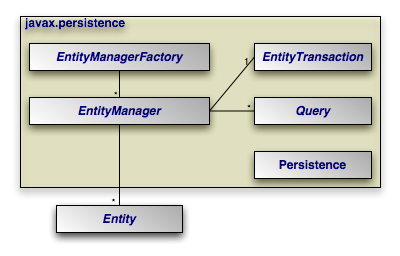
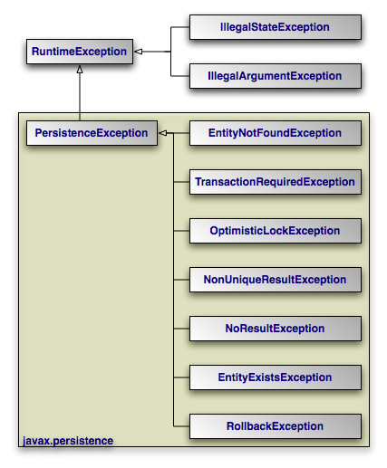

[[jpa_overview_arch]]
=== Java Persistence API Architecture
(((JPA, architecture)))

The diagram below illustrates the relationships between the primary components of the JPA architecture.

[NOTE]
====
A number of the depicted interfaces are only required outside of an EJB3-compliant application server.
In an application server, [class]``EntityManager`` instances are typically injected, rendering the [class]``EntityManagerFactory`` unnecessary.
Also, transactions within an application server are handled using standard application server transaction controls.
Thus, the [class]``EntityTransaction`` also goes unused.
====

* **<<jpa_overview_persistence,[class]``** Persistence**``>>**: The [class]``jakarta.persistence.Persistence`` class contains static helper methods to obtain [class]``EntityManagerFactory`` instances in a vendor-neutral fashion.
* (((EntityManagerFactory)))**<<jpa_overview_emfactory,[class]``**
EntityManagerFactory**``>>**: The [class]``jakarta.persistence.EntityManagerFactory`` class is a factory for [class]``EntityManager`` s.
* (((EntityManager)))**<<jpa_overview_em,[class]``**EntityManager**``>>**: The [class]``jakarta.persistence.EntityManager`` is the primary JPA interface used by applications.
Each [class]``EntityManager`` manages a set of persistent objects, and has APIs to insert new objects and delete existing ones.
When used outside the container, there is a one-to-one relationship between an [class]``EntityManager`` and an [class]``EntityTransaction``. [class]``EntityManager``s also act as factories for [class]``Query`` instances.
* (((entity)))**<<jpa_overview_pc,[class]``**Entity**``>>**: Entities are persistent objects that represent datastore records.
* (((EntityTransaction)))**<<jpa_overview_trans,[class]``**
EntityTransaction**``>>**: Each [class]``EntityManager`` has a one-to-one relation with a single [class]``jakarta.persistence.EntityTransaction``. [class]``EntityTransaction``s allow operations on persistent data to be grouped into units of work that either completely succeed or completely fail, leaving the datastore in its original state.
These all-or-nothing operations are important for maintaining data integrity.
* (((Query)))
(((Java Persistence Query Language)))
(((JPQL)))
(((JPA , query language)))
(((SQL)))**<<jpa_overview_query,[class]``**Query**``>>**: The [class]``jakarta.persistence.Query`` interface is implemented by each JPA vendor to find persistent objects that meet certain criteria.
JPA standardizes support for queries using both the Java Persistence Query Language (JPQL) and the Structured Query Language (SQL). You obtain [class]``Query`` instances from an [class]``EntityManager``.

The example below illustrates how the JPA interfaces interact to execute a JPQL query and update persistent objects.
The example assumes execution outside a container.

[[jpa_overview_arch_interact_outside]]
.Interaction of Interfaces Outside Container
====
[source]
----

  // get an EntityManagerFactory using the Persistence class
  // It is not recommended to obtain a factory often, as construction of a
  // factory is a costly operation. Typically you will like to cache
  // a factory and then refer it for repeated use
  EntityManagerFactory factory = Persistence.createEntityManagerFactory(null);

  // get an EntityManager from the factory
  EntityManager em = factory.createEntityManager();

  // Begin a transaction
  em.getTransaction().begin();

  // query for all employees who work in our research division
  // and put in over 40 hours a week average
  Query query = em.createQuery("SELECT e "
                               "  FROM Employee e "
                               " WHERE e.division.name = 'Research' "
                               "   AND e.avgHours > 40");
  List results = query.getResultList();

  // give all those hard-working employees a raise
  for (Object res : results) {
    Employee emp = (Employee) res;
    emp.setSalary(emp.getSalary() * 1.1);
  }

  // commit will detect all updated entities and save them in database
  em.getTransaction().commit();

  // free the resources
  em.close();
----
====

Within a container, the [class]``EntityManager`` will be injected and transactions will be handled declaratively.
Thus, the in-container version of the example consists entirely of business logic:

[[jpa_overview_arch_interact_inside]]
.Interaction of Interfaces Inside Container
====
[source]
----

// query for all employees who work in our research division
// and put in over 40 hours a week average - note that the EntityManager em
// is injected using a @Resource annotation
Query query = em.createQuery("select e from Employee e where "
    + "e.division.name = 'Research' and e.avgHours > 40");
List results = query.getResultList();

// give all those hard-working employees a raise
for (Object res : results) {
    emp = (Employee) res;
    emp.setSalary(emp.getSalary() * 1.1);
}
----
====

The remainder of this document explores the JPA interfaces in detail.
We present them in roughly the order that you will use them as you develop your application.

[[jpa_overview_arch_exceptions]]
==== JPA Exceptions
(((JPA , exceptions)))

The diagram above depicts the JPA exception architecture.
All exceptions are unchecked.
JPA uses standard exceptions where appropriate, most notably [class]``IllegalArgumentException``s and [class]``IllegalStateException``s.
The specification also provides a few JPA-specific exceptions in the `jakarta.persistence` package.
These exceptions should be self-explanatory.
See the https://jakarta.ee/specifications/persistence/3.2/apidocs/jakarta.persistence/module-summary.html[Javadoc] for additional details on JPA exceptions.

[NOTE]
====
All exceptions thrown by OpenJPA implement link:../../apidocs/org/apache/openjpa/util/ExceptionInfo.html[
org.apache.openjpa.util.ExceptionInfo] to provide you with additional error information.
====

ifdef::backend-docbook[]
[index]
== Index
endif::backend-docbook[]
