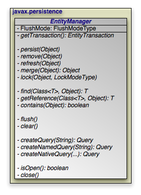
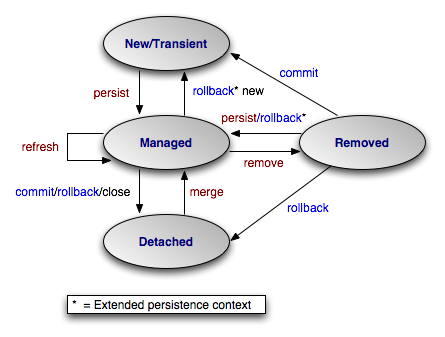

[[_jpa_overview_em]]
=== EntityManager
(((EntityManager)))

The diagram above presents an overview of the [class]``EntityManager `` interface.
For a complete treatment of the [class]``
EntityManager`` API, see the https://jakarta.ee/specifications/persistence/3.2/apidocs/jakarta.persistence/jakarta/persistence/entitymanager[
Javadoc] documentation.
Methods whose parameter signatures consist of an ellipsis (...) are overloaded to take multiple parameter types.

[NOTE]
====
OpenJPA extends the standard [class]``EntityManager`` interface with the link:../../apidocs/org/apache/openjpa/persistence/OpenJPAEntityManager.html[
org.apache.openjpa.persistence.OpenJPAEntityManager
] interface to provide additional functionality.
====

The [class]``EntityManager`` is the primary interface used by application developers to interact with the JPA runtime.
The methods of the [class]``EntityManager`` can be divided into the following functional categories:

* [class]``Transaction`` association.
* Entity lifecycle management.
* Entity identity management.
* Cache management.
* [class]``Query`` factory.
* Entity locking.
* Closing.

[[_jpa_overview_em_trans]]
==== Transaction Association
(((EntityManager , obtaining the Transaction)))

[source]
----

public EntityTransaction getTransaction();
----

Every [class]``EntityManager`` has a one-to-one relation with an <<_jpa_overview_trans,[class]``EntityTransaction``>> instance.
In fact, many vendors use a single class to implement both the [class]``EntityManager`` and [class]``EntityTransaction `` interfaces.
If your application requires multiple concurrent transactions, you will use multiple [class]``EntityManager``s.

You can retrieve the [class]``EntityTransaction`` associated with an [class]``EntityManager`` through the [method]``getTransaction `` method.
Note that most JPA implementations can integrate with an application server's managed transactions.
If you take advantage of this feature, you will control transactions by declarative demarcation or through the Java Transaction API (JTA) rather than through the [class]``EntityTransaction``.

[[_jpa_overview_em_lifecycle]]
==== Entity Lifecycle Management
(((EntityManager , lifecycle operations)))

[class]``EntityManager``s perform several actions that affect the lifecycle state of entity instances.

[source]
----

public void persist(Object entity);
----

(((persist)))
(((persistent objects , persisting))) Transitions new instances to managed.
On the next flush or commit, the newly persisted instances will be inserted into the datastore.

For a given entity ``A``, the [method]``persist`` method behaves as follows:

* If `A` is a new entity, it becomes managed.
* If `A` is an existing managed entity, it is ignored. However, the persist operation cascades as defined below.
* If `A` is a removed entity, it becomes managed.
* If `A` is a detached entity, an [class]`` IllegalArgumentException`` is thrown.
* The persist operation recurses on all relation fields of `A` whose <<_jpa_overview_meta_cascade,cascades>> include ``CascadeType.PERSIST``.

This action can only be used in the context of an active transaction.

[source]
----

public void remove(Object entity);
----

(((remove)))
(((persistent objects , deleting))) Transitions managed instances to removed.
The instances will be deleted from the datastore on the next flush or commit.
Accessing a removed entity has undefined results.

For a given entity ``A``, the [method]``remove`` method behaves as follows:

* If `A` is a new entity, it is ignored. However, the remove operation cascades as defined below.
* If `A` is an existing managed entity, it becomes removed.
* If `A` is a removed entity, it is ignored.
* If `A` is a detached entity, an [class]`` IllegalArgumentException`` is thrown.
* The remove operation recurses on all relation fields of `A` whose <<_jpa_overview_meta_cascade,cascades>> include ``CascadeType.REMOVE``.

This action can only be used in the context of an active transaction.

[source]
----

public void refresh(Object entity);
----

(((refresh)))
(((persistent objects , refreshing state))) Use the [method]``refresh`` action to make sure the persistent state of an instance is synchronized with the values in the datastore. [method]``refresh`` is intended for long-running optimistic transactions in which there is a danger of seeing stale data.

For a given entity ``A``, the [method]``refresh`` method behaves as follows:

* If `A` is a new entity, it is ignored. However, the refresh operation cascades as defined below.
* If `A` is an existing managed entity, its state is refreshed from the datastore.
* If `A` is a removed entity, it is ignored.
* If `A` is a detached entity, an [class]`` IllegalArgumentException`` is thrown.
* The refresh operation recurses on all relation fields of `A` whose <<_jpa_overview_meta_cascade,cascades>> include ``CascadeType.REFRESH``.

[source]
----

public Object merge(Object entity);
----

(((EntityManager , merge)))
(((merge)))
(((data transfer object)))
(((value object))) A common use case for an application running in a servlet or application server is to "detach" objects from all server resources, modify them, and then "attach" them again.
For example, a servlet might store persistent data in a user session between a modification based on a series of web forms.
Between each form request, the web container might decide to serialize the session, requiring that the stored persistent state be disassociated from any other resources.
Similarly, a client/server application might transfer persistent objects to a client via serialization, allow the client to modify their state, and then have the client return the modified data in order to be saved.
This is sometimes referred to as the _data transfer object_ or _value
object_ pattern, and it allows fine-grained manipulation of data objects without incurring the overhead of multiple remote method invocations.

JPA provides support for this pattern by automatically detaching entities when they are serialized or when a persistence context ends (see <<_jpa_overview_emfactory_perscontext>> for an exploration of persistence contexts). The JPA _merge_ API re-attaches detached entities.
This allows you to detach a persistent instance, modify the detached instance offline, and merge the instance back into an [class]``EntityManager`` (either the same one that detached the instance, or a new one). The changes will then be applied to the existing instance from the datastore.

A detached entity maintains its persistent identity, but cannot load additional state from the datastore.
Accessing any persistent field or property that was not loaded at the time of detachment has undefined results.
Also, be sure not to alter the version or identity fields of detached instances if you plan on merging them later.

The [method]``merge`` method returns a managed copy of the given detached entity.
Changes made to the persistent state of the detached entity are applied to this managed instance.
Because merging involves changing persistent state, you can only merge within a transaction.

If you attempt to merge an instance whose representation has changed in the datastore since detachment, the merge operation will throw an exception, or the transaction in which you perform the merge will fail on commit, just as if a normal optimistic conflict were detected.

[NOTE]
====
OpenJPA offers enhancements to JPA detachment functionality, including additional options to control which fields are detached.
See <<_ref_guide_detach>> in the Reference Guide for details.
====

For a given entity ``A``, the [method]``merge`` method behaves as follows:

* If `A` is a detached entity, its state is copied into existing managed instance `A'` of the same entity identity, or a new managed copy of `A` is created.
* If `A` is a new entity, a new managed entity `A'`  is created and the state of `A` is copied into ``A'``.
* If `A` is an existing managed entity, it is ignored. However, the merge operation still cascades as defined below.
* If `A` is a removed entity, an [class]`` IllegalArgumentException`` is thrown.
* The merge operation recurses on all relation fields of `A` whose <<_jpa_overview_meta_cascade,cascades>> include ``CascadeType.MERGE``.

The following diagram illustrates the lifecycle of an entity with respect to the APIs presented in this section.

[[_jpa_overview_em_lifeexamples]]
==== Lifecycle Examples

The examples below demonstrate how to use the lifecycle methods presented in the previous section.
The examples are appropriate for out-of-container use.
Within a container, [class]`` EntityManager``s are usually injected, and transactions are usually managed.
You would therefore omit the [method]``
createEntityManager`` and [method]``close`` calls, as well as all transaction demarcation code.

.Persisting Objects
====
(((persistent objects , persisting , example)))
[source]
----

// create some objects
Magazine mag = new Magazine("1B78-YU9L", "JavaWorld");

Company pub = new Company("Weston House");
pub.setRevenue(1750000D);
mag.setPublisher(pub);
pub.addMagazine(mag);

Article art = new Article("JPA Rules!", "Transparent Object Persistence");
art.addAuthor(new Author("Fred", "Hoyle"));
mag.addArticle(art);

// persist
EntityManager em = emf.createEntityManager();
em.getTransaction().begin();
em.persist(mag);
em.persist(pub);
em.persist(art);
em.getTransaction().commit();

// or we could continue using the EntityManager...
em.close();
----
====

.Updating Objects
====
[source]
----

Magazine.MagazineId mi = new Magazine.MagazineId();
mi.isbn = "1B78-YU9L";
mi.title = "JavaWorld";

// updates should always be made within transactions; note that
// there is no code explicitly linking the magazine or company
// with the transaction; JPA automatically tracks all changes
EntityManager em = emf.createEntityManager();
em.getTransaction().begin();
Magazine mag = em.find(Magazine.class, mi);
mag.setPrice(5.99);
Company pub = mag.getPublisher();
pub.setRevenue(1750000D);
em.getTransaction().commit();

// or we could continue using the EntityManager...
em.close();
----
====

.Removing Objects
====
[source]
----

// assume we have an object id for the company whose subscriptions
// we want to delete
Object oid = ...;

// deletes should always be made within transactions
EntityManager em = emf.createEntityManager();
em.getTransaction().begin();
Company pub = (Company) em.find(Company.class, oid);
for (Subscription sub : pub.getSubscriptions())
    em.remove(sub);
pub.getSubscriptions().clear();
em.getTransaction().commit();

// or we could continue using the EntityManager...
em.close();
----
====

.Detaching and Merging
====
This example demonstrates a common client/server scenario.
The client requests objects and makes changes to them, while the server handles the object lookups and transactions.

[source]
----

// CLIENT:
// requests an object with a given oid
Record detached = (Record) getFromServer(oid);

...

// SERVER:
// send object to client; object detaches on EM close
Object oid = processClientRequest();
EntityManager em = emf.createEntityManager();
Record record = em.find(Record.class, oid);
em.close();
sendToClient(record);

...

// CLIENT:
// makes some modifications and sends back to server
detached.setSomeField("bar");
sendToServer(detached);

...

// SERVER:
// merges the instance and commit the changes
Record modified = (Record) processClientRequest();
EntityManager em = emf.createEntityManager();
em.getTransaction().begin();
Record merged = (Record) em.merge(modified);
merged.setLastModified(System.currentTimeMillis());
merged.setModifier(getClientIdentityCode());
em.getTransaction().commit();
em.close();
----
====

[[_jpa_overview_em_identity]]
==== Entity Identity Management

Each [class]``EntityManager`` is responsible for managing the persistent identities of the managed objects in the persistence context.
The following methods allow you to interact with the management of persistent identities.
The behavior of these methods is deeply affected by the persistence context type of the [class]``EntityManager``; see <<_jpa_overview_emfactory_perscontext>> for an explanation of persistence contexts.

[source]
----

public <T> T find(Class<T> cls, Object oid);
----

(((EntityManager , find)))
(((identity , retrieving objects by identity))) This method returns the persistent instance of the given type with the given persistent identity.
If the instance is already present in the current persistence context, the cached version will be returned.
Otherwise, a new instance will be constructed and loaded with state from the datastore.
If no entity with the given type and identity exists in the datastore, this method returns null.

[source]
----

public <T> T getReference(Class<T> cls, Object oid);
----

(((getReference)))
(((identity , retrieving objects by identity))) This method is similar to [method]``find``, but does not necessarily go to the database when the entity is not found in cache.
The implementation may construct a _hollow_ entity and return it to you instead.
Hollow entities do not have any state loaded.
The state only gets loaded when you attempt to access a persistent field.
At that time, the implementation may throw an [class]``EntityNotFoundException`` if it discovers that the entity does not exist in the datastore.
The implementation may also throw an [class]``EntityNotFoundException`` from the [method]``getReference`` method itself.
Unlike [method]``
find``, [method]``getReference`` does not return null.

[source]
----

public boolean contains(Object entity);
----

(((EntityManager , contains))) Returns true if the given entity is part of the current persistence context, and false otherwise.
Removed entities are not considered part of the current persistence context.

[[_jpa_overview_em_cache]]
==== Cache Management
(((EntityManager , cache)))

[source]
----

public void flush();
----

(((flush)))
(((transactions , flushing changes before commit))) The [method]``flush`` method writes any changes that have been made in the current transaction to the datastore.
If the [class]``EntityManager `` does not already have a connection to the datastore, it obtains one for the flush and retains it for the duration of the transaction.
Any exceptions during flush cause the transaction to be marked for rollback.
See <<_jpa_overview_trans>>.

Flushing requires an active transaction.
If there isn't a transaction in progress, the [method]``flush`` method throws a [class]``
TransactionRequiredException``.

[source]
----

public FlushModeType getFlushMode();
public void setFlushMode(FlushModeType flushMode);
----

(((FlushMode))) The [class]``EntityManager``'s `FlushMode` property controls whether to flush transactional changes before executing queries.
This allows the query results to take into account changes you have made during the current transaction.
Available https://jakarta.ee/specifications/persistence/3.2/apidocs/jakarta.persistence/jakarta/persistence/flushmodetype[
jakarta.persistence.FlushModeType] constants are:

* ``COMMIT``: Only flush when committing, or when told to do so through the [method]``flush`` method. Query results may not take into account changes made in the current transaction.
* ``AUTO``: The implementation is permitted to flush before queries to ensure that the results reflect the most recent object state.

You can also set the flush mode on individual <<_jpa_overview_query,[class]``Query``>> instances.

[NOTE]
====
OpenJPA only flushes before a query if the query might be affected by data changed in the current transaction.
Additionally, OpenJPA allows fine-grained control over flushing behavior.
See the Reference Guide's <<_ref_guide_dbsetup_retain>>.
====

[source]
----

public void clear();
----

(((EntityManager , clear))) Clearing the [class]``EntityManager`` effectively ends the persistence context.
All entities managed by the [class]``EntityManager `` become detached.

[[_jpa_overview_em_query]]
==== Query Factory
(((EntityManager , as Query factory)))

[source]
----

public Query createQuery(String query);
----

[class]``Query`` objects are used to find entities matching certain criteria.
The [method]``createQuery`` method creates a query using the given Java Persistence Query Language (JPQL) string.
See <<_jpa_overview_query>> for details.

[source]
----

public Query createNamedQuery(String name);
----

This method retrieves a query defined in metadata by name.
The returned [class]``Query`` instance is initialized with the information declared in metadata.
For more information on named queries, read <<_jpa_overview_query_named>>.

[source]
----

public Query createNativeQuery(String sql);
public Query createNativeQuery(String sql, Class resultCls);
public Query createNativeQuery(String sql, String resultMapping);
----

_Native_ queries are queries in the datastore's native language.
For relational databases, this is the Structured Query Language (SQL). <<_jpa_overview_sqlquery>> elaborates on JPA's native query support.

[[_jpa_overview_em_locking]]
==== Entity Locking
(((EntityManager , locking)))

In the area of concurrency control, the JPA specification supports optimistic and pessimistic locking.

[source]
----

public void lock(Object entity, LockModeType mode);
----

(((locking))) This method locks the given entity using the named mode.
The https://jakarta.ee/specifications/persistence/3.2/apidocs/jakarta.persistence/jakarta/persistence/lockmodetype[
jakarta.persistence.LockModeType] enum defines eight modes:

* ``OPTIMISTIC``: Optimistic locking.
* ``OPTIMISTIC_FORCE_INCREMENT``: Optimistic locking. When a transaction is committed, the entity's version column will be incremented even if the entity's state did not change in the transaction.
* ``PESSIMISTIC_READ``: Pessimistic locking. Other transactions may concurrently read the entity, but cannot concurrently update it.
* ``PESSIMISTIC_WRITE``: Pessimistic locking. Other transactions cannot concurrently read or write the entity.
* ``PESSIMISTIC_FORCE_INCREMENT``: Pessimistic locking. Other transactions cannot concurrently read or write the entity. When a transaction is committed, the entity's version column will be incremented even if the entity's state did not change in the transaction.
* ``READ``: A synonym for ``OPTIMISTIC``.
* ``WRITE``: A synonym for ``OPTIMISTIC_FORCE_INCREMENT``.
* ``NONE``: No locking is performed.

Entities can also be locked at the time when entity state gets loaded from the datastore.
This is achieved by supplying a lock mode to the respective versions of [method]``find`` and [method]``refresh`` methods.
If an entity state is to be loaded by a query, a lock mode can be passed to the [method]``Query.setLockMode`` and [method]``TypedQuery.setLockMode`` methods.

[source]
----

public LockModeType getLockMode(Object entity);
----

Returns the lock mode currently held by the given entity.

[NOTE]
====
* OpenJPA differentiates between `PESSIMISTIC_READ` and ``PESSIMISTIC_WRITE`` lock modes only with DB2 databases. While running with other databases, there is no distinction between these two modes because ``PESSIMISTIC_READ`` lock mode is upgraded to ``PESSIMISTIC_WRITE``.
* OpenJPA has additional APIs for controlling entity locking. See <<_ref_guide_locking>> in the Reference Guide for details.

====

[[_jpa_overview_em_properties]]
==== Retrieving Properties Information
(((EntityManager , properties information)))

[[_jpa_overview_em_closing]]
==== Closing

[source]
----

public boolean isOpen();
public void close();
----

When an [class]``EntityManager`` is no longer needed, you should call its [method]``close`` method.
Closing an [class]``
EntityManager`` releases any resources it is using.
The persistence context ends, and the entities managed by the [class]``EntityManager `` become detached.
Any [class]``Query`` instances the [class]``EntityManager`` created become invalid.
Calling any method other than [method]``isOpen`` on a closed [class]``EntityManager `` results in an [class]``IllegalStateException``.
You cannot close a [class]``EntityManager`` that is in the middle of a transaction.

If you are in a managed environment using injected entity managers, you should not close them.

ifdef::backend-docbook[]
[index]
== Index
endif::backend-docbook[]
