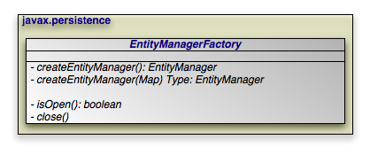

[[_jpa_overview_emfactory]]
=== EntityManagerFactory
(((
            EntityManagerFactory
        )))

The [class]``EntityManagerFactory`` creates [class]``
EntityManager`` instances for application use.

[NOTE]
====
OpenJPA extends the standard [class]``EntityManagerFactory`` interface with the link:../../apidocs/org/apache/openjpa/persistence/OpenJPAEntityManagerFactory.html[
OpenJPAEntityManagerFactory] to provide additional functionality.
====

[[_jpa_overview_emfactory_obtain]]
==== Obtaining an EntityManagerFactory
(((
                EntityManagerFactory
            ,
                construction
            )))
(((
                JCA
            )))

Within a container, you will typically use _injection_ to access an [class]``EntityManagerFactory``.
There are, however, alternative mechanisms for [class]``EntityManagerFactory`` construction.

Some vendors may supply public constructors for their [class]``
EntityManagerFactory`` implementations, but we recommend using the Java Connector Architecture (JCA) in a managed environment, or the [class]``
Persistence`` class' [method]``createEntityManagerFactory `` methods in an unmanaged environment, as described in <<_jpa_overview_persistence>>.
These strategies allow vendors to pool factories, cutting down on resource utilization.

(((
                JNDI
            ))) JPA allows you to create and configure an [class]``
EntityManagerFactory``, then store it in a Java Naming and Directory Interface (JNDI) tree for later retrieval and use.

[[_jpa_overview_emfactory_em]]
==== Obtaining EntityManagers
(((
                EntityManager
            ,
                obtaining
            )))

[source]
----

public EntityManager createEntityManager();
public EntityManager createEntityManager(Map map);
----

The two [method]``createEntityManager`` methods above create a new [class]``EntityManager`` each time they are invoked.
The optional [class]``Map`` is used to supply vendor-specific settings.
If you have configured your implementation for JTA transactions and a JTA transaction is active, the returned [class]``EntityManager`` will be synchronized with that transaction.

[NOTE]
====
OpenJPA recognizes the following string keys in the map supplied to [method]``
createEntityManager``:

* `openjpa.ConnectionUserName`
* `openjpa.ConnectionPassword`
* `openjpa.ConnectionRetainMode`
* `openjpa.TransactionMode`
* ``openjpa.<property>``, where _<property> _ is any JavaBean property of the link:../../apidocs/org/apache/openjpa/persistence/OpenJPAEntityManager.html[ org.apache.openjpa.persistence.OpenJPAEntityManager].

The last option uses reflection to configure any property of OpenJPA's [class]``EntityManager`` implementation with the value supplied in your map.
The first options correspond exactly to the same-named OpenJPA configuration keys described in <<_ref_guide_conf>> of the Reference Guide.
====

[[_jpa_overview_emfactory_perscontext]]
==== Persistence Context
(((
                persistence context
            )))
(((
                PersistenceContextType
            )))

A persistence context is a set of entities such that for any persistent identity there is a unique entity instance.
Within a persistence context, entities are __managed__.
The [class]`` EntityManager`` controls their lifecycle, and they can access datastore resources.

When a persistence context ends, previously-managed entities become __
detached__.
A detached entity is no longer under the control of the [class]``EntityManager``, and no longer has access to datastore resources.
We discuss detachment in detail in <<_jpa_overview_em_lifecycle>>.
For now, it is sufficient to know that detachment has two obvious consequences:

. The detached entity cannot load any additional persistent state.
. The [class]``EntityManager`` will not return the detached entity from [method]``find``, nor will queries include the detached entity in their results. Instead, [method]``find`` method invocations and query executions that would normally incorporate the detached entity will create a new managed entity with the same identity.

[NOTE]
====
OpenJPA offers several features related to detaching entities.
See <<_ref_guide_detach>> in the Reference Guide. <<_ref_guide_detach_graph>> in particular describes how to use the `DetachState` setting to boost the performance of merging detached entities.
====

Injected [class]``EntityManager``s have a _transaction _ persistence context, while [class]`` EntityManager``s obtained through the [class]``EntityManagerFactory`` have an _extended _ persistence context.
We describe these persistence context types below.

[[_jpa_overview_emfactory_perscontext_trans]]
===== Transaction Persistence Context

Under the transaction persistence context model, an [class]`` EntityManager `` begins a new persistence context with each transaction, and ends the context when the transaction commits or rolls back.
Within the transaction, entities you retrieve through the [class]``EntityManager`` or via [class]``Queries`` are managed entities.
They can access datastore resources to lazy-load additional persistent state as needed, and only one entity may exist for any persistent identity.

When the transaction completes, all entities lose their association with the [class]``EntityManager`` and become detached.
Traversing a persistent field that wasn't already loaded now has undefined results.
And using the [class]`` EntityManager`` or a [class]``Query`` to retrieve additional objects may now create new instances with the same persistent identities as detached instances.

If you use an [class]``EntityManager`` with a transaction persistence context model outside of an active transaction, each method invocation creates a new persistence context, performs the method action, and ends the persistence context.
For example, consider using the [method]``
EntityManager.find`` method outside of a transaction.
The [class]``
EntityManager`` will create a temporary persistence context, perform the find operation, end the persistence context, and return the detached result object to you.
A second call with the same id will return a second detached object.

When the next transaction begins, the [class]``EntityManager`` will begin a new persistence context, and will again start returning managed entities.
As you'll see in <<_jpa_overview_em>>, you can also merge the previously-detached entities back into the new persistence context.

.Behavior of Transaction Persistence Context
====
The following code illustrates the behavior of entities under an [class]``
EntityManager`` using a transaction persistence context.

[source]
----

EntityManager em; // injected
...

// outside a transaction:

// each operation occurs in a separate persistence context, and returns
// a new detached instance
Magazine mag1 = em.find(Magazine.class, magId);
Magazine mag2 = em.find(Magazine.class, magId);
assertTrue(mag2 != mag1);
...

// transaction begins:

// within a transaction, a subsequent lookup doesn't return any of the
// detached objects.  however, two lookups within the same transaction
// return the same instance, because the persistence context spans the
// transaction
Magazine mag3 = em.find(Magazine.class, magId);
assertTrue(mag3 != mag1 && mag3 != mag2);
Magazine mag4 = em.find(Magazine.class, magId);
assertTrue(mag4 == mag3);
...

// transaction commits:

// once again, each operation returns a new instance
Magazine mag5 = em.find(Magazine.class, magId);
assertTrue(mag5 != mag3);
----
====

[[_jpa_overview_emfactory_perscontext_extend]]
===== Extended Persistence Context

An [class]``EntityManager`` using an extended persistence context maintains the same persistence context for its entire lifecycle.
Whether inside a transaction or not, all entities returned from the [class]``EntityManager `` are managed, and the [class]``EntityManager`` never creates two entity instances to represent the same persistent identity.
Entities only become detached when you finally close the [class]``EntityManager `` (or when they are serialized).

.Behavior of Extended Persistence Context
====
The following code illustrates the behavior of entities under an [class]``
EntityManager`` using an extended persistence context.

[source]
----

EntityManagerFactory emf = ...
EntityManager em = emf.createEntityManager();

// persistence context active for entire life of EM, so only one entity
// for a given persistent identity
Magazine mag1 = em.find(Magazine.class, magId);
Magazine mag2 = em.find(Magazine.class, magId);
assertTrue(mag2 == mag1);

em.getTransaction().begin();

// same persistence context active within the transaction
Magazine mag3 = em.find(Magazine.class, magId);
assertTrue(mag3 == mag1);
Magazine mag4 = em.find(Magazine.class, magId);
assertTrue(mag4 == mag1);

em.getTransaction.commit();

// when the transaction commits, instance still managed
Magazine mag5 = em.find(Magazine.class, magId);
assertTrue(mag5 == mag1);

// instance finally becomes detached when EM closes
em.close();
----
====

[[_jpa_overview_emf_properties]]
==== Retrieving Properties Information
(((
                EntityManagerFactory
            ,
                properties information
            )))

[[_jpa_overview_emfactory_close]]
==== Closing the EntityManagerFactory

[source]
----

public boolean isOpen();
public void close();
----

[class]``EntityManagerFactory`` instances are heavyweight objects.
Each factory might maintain a metadata cache, object state cache, [class]``
EntityManager`` pool, connection pool, and more.
If your application no longer needs an [class]``EntityManagerFactory``, you should close it to free these resources.
When an [class]``EntityManagerFactory `` closes, all [class]``EntityManager``s from that factory, and by extension all entities managed by those [class]``
EntityManager``s, become invalid.
Attempting to close an [class]``
EntityManagerFactory`` while one or more of its [class]``
EntityManager``s has an active transaction may result in an [class]``IllegalStateException``.

Closing an [class]``EntityManagerFactory`` should not be taken lightly.
It is much better to keep a factory open for a long period of time than to repeatedly create and close new factories.
Thus, most applications will never close the factory, or only close it when the application is exiting.
Only applications that require multiple factories with different configurations have an obvious reason to create and close multiple [class]``EntityManagerFactory `` instances.
Once a factory is closed, all methods except [method]``isOpen`` throw an [class]``
IllegalStateException``.

[[_jpa_overview_emfactory_puutil]]
==== PersistenceUnitUtil
(((
                EntityManagerFactory
            ,
                util
            )))

[source]
----

public PersistenceUnitUtil getPersistenceUnitUtil();
----

The [class]``EntityManagerFactory`` method [method]``getPersistenceUnitUtil`` provides access to a [class]``PersistenceUnitUtil`` utility. [class]``PersistenceUnitUtil`` can be used to obtain the identity of a managed object and determine the load state of the entity or one of its attributes.
If the object is not managed by one of the entity managers created from the entity manager factory from which the utility was obtained, the [method]``getIdentifier`` method will return null and the [method]``isLoaded`` methods will return false.
[source]
----

EntityManagerFactory emf = Persistence.createEntityManagerFactory();
PersistenceUnitUtil puUtil = emf.getPersistenceUnitUtil();

if (puUtil.getIdentifier(deptEntity) == null) {
    throw new Exception("Identity is not valid.");
}
if (!puUtil.isLoaded(deptEntity, "employees")) {
    throw new Exception("Employees not loaded.");
}
----

ifdef::backend-docbook[]
[index]
== Index
endif::backend-docbook[]
