////
 Licensed to the Apache Software Foundation (ASF) under one
 or more contributor license agreements.  See the NOTICE file
 distributed with this work for additional information
 regarding copyright ownership.  The ASF licenses this file
 to you under the Apache License, Version 2.0 (the
 "License"); you may not use this file except in compliance
 with the License.  You may obtain a copy of the License at

 http://www.apache.org/licenses/LICENSE-2.0

 Unless required by applicable law or agreed to in writing,
 software distributed under the License is distributed on an
 "AS IS" BASIS, WITHOUT WARRANTIES OR CONDITIONS OF ANY
 KIND, either express or implied.  See the License for the
 specific language governing permissions and limitations
 under the License.
////
[[jpa_overview_mapping]]
=== Mapping Metadata
(((mapping metadata)))
(((entities , mapping to database)))
(((ORM)))
(((JPA , object-relational mapping)))

_Object-relational mapping_ is the process of mapping entities to relational database tables.
In JPA, you perform object/relational mapping through __mapping metadata__.
Mapping metadata uses annotations to describe how to link your object model to your relational model.

[NOTE]
====
OpenJPA offers tools to automate mapping and schema creation.
See <<ref_guide_mapping>> in the Reference Guide.
====

Throughout this chapter, we will draw on the object model introduced in <<jpa_overview_meta>>.
We present that model again below.
As we discuss various aspects of mapping metadata, we will zoom in on specific areas of the model and show how we map the object layer to the relational layer.

image::img/jpa-meta-model.png[]

All mapping metadata is optional.
Where no explicit mapping metadata is given, JPA uses the defaults defined by the specification.
As we present each mapping throughout this chapter, we also describe the defaults that apply when the mapping is absent.

[NOTE]
====
Mapping metadata is used primarily with schema generation.
This metadata should not be relied upon for validation prior to communicating with the database.
For example using the @Column(nullable=false) annotation does not do up front validation that the value in the entity is correct.
====

[[jpa_overview_mapping_table]]
==== Table

The [class]``Table`` annotation specifies the table for an entity class.
If you omit the [class]``Table`` annotation, base entity classes default to a table with their unqualified class name.
The default table of an entity subclass depends on the inheritance strategy, as you will see in <<jpa_overview_mapping_inher>>.

[class]``Table``s have the following properties:

* ``String name``: The name of the table. Defaults to the unqualified entity class name.
* ``String schema``: The table's schema. If you do not name a schema, JPA uses the default schema for the database connection.
* ``String catalog``: The table's catalog. If you do not name a catalog, JPA uses the default catalog for the database connection.
* ``UniqueConstraint[] uniqueConstraints``: An array of unique constraints to place on the table. We cover unique constraints below. Defaults to an empty array.

The equivalent XML element is ``table``.
It has the following attributes, which correspond to the annotation properties above:

* `name`
* `schema`
* `catalog`

The `table` element also accepts nested 
`unique-constraint` elements representing unique constraints.
We will detail unique constraints shortly.

Sometimes, some of the fields in a class are mapped to secondary tables.
In that case, use the class' [class]``Table`` annotation to name what you consider the class' primary table.
Later, we will see how to map certain fields to other tables.

The example below maps classes to tables to separate schemas.
The ``CONTRACT``, ``SUB``, and `LINE_ITEM`  tables are in the `CNTRCT` schema; all other tables are in the default schema.

[[jpa_overview_mapping_classex]]
.Mapping Classes
====
[source]
----

package org.mag;

@Entity
@IdClass(Magazine.MagazineId.class)
@Table(name="MAG")
public class Magazine {
    ...

    public static class MagazineId {
        ...
    }
}

@Entity
@Table(name="ART")
public class Article {
    ...
}

package org.mag.pub;

@Entity
@Table(name="COMP")
public class Company {
    ...
}

@Entity
@Table(name="AUTH")
public class Author {
    ...
}

@Embeddable
public class Address {
    ...
}

package org.mag.subscribe;

@MappedSuperclass
public abstract class Document {
    ...
}

@Entity
@Table(schema="CNTRCT")
public class Contract
    extends Document {
    ...
}

@Entity
@Table(name="SUB", schema="CNTRCT")
public class Subscription {
    ...

    @Entity
    @Table(name="LINE_ITEM", schema="CNTRCT")
    public static class LineItem
        extends Contract {
        ...
    }
}

@Entity(name="Lifetime")
public class LifetimeSubscription
    extends Subscription {
    ...
}

@Entity(name="Trial")
public class TrialSubscription
    extends Subscription {
    ...
}
----

The same mapping information expressed in XML:

[source]
----

<entity-mappings xmlns="http://java.sun.com/xml/ns/persistence/orm"
    xmlns:xsi="http://www.w3.org/2001/XMLSchema-instance"
    xsi:schemaLocation="http://java.sun.com/xml/ns/persistence/orm orm_1_0.xsd"
    version="1.0">
    <mapped-superclass class="org.mag.subscribe.Document">
        ...
    </mapped-superclass>
    <entity class="org.mag.Magazine">
        <table name="MAG"/>
        <id-class="org.mag.Magazine.MagazineId"/>
        ...
    </entity>
    <entity class="org.mag.Article">
        <table name="ART"/>
        ...
    </entity>
    <entity class="org.mag.pub.Company">
        <table name="COMP"/>
        ...
    </entity>
    <entity class="org.mag.pub.Author">
        <table name="AUTH"/>
        ...
    </entity>
    <entity class="org.mag.subcribe.Contract">
        <table schema="CNTRCT"/>
        ...
    </entity>
    <entity class="org.mag.subcribe.Subscription">
        <table name="SUB" schema="CNTRCT"/>
        ...
    </entity>
    <entity class="org.mag.subscribe.Subscription.LineItem">
        <table name="LINE_ITEM" schema="CNTRCT"/>
        ...
    </entity>
    <entity class="org.mag.subscribe.LifetimeSubscription" name="Lifetime">
        ...
    </entity>
    <entity class="org.mag.subscribe.TrialSubscription" name="Trial">
        ...
    </entity>
    <embeddable class="org.mag.pub.Address">
        ...
    </embeddable>
</entity-mappings>
----
====

[[jpa_overview_mapping_unq]]
==== Unique Constraints
(((mapping metadata , unique constraints)))

Unique constraints ensure that the data in a column or combination of columns is unique for each row.
A table's primary key, for example, functions as an implicit unique constraint.
In JPA, you represent other unique constraints with an array of [class]``UniqueConstraint`` annotations within the table annotation.
The unique constraints you define are used during table creation to generate the proper database constraints, and may also be used at runtime to order ``INSERT``, ``UPDATE``, and `DELETE` statements.
For example, suppose there is a unique constraint on the columns of field ``F``.
In the same transaction, you remove an object `A` and persist a new object ``B``, both with the same `F` value.
The JPA runtime must ensure that the SQL deleting `A` is sent to the database before the SQL inserting `B` to avoid a unique constraint violation.

[class]``UniqueConstraint`` has these properties:

* ``String name``: The name of the constraint. OpenJPA will choose a name if you do not provide one, or will create an anonymous constraint.
* ``String[] columnNames``: The names of the columns the constraint spans.

In XML, unique constraints are represented by nesting 
`unique-constraint` elements within the  `table` element.
Each `unique-constraint` element in turn nests ``column-name`` text elements to enumerate the constraint's columns.

[[jpa_overview_mapping_unq_attrex]]
.Defining a Unique Constraint
====
The following defines a unique constraint on the  `TITLE` column of the `ART` table:

[source]
----

@Entity
@Table(name="ART", uniqueConstraints=@UniqueConstraint(name="TITLE_CNSTR", columnNames="TITLE"))
public class Article {
    ...
}
----

The same metadata expressed in XML form:

[source]
----

<entity class="org.mag.Article">
    <table name="ART">
        <unique-constraint>
            <name>TITLE_CNSTR</name>
            <column-name>TITLE</column-name>
        </unique-constraint>
    </table>
    ...
</entity>
----
====

[[jpa_overview_mapping_column]]
==== Column
(((mapping metadata , Column)))

In the previous section, we saw that a [class]``UniqueConstraint`` uses an array of column names.
Field mappings, however, use full-fledged [class]``Column`` annotations.
Column annotations have the following properties:

* (((mapping metadata , Column , name property)))``String name``: The column name.
Defaults to the field name.
* ``String columnDefinition``: The database-specific column type name. This property is only used by vendors that support creating tables from your mapping metadata. During table creation, the vendor will use the value of the `columnDefinition` as the declared column type. If no ``columnDefinition`` is given, the vendor will choose an appropriate default based on the field type combined with the column's length, precision, and scale.
* ``int length``: The column length. This property is typically only used during table creation, though some vendors might use it to validate data before flushing. `CHAR` and `VARCHAR` columns typically default to a length of 255; other column types use the database default.
* (((mapping metadata , Column , precision property)))``int precision``: The precision of a numeric column.
This property is often used in conjunction with `scale` to form the proper column type name during table creation.
* ``int scale``: The number of decimal digits a numeric column can hold. This property is often used in conjunction with `precision`  to form the proper column type name during table creation.
* ``boolean nullable``: Whether the column can store null values. Vendors may use this property both for table creation and at runtime; however, it is never required. Defaults to ``true``.
* (((mapping metadata , Column , insertable property)))``boolean insertable``: By setting this property to ``false``, you can omit the column from SQL `INSERT` statements.
Defaults to ``true``.
* ``boolean updatable``: By setting this property to ``false``, you can omit the column from SQL `UPDATE` statements. Defaults to ``true``.
* ``String table``: Sometimes you will need to map fields to tables other than the primary table. This property allows you specify that the column resides in a secondary table. We will see how to map fields to secondary tables later in the chapter.

The equivalent XML element is ``column``.
This element has attributes that are exactly equivalent to the [class]``Column`` annotation's properties described above:

* `name`
* `column-definition`
* `length`
* `precision`
* `scale`
* `insertable`
* `updatable`
* `table`

[[jpa_overview_mapping_id]]
==== Identity Mapping
(((Id)))
(((mapping metadata , identity)))

With our new knowledge of columns, we can map the identity fields of our entities.
The diagram below now includes primary key columns for our model's tables.
The primary key column for [class]``Author`` uses nonstandard type ``INTEGER64``, and the `Magazine.isbn`  field is mapped to a `VARCHAR(9)` column instead of a `VARCHAR(255)` column, which is the default for string fields.
We do not need to point out either one of these oddities to the JPA implementation for runtime use.
If, however, we want to use the JPA implementation to create our tables for us, it needs to know about any desired non-default column types.
Therefore, the example following the diagram includes this data in its encoding of our mappings.

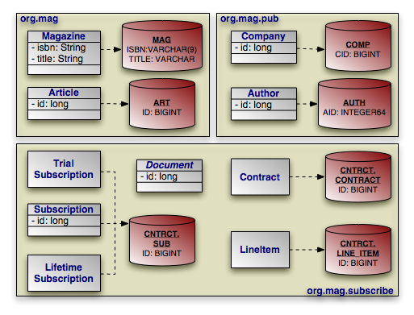

Note that many of our identity fields do not need to specify column information, because they use the default column name and type.

[[jpa_overview_mapping_identityex]]
.Identity Mapping
====
[source]
----

package org.mag;

@Entity
@IdClass(Magazine.MagazineId.class)
@Table(name="MAG")
public class Magazine {

    @Column(length=9)
    @Id private String isbn;
    @Id private String title;

    ...

    public static class MagazineId {
        ...
    }
}

@Entity
@Table(name="ART", uniqueConstraints=@Unique(columnNames="TITLE"))
public class Article {

    @Id private long id;

    ...
}

package org.mag.pub;

@Entity
@Table(name="COMP")
public class Company {

    @Column(name="CID")
    @Id private long id;

    ...
}

@Entity
@Table(name="AUTH")
public class Author {

    @Column(name="AID", columnDefinition="INTEGER64")
    @Id private long id;

    ...
}

@Embeddable
public class Address {
    ...
}

package org.mag.subscribe;

@MappedSuperclass
public abstract class Document {

    @Id
    @GeneratedValue(strategy=GenerationType.IDENTITY)
    private long id;

    ...
}

@Entity
@Table(schema="CNTRCT")
public class Contract
    extends Document {
    ...
}

@Entity
@Table(name="SUB", schema="CNTRCT")
public class Subscription {

    @Id private long id;

    ...

    @Entity
    @Table(name="LINE_ITEM", schema="CNTRCT")
    public static class LineItem
        extends Contract {
        ...
    }
}

@Entity(name="Lifetime")
public class LifetimeSubscription
    extends Subscription {
    ...
}

@Entity(name="Trial")
public class TrialSubscription
    extends Subscription {
    ...
}
----

The same metadata for `Magazine` and `Company` expressed in XML form:

[source]
----

<entity class="org.mag.Magazine">
    <id-class class="org.mag.Magazine.Magazine.MagazineId"/>
    <table name="MAG"/>
    <attributes>
        <id name="isbn">
            <column length="9"/>
        </id>
        <id name="title"/>
      ...
    </attributes>
</entity>
<entity class="org.mag.pub.Company">
    <table name="COMP"/>
    <attributes>
        <id name="id">
            <column name="CID"/>
        </id>
        ...
    </attributes>
</entity>
----
====

[[jpa_overview_mapping_sequence]]
==== Generators
(((generators , mapping metadata)))

One aspect of identity mapping not covered in the previous section is JPA's ability to automatically assign a value to your numeric identity fields using __generators__.
We discussed the available generator types in <<jpa_overview_meta_id>>.
Now we show you how to define named generators.

[[jpa_overview_mapping_sequence_seqgen]]
===== Sequence Generator
(((generators , SequenceGenerator)))

Most databases allow you to create native sequences.
These are database structures that generate increasing numeric values.
The [class]``SequenceGenerator`` annotation represents a named database sequence.
You can place the annotation on any package, entity class, persistent field declaration (if your entity uses field access), or getter method for a persistent property (if your entity uses property access). [class]``SequenceGenerator`` has the following properties:

* (((SequenceGenerator , name property)))``String name``: The generator name.
This property is required.
* ``String sequenceName``: The name of the database sequence. If you do not specify the database sequence, your vendor will choose an appropriate default.
* (((SequenceGenerator , initialValue property)))``int initialValue``: The initial sequence value.
* ``int allocationSize``: The number of values to allocate in memory for each trip to the database. Allocating values in memory allows the JPA runtime to avoid accessing the database for every sequence request. This number also specifies the amount that the sequence value is incremented each time the sequence is accessed. Defaults to 50.
* (((SequenceGenerator , schema property)))``String schema``: The sequence's schema.
If you do not name a schema, JPA uses the default schema for the database connection.

[NOTE]
====
OpenJPA allows you to use one of OpenJPA's built-in generator implementations in the `sequenceName` property.
You can also set the `sequenceName` to `system` to use the system sequence defined by the <<openjpa.Sequence,
`openjpa.Sequence`>> configuration property.
See the Reference Guide's <<ref_guide_sequence>> for details.
====

The XML element for a sequence generator is ``sequence-generator``.
Its attributes mirror the above annotation's properties:

* `name`
* `sequence-name`
* `initial-value`
* `allocation-size`
* `schema`

To use a sequence generator, set your [class]``GeneratedValue`` annotation's `strategy` property to ``GenerationType.SEQUENCE``, and its `generator` property to the sequence generator's declared name.
Or equivalently, set your 
`generated-value` XML element's `strategy` attribute to ``SEQUENCE`` and its `generator` attribute to the generator name.

[[jpa_overview_mapping_sequence_tablegen]]
===== Table Generator
(((TableGenerator)))

A [class]``TableGenerator`` refers to a database table used to store increasing sequence values for one or more entities.
As with [class]``SequenceGenerator``, you can place the [class]``TableGenerator`` annotation on any package, entity class, persistent field declaration (if your entity uses field access), or getter method for a persistent property (if your entity uses property access). [class]``TableGenerator`` has the following properties:

* (((TableGenerator , name property)))``String name``: The generator name.
This property is required.
* ``String table``: The name of the generator table. If left unspecified, your vendor will choose a default table.
* (((TableGenerator , schema property)))``String schema``: The named table's schema.
* ``String catalog``: The named table's catalog.
* (((TableGenerator , pkColumnName property)))``String pkColumnName``: The name of the primary key column in the generator table.
If unspecified, your implementation will choose a default.
* ``String valueColumnName``: The name of the column that holds the sequence value. If unspecified, your implementation will choose a default.
* (((TableGenerator , pkColumnValue property)))``String pkColumnValue``: The primary key column value of the row in the generator table holding this sequence value.
You can use the same generator table for multiple logical sequences by supplying different 
`pkColumnValue` s.
If you do not specify a value, the implementation will supply a default.
* ``int initialValue``: The value of the generator's first issued number.
* (((TableGenerator , allocationSize property)))``int allocationSize``: The number of values to allocate in memory for each trip to the database.
Allocating values in memory allows the JPA runtime to avoid accessing the database for every sequence request.
This number also specifies the amount that the sequence value is incremented each time the generator table is updated.
Defaults to 50.

The XML equivalent is the `table-generator` element.
This element's attributes correspond exactly to the above annotation's properties:

* `name`
* `table`
* `schema`
* `catalog`
* `pk-column-name`
* `value-column-name`
* `pk-column-value`
* `initial-value`
* `allocation-size`

To use a table generator, set your [class]``GeneratedValue`` annotation's `strategy` property to ``GenerationType.TABLE``, and its `generator` property to the table generator's declared name.
Or equivalently, set your 
`generated-value` XML element's `strategy` attribute to ``TABLE`` and its `generator` attribute to the generator name.

[[jpa_overview_mapping_sequence_genex]]
===== Example

Let's take advantage of generators in our entity model.
Here are our updated mappings.

[[jpa_overview_mapping_sequenceex]]
.Generator Mapping
====
[source]
----

package org.mag;

@Entity
@IdClass(Magazine.MagazineId.class)
@Table(name="MAG")
public class Magazine {

    @Column(length=9)
    @Id private String isbn;
    @Id private String title;

    ...

    public static class MagazineId {
        ...
    }
}

@Entity
@Table(name="ART", uniqueConstraints=@Unique(columnNames="TITLE"))
@SequenceGenerator(name="ArticleSeq", sequenceName="ART_SEQ")
public class Article {

    @Id
    @GeneratedValue(strategy=GenerationType.SEQUENCE, generator="ArticleSeq")
    private long id;

    ...
}

package org.mag.pub;

@Entity
@Table(name="COMP")
public class Company {

    @Column(name="CID")
    @Id private long id;

    ...
}

@Entity
@Table(name="AUTH")
public class Author {

    @Id
    @GeneratedValue(strategy=GenerationType.TABLE, generator="AuthorGen")
    @TableGenerator(name="AuthorGen", table="AUTH_GEN", pkColumnName="PK",
        valueColumnName="AID")
    @Column(name="AID", columnDefinition="INTEGER64")
    private long id;

    ...
}

@Embeddable
public class Address {
    ...
}

package org.mag.subscribe;

@MappedSuperclass
public abstract class Document {

    @Id
    @GeneratedValue(generate=GenerationType.IDENTITY)
    private long id;

    ...
}

@Entity
@Table(schema="CNTRCT")
public class Contract
    extends Document {

    ...
}

@Entity
@Table(name="SUB", schema="CNTRCT")
public class Subscription {

    @Id
    @GeneratedValue(strategy=GenerationType.IDENTITY)
    private long id;

    ...

    @Entity
    @Table(name="LINE_ITEM", schema="CNTRCT")
    public static class LineItem
        extends Contract {
        ...
    }
}

@Entity(name="Lifetime")
public class LifetimeSubscription
    extends Subscription {
    ...
}

@Entity(name="Trial")
public class TrialSubscription
    extends Subscription {
    ...
}
----

The same metadata for `Article` and `Author` expressed in XML form:

[source]
----

<entity class="org.mag.Article">
    <table name="ART">
        <unique-constraint>
            <column-name>TITLE</column-name>
        </unique-constraint>
    </table>
    <sequence-generator name="ArticleSeq" sequence-name="ART_SEQ"/>
    <attributes>
        <id name="id">
            <generated-value strategy="SEQUENCE" generator="ArticleSeq"/>
        </id>
        ...
    </attributes>
</entity>
<entity class="org.mag.pub.Author">
    <table name="AUTH"/>
    <attributes>
        <id name="id">
            <column name="AID" column-definition="INTEGER64"/>
            <generated-value strategy="TABLE" generator="AuthorGen"/>
            <table-generator name="AuthorGen" table="AUTH_GEN"
                pk-column-name="PK" value-column-name="AID"/>
        </id>
        ...
    </attributes>
</entity>
----
====

[[jpa_overview_mapping_inher]]
==== Inheritance
(((inheritance , mapping)))
(((impedance mismatch)))

In the 1990's programmers coined the term _impedance mismatch_  to describe the difficulties in bridging the object and relational worlds.
Perhaps no feature of object modeling highlights the impedance mismatch better than inheritance.
There is no natural, efficient way to represent an inheritance relationship in a relational database.

(((mapping metadata , inheritance , strategy attribute))) Luckily, JPA gives you a choice of inheritance strategies, making the best of a bad situation.
The base entity class defines the inheritance strategy for the hierarchy with the [class]``Inheritance`` annotation. [class]``Inheritance`` has the following properties:

* ``InheritanceType strategy``: Enum value declaring the inheritance strategy for the hierarchy. Defaults to ``InheritanceType.SINGLE_TABLE``. We detail each of the available strategies below.

The corresponding XML element is ``inheritance``, which has a single attribute:

* ``strategy``: One of ``SINGLE_TABLE``, ``JOINED``, or ``TABLE_PER_CLASS``.

The following sections describe JPA's standard inheritance strategies.

[NOTE]
====
OpenJPA allows you to vary your inheritance strategy for each class, rather than forcing a single strategy per inheritance hierarchy.
See <<ref_guide_mapping_jpa>> in the Reference Guide for details.
====

[[jpa_overview_mapping_inher_single]]
===== Single Table

The `InheritanceType.SINGLE_TABLE` strategy maps all classes in the hierarchy to the base class' table.

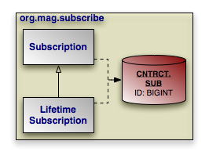

In our model, [class]``Subscription`` is mapped to the 
`CNTRCT.SUB` table. [class]``LifetimeSubscription``, which extends [class]``Subscription``, adds its field data to this table as well.

[[jpa_overview_mapping_inher_singleex]]
.Single Table Mapping
====
[source]
----

@Entity
@Table(name="SUB", schema="CNTRCT")
@Inheritance(strategy=InheritanceType.SINGLE_TABLE)
public class Subscription {
    ...
}

@Entity(name="Lifetime")
public class LifetimeSubscription
    extends Subscription {
    ...
}
----

The same metadata expressed in XML form:

[source]
----

<entity class="org.mag.subcribe.Subscription">
    <table name="SUB" schema="CNTRCT"/>
    <inheritance strategy="SINGLE_TABLE"/>
    ...
</entity>
<entity class="org.mag.subscribe.LifetimeSubscription">
    ...
</entity>
----
====

Single table inheritance is the default strategy.
Thus, we could omit the ``@Inheritance`` annotation in the example above and get the same result.

[NOTE]
====

(((inheritance , flat))) Mapping subclass state to the superclass table is often called _flat_  inheritance mapping.
====

[[jpa_overview_mapping_inher_single_adv]]
====== Advantages
(((inheritance , SINGLE_TABLE strategy , advantages)))

Single table inheritance mapping is the fastest of all inheritance models, since it never requires a join to retrieve a persistent instance from the database.
Similarly, persisting or updating a persistent instance requires only a single ``INSERT`` or `UPDATE` statement.
Finally, relations to any class within a single table inheritance hierarchy are just as efficient as relations to a base class.

[[jpa_overview_mapping_inher_single_disadv]]
====== Disadvantages

The larger the inheritance model gets, the "wider" the mapped table gets, in that for every field in the entire inheritance hierarchy, a column must exist in the mapped table.
This may have undesirable consequence on the database size, since a wide or deep inheritance hierarchy will result in tables with many mostly-empty columns.

[[jpa_overview_mapping_inher_joined]]
===== Joined
(((inheritance , JOINED strategy)))

The `InheritanceType.JOINED` strategy uses a different table for each class in the hierarchy.
Each table only includes state declared in its class.
Thus to load a subclass instance, the JPA implementation must read from the subclass table as well as the table of each ancestor class, up to the base entity class.

[NOTE]
====

(((vertical))) Using joined subclass tables is also called _vertical_ inheritance mapping.
====

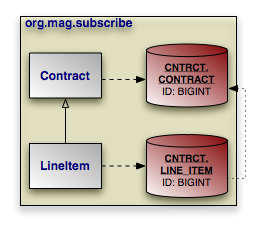

[class]``PrimaryKeyJoinColumn`` annotations tell the JPA implementation how to join each subclass table record to the corresponding record in its direct superclass table.
In our model, the `LINE_ITEM.ID`  column joins to the `CONTRACT.ID` column.
The [class]``PrimaryKeyJoinColumn`` annotation has the following properties:

* ``String name``: The name of the subclass table column. When there is a single identity field, defaults to that field's column name.
* ``String referencedColumnName``: The name of the superclass table column this subclass table column joins to. When there is a single identity field, defaults to that field's column name.
* ``String columnDefinition``: This property has the same meaning as the `columnDefinition` property on the [class]``Column`` annotation, described in <<jpa_overview_mapping_column>>.

The XML equivalent is the `primary-key-join-column` element.
Its attributes mirror the annotation properties described above:

* `name`
* `referenced-column-name`
* `column-definition`

The example below shows how we use `InheritanceTable.JOINED` and a primary key join column to map our sample model according to the diagram above.
Note that a primary key join column is not strictly needed, because there is only one identity column, and the subclass table column has the same name as the superclass table column.
In this situation, the defaults suffice.
However, we include the primary key join column for illustrative purposes.

[[jpa_overview_mapping_inher_joinedex]]
.Joined Subclass Tables
====
[source]
----

@Entity
@Table(schema="CNTRCT")
@Inheritance(strategy=InheritanceType.JOINED)
public class Contract
    extends Document {
    ...
}

public class Subscription {
    ...

    @Entity
    @Table(name="LINE_ITEM", schema="CNTRCT")
    @PrimaryKeyJoinColumn(name="ID", referencedColumnName="ID")
    public static class LineItem
        extends Contract {
        ...
    }
}
----

The same metadata expressed in XML form:

[source]
----

<entity class="org.mag.subcribe.Contract">
    <table schema="CNTRCT"/>
    <inheritance strategy="JOINED"/>
    ...
</entity>
<entity class="org.mag.subscribe.Subscription.LineItem">
    <table name="LINE_ITEM" schema="CNTRCT"/>
    <primary-key-join-column name="ID" referenced-column-name="PK"/>
    ...
</entity>
----
====

When there are multiple identity columns, you must define multiple [class]``PrimaryKeyJoinColumn``s using the aptly-named [class]``PrimaryKeyJoinColumns`` annotation.
This annotation's value is an array of [class]``PrimaryKeyJoinColumn`` s.
We could rewrite [class]``LineItem``'s mapping as:

[source]
----

@Entity
@Table(name="LINE_ITEM", schema="CNTRCT")
@PrimaryKeyJoinColumns({
    @PrimaryKeyJoinColumn(name="ID", referencedColumnName="ID")
})
public static class LineItem
    extends Contract {
    ...
}
----

In XML, simply list as many  `primary-key-join-column` elements as necessary.

[[jpa_overview_mapping_inher_joined_adv]]
====== Advantages
(((inheritance , JOINED strategy , advantages)))

The joined strategy has the following advantages:

. Using joined subclass tables results in the most _normalized_ database schema, meaning the schema with the least spurious or redundant data.
. As more subclasses are added to the data model over time, the only schema modification that needs to be made is the addition of corresponding subclass tables in the database (rather than having to change the structure of existing tables).
. Relations to a base class using this strategy can be loaded through standard joins and can use standard foreign keys, as opposed to the machinations required to load polymorphic relations to table-per-class base types, described below.

[[jpa_overview_mapping_inher_joined_disadv]]
====== Disadvantages

Aside from certain uses of the table-per-class strategy described below, the joined strategy is often the slowest of the inheritance models.
Retrieving any subclass requires one or more database joins, and storing subclasses requires multiple `INSERT` or `UPDATE` statements.
This is only the case when persistence operations are performed on subclasses; if most operations are performed on the least-derived persistent superclass, then this mapping is very fast.

[NOTE]
====
When executing a select against a hierarchy that uses joined subclass table inheritance, you must consider how to load subclass state. <<ref_guide_perfpack_eager>> in the Reference Guide describes OpenJPA's options for efficient data loading.
====

[[jpa_overview_mapping_inher_tpc]]
===== Table Per Class
(((mapping metadata , inheritance , TABLE_PER_CLASS strategy)))

Like the `JOINED` strategy, the 
`InheritanceType.TABLE_PER_CLASS` strategy uses a different table for each class in the hierarchy.
Unlike the `JOINED` strategy, however, each table includes all state for an instance of the corresponding class.
Thus to load a subclass instance, the JPA implementation must only read from the subclass table; it does not need to join to superclass tables.

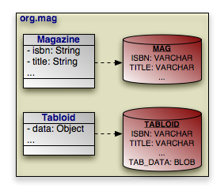

Suppose that our sample model's [class]``Magazine`` class has a subclass [class]``Tabloid``.
The classes are mapped using the table-per-class strategy, as in the diagram above.
In a table-per-class mapping, [class]``Magazine``'s table `MAG` contains all state declared in the base [class]``Magazine`` class. [class]``Tabloid`` maps to a separate table, ``TABLOID``.
This table contains not only the state declared in the [class]``Tabloid`` subclass, but all the base class state from [class]``Magazine`` as well.
Thus the `TABLOID` table would contain columns for ``isbn``, ``title``, and other [class]``Magazine`` fields.
These columns would default to the names used in [class]``Magazine``'s mapping metadata. <<jpa_overview_mapping_embed>> will show you how to use ``AttributeOverride``s and `AssociationOverride` s to override superclass field mappings.

[[jpa_overview_mapping_inher_tpcex]]
.Table Per Class Mapping
====
[source]
----

@Entity
@Table(name="MAG")
@Inheritance(strategy=InheritanceType.TABLE_PER_CLASS)
public class Magazine {
    ...
}

@Entity
@Table(name="TABLOID")
public class Tabloid
    extends Magazine {
    ...
}
----

And the same classes in XML:

[source]
----

<entity class="org.mag.Magazine">
    <table name="MAG"/>
    <inheritance strategy="TABLE_PER_CLASS"/>
    ...
</entity>
<entity class="org.mag.Tabloid">
    <table name="TABLOID"/>
    ...
</entity>
----
====

[[jpa_overview_mapping_inher_tpc_adv]]
====== Advantages

The table-per-class strategy is very efficient when operating on instances of a known class.
Under these conditions, the strategy never requires joining to superclass or subclass tables.
Reads, joins, inserts, updates, and deletes are all efficient in the absence of polymorphic behavior.
Also, as in the joined strategy, adding additional classes to the hierarchy does not require modifying existing class tables.

[[jpa_overview_mapping_inher_tpc_disadv]]
====== Disadvantages
(((inheritance , TABLE_PER_CLASS strategy , disadvantages)))

Polymorphic relations to non-leaf classes in a table-per-class hierarchy have many limitations.
When the concrete subclass is not known, the related object could be in any of the subclass tables, making joins through the relation impossible.
This ambiguity also affects identity lookups and queries; these operations require multiple SQL ``SELECT``s (one for each possible subclass), or a complex ``UNION``.

[NOTE]
====
<<ref_guide_mapping_limits_tpc>> in the Reference Guide describes the limitations OpenJPA places on table-per-class mapping.
====

[[jpa_overview_mapping_inher_together]]
===== Putting it All Together

Now that we have covered JPA's inheritance strategies, we can update our mapping document with inheritance information.
Here is the complete model:

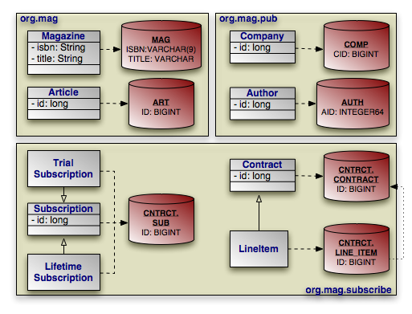

And here is the corresponding mapping metadata:

[[jpa_overview_mapping_inher_togetherex]]
.Inheritance Mapping
====
[source]
----

package org.mag;

@Entity
@IdClass(Magazine.MagazineId.class)
@Table(name="MAG")
public class Magazine {

    @Column(length=9)
    @Id private String isbn;
    @Id private String title;

    ...

    public static class MagazineId {
        ...
    }
}

@Entity
@Table(name="ART", uniqueConstraints=@Unique(columnNames="TITLE"))
@SequenceGenerator(name="ArticleSeq", sequenceName="ART_SEQ")
public class Article {

    @Id
    @GeneratedValue(strategy=GenerationType.SEQUENCE, generator="ArticleSeq")
    private long id;

    ...
}

package org.mag.pub;

@Entity
@Table(name="COMP")
public class Company {

    @Column(name="CID")
    @Id private long id;

    ...
}

@Entity
@Table(name="AUTH")
public class Author {

    @Id
    @GeneratedValue(strategy=GenerationType.TABLE, generator="AuthorGen")
    @TableGenerator(name="AuthorGen", table="AUTH_GEN", pkColumnName="PK",
        valueColumnName="AID")
    @Column(name="AID", columnDefinition="INTEGER64")
    private long id;

    ...
}

@Embeddable
public class Address {
    ...
}

package org.mag.subscribe;

@MappedSuperclass
public abstract class Document {

    @Id
    @GeneratedValue(strategy=GenerationType.IDENTITY)
    private long id;

    ...
}

@Entity
@Table(schema="CNTRCT")
@Inheritance(strategy=InheritanceType.JOINED)
public class Contract
    extends Document {
    ...
}

@Entity
@Table(name="SUB", schema="CNTRCT")
@Inheritance(strategy=InheritanceType.SINGLE_TABLE)
public class Subscription {

    @Id
    @GeneratedValue(strategy=GenerationType.IDENTITY)
    private long id;

    ...

    @Entity
    @Table(name="LINE_ITEM", schema="CNTRCT")
    @PrimaryKeyJoinColumn(name="ID", referencedColumnName="ID")
    public static class LineItem
        extends Contract {
        ...
    }
}

@Entity(name="Lifetime")
public class LifetimeSubscription
    extends Subscription {
    ...
}

@Entity(name="Trial")
public class TrialSubscription
    extends Subscription {
    ...
}
----

The same metadata expressed in XML form:

[source]
----

<entity-mappings xmlns="http://java.sun.com/xml/ns/persistence/orm"
    xmlns:xsi="http://www.w3.org/2001/XMLSchema-instance"
    xsi:schemaLocation="http://java.sun.com/xml/ns/persistence/orm orm_1_0.xsd"
    version="1.0">
    <mapped-superclass class="org.mag.subscribe.Document">
        <attributes>
            <id name="id">
                <generated-value strategy="IDENTITY"/>
            </id>
            ...
        </attributes>
    </mapped-superclass>
    <entity class="org.mag.Magazine">
        <table name="MAG"/>
        <id-class="org.mag.Magazine.MagazineId"/>
        <attributes>
            <id name="isbn">
                <column length="9"/>
            </id>
            <id name="title"/>
            ...
        </attributes>
    </entity>
    <entity class="org.mag.Article">
        <table name="ART">
            <unique-constraint>
               <column-name>TITLE</column-name>
            </unique-constraint>
        </table>
        <sequence-generator name="ArticleSeq" sequence-name="ART_SEQ"/>
        <attributes>
            <id name="id">
                <generated-value strategy="SEQUENCE" generator="ArticleSeq"/>
            </id>
           ...
        </attributes>
    </entity>
    <entity class="org.mag.pub.Company">
        <table name="COMP"/>
        <attributes>
            <id name="id">
                <column name="CID"/>
            </id>
            ...
        </attributes>
    </entity>
    <entity class="org.mag.pub.Author">
        <table name="AUTH"/>
        <attributes>
            <id name="id">
                <column name="AID" column-definition="INTEGER64"/>
                <generated-value strategy="TABLE" generator="AuthorGen"/>
                <table-generator name="AuthorGen" table="AUTH_GEN"
                    pk-column-name="PK" value-column-name="AID"/>
            </id>
            ...
        </attributes>
    </entity>
    <entity class="org.mag.subcribe.Contract">
        <table schema="CNTRCT"/>
        <inheritance strategy="JOINED"/>
        <attributes>
            ...
        </attributes>
    </entity>
    <entity class="org.mag.subcribe.Subscription">
        <table name="SUB" schema="CNTRCT"/>
        <inheritance strategy="SINGLE_TABLE"/>
        <attributes>
            <id name="id">
                <generated-value strategy="IDENTITY"/>
            </id>
            ...
        </attributes>
    </entity>
    <entity class="org.mag.subscribe.Subscription.LineItem">
        <table name="LINE_ITEM" schema="CNTRCT"/>
        <primary-key-join-column name="ID" referenced-column-name="PK"/>
        ...
    </entity>
    <entity class="org.mag.subscribe.LifetimeSubscription" name="Lifetime">
        ...
    </entity>
    <entity class="org.mag.subscribe.TrialSubscription" name="Trial">
        ...
    </entity>
</entity-mappings>
----
====

[[jpa_overview_mapping_discrim]]
==== Discriminator
(((inheritance , discriminator)))

The <<jpa_overview_mapping_inher_single,single table>> inheritance strategy results in a single table containing records for two or more different classes in an inheritance hierarchy.
Similarly, using the <<jpa_overview_mapping_inher_joined, joined>> strategy results in the superclass table holding records for superclass instances as well as for the superclass state of subclass instances.
When selecting data, JPA needs a way to differentiate a row representing an object of one class from a row representing an object of another.
That is the job of the _discriminator_ column.

The discriminator column is always in the table of the base entity.
It holds a different value for records of each class, allowing the JPA runtime to determine what class of object each row represents.

The [class]``DiscriminatorColumn`` annotation represents a discriminator column.
It has these properties:

* ``String name``: The column name. Defaults to ``DTYPE``.
* ``length``: For string discriminator values, the length of the column. Defaults to 31.
* ``String columnDefinition``: This property has the same meaning as the `columnDefinition` property on the [class]``Column`` annotation, described in <<jpa_overview_mapping_column>>.
* ``DiscriminatorType discriminatorType``: Enum value declaring the discriminator strategy of the hierarchy.

The corresponding XML element is ``discriminator-column``.
Its attributes mirror the annotation properties above:

* `name`
* `length`
* `column-definition`
* ``discriminator-type``: One of ``STRING``, ``CHAR``, or ``INTEGER``.

The [class]``DiscriminatorValue`` annotation specifies the discriminator value for each class.
Though this annotation's value is always a string, the implementation will parse it according to the [class]``DiscriminatorColumn``'s `discriminatorType` property above.
The type defaults to ``DiscriminatorType.STRING``, but may be  `DiscriminatorType.CHAR` or ``DiscriminatorType.INTEGER``.
If you do not specify a [class]``DiscriminatorValue``, the provider will choose an appropriate default.

The corresponding XML element is ``discriminator-value``.
The text within this element is parsed as the discriminator value.

[NOTE]
====
OpenJPA assumes your model employs a discriminator column if any of the following are true:

. The base entity explicitly declares an inheritance type of ``SINGLE_TABLE``.
. The base entity sets a discriminator value.
. The base entity declares a discriminator column.

Only `SINGLE_TABLE` inheritance hierarchies require a discriminator column and values.  `JOINED` hierarchies can use a discriminator to make some operations more efficient, but do not require one. ``TABLE_PER_CLASS`` hierarchies have no use for a discriminator.

OpenJPA defines additional discriminator strategies; see <<ref_guide_mapping_jpa>> in the Reference Guide for details.
OpenJPA also supports final entity classes.
OpenJPA does not use a discriminator on final classes.
====

We can now translate our newfound knowledge of JPA discriminators into concrete JPA mappings.
We first extend our diagram with discriminator columns:

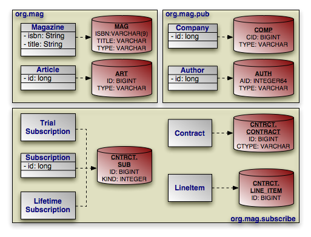

Next, we present the updated mapping document.
Notice that in this version, we have removed explicit inheritance annotations when the defaults sufficed.
Also, notice that entities using the default `DTYPE` discriminator column mapping do not need an explicit [class]``DiscriminatorColumn`` annotation.

[[jpa_overview_mapping_discrimex]]
.Discriminator Mapping
====
[source]
----

package org.mag;

@Entity
@IdClass(Magazine.MagazineId.class)
@Table(name="MAG")
@DiscriminatorValue("Mag")
public class Magazine {

    @Column(length=9)
    @Id private String isbn;
    @Id private String title;

    ...

    public static class MagazineId {
        ...
    }
}

@Entity
@Table(name="ART", uniqueConstraints=@Unique(columnNames="TITLE"))
@SequenceGenerator(name="ArticleSeq", sequenceName="ART_SEQ")
public class Article {

    @Id
    @GeneratedValue(strategy=GenerationType.SEQUENCE, generator="ArticleSeq")
    private long id;

    ...
}

package org.mag.pub;

@Entity
@Table(name="COMP")
public class Company {

    @Column(name="CID")
    @Id private long id;

    ...
}

@Entity
@Table(name="AUTH")
public class Author {

    @Id
    @GeneratedValue(strategy=GenerationType.TABLE, generator="AuthorGen")
    @TableGenerator(name="AuthorGen", table="AUTH_GEN", pkColumnName="PK",
        valueColumnName="AID")
    @Column(name="AID", columnDefinition="INTEGER64")
    private long id;

    ...
}

@Embeddable
public class Address {
    ...
}

package org.mag.subscribe;

@MappedSuperclass
public abstract class Document {

    @Id
    @GeneratedValue(strategy=GenerationType.IDENTITY)
    private long id;

    ...
}

@Entity
@Table(schema="CNTRCT")
@Inheritance(strategy=InheritanceType.JOINED)
@DiscriminatorColumn(name="CTYPE")
public class Contract
    extends Document {
    ...
}

@Entity
@Table(name="SUB", schema="CNTRCT")
@DiscriminatorColumn(name="KIND", discriminatorType=DiscriminatorType.INTEGER)
@DiscriminatorValue("1")
public class Subscription {

    @Id
    @GeneratedValue(strategy=GenerationType.IDENTITY)
    private long id;

    ...

    @Entity
    @Table(name="LINE_ITEM", schema="CNTRCT")
    public static class LineItem
        extends Contract {
        ...
    }
}

@Entity(name="Lifetime")
@DiscriminatorValue("2")
public class LifetimeSubscription
    extends Subscription {
    ...
}

@Entity(name="Trial")
@DiscriminatorValue("3")
public class TrialSubscription
    extends Subscription {
    ...
}
----

The same metadata expressed in XML:

[source]
----

<entity-mappings xmlns="http://java.sun.com/xml/ns/persistence/orm"
    xmlns:xsi="http://www.w3.org/2001/XMLSchema-instance"
    xsi:schemaLocation="http://java.sun.com/xml/ns/persistence/orm orm_1_0.xsd"
    version="1.0">
    <mapped-superclass class="org.mag.subscribe.Document">
        <attributes>
            <id name="id">
                <generated-value strategy="IDENTITY"/>
            </id>
            ...
        </attributes>
    </mapped-superclass>
    <entity class="org.mag.Magazine">
        <table name="MAG"/>
        <id-class="org.mag.Magazine.MagazineId"/>
        <discriminator-value>Mag</discriminator-value>
        <attributes>
            <id name="isbn">
                <column length="9"/>
            </id>
            <id name="title"/>
            ...
        </attributes>
    </entity>
    <entity class="org.mag.Article">
        <table name="ART">
            <unique-constraint>
                <column-name>TITLE</column-name>
            </unique-constraint>
        </table>
        <sequence-generator name="ArticleSeq" sequence-name="ART_SEQ"/>
        <attributes>
            <id name="id">
                <generated-value strategy="SEQUENCE" generator="ArticleSeq"/>
            </id>
            ...
        </attributes>
    </entity>
    <entity class="org.mag.pub.Company">
        <table name="COMP"/>
        <attributes>
            <id name="id">
                <column name="CID"/>
            </id>
            ...
        </attributes>
    </entity>
    <entity class="org.mag.pub.Author">
        <table name="AUTH"/>
        <attributes>
            <id name="id">
                <column name="AID" column-definition="INTEGER64"/>
                <generated-value strategy="TABLE" generator="AuthorGen"/>
                <table-generator name="AuthorGen" table="AUTH_GEN"
                    pk-column-name="PK" value-column-name="AID"/>
            </id>
            ...
        </attributes>
    </entity>
    <entity class="org.mag.subcribe.Contract">
        <table schema="CNTRCT"/>
        <inheritance strategy="JOINED"/>
        <discriminator-column name="CTYPE"/>
        <attributes>
            ...
        </attributes>
    </entity>
    <entity class="org.mag.subcribe.Subscription">
        <table name="SUB" schema="CNTRCT"/>
        <inheritance strategy="SINGLE_TABLE"/>
        <discriminator-value>1</discriminator-value>
        <discriminator-column name="KIND" discriminator-type="INTEGER"/>
        <attributes>
            <id name="id">
                <generated-value strategy="IDENTITY"/>
            </id>
            ...
        </attributes>
    </entity>
    <entity class="org.mag.subscribe.Subscription.LineItem">
        <table name="LINE_ITEM" schema="CNTRCT"/>
        <primary-key-join-column name="ID" referenced-column-name="PK"/>
        ...
    </entity>
    <entity class="org.mag.subscribe.LifetimeSubscription" name="Lifetime">
        <discriminator-value>2</discriminator-value>
        ...
    </entity>
    <entity class="org.mag.subscribe.TrialSubscription" name="Trial">
        <discriminator-value>3</discriminator-value>
        ...
    </entity>
</entity-mappings>
----
====

[[jpa_overview_mapping_field]]
==== Field Mapping
(((persistent fields , mapping metadata)))

The following sections enumerate the myriad of field mappings JPA supports.
JPA augments the persistence metadata covered in <<jpa_overview_meta>> with many new object-relational annotations.
As we explore the library of standard mappings, we introduce each of these enhancements in context.

[NOTE]
====
OpenJPA supports many additional field types, and allows you to create custom mappings for unsupported field types or database schemas.
See the Reference Guide's <<ref_guide_mapping>> for complete coverage of OpenJPA's mapping capabilities.
====

[[jpa_overview_mapping_basic]]
===== Basic Mapping
(((persistent fields , basic)))

A _basic_ field mapping stores the field value directly into a database column.
The following field metadata types use basic mapping.
These types were defined in <<jpa_overview_meta_field>>.

* <<jpa_overview_meta_id,[class]``Id``>> fields.
* <<jpa_overview_meta_version,[class]``Version``>> fields.
* <<jpa_overview_meta_basic,[class]``Basic``>> fields.

In fact, you have already seen examples of basic field mappings in this chapter - the mapping of all identity fields in <<jpa_overview_mapping_identityex>>.
As you saw in that section, to write a basic field mapping you use the [class]``Column`` annotation to describe the column the field value is stored in.
We discussed the [class]``Column`` annotation in <<jpa_overview_mapping_column>>.
Recall that the name of the column defaults to the field name, and the type of the column defaults to an appropriate type for the field type.
These defaults allow you to sometimes omit the annotation altogether.

[[jpa_overview_mapping_lob]]
====== LOBs
(((mapping metadata , LOB types)))

Adding the [class]``Lob`` marker annotation to a basic field signals that the data is to be stored as a LOB (Large OBject). If the field holds string or character data, it will map to a `CLOB` (Character Large OBject) database column.
If the field holds any other data type, it will be stored as binary data in a `BLOB` (Binary Large OBject) column.
The implementation will serialize the Java value if needed.

The equivalent XML element is ``lob``, which has no children or attributes.

[NOTE]
====
OpenJPA also supports LOB streaming.
See <<ref_guide_streamsupport>> in the Reference Guide for details.
====

[[jpa_overview_mapping_enum]]
====== Enumerated
(((Enumerated)))
(((mapping metadata , enums)))

You can apply the [class]``Enumerated`` annotation to your [class]``Enum`` fields to control how they map to the database.
The [class]``Enumerated`` annotation's value one of the following constants from the [class]``EnumType`` enum:

* ``EnumType.ORDINAL``: The default. The persistence implementation places the ordinal value of the enum in a numeric column. This is an efficient mapping, but may break if you rearrange the Java enum declaration.
* ``EnumType.STRING``: Store the name of the enum value rather than the ordinal. This mapping uses a `VARCHAR` column rather than a numeric one.

The [class]``Enumerated`` annotation is optional.
Any un-annotated enumeration field defaults to `ORDINAL` mapping.

The corresponding XML element is ``enumerated``.
Its embedded text must be one of `STRING` or ``ORIDINAL``.

[[jpa_overview_mapping_temporal]]
====== Temporal Types
(((mapping metadata , temporal types)))

The [class]``Temporal`` annotation determines how the implementation handles your basic [class]``java.util.Date`` and [class]``java.util.Calendar`` fields at the JDBC level.
The [class]``Temporal`` annotation's value is a constant from the [class]``TemporalType`` enum.
Available values are:

* ``TemporalType.TIMESTAMP``: The default. Use JDBC's timestamp APIs to manipulate the column data.
* ``TemporalType.DATE``: Use JDBC's SQL date APIs to manipulate the column data.
* ``TemporalType.TIME``: Use JDBC's time APIs to manipulate the column data.

If the [class]``Temporal`` annotation is omitted, the implementation will treat the data as a timestamp.

The corresponding XML element is ``temporal``, whose text value must be one of: ``TIME``, ``DATE``, or ``TIMESTAMP``.

[[jpa_overview_mapping_basic_example]]
====== The Updated Mappings

Below we present an updated diagram of our model and its associated database schema, followed by the corresponding mapping metadata.
Note that the mapping metadata relies on defaults where possible.
Also note that as a mapped superclass, [class]``Document`` can define mappings that will automatically transfer to its subclass' tables.
In <<jpa_overview_mapping_embed>>, you will see how a subclass can override its mapped superclass' mappings.

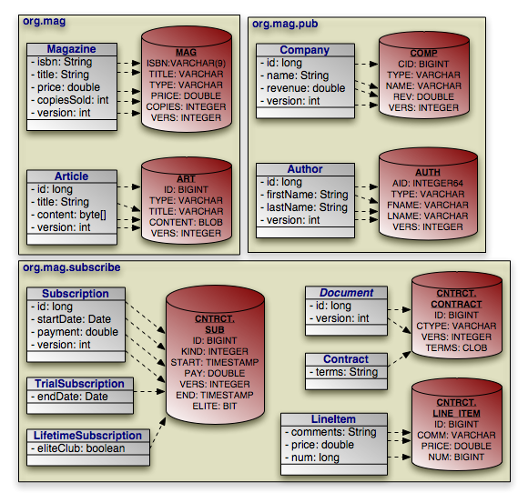

[[jpa_overview_mapping_basicex]]
.Basic Field Mapping
====
[source]
----

package org.mag;

@Entity
@IdClass(Magazine.MagazineId.class)
@Table(name="MAG")
@DiscriminatorValue("Mag")
public class Magazine {

    @Column(length=9)
    @Id private String isbn;
    @Id private String title;

    @Column(name="VERS")
    @Version private int version;

    private String name;
    private double price;

    @Column(name="COPIES")
    private int copiesSold;

    ...

    public static class MagazineId {
        ...
    }
}

@Entity
@Table(name="ART", uniqueConstraints=@Unique(columnNames="TITLE"))
@SequenceGenerator(name="ArticleSeq", sequenceName="ART_SEQ")
public class Article {

    @Id
    @GeneratedValue(strategy=GenerationType.SEQUENCE, generator="ArticleSeq")
    private long id;

    @Column(name="VERS")
    @Version private int version;

    private String title;
    private byte[] content;

    ...
}

package org.mag.pub;

@Entity
@Table(name="COMP")
public class Company {

    @Column(name="CID")
    @Id private long id;

    @Column(name="VERS")
    @Version private int version;

    private String name;

    @Column(name="REV")
    private double revenue;

    ...
}

@Entity
@Table(name="AUTH")
public class Author {

    @Id
    @GeneratedValue(strategy=GenerationType.TABLE, generator="AuthorGen")
    @TableGenerator(name="AuthorGen", table="AUTH_GEN", pkColumnName="PK",
        valueColumnName="AID")
    @Column(name="AID", columnDefinition="INTEGER64")
    private long id;

    @Column(name="VERS")
    @Version private int version;

    @Column(name="FNAME")
    private String firstName;

    @Column(name="LNAME")
    private String lastName;

    ...
}

@Embeddable
public class Address {
    ...
}

package org.mag.subscribe;

@MappedSuperclass
public abstract class Document {

    @Id
    @GeneratedValue(strategy=GenerationType.IDENTITY)
    private long id;

    @Column(name="VERS")
    @Version private int version;

    ...
}

@Entity
@Table(schema="CNTRCT")
@Inheritance(strategy=InheritanceType.JOINED)
@DiscriminatorColumn(name="CTYPE")
public class Contract
    extends Document {

    @Lob
    private String terms;

    ...
}

@Entity
@Table(name="SUB", schema="CNTRCT")
@DiscriminatorColumn(name="KIND", discriminatorType=DiscriminatorType.INTEGER)
@DiscriminatorValue("1")
public class Subscription {

    @Id
    @GeneratedValue(strategy=GenerationType.IDENTITY)
    private long id;

    @Column(name="VERS")
    @Version private int version;

    @Column(name="START")
    private Date startDate;

    @Column(name="PAY")
    private double payment;

    ...

    @Entity
    @Table(name="LINE_ITEM", schema="CNTRCT")
    public static class LineItem
        extends Contract {

        @Column(name="COMM")
        private String comments;

        private double price;
        private long num;
        ...
    }
}

@Entity(name="Lifetime")
@DiscriminatorValue("2")
public class LifetimeSubscription
    extends Subscription {

    @Basic(fetch=FetchType.LAZY)
    @Column(name="ELITE")
    private boolean getEliteClub() { ... }
    public void setEliteClub(boolean elite) { ... }

    ...
}

@Entity(name="Trial")
@DiscriminatorValue("3")
public class TrialSubscription
    extends Subscription {

    @Column(name="END")
    public Date getEndDate() { ... }
    public void setEndDate(Date end) { ... }

    ...
}
----

The same metadata expressed in XML:

[source]
----

<entity-mappings xmlns="http://java.sun.com/xml/ns/persistence/orm"
    xmlns:xsi="http://www.w3.org/2001/XMLSchema-instance"
    xsi:schemaLocation="http://java.sun.com/xml/ns/persistence/orm orm_1_0.xsd"
    version="1.0">
    <mapped-superclass class="org.mag.subscribe.Document">
        <attributes>
            <id name="id">
                <generated-value strategy="IDENTITY"/>
            </id>
            <version name="version">
                <column name="VERS"/>
            </version>
            ...
        </attributes>
    </mapped-superclass>
    <entity class="org.mag.Magazine">
        <table name="MAG"/>
        <id-class="org.mag.Magazine.MagazineId"/>
        <discriminator-value>Mag</discriminator-value>
        <attributes>
            <id name="isbn">
                <column length="9"/>
            </id>
            <id name="title"/>
            <basic name="name"/>
            <basic name="price"/>
            <basic name="copiesSold">
                <column name="COPIES"/>
            </basic>
            <version name="version">
                <column name="VERS"/>
            </version>
            ...
        </attributes>
    </entity>
    <entity class="org.mag.Article">
        <table name="ART">
            <unique-constraint>
               <column-name>TITLE</column-name>
            </unique-constraint>
        </table>
        <sequence-generator name="ArticleSeq", sequenceName="ART_SEQ"/>
        <attributes>
            <id name="id">
                <generated-value strategy="SEQUENCE" generator="ArticleSeq"/>
            </id>
            <basic name="title"/>
            <basic name="content"/>
            <version name="version">
                <column name="VERS"/>
            </version>
            ...
        </attributes>
    </entity>
    <entity class="org.mag.pub.Company">
        <table name="COMP"/>
        <attributes>
            <id name="id">
                <column name="CID"/>
            </id>
            <basic name="name"/>
            <basic name="revenue">
                <column name="REV"/>
            </basic>
        </attributes>
    </entity>
    <entity class="org.mag.pub.Author">
        <table name="AUTH"/>
        <attributes>
            <id name="id">
                <column name="AID" column-definition="INTEGER64"/>
                <generated-value strategy="TABLE" generator="AuthorGen"/>
                <table-generator name="AuthorGen" table="AUTH_GEN"
                    pk-column-name="PK" value-column-name="AID"/>
            </id>
            <basic name="firstName">
                <column name="FNAME"/>
            </basic>
            <basic name="lastName">
                <column name="LNAME"/>
            </basic>
            <version name="version">
                <column name="VERS"/>
            </version>
            ...
        </attributes>
    </entity>
    <entity class="org.mag.subcribe.Contract">
        <table schema="CNTRCT"/>
        <inheritance strategy="JOINED"/>
        <discriminator-column name="CTYPE"/>
        <attributes>
            <basic name="terms">
                <lob/>
            </basic>
            ...
        </attributes>
    </entity>
    <entity class="org.mag.subcribe.Subscription">
        <table name="SUB" schema="CNTRCT"/>
        <inheritance strategy="SINGLE_TABLE"/>
        <discriminator-value>1</discriminator-value>
        <discriminator-column name="KIND" discriminator-type="INTEGER"/>
        <attributes>
            <id name="id">
                <generated-value strategy="IDENTITY"/>
            </id>
            <basic name="payment">
                <column name="PAY"/>
            </basic>
            <basic name="startDate">
                <column name="START"/>
            </basic>
            <version name="version">
                <column name="VERS"/>
            </version>
            ...
        </attributes>
    </entity>
    <entity class="org.mag.subscribe.Subscription.LineItem">
        <table name="LINE_ITEM" schema="CNTRCT"/>
        <primary-key-join-column name="ID" referenced-column-name="PK"/>
        <attributes>
            <basic name="comments">
                <column name="COMM"/>
            </basic>
            <basic name="price"/>
            <basic name="num"/>
            ...
        </attributes>
    </entity>
    <entity class="org.mag.subscribe.LifetimeSubscription" name="Lifetime">
        <discriminator-value>2</discriminator-value>
        <attributes>
            <basic name="eliteClub" fetch="LAZY">
                <column name="ELITE"/>
            </basic>
            ...
        </attributes>
    </entity>
    <entity class="org.mag.subscribe.TrialSubscription" name="Trial">
        <discriminator-value>3</discriminator-value>
        <attributes>
            <basic name="endDate">
                <column name="END"/>
            </basic>
            ...
        </attributes>
    </entity>
</entity-mappings>
----
====

[[jpa_overview_mapping_secondary]]
===== Secondary Tables
(((mapping metadata , secondary table fields)))

Sometimes a logical record is spread over multiple database tables.
JPA calls a class' declared table the _primary_ table, and calls other tables that make up a logical record _secondary_  tables.
You can map any persistent field to a secondary table.
Just write the standard field mapping, then perform these two additional steps:

. Set the `table` attribute of each of the field's columns or join columns to the name of the secondary table.
. Define the secondary table on the entity class declaration.

You define secondary tables with the [class]``SecondaryTable`` annotation.
This annotation has all the properties of the [class]``Table`` annotation covered in <<jpa_overview_mapping_table>> , plus a  `pkJoinColumns` property.

The `pkJoinColumns` property is an array of [class]``PrimaryKeyJoinColumn``s dictating how to join secondary table records to their owning primary table records.
Each [class]``PrimaryKeyJoinColumn`` joins a secondary table column to a primary key column in the primary table.
See <<jpa_overview_mapping_inher_joined>> above for coverage of [class]``PrimaryKeyJoinColumn``'s properties.

The corresponding XML element is ``secondary-table``.
This element has all the attributes of the `table` element, but also accepts nested `primary-key-join-column` elements.

In the following example, we move the `Article.content` field we mapped in <<jpa_overview_mapping_basic>> into a joined secondary table, like so:

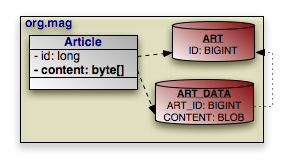

[[jpa_overview_mapping_secondaryex]]
.Secondary Table Field Mapping
====
[source]
----

package org.mag;

@Entity
@Table(name="ART")
@SecondaryTable(name="ART_DATA",
    pkJoinColumns=@PrimaryKeyJoinColumn(name="ART_ID", referencedColumnName="ID"))
public class Article {

    @Id private long id;

    @Column(table="ART_DATA")
    private byte[] content;

    ...
}
----

And in XML:

[source]
----

<entity class="org.mag.Article">
    <table name="ART"/>
    <secondary-table name="ART_DATA">
        <primary-key-join-column name="ART_ID" referenced-column-name="ID"/>
    </secondary-table>
    <attributes>
        <id name="id"/>
        <basic name="content">
            <column table="ART_DATA"/>
        </basic>
        ...
    </attributes>
</entity>
----
====

[[jpa_overview_mapping_embed]]
===== Embedded Mapping
(((mapping metadata , embedded fields)))

<<jpa_overview_meta>> describes JPA's concept of _embeddable_ objects.
The field values of embedded objects are stored as part of the owning record, rather than as a separate database record.
Thus, instead of mapping a relation to an embeddable object as a foreign key, you map all the fields of the embeddable instance to columns in the owning field's table.

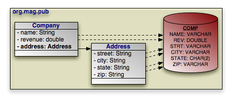

JPA defaults the embedded column names and descriptions to those of the embeddable class' field mappings.
The [class]``AttributeOverride`` annotation overrides a basic embedded mapping.
This annotation has the following properties:

* ``String name``: The name of the embedded class' field being mapped to this class' table.
* ``Column column``: The column defining the mapping of the embedded class' field to this class' table.

The corresponding XML element is ``attribute-override``.
It has a single `name` attribute to name the field being overridden, and a single `column` child element.

To declare multiple overrides, use the [class]``AttributeOverrides`` annotation, whose value is an array of [class]``AttributeOverride`` s.
In XML, simply list multiple `attribute-override` elements in succession.

To override a many to one or one to one relationship, use the [class]``AssociationOverride`` annotation in place of [class]``AttributeOverride``. [class]``AssociationOverride`` has the following properties:

* ``String name``: The name of the embedded class' field being mapped to this class' table.
* ``JoinColumn[] joinColumns``: The foreign key columns joining to the related record.

The corresponding XML element is ``association-override``.
It has a single `name` attribute to name the field being overridden, and one or more `join-column` child elements.

To declare multiple relation overrides, use the [class]``AssociationOverrides`` annotation, whose value is an array of [class]``AssociationOverride`` s.
In XML, simply list multiple 
`association-override` elements in succession.

[[jpa_overview_mapping_embedex]]
.Embedded Field Mapping
====
In this example, [class]``Company`` overrides the default mapping of ``Address.street`` and ``Address.city``.
All other embedded mappings are taken from the [class]``Address`` embeddable class.

[source]
----

package org.mag.pub;

@Entity
@Table(name="COMP")
public class Company {

    @Embedded
    @AttributeOverrides({
        @AttributeOverride(name="street", column=@Column(name="STRT")),
        @AttributeOverride(name="city", column=@Column(name="ACITY"))
    })
    private Address address;

    ...
}

@Entity
@Table(name="AUTH")
public class Author {

    // use all defaults from Address class mappings
    private Address address;

    ...
}

@Embeddable
public class Address {

    private String street;
    private String city;
    @Column(columnDefinition="CHAR(2)")
    private String state;
    private String zip;
}
----

The same metadata expressed in XML:

[source]
----

<entity class="org.mag.pub.Company">
    <table name="COMP"/>
    <attributes>
        ...
        <embedded name="address">
            <attribute-override name="street">
               <column name="STRT"/>
            </attribute-override>
            <attribute-override name="city">
               <column name="ACITY"/>
            </attribute-override>
        </embedded>
    </attributes>
</entity>
<entity class="org.mag.pub.Author">
    <table name="AUTH"/>
    <attributes>
        <embedded name="address">
            <!-- use all defaults from Address -->
        </embedded>
    </attributes>
</entity>
<embeddable class="org.mag.pub.Address">
    <attributes>
        <basic name="street"/>
        <basic name="city"/>
        <basic name="state">
            <column column-definition="CHAR(2)"/>
        </basic>
        <basic name="zip"/>
    </attributes>
</embeddable>
----
====

You can also use attribute overrides on an entity class to override mappings defined by its mapped superclass or table-per-class superclass.
The example below re-maps the `Document.version` field to the [class]``Contract`` table's `CVERSION` column.

[[jpa_overview_mapping_joined_overex]]
.Mapping Mapped Superclass Field
====
[source]
----

@MappedSuperclass
public abstract class Document {

    @Column(name="VERS")
    @Version private int version;

    ...
}

@Entity
@Table(schema="CNTRCT")
@Inheritance(strategy=InheritanceType.JOINED)
@DiscriminatorColumn(name="CTYPE")
@AttributeOverride(name="version", column=@Column(name="CVERSION"))
public class Contract
    extends Document {
    ...
}
----

The same metadata expressed in XML form:

[source]
----

<mapped-superclass class="org.mag.subcribe.Document">
    <attributes>
        <version name="version">
            <column name="VERS">
        </version>
        ...
    </attributes>
</mapped-superclass>
<entity class="org.mag.subcribe.Contract">
    <table schema="CNTRCT"/>
    <inheritance strategy="JOINED"/>
    <discriminator-column name="CTYPE"/>
    <attribute-override name="version">
        <column name="CVERSION"/>
    </attribute-override>
    <attributes>
        ...
    </attributes>
</entity>
----
====

[[jpa_overview_mapping_rel]]
===== Direct Relations
(((mapping metadata , direct relation fields)))
(((one-one)))
(((many-one)))

A direct relation is a non-embedded persistent field that holds a reference to another entity. <<jpa_overview_meta_manytoone,many to one>> and <<jpa_overview_meta_onetoone,one to one>> metadata field types are mapped as direct relations.
Our model has three direct relations: [class]``Magazine``'s `publisher` field is a direct relation to a [class]``Company``, [class]``Magazine``'s ``coverArticle`` field is a direct relation to [class]``Article``, and the `LineItem.magazine` field is a direct relation to a [class]``Magazine``.
Direct relations are represented in the database by foreign key columns:

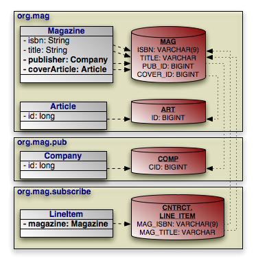

You typically map a direct relation with [class]``JoinColumn`` annotations describing how the local foreign key columns join to the primary key columns of the related record.
The [class]``JoinColumn`` annotation exposes the following properties:

* ``String name``: The name of the foreign key column. Defaults to the relation field name, plus an underscore, plus the name of the referenced primary key column.
* ``String referencedColumnName``: The name of the primary key column being joined to. If there is only one identity field in the related entity class, the join column name defaults to the name of the identity field's column.
* ``boolean unique``: Whether this column is guaranteed to hold unique values for all rows. Defaults to false.

[class]``JoinColumn`` also has the same  `nullable` , ``insertable``, ``updatable``, ``columnDefinition``, and `table` properties as the [class]``Column`` annotation.
See <<jpa_overview_mapping_column>> for details on these properties.

The `join-column` element represents a join column in XML.
Its attributes mirror the above annotation's properties:

* `name`
* `referenced-column-name`
* `unique`
* `nullable`
* `insertable`
* `updatable`
* `column-definition`
* `table`

When there are multiple columns involved in the join, as when a [class]``LineItem`` references a [class]``Magazine`` in our model, the [class]``JoinColumns`` annotation allows you to specify an array of [class]``JoinColumn`` values.
In XML, simply list multiple ``join-column`` elements.

[NOTE]
====
OpenJPA supports many non-standard joins.
See <<ref_guide_mapping_notes_nonstdjoins>> in the Reference Guide for details.
====

[[jpa_overview_mapping_relex]]
.Direct Relation Field Mapping
====
[source]
----

package org.mag;

@Table(name="AUTH")
public class Magazine {

    @Column(length=9)
    @Id private String isbn;
    @Id private String title;

    @OneToOne
    @JoinColumn(name="COVER_ID" referencedColumnName="ID")
    private Article coverArticle;

    @ManyToOne
    @JoinColumn(name="PUB_ID" referencedColumnName="CID")
    private Company publisher;

    ...
}

@Table(name="ART")
public class Article {

    @Id private long id;

    ...
}

package org.mag.pub;

@Table(name="COMP")
public class Company {

    @Column(name="CID")
    @Id private long id;

    ...
}

package org.mag.subscribe;

public class Subscription {
    ...

    @Table(name="LINE_ITEM", schema="CNTRCT")
    public static class LineItem
        extends Contract {

        @ManyToOne
        @JoinColumns({
            @JoinColumn(name="MAG_ISBN" referencedColumnName="ISBN"),
            @JoinColumn(name="MAG_TITLE" referencedColumnName="TITLE")
        })
        private Magazine magazine;

        ...
    }
}
----

The same metadata expressed in XML form:

[source]
----

<entity class="org.mag.Magazine">
    <table name="MAG"/>
    <id-class="org.mag.Magazine.MagazineId"/>
    <attributes>
        <id name="isbn">
            <column length="9"/>
        </id>
        <id name="title"/>
        <one-to-one name="coverArticle">
            <join-column name="COVER_ID" referenced-column-name="ID"/>
        </one-to-one>
        <many-to-one name="publisher">
            <join-column name="PUB_IC" referenced-column-name="CID"/>
        </many-to-one>
        ...
    </attributes>
</entity>
<entity class="org.mag.Article">
    <table name="ART"/>
    <attributes>
        <id name="id"/>
        ...
    </attributes>
</entity>
<entity class="org.mag.pub.Company">
    <table name="COMP"/>
    <attributes>
        <id name="id">
            <column name="CID"/>
        </id>
        ...
    </attributes>
</entity>
<entity class="org.mag.subscribe.Subscription.LineItem">
    <table name="LINE_ITEM" schema="CNTRCT"/>
    <primary-key-join-column name="ID" referenced-column-name="PK"/>
    <attributes>
        <many-to-one name="magazine">
            <join-column name="MAG_ISBN" referenced-column-name="ISBN"/>
            <join-column name="MAG_TITLE" referenced-column-name="TITLE"/>
        </many-to-one>
        ...
    </attributes>
</entity>
----
====

When the entities in a one to one relation join on shared primary key values rather than separate foreign key columns, use the [class]``PrimaryKeyJoinColumn(s)`` annotation or 
`primary-key-join-column` elements in place of [class]``JoinColumn(s)`` /  `join-column` elements.

[[jpa_overview_mapping_assoccoll]]
===== Join Table
(((mapping metadata , association table collection fields)))
(((join table)))
(((one-many)))
(((many-many)))

A _join table_ consists of two foreign keys.
Each row of a join table associates two objects together.
JPA uses join tables to represent collections of entity objects: one foreign key refers back to the collection's owner, and the other refers to a collection element.

<<jpa_overview_meta_onetomany,one to many>> and <<jpa_overview_meta_manytomany,many to many>> metadata field types can map to join tables.
Several fields in our model use join table mappings, including `Magazine.articles` and ``Article.authors``.

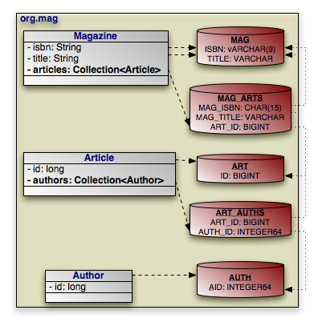

You define join tables with the [class]``JoinTable`` annotation.
This annotation has the following properties:

* ``String name``: Table name. If not given, the name of the table defaults to the name of the owning entity's table, plus an underscore, plus the name of the related entity's table.
* ``String catalog``: Table catalog.
* ``String schema``: Table schema.
* ``JoinColumn[] joinColumns``: Array of [class]``JoinColumn`` showing how to associate join table records with the owning row in the primary table. This property mirrors the `pkJoinColumns` property of the [class]``SecondaryTable`` annotation in functionality. See <<jpa_overview_mapping_secondary>> to refresh your memory on secondary tables.

If this is a bidirectional relation (see <<jpa_overview_meta_mappedby>> ), the name of a join column defaults to the inverse field name, plus an underscore, plus the referenced primary key column name.
Otherwise, the join column name defaults to the field's owning entity name, plus an underscore, plus the referenced primary key column name.
* ``JoinColumn[] inverseJoinColumns``: Array of [class]``JoinColumns`` showing how to associate join table records with the records that form the elements of the collection. These join columns are used just like the join columns for direct relations, and they have the same naming defaults. Read <<jpa_overview_mapping_rel>> for a review of direct relation mapping.

`join-table` is the corresponding XML element.
It has the same attributes as the `table` element, but includes the ability to nest `join-column` and `inverse-join-column` elements as children.
We have seen `join-column` elements already; `inverse-join-column` elements have the same attributes.

Here are the join table mappings for the diagram above.

[[jpa_overview_mapping_assoccollex]]
.Join Table Mapping
====
[source]
----

package org.mag;

@Entity
@Table(name="MAG")
public class Magazine {

    @Column(length=9)
    @Id private String isbn;
    @Id private String title;

    @OneToMany(...)
    @OrderBy
    @JoinTable(name="MAG_ARTS",
        joinColumns={
            @JoinColumn(name="MAG_ISBN", referencedColumnName="ISBN"),
            @JoinColumn(name="MAG_TITLE", referencedColumnName="TITLE")
        },
        inverseJoinColumns=@JoinColumn(name="ART_ID", referencedColumnName="ID"))
    private Collection<Article> articles;

    ...
}

@Entity
@Table(name="ART")
public class Article {

    @Id private long id;

    @ManyToMany(cascade=CascadeType.PERSIST)
    @OrderBy("lastName, firstName")
    @JoinTable(name="ART_AUTHS",
        joinColumns=@JoinColumn(name="ART_ID", referencedColumnName="ID"),
        inverseJoinColumns=@JoinColumn(name="AUTH_ID", referencedColumnName="AID"))
    private Collection<Author> authors;

    ...
}

package org.mag.pub;

@Entity
@Table(name="AUTH")
public class Author {

    @Column(name="AID", columnDefinition="INTEGER64")
    @Id private long id;

    ...
}
----

The same metadata expressed in XML:

[source]
----

<entity class="org.mag.Magazine">
    <table name="MAG"/>
    <attributes>
        <id name="isbn">
            <column length="9"/>
        </id>
        <id name="title"/>
        <one-to-many name="articles">
            <order-by/>
            <join-table name="MAG_ARTS">
                <join-column name="MAG_ISBN" referenced-column-name="ISBN"/>
                <join-column name="MAG_TITLE" referenced-column-name="TITLE"/>
                <inverse-join-column name="ART_ID" referenced-column-name="ID"/>
            </join-table>
        </one-to-many>
        ...
    </attributes>
</entity>
<entity class="org.mag.Article">
    <table name="ART"/>
        <attributes>
            <id name="id"/>
            <many-to-many name="authors">
                <order-by>lastName, firstName</order-by>
                <join-table name="ART_AUTHS">
                    <join-column name="ART_ID" referenced-column-name="ID"/>
                    <inverse-join-column name="AUTH_ID" referenced-column-name="AID"/>
                </join-table>
            <cascade>
                <cascade-persist/>
            </cascade>
            </many-to-many>
            ...
       </attributes>
</entity>
<entity class="org.mag.pub.Author">
    <table name="AUTH"/>
    <attributes>
        <id name="id">
            <column name="AID" column-definition="INTEGER64"/>
        </id>
        ...
    </attributes>
</entity>
----
====

[[jpa_overview_mapping_bidi]]
===== Bidirectional Mapping
(((bidirectional relations , mapping)))

<<jpa_overview_meta_mappedby>> introduced bidirectional relations.
To map a bidirectional relation, you map one field normally using the annotations we have covered throughout this chapter.
Then you use the 
`mappedBy` property of the other field's metadata annotation or the corresponding `mapped-by` XML attribute to refer to the mapped field.
Look for this pattern in these bidirectional relations as you peruse the complete mappings below:

* `Magazine.publisher` and ``Company.mags``.
* `Article.authors` and ``Author.articles``.

[[jpa_overview_mapping_map]]
===== Map Mapping
(((persistent fields , maps)))

All map fields in JPA are modeled on either one to many or many to many associations.
The map key is always derived from an associated entity's field.
Thus map fields use the same mappings as any one to many or many to many fields, namely dedicated <<jpa_overview_mapping_assoccoll,join
tables>> or <<jpa_overview_mapping_bidi,bidirectional
relations>>.
The only additions are the [class]``MapKey`` annotation and `map-key` element to declare the key field.
We covered these additions in <<jpa_overview_meta_mapkey>>.

For a map of basic types the key is held in a column of its own.
Unless [class]``MapKeyColumn`` names it, the column defaults to ``the
name of the field or property + _KEY``.
To use the default of OpenJPA releases before 4.2.0, `KEY` (which most dictionaries turn into ``KEY0``, as `KEY` is a reserved word), set the <<openjpa.Compatibility>> option ``UseSpecDefaultMapKeyColumnName`` to ``false``.

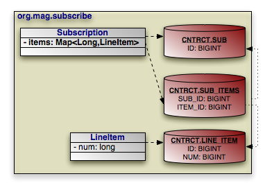

The example below maps [class]``Subscription``'s map of [class]``LineItem``s to the `SUB_ITEMS` join table.
The key for each map entry is the [class]``LineItem``'s `num`  field value.

[[jpa_overview_mapping_mapex]]
.Join Table Map Mapping
====
[source]
----

package org.mag.subscribe;

@Entity
@Table(name="SUB", schema="CNTRCT")
public class Subscription {

    @OneToMany(cascade={CascadeType.PERSIST,CascadeType.REMOVE})
    @MapKey(name="num")
    @JoinTable(name="SUB_ITEMS", schema="CNTRCT",
        joinColumns=@JoinColumn(name="SUB_ID"),
        inverseJoinColumns=@JoinColumn(name="ITEM_ID"))
    private Map<Long,LineItem> items;

    ...

    @Entity
    @Table(name="LINE_ITEM", schema="CNTRCT")
    public static class LineItem
        extends Contract {

        private long num;

        ...
    }
}
----

The same metadata expressed in XML:

[source]
----

<entity class="org.mag.subscribe.Subscription">
    <table name="SUB" schema="CNTRCT"/>
    <attributes>
        ...
        <one-to-many name="items">
            <map-key name="num">
            <join-table name="SUB_ITEMS" schema="CNTRCT">
                <join-column name="SUB_ID"/>
                <inverse-join-column name="ITEM_ID"/>
            </join-table>
            <cascade>
                <cascade-persist/>
                <cascade-remove/>
            </cascade>
        </one-to-many>
        ...
    </attributes>
</entity>
<entity class="org.mag.subscribe.Subscription.LineItem">
    <table name="LINE_ITEM" schema="CNTRCT"/>
    <attributes>
        ...
        <basic name="num"/>
        ...
    </attributes>
</entity>
----
====

[[jpa_overview_mapping_full]]
==== The Complete Mappings

We began this chapter with the goal of mapping the following object model:

image::img/jpa-meta-model.png[]

That goal has now been met.
In the course of explaining JPA's object-relational mapping metadata, we slowly built the requisite schema and mappings for the complete model.
First, the database schema:

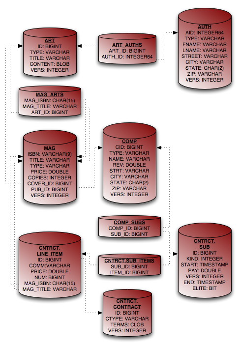

And finally, the complete entity mappings.
We have trimmed the mappings to take advantage of JPA defaults where possible.

[[jpa_overview_mapping_fullex]]
.Full Entity Mappings
====
[source]
----

package org.mag;

@Entity
@IdClass(Magazine.MagazineId.class)
@Table(name="MAG")
@DiscriminatorValue("Mag")
public class Magazine {

    @Column(length=9)
    @Id private String isbn;
    @Id private String title;

    @Column(name="VERS")
    @Version private int version;

    private String name;
    private double price;

    @Column(name="COPIES")
    private int copiesSold;

    @OneToOne(fetch=FetchType.LAZY,
        cascade={CascadeType.PERSIST,CascadeType.REMOVE})
    @JoinColumn(name="COVER_ID")
    private Article coverArticle;

    @OneToMany(cascade={CascadeType.PERSIST,CascadeType.REMOVE})
    @OrderBy
    @JoinTable(name="MAG_ARTS",
        joinColumns={
            @JoinColumn(name="MAG_ISBN", referencedColumnName="ISBN"),
            @JoinColumn(name="MAG_TITLE", referencedColumnName="TITLE")
        },
        inverseJoinColumns=@JoinColumn(name="ART_ID"))
    private Collection<Article> articles;

    @ManyToOne(fetch=FetchType.LAZY, cascade=CascadeType.PERSIST)
    @JoinColumn(name="PUB_ID")
    private Company publisher;

    @Transient private byte[] data;

    ...

    public static class MagazineId {
        ...
    }
}

@Entity
@Table(name="ART", uniqueConstraints=@Unique(columnNames="TITLE"))
@SequenceGenerator(name="ArticleSeq", sequenceName="ART_SEQ")
public class Article {

    @Id
    @GeneratedValue(strategy=GenerationType.SEQUENCE, generator="ArticleSeq")
    private long id;

    @Column(name="VERS")
    @Version private int version;

    private String title;
    private byte[] content;

    @ManyToMany(cascade=CascadeType.PERSIST)
    @OrderBy("lastName, firstName")
    @JoinTable(name="ART_AUTHS",
        joinColumns=@JoinColumn(name="ART_ID"),
        inverseJoinColumns=@JoinColumn(name="AUTH_ID"))
    private Collection<Author> authors;

    ...
}

package org.mag.pub;

@Entity
@Table(name="COMP")
public class Company {

    @Column(name="CID")
    @Id private long id;

    @Column(name="VERS")
    @Version private int version;

    private String name;

    @Column(name="REV")
    private double revenue;

    @Embedded
    @AttributeOverrides({
        @AttributeOverride(name="street", column=@Column(name="STRT")),
        @AttributeOverride(name="city", column=@Column(name="ACITY"))
    })
    private Address address;

    @OneToMany(mappedBy="publisher", cascade=CascadeType.PERSIST)
    private Collection<Magazine> mags;

    @OneToMany(cascade=CascadeType.PERSIST,CascadeType.REMOVE)
    @JoinTable(name="COMP_SUBS",
        joinColumns=@JoinColumn(name="COMP_ID"),
        inverseJoinColumns=@JoinColumn(name="SUB_ID"))
    private Collection<Subscription> subscriptions;

    ...
}

@Entity
@Table(name="AUTH")
public class Author {

    @Id
    @GeneratedValue(strategy=GenerationType.TABLE, generator="AuthorGen")
    @TableGenerator(name="AuthorGen", tableName="AUTH_GEN", pkColumnName="PK",
        valueColumnName="AID")
    @Column(name="AID", columnDefinition="INTEGER64")
    private long id;

    @Column(name="VERS")
    @Version private int version;

    @Column(name="FNAME")
    private String firstName;

    @Column(name="LNAME")
    private String lastName;

    private Address address;

    @ManyToMany(mappedBy="authors", cascade=CascadeType.PERSIST)
    private Collection<Article> arts;

    ...
}

@Embeddable
public class Address {

    private String street;
    private String city;
    @Column(columnDefinition="CHAR(2)")
    private String state;
    private String zip;
}

package org.mag.subscribe;

@MappedSuperclass
public abstract class Document {

    @Id
    @GeneratedValue(strategy=GenerationType.IDENTITY)
    private long id;

    @Column(name="VERS")
    @Version private int version;

    ...
}

@Entity
@Table(schema="CNTRCT")
@Inheritance(strategy=InheritanceType.JOINED)
@DiscriminatorColumn(name="CTYPE")
public class Contract
    extends Document {

    @Lob
    private String terms;

    ...
}

@Entity
@Table(name="SUB", schema="CNTRCT")
@DiscriminatorColumn(name="KIND", discriminatorType=DiscriminatorType.INTEGER)
@DiscriminatorValue("1")
public class Subscription {

    @Id
    @GeneratedValue(strategy=GenerationType.IDENTITY)
    private long id;

    @Column(name="VERS")
    @Version private int version;

    @Column(name="START")
    private Date startDate;

    @Column(name="PAY")
    private double payment;

    @OneToMany(cascade={CascadeType.PERSIST,CascadeType.REMOVE})
    @MapKey(name="num")
    @JoinTable(name="SUB_ITEMS", schema="CNTRCT",
        joinColumns=@JoinColumn(name="SUB_ID"),
        inverseJoinColumns=@JoinColumn(name="ITEM_ID"))
    private Map<Long,LineItem> items;

    ...

    @Entity
    @Table(name="LINE_ITEM", schema="CNTRCT")
    public static class LineItem
        extends Contract {

        @Column(name="COMM")
        private String comments;

        private double price;
        private long num;

        @ManyToOne
        @JoinColumns({
             @JoinColumn(name="MAG_ISBN", referencedColumnName="ISBN"),
             @JoinColumn(name="MAG_TITLE", referencedColumnName="TITLE")
        })
        private Magazine magazine;
        ...
    }
}

@Entity(name="Lifetime")
@DiscriminatorValue("2")
public class LifetimeSubscription
    extends Subscription {

    @Basic(fetch=FetchType.LAZY)
    @Column(name="ELITE")
    private boolean getEliteClub() { ... }
    public void setEliteClub(boolean elite) { ... }

    ...
}

@Entity(name="Trial")
@DiscriminatorValue("3")
public class TrialSubscription
    extends Subscription {

    @Column(name="END")
    public Date getEndDate() { ... }
    public void setEndDate(Date end) { ... }

    ...
}
----

The same metadata expressed in XML form:

[source]
----

<entity-mappings xmlns="http://java.sun.com/xml/ns/persistence/orm"
    xmlns:xsi="http://www.w3.org/2001/XMLSchema-instance"
    xsi:schemaLocation="http://java.sun.com/xml/ns/persistence/orm orm_1_0.xsd"
    version="1.0">
    <mapped-superclass class="org.mag.subscribe.Document">
        <attributes>
            <id name="id">
                <generated-value strategy="IDENTITY"/>
            </id>
            <version name="version">
                <column name="VERS"/>
            </version>
        </attributes>
    </mapped-superclass>
    <entity class="org.mag.Magazine">
        <table name="MAG"/>
        <id-class="org.mag.Magazine.MagazineId"/>
        <discriminator-value>Mag</discriminator-value>
        <attributes>
            <id name="isbn">
                <column length="9"/>
            </id>
            <id name="title"/>
            <basic name="name"/>
            <basic name="price"/>
            <basic name="copiesSold">
                <column name="COPIES"/>
            </basic>
            <version name="version">
                <column name="VERS"/>
            </version>
            <many-to-one name="publisher" fetch="LAZY">
                <join-column name="PUB_ID"/>
                <cascade>
                    <cascade-persist/>
                </cascade>
            </many-to-one>
            <one-to-many name="articles">
                <order-by/>
                <join-table name="MAG_ARTS">
                    <join-column name="MAG_ISBN" referenced-column-name="ISBN"/>
                    <join-column name="MAG_TITLE" referenced-column-name="TITLE"/>
                    <inverse-join-column name="ART_ID"/>
                </join-table>
                <cascade>
                    <cascade-persist/>
                    <cascade-remove/>
                </cascade>
            </one-to-many>
            <one-to-one name="coverArticle" fetch="LAZY">
                <join-column name="COVER_ID"/>
                <cascade>
                    <cascade-persist/>
                    <cascade-remove/>
                </cascade>
            </one-to-one>
            <transient name="data"/>
        </attributes>
    </entity>
    <entity class="org.mag.Article">
        <table name="ART">
            <unique-constraint>
               <column-name>TITLE</column-name>
            </unique-constraint>
        </table>
        <sequence-generator name="ArticleSeq", sequenceName="ART_SEQ"/>
        <attributes>
            <id name="id">
                <generated-value strategy="SEQUENCE" generator="ArticleSeq"/>
            </id>
            <basic name="title"/>
            <basic name="content"/>
            <version name="version">
                <column name="VERS"/>
            </version>
            <many-to-many name="articles">
                <order-by>lastName, firstName</order-by>
                <join-table name="ART_AUTHS">
                    <join-column name="ART_ID" referenced-column-name="ID"/>
                    <inverse-join-column name="AUTH_ID" referenced-column-name="AID"/>
                </join-table>
            </many-to-many>
        </attributes>
    </entity>
    <entity class="org.mag.pub.Company">
        <table name="COMP"/>
        <attributes>
            <id name="id">
                <column name="CID"/>
            </id>
            <basic name="name"/>
            <basic name="revenue">
                <column name="REV"/>
            </basic>
            <version name="version">
                <column name="VERS"/>
            </version>
            <one-to-many name="mags" mapped-by="publisher">
                <cascade>
                    <cascade-persist/>
                </cascade>
            </one-to-many>
            <one-to-many name="subscriptions">
                <join-table name="COMP_SUBS">
                    <join-column name="COMP_ID"/>
                    <inverse-join-column name="SUB_ID"/>
                </join-table>
                <cascade>
                    <cascade-persist/>
                    <cascade-remove/>
                </cascade>
            </one-to-many>
            <embedded name="address">
                <attribute-override name="street">
                   <column name="STRT"/>
                </attribute-override>
                <attribute-override name="city">
                   <column name="ACITY"/>
                </attribute-override>
            </embedded>
        </attributes>
    </entity>
    <entity class="org.mag.pub.Author">
        <table name="AUTH"/>
        <attributes>
            <id name="id">
                <column name="AID" column-definition="INTEGER64"/>
                <generated-value strategy="TABLE" generator="AuthorGen"/>
                <table-generator name="AuthorGen" table="AUTH_GEN"
                    pk-column-name="PK" value-column-name="AID"/>
            </id>
            <basic name="firstName">
                <column name="FNAME"/>
            </basic>
            <basic name="lastName">
                <column name="LNAME"/>
            </basic>
            <version name="version">
                <column name="VERS"/>
            </version>
            <many-to-many name="arts" mapped-by="authors">
                <cascade>
                    <cascade-persist/>
                </cascade>
            </many-to-many>
            <embedded name="address"/>
        </attributes>
    </entity>
    <entity class="org.mag.subcribe.Contract">
        <table schema="CNTRCT"/>
        <inheritance strategy="JOINED"/>
        <discriminator-column name="CTYPE"/>
        <attributes>
            <basic name="terms">
                <lob/>
            </basic>
        </attributes>
    </entity>
    <entity class="org.mag.subcribe.Subscription">
        <table name="SUB" schema="CNTRCT"/>
        <inheritance strategy="SINGLE_TABLE"/>
        <discriminator-value>1</discriminator-value>
        <discriminator-column name="KIND" discriminator-type="INTEGER"/>
        <attributes>
            <id name="id">
                <generated-value strategy="IDENTITY"/>
            </id>
            <basic name="payment">
                <column name="PAY"/>
            </basic>
            <basic name="startDate">
                <column name="START"/>
            </basic>
            <version name="version">
                <column name="VERS"/>
            </version>
            <one-to-many name="items">
                <map-key name="num">
                <join-table name="SUB_ITEMS" schema="CNTRCT">
                    <join-column name="SUB_ID"/>
                    <inverse-join-column name="ITEM_ID"/>
                </join-table>
                <cascade>
                    <cascade-persist/>
                    <cascade-remove/>
                </cascade>
            </one-to-many>
        </attributes>
    </entity>
    <entity class="org.mag.subscribe.Subscription.LineItem">
        <table name="LINE_ITEM" schema="CNTRCT"/>
        <attributes>
            <basic name="comments">
                <column name="COMM"/>
            </basic>
            <basic name="price"/>
            <basic name="num"/>
            <many-to-one name="magazine">
                <join-column name="MAG_ISBN" referenced-column-name="ISBN"/>
                <join-column name="MAG_TITLE" referenced-column-name="TITLE"/>
            </many-to-one>
        </attributes>
    </entity>
    <entity class="org.mag.subscribe.LifetimeSubscription" name="Lifetime">
        <discriminator-value>2</discriminator-value>
        <attributes>
            <basic name="eliteClub" fetch="LAZY">
                <column name="ELITE"/>
            </basic>
        </attributes>
    </entity>
    <entity class="org.mag.subscribe.TrialSubscription" name="Trial">
        <discriminator-value>3</discriminator-value>
        <attributes>
            <basic name="endDate">
                <column name="END"/>
            </basic>
        </attributes>
    </entity>
    <embeddable class="org.mag.pub.Address">
        <attributes>
            <basic name="street"/>
            <basic name="city"/>
            <basic name="state">
                <column column-definition="CHAR(2)"/>
            </basic>
            <basic name="zip"/>
        </attributes>
    </embeddable>
</entity-mappings>
----
====

ifdef::backend-docbook[]
[index]
== Index
endif::backend-docbook[]
