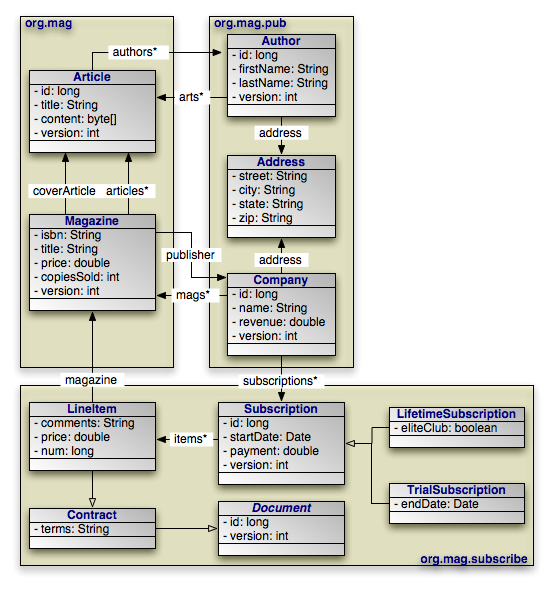

[[_jpa_overview_meta]]
=== Metadata
(((
            metadata
        )))
(((
            JPA
        ,
            metadata
        )))

JPA requires that you accompany each persistent class with persistence metadata.
This metadata serves three primary purposes:

. To identify persistent classes.
. To override default JPA behavior.
. To provide the JPA implementation with information that it cannot glean from simply reflecting on the persistent class.

Persistence metadata is specified using either the Java annotations defined in the `jakarta.persistence` package, XML mapping files, or a mixture of both.
In the latter case, XML declarations override conflicting annotations.
If you choose to use XML metadata, the XML files must be available at development and runtime, and must be discoverable via either of two strategies:

. In a resource named [path]_orm.xml_ placed in a [path]_ META-INF_ directory within a directory in your classpath or within a jar archive containing your persistent classes.
. Declared in your <<_jpa_overview_persistence_xml,[path]_ persistence.xml_>> configuration file. In this case, each XML metadata file must be listed in a `mapping-file` element whose content is either a path to the given file or a resource location available to the class' class loader.

We describe the standard metadata annotations and XML equivalents throughout this chapter.
The full schema for XML mapping files is available in <<_jpa_overview_meta_xml>>.
JPA also standardizes relational mapping metadata and named query metadata, which we discuss in <<_jpa_overview_mapping>> and <<_jpa_overview_query_named>> respectively.

[NOTE]
====
OpenJPA defines many useful annotations beyond the standard set.
See <<_ref_guide_meta_jpa>> and <<_ref_guide_meta_ext>> in the Reference Guide for details.
There are currently no XML equivalents for these extension annotations.
====

[NOTE]
====
Persistence metadata may be used to validate the contents of your entities prior to communicating with the database.
This differs from mapping meta data which is primarily used for schema generation.
For example if you indicate that a relationship is not optional (e.g.
@Basic(optional=false)) OpenJPA will validate that the variable in your entity is not null _before_ inserting a row in the database.
====




Through the course of this chapter, we will create the persistent object model above.

[[_jpa_overview_meta_class]]
==== Class Metadata

The following metadata annotations and XML elements apply to persistent class declarations.

[[_jpa_overview_meta_entity]]
===== Entity
(((
                    Entity
                ,
                    annotation
                )))
(((
                    annotations
                ,
                    Entity
                )))

The [class]``Entity`` annotation denotes an entity class.
All entity classes must have this annotation.
The [class]``Entity`` annotation takes one optional property:

* ``String name``: Name used to refer to the entity in queries. Must not be a reserved literal in JPQL. Defaults to the unqualified name of the entity class.

The equivalent XML element is ``entity``.
It has the following attributes:

* ``class``: The entity class. This attribute is required.
* ``name``: Named used to refer to the class in queries. See the name property above.
* ``access``: The access type to use for the class. Must either be ``FIELD`` or ``PROPERTY``. For details on access types, see <<_jpa_overview_meta_field>>.


[NOTE]
====
OpenJPA uses a process called _enhancement_ to modify the bytecode of entities for transparent lazy loading and immediate dirty tracking.
See <<_ref_guide_pc_enhance>> in the Reference Guide for details on enhancement.
====

[[_jpa_overview_meta_idclass]]
===== Id Class
(((
                    metadata
                ,
                    IdClass
                )))

As we discussed in <<_jpa_overview_pc_identitycls>>, entities with multiple identity fields must use an _ identity class _ to encapsulate their persistent identity.
The [class]``IdClass `` annotation specifies this class.
It accepts a single [class]``
java.lang.Class`` value.

The equivalent XML element is ``id-class``, which has a single attribute:

* ``class``: Set this required attribute to the name of the identity class.


[[_jpa_overview_meta_embeddablesuper]]
===== Mapped Superclass
(((
                    MappedSuperclass
                )))
(((
                    metadata
                ,
                    MappedSuperclass
                )))

A _mapped superclass_ is a non-entity class that can define persistent state and mapping information for entity subclasses.
Mapped superclasses are usually abstract.
Unlike true entities, you cannot query a mapped superclass, pass a mapped superclass instance to any [class]``
EntityManager`` or [class]``Query`` methods, or declare a persistent relation with a mapped superclass target.
You denote a mapped superclass with the [class]``MappedSuperclass`` marker annotation.

The equivalent XML element is ``mapped-superclass``.
It expects the following attributes:

* ``class``: The entity class. This attribute is required.
* ``access``: The access type to use for the class. Must either be ``FIELD`` or ``PROPERTY``. For details on access types, see <<_jpa_overview_meta_field>>.


[NOTE]
====
OpenJPA allows you to query on mapped superclasses.
A query on a mapped superclass will return all matching subclass instances.
OpenJPA also allows you to declare relations to mapped superclass types; however, you cannot query across these relations.
====

[[_jpa_overview_meta_embeddable]]
===== Embeddable
(((
                    Embeddable
                )))
(((
                    metadata
                ,
                    Embeddable
                )))

The [class]``Embeddable`` annotation designates an embeddable persistent class.
Embeddable instances are stored as part of the record of their owning instance.
All embeddable classes must have this annotation.

A persistent class can either be an entity or an embeddable class, but not both.

The equivalent XML element is ``embeddable``.
It understands the following attributes:

* ``class``: The entity class. This attribute is required.
* ``access``: The access type to use for the class. Must either be ``FIELD`` or ``PROPERTY``. For details on access types, see <<_jpa_overview_meta_field>>.


[NOTE]
====
OpenJPA allows a persistent class to be both an entity and an embeddable class.
Instances of the class will act as entities when persisted explicitly or assigned to non-embedded fields of entities.
Instances will act as embedded values when assigned to embedded fields of entities.

To signal that a class is both an entity and an embeddable class in OpenJPA, simply add both the `@Entity` and the `@Embeddable ` annotations to the class.
====

[[_jpa_overview_meta_entity_listeners]]
===== EntityListeners
(((
                    EntityListeners
                )))
(((
                    entity-listeners
                )))
(((
                    metadata
                ,
                    EntityListeners
                )))

An entity may list its lifecycle event listeners in the [class]``
EntityListeners`` annotation.
This value of this annotation is an array of the listener [class]``Class`` es for the entity.
The equivalent XML element is ``entity-listeners``.
For more details on entity listeners, see <<_jpa_overview_pc_callbacks>>.

[[_jpa_overview_meta_classex]]
===== Example

Here are the class declarations for our persistent object model, annotated with the appropriate persistence metadata.
Note that [class]``Magazine`` declares an identity class, and that [class]``Document`` and [class]``Address`` are a mapped superclass and an embeddable class, respectively. [class]``LifetimeSubscription`` and [class]``
TrialSubscription`` override the default entity name to supply a shorter alias for use in queries.

.Class Metadata
====
[source]
----

package org.mag;

@Entity
@IdClass(Magazine.MagazineId.class)
public class Magazine {
    ...

    public static class MagazineId {
        ...
    }
}

@Entity
public class Article {
    ...
}


package org.mag.pub;

@Entity
public class Company {
    ...
}

@Entity
public class Author {
    ...
}

@Embeddable
public class Address {
    ...
}


package org.mag.subscribe;

@MappedSuperclass
public abstract class Document {
    ...
}

@Entity
public class Contract
    extends Document {
    ...
}

@Entity
public class Subscription {
    ...

    @Entity
    public static class LineItem
        extends Contract {
        ...
    }
}

@Entity(name="Lifetime")
public class LifetimeSubscription
    extends Subscription {
    ...
}

@Entity(name="Trial")
public class TrialSubscription
    extends Subscription {
    ...
}
----

The equivalent declarations in XML:

[source]
----

<entity-mappings xmlns="http://java.sun.com/xml/ns/persistence/orm"
    xmlns:xsi="http://www.w3.org/2001/XMLSchema-instance"
    xsi:schemaLocation="http://java.sun.com/xml/ns/persistence/orm orm_1_0.xsd"
    version="1.0">
    <mapped-superclass class="org.mag.subscribe.Document">
        ...
    </mapped-superclass>
    <entity class="org.mag.Magazine">
        <id-class class="org.mag.Magazine$MagazineId"/>
        ...
    </entity>
    <entity class="org.mag.Article">
        ...
    </entity>
    <entity class="org.mag.pub.Company">
        ...
    </entity>
    <entity class="org.mag.pub.Author">
        ...
    </entity>
    <entity class="org.mag.subscribe.Contract">
        ...
    </entity>
    <entity class="org.mag.subscribe.LineItem">
        ...
    </entity>
    <entity class="org.mag.subscribe.LifetimeSubscription" name="Lifetime">
        ...
    </entity>
    <entity class="org.mag.subscribe.TrialSubscription" name="Trial">
        ...
    </entity>
    <embeddable class="org.mag.pub.Address">
        ...
    </embeddable>
</entity-mappings>
----
====

[[_jpa_overview_meta_field]]
==== Field and Property Metadata

The persistence implementation must be able to retrieve and set the persistent state of your entities, mapped superclasses, and embeddable types.
JPA offers two modes of persistent state access: __field access__, and __property access__.
The access type of a persistent attribute can be either set explicitly on a class or attribute level, inherited, or determined by the provider.

Under field access, the implementation injects state directly into your persistent fields, and retrieves changed state from your fields as well.
To declare field access on an entire entity with XML metadata, set the ``access`` attribute of your `entity` XML element to ``FIELD``.
To use field access for an entire entity using annotation metadata, simply place your metadata and mapping annotations on your field declarations:

[source]
----

@ManyToOne
private Company publisher;
----


(((
                metadata
            ,
                property access
            )))
(((
                persistent properties
            ))) Property access, on the other hand, retrieves and loads state through JavaBean "getter" and "setter" methods.
For a property `p` of type ``T``, you must define the following getter method:

[source]
----

T getP();
----

For boolean properties, this is also acceptable:

[source]
----

boolean isP();
----

You must also define the following setter method:

[source]
----

void setP(T value);
----

To implicitly use property access for an entire class by default, set your ``entity`` element's ` access` attribute to ``PROPERTY``, or place your metadata and mapping annotations on the getter method:

[source]
----

@ManyToOne
private Company getPublisher() { ... }

private void setPublisher(Company publisher) { ... }
----

[[_jpa_overview_explicit_access]]
===== Explicit Access


(((
                    metadata
                ,
                    explicit access
                )))
(((
                    persistent attributes
                ))) The access type of a class or individual persistent attributes can be specified explicitly using the `@Access` annotation or `access ` attribute on the XML elements used to define persistent attributes.
When explicitly defining access, specify the explicit access type for the class and then apply the `@Access` annotation or ``access ``XML attribute to individual fields or properties.
If explicit ``FIELD`` or `PROPERTY` is specified at the class level, all eligible non-transient fields or properties will be persistent.
If using class level `FIELD` access, non-persistent fields must be `transient` or annotated with ``@Transient``.
If using class level `PROPERTY` access, non-persistent properties must be annotated `@Transient` or excluded using the `transient` XML attribute.
Refer to the JPA specification for specific rules regarding the use of explicit access with embeddables and within an inheritance hierarchy.

This entity definitions shows how multiple access types may be specified on an entity:

[source]
----

@Entity
@Access(AccessType.FIELD)
public class PaymentContract {

    @Id
    private String id;

    @Temporal(TemporalType.DATE)
    private String contractDate;

    @Transient
    private String terms;

    @Version
    private int version;

    @Lob
    @Access(AccessType.PROPERTY)
    public String getContractTerms() {
        return terms;
    }

    public void setContractTerms(String terms) {
        // Format string before persisting
        this.terms = formatTerms(terms);
    }
    ...
}
----

The equivalent declarations in XML:

[source]
----

<entity-mappings xmlns="https://jakarta.ee/xml/ns/persistence/orm"
    xmlns:xsi="http://www.w3.org/2001/XMLSchema-instance"
    xsi:schemaLocation="https://jakarta.ee/xml/ns/persistence/orm https://jakarta.ee/xml/ns/persistence/orm/orm_3_0.xsd"
    version="3.0">
    <entity class="org.xyz.PaymentContract" access="FIELD">
        <attributes>
            <id name="id"/>
             <basic name="contractTerms" access="PROPERTY">
                <lob/>
            </basic>
            <basic name="contractDate">
                <temporal>DATE</temporal>
            </basic>
            <version name="version"/>
            <transient name="terms"/>
       </attributes>
    </entity>
</entity-mappings>
----

[WARNING]
====
When using property access, only the getter and setter method for a property should ever access the underlying persistent field directly.
Other methods, including internal business methods in the persistent class, should go through the getter and setter methods when manipulating persistent state.

Also, take care when adding business logic to your getter and setter methods.
Consider that they are invoked by the persistence implementation to load and retrieve all persistent state; other side effects might not be desirable.
====

The remainder of this document uses the term "persistent field" to refer to either a persistent field or a persistent property.

[[_jpa_overview_meta_transient]]
===== Transient
(((
                    Transient
                )))
(((
                    metadata
                ,
                    Transient
                )))

The [class]``Transient`` annotation specifies that a field is non-persistent.
Use it to exclude fields from management that would otherwise be persistent. [class]``Transient`` is a marker annotation only; it has no properties.

The equivalent XML element is ``transient``.
It has a single attribute:

* ``name``: The transient field or property name. This attribute is required.


[[_jpa_overview_meta_id]]
===== Id
(((
                    Id
                )))
(((
                    metadata
                ,
                    Id
                )))

Annotate your simple identity fields with [class]``Id``.
This annotation has no properties.
We explore entity identity and identity fields in <<_jpa_overview_pc_id>>.

The equivalent XML element is ``id``.
It has one required attribute:

* ``name``: The name of the identity field or property.


[[_jpa_overview_meta_gen]]
===== Generated Value
(((
                    GeneratedValue
                )))
(((
                    metadata
                ,
                    GeneratedValue
                )))

The previous section showed you how to declare your identity fields with the [class]``Id`` annotation.
It is often convenient to allow the persistence implementation to assign a unique value to your identity fields automatically.
JPA includes the [class]``GeneratedValue`` annotation for this purpose.
It has the following properties:

* ``GenerationType strategy``: Enum value specifying how to auto-generate the field value. The [class]``GenerationType`` enum has the following values:
** ``GeneratorType.AUTO``: The default. Assign the field a generated value, leaving the details to the JPA vendor. If the field type is UUID, it will be given an generated UUID.
** ``GenerationType.IDENTITY``: The database will assign an identity value on insert.
** ``GenerationType.SEQUENCE``: Use a datastore sequence to generate a field value.
** ``GenerationType.TABLE``: Use a sequence table to generate a field value.
** ``GenerationType.UUID``: Assign the field a type 4 UUID generated value. In this case, the field must be either [class]``String`` or [class]``UUID``.
* ``String generator``: The name of a generator defined in mapping metadata. We show you how to define named generators in <<_jpa_overview_mapping_sequence>>. If the [class]`` GenerationType`` is set but this property is unset, the JPA implementation uses appropriate defaults for the selected generation type.

The equivalent XML element is ``generated-value``, which includes the following attributes:

* ``strategy``: One of `` TABLE``, `` SEQUENCE``, `` IDENTITY``, or ``AUTO``, defaulting to ``AUTO``.
* ``generator``: Equivalent to the generator property listed above.


[NOTE]
====
OpenJPA allows you to use the [class]``GeneratedValue`` annotation on any field, not just identity fields.
Before using the `IDENTITY ` generation strategy, however, read <<_ref_guide_pc_oid_pkgen_autoinc>> in the Reference Guide.

OpenJPA also offers additional generator strategies for non-numeric fields, which you can access by setting `strategy` to `AUTO ` (the default), and setting the `generator` string to:

* (((
                                mapping metadata
                            ,
                                uuid-string
                            )))``uuid-string``: OpenJPA will generate a 128-bit type 1 UUID unique within the network, represented as a 16-character string.
For more information on UUIDs, see the IETF UUID draft specification at: http://www.ics.uci.edu/~ejw/authoring/uuid-guid/[
http://www.ics.uci.edu/~ejw/authoring/uuid-guid/]
* (((
                                mapping metadata
                            ,
                                uuid-hex
                            )))``uuid-hex``: Same as `` uuid-string``, but represents the type 1 UUID as a 32-character hexadecimal string.
* (((
                                mapping metadata
                            ,
                                uuid-type4-string
                            )))``uuid-type4-string``: OpenJPA will generate a 128-bit type 4 pseudo-random UUID, represented as a 16-character string.
For more information on UUIDs, see the IETF UUID draft specification at: http://www.ics.uci.edu/~ejw/authoring/uuid-guid/[
http://www.ics.uci.edu/~ejw/authoring/uuid-guid/]
* (((
                                mapping metadata
                            ,
                                uuid-type4-hex
                            )))``uuid-type4-hex``: Same as ` uuid-type4-string` , but represents the type 4 UUID as a 32-character hexadecimal string.

These string constants are defined in link:../../apidocs/org/apache/openjpa/persistence/Generator.html[
org.apache.openjpa.persistence.Generator].

If the entities are mapped to the same table name but with different schema name within one `PersistenceUnit` intentionally, and the strategy of `GeneratedType.AUTO` is used to generate the ID for each entity, a schema name for each entity must be explicitly declared either through the annotation or the mapping.xml file.
Otherwise, the mapping tool only creates the tables for those entities with the schema names under each schema.
In addition, there will be only one ``OPENJPA_SEQUENCE_TABLE`` created for all the entities within the `PersistenceUnit` if the entities are not identified with the schema name.
Read <<_ref_guide_sequence>> and <<_ref_guide_schema_def>> in the Reference Guide.
====

[[_jpa_overview_meta_embedid]]
===== Embedded Id
(((
                    EmbeddedId
                )))
(((
                    metadata
                ,
                    EmbeddedId
                )))

If your entity has multiple identity values, you may declare multiple `
@Id` fields, or you may declare a single `@EmbeddedId` field.
The type of a field annotated with [class]``EmbeddedId`` must be an embeddable entity class.
The fields of this embeddable class are considered the identity values of the owning entity.
We explore entity identity and identity fields in <<_jpa_overview_pc_id>>.

The [class]``EmbeddedId`` annotation has no properties.

The equivalent XML element is ``embedded-id``.
It has one required attribute:

* ``name``: The name of the identity field or property.


[[_jpa_overview_meta_version]]
===== Version
(((
                    Version
                )))
(((
                    metadata
                ,
                    Version
                )))

Use the [class]``Version`` annotation to designate a version field. <<_jpa_overview_pc_version>> explained the importance of version fields to JPA.
This is a marker annotation; it has no properties.

The equivalent XML element is ``version``, which has a single attribute:

* ``name``: The name of the version field or property. This attribute is required.


[[_jpa_overview_meta_basic]]
===== Basic
(((
                    Basic
                )))
(((
                    metadata
                ,
                    Basic
                )))

[class]``Basic`` signifies a standard value persisted as-is to the datastore.
You can use the [class]``Basic`` annotation on persistent fields of the following types: primitives, primitive wrappers, [class]``
java.lang.String``, [class]``byte[]``, [class]``
Byte[]``, [class]``char[]``, [class]``
Character[]``, [class]``java.math.BigDecimal``, [class]``java.math.BigInteger``, [class]``
java.util.Date``, [class]``java.util.Calendar``, [class]``java.sql.Date``, [class]``java.sql.Timestamp``, [class]``java.sql.Time``, [class]``Enum``s, and [class]``Serializable`` types.

Since JPA 2.2 the following [class]``java.time`` Types are also supported: [class]``java.time.LocalDate``, [class]``java.time.LocalDateTime``, [class]``java.time.LocalTime``, [class]``java.time.LocalOffsetTime`` and [class]``java.time.OffsetDateTime``.

Since JPA 3.1, [class]``java.util.UUID`` is also supported.

[class]``Basic`` declares these properties:

* ``FetchType fetch``: Whether to load the field eagerly (``FetchType.EAGER``) or lazily (`` FetchType.LAZY``). Defaults to ``FetchType.EAGER``.
* ``boolean optional``: Whether the datastore allows null values. Defaults to true.

The equivalent XML element is ``basic``.
It has the following attributes:

* ``name``: The name of the field or property. This attribute is required.
* ``fetch``: One of `EAGER` or ``LAZY ``.
* ``optional``: Boolean indicating whether the field value may be null.


[[_jpa_overview_meta_fetch]]
====== Fetch Type
(((
                        eager fetching
                    ,
                        FetchType
                    )))
(((
                        metadata
                    ,
                        FetchType
                    )))

Many metadata annotations in JPA have a `fetch` property.
This property can take on one of two values: `FetchType.EAGER` or ``FetchType.LAZY``. `FetchType.EAGER` means that the field is loaded by the JPA implementation before it returns the persistent object to you.
Whenever you retrieve an entity from a query or from the [class]``EntityManager``, you are guaranteed that all of its eager fields are populated with datastore data.

`FetchType.LAZY` is a hint to the JPA runtime that you want to defer loading of the field until you access it.
This is called __lazy
loading__.
Lazy loading is completely transparent; when you attempt to read the field for the first time, the JPA runtime will load the value from the datastore and populate the field automatically.
Lazy loading is only a hint and not a directive because some JPA implementations cannot lazy-load certain field types.

With a mix of eager and lazily-loaded fields, you can ensure that commonly-used fields load efficiently, and that other state loads transparently when accessed.
As you will see in <<_jpa_overview_emfactory_perscontext>>, you can also use eager fetching to ensure that entities have all needed data loaded before they become _detached_ at the end of a persistence context.

[NOTE]
====
OpenJPA can lazy-load any field type.
OpenJPA also allows you to dynamically change which fields are eagerly or lazily loaded at runtime.
See <<_ref_guide_fetch>> in the Reference Guide for details.

The Reference Guide details OpenJPA's eager fetching behavior in <<_ref_guide_perfpack_eager>>.
====

[[_jpa_overview_meta_embedded]]
===== Embedded
(((
                    metadata
                ,
                    Embedded
                )))

Use the [class]``Embedded`` marker annotation on embeddable field types.
Embedded fields are mapped as part of the datastore record of the declaring entity.
In our sample model, [class]``Author`` and [class]``Company`` each embed their [class]``Address``, rather than forming a relation to an [class]``Address`` as a separate entity.

The equivalent XML element is ``embedded``, which expects a single attribute:

* ``name``: The name of the field or property. This attribute is required.


[[_jpa_overview_meta_manytoone]]
===== Many To One
(((
                    ManyToOne
                )))
(((
                    metadata
                ,
                    ManyToOne
                )))

When an entity `A` references a single entity ``
B``, and other ``A``s might also reference the same ``B``, we say there is a _many to one_ relation from `A` to ``B``.
In our sample model, for example, each magazine has a reference to its publisher.
Multiple magazines might have the same publisher.
We say, then, that the `
Magazine.publisher` field is a many to one relation from magazines to publishers.

JPA indicates many to one relations between entities with the [class]``
ManyToOne`` annotation.
This annotation has the following properties:

* ``Class targetEntity``: The class of the related entity type.
* ``CascadeType[] cascade``: Array of enum values defining cascade behavior for this field. We explore cascades below. Defaults to an empty array.
* ``FetchType fetch``: Whether to load the field eagerly (``FetchType.EAGER``) or lazily (``FetchType.LAZY``). Defaults to `` FetchType.EAGER``. See <<_jpa_overview_meta_fetch>> above for details on fetch types.
* ``boolean optional``: Whether the related object must exist. If ``false``, this field cannot be null. Defaults to `` true``.

The equivalent XML element is ``many-to-one``.
It accepts the following attributes:

* ``name``: The name of the field or property. This attribute is required.
* ``target-entity``: The class of the related type.
* ``fetch``: One of `EAGER` or `` LAZY``.
* ``optional``: Boolean indicating whether the field value may be null.


[[_jpa_overview_meta_cascade]]
====== Cascade Type
(((
                        CascadeType
                    )))
(((
                        metadata
                    ,
                        CascadeType
                    )))

We introduce the JPA [class]``EntityManager`` in <<_jpa_overview_em>>.
The [class]``EntityManager `` has APIs to persist new entities, remove (delete) existing entities, refresh entity state from the datastore, and merge _detached _ entity state back into the persistence context.
We explore all of these APIs in detail later in the overview.

When the [class]``EntityManager`` is performing the above operations, you can instruct it to automatically cascade the operation to the entities held in a persistent field with the `cascade` property of your metadata annotation.
This process is recursive.
The `cascade ` property accepts an array of [class]``CascadeType`` enum values.

* ``CascadeType.PERSIST``: When persisting an entity, also persist the entities held in this field. We suggest liberal application of this cascade rule, because if the [class]``EntityManager`` finds a field that references a new entity during flush, and the field does not use `` CascadeType.PERSIST``, it is an error.
* ``CascadeType.REMOVE``: When deleting an entity, also delete the entities held in this field.
* ``CascadeType.REFRESH``: When refreshing an entity, also refresh the entities held in this field.
* ``CascadeType.MERGE``: When merging entity state, also merge the entities held in this field.


[NOTE]
====
OpenJPA offers enhancements to JPA's CascadeType.REMOVE functionality, including additional annotations to control how and when dependent fields will be removed.
See <<_dependent>> for more details.
====

[class]``CascadeType`` defines one additional value, ``
CascadeType.ALL``, that acts as a shortcut for all of the values above.
The following annotations are equivalent:

[source]
----

@ManyToOne(cascade={CascadeType.PERSIST,CascadeType.REMOVE,
    CascadeType.REFRESH,CascadeType.MERGE})
private Company publisher;
----

[source]
----

@ManyToOne(cascade=CascadeType.ALL)
private Company publisher;
----

In XML, these enumeration constants are available as child elements of the ``cascade`` element.
The `cascade` element is itself a child of ``many-to-one``.
The following examples are equivalent:

[source]
----

<many-to-one name="publisher">
    <cascade>
        <cascade-persist/>
        <cascade-merge/>
        <cascade-remove/>
        <cascade-refresh/>
    </cascade>
</many-to-one>
----

[source]
----

<many-to-one name="publisher">
    <cascade>
        <cascade-all/>
    </cascade>
</many-to-one>
----

[[_jpa_overview_meta_onetomany]]
===== One To Many
(((
                    metadata
                ,
                    OneToMany
                )))

When an entity `A` references multiple `B` entities, and no two ``A``s reference the same ``
B``, we say there is a _one to many_ relation from ``A`` to ``B``.

One to many relations are the exact inverse of the many to one relations we detailed in the preceding section.
In that section, we said that the `
Magazine.publisher` field is a many to one relation from magazines to publishers.
Now, we see that the `Company.mags` field is the inverse - a one to many relation from publishers to magazines.
Each company may publish multiple magazines, but each magazine can have only one publisher.

JPA indicates one to many relations between entities with the [class]``
OneToMany`` annotation.
This annotation has the following properties:

* ``Class targetEntity``: The class of the related entity type. This information is usually taken from the parameterized collection or map element type. You must supply it explicitly, however, if your field isn't a parameterized type.
* ``String mappedBy``: Names the many to one field in the related entity that maps this bidirectional relation. We explain bidirectional relations below. Leaving this property unset signals that this is a standard unidirectional relation.
* ``CascadeType[] cascade``: Array of enum values defining cascade behavior for the collection elements. We explore cascades above in <<_jpa_overview_meta_cascade>>. Defaults to an empty array.
* ``FetchType fetch``: Whether to load the field eagerly (``FetchType.EAGER``) or lazily (``FetchType.LAZY``). Defaults to `` FetchType.LAZY``. See <<_jpa_overview_meta_fetch>> above for details on fetch types.

The equivalent XML element is ``one-to-many``, which includes the following attributes:

* ``name``: The name of the field or property. This attribute is required.
* ``target-entity``: The class of the related type.
* ``fetch``: One of `EAGER` or `` LAZY``.
* ``mapped-by``: The name of the field or property that owns the relation. See <<_jpa_overview_meta_field>>.

You may also nest the `cascade` element within a `
one-to-many` element.

[[_jpa_overview_meta_mappedby]]
====== Bidirectional Relations
(((
                        bidirectional relations
                    )))
(((
                        mappedBy
                    )))
(((
                        mapping metadata
                    )))

When two fields are logical inverses of each other, they form a __
bidirectional relation__.
Our model contains two bidirectional relations: `Magazine.publisher` and `Company.mags ` form one bidirectional relation, and `Article.authors ` and `Author.articles` form the other.
In both cases, there is a clear link between the two fields that form the relationship.
A magazine refers to its publisher while the publisher refers to all its published magazines.
An article refers to its authors while each author refers to her written articles.

When the two fields of a bidirectional relation share the same datastore mapping, JPA formalizes the connection with the `mappedBy` property.
Marking `Company.mags` as `mappedBy```Magazine.publisher`` means two things:

. `Company.mags` uses the datastore mapping for `` Magazine.publisher``, but inverses it. In fact, it is illegal to specify any additional mapping information when you use the `mappedBy ` property. All mapping information is read from the referenced field. We explore mapping in depth in <<_jpa_overview_mapping>>.
. `Magazine.publisher` is the "owner" of the relation. The field that specifies the mapping data is always the owner. This means that changes to the `Magazine.publisher` field are reflected in the datastore, while changes to the `Company.mags` field alone are not. Changes to `Company.mags` may still affect the JPA implementation's cache, however. Thus, it is very important that you keep your object model consistent by properly maintaining both sides of your bidirectional relations at all times.

You should always take advantage of the `mappedBy` property rather than mapping each field of a bidirectional relation independently.
Failing to do so may result in the JPA implementation trying to update the database with conflicting data.
Be careful to only mark one side of the relation as ``mappedBy``, however.
One side has to actually do the mapping!

[NOTE]
====
You can configure OpenJPA to automatically synchronize both sides of a bidirectional relation, or to perform various actions when it detects inconsistent relations.
See <<_ref_guide_inverses>> in the Reference Guide for details.
====

[[_jpa_overview_meta_onetoone]]
===== One To One
(((
                    OneToOne
                )))
(((
                    metadata
                ,
                    OneToOne
                )))

When an entity `A` references a single entity ``
B``, and no other ``A``s can reference the same ``
B``, we say there is a _one to one_ relation between ``A`` and ``B``.
In our sample model, [class]``
Magazine`` has a one to one relation to [class]``Article`` through the `Magazine.coverArticle` field.
No two magazines can have the same cover article.

JPA indicates one to one relations between entities with the [class]``
OneToOne`` annotation.
This annotation has the following properties:

* ``Class targetEntity``: The class of the related entity type. This information is usually taken from the field type.
* ``String mappedBy``: Names the field in the related entity that maps this bidirectional relation. We explain bidirectional relations in <<_jpa_overview_meta_mappedby>> above. Leaving this property unset signals that this is a standard unidirectional relation.
* ``CascadeType[] cascade``: Array of enum values defining cascade behavior for this field. We explore cascades in <<_jpa_overview_meta_cascade>> above. Defaults to an empty array.
* ``FetchType fetch``: Whether to load the field eagerly (``FetchType.EAGER``) or lazily (``FetchType.LAZY``). Defaults to `` FetchType.EAGER``. See <<_jpa_overview_meta_fetch>> above for details on fetch types.
* ``boolean optional``: Whether the related object must exist. If ``false``, this field cannot be null. Defaults to `` true``.

The equivalent XML element is `one-to-one` which understands the following attributes:

* ``name``: The name of the field or property. This attribute is required.
* ``target-entity``: The class of the related type.
* ``fetch``: One of `EAGER` or `` LAZY``.
* ``mapped-by``: The field that owns the relation. See <<_jpa_overview_meta_field>>.

You may also nest the `cascade` element within a `
one-to-one` element.

[[_jpa_overview_meta_manytomany]]
===== Many To Many
(((
                    ManyToMany
                )))
(((
                    metadata
                ,
                    ManyToMany
                )))

When an entity `A` references multiple `B` entities, and other ``A``s might reference some of the same ``B``s, we say there is a _many to many_ relation between `A` and ``B``.
In our sample model, for example, each article has a reference to all the authors that contributed to the article.
Other articles might have some of the same authors.
We say, then, that [class]``Article`` and [class]``Author `` have a many to many relation through the `Article.authors ` field.

JPA indicates many to many relations between entities with the [class]``
ManyToMany`` annotation.
This annotation has the following properties:

* ``Class targetEntity``: The class of the related entity type. This information is usually taken from the parameterized collection or map element type. You must supply it explicitly, however, if your field isn't a parameterized type.
* ``String mappedBy``: Names the many to many field in the related entity that maps this bidirectional relation. We explain bidirectional relations in <<_jpa_overview_meta_mappedby>> above. Leaving this property unset signals that this is a standard unidirectional relation.
* ``CascadeType[] cascade``: Array of enum values defining cascade behavior for the collection elements. We explore cascades above in <<_jpa_overview_meta_cascade>>. Defaults to an empty array.
* ``FetchType fetch``: Whether to load the field eagerly (``FetchType.EAGER``) or lazily (``FetchType.LAZY``). Defaults to `` FetchType.LAZY``. See <<_jpa_overview_meta_fetch>> above for details on fetch types.

The equivalent XML element is ``many-to-many``.
It accepts the following attributes:

* ``name``: The name of the field or property. This attribute is required.
* ``target-entity``: The class of the related type.
* ``fetch``: One of `EAGER` or `` LAZY``.
* ``mapped-by``: The field that owns the relation. See <<_jpa_overview_meta_field>>.

You may also nest the `cascade` element within a `
many-to-many` element.

[[_jpa_overview_meta_orderby]]
===== Order By
(((
                    OrderBy
                )))
(((
                    metadata
                ,
                    OrderBy
                )))

Datastores such as relational databases do not preserve the order of records.
Your persistent [class]``List`` fields might be ordered one way the first time you retrieve an object from the datastore, and a completely different way the next.
To ensure consistent ordering of collection fields, you must use the [class]``OrderBy`` annotation.
The [class]``OrderBy `` annotation's value is a string defining the order of the collection elements.
An empty value means to sort on the identity value(s) of the elements in ascending order.
Any other value must be of the form:

[source]
----

<field name>[ ASC|DESC][, ...]
----

Each `<field name>` is the name of a persistent field in the collection's element type.
You can optionally follow each field by the keyword `ASC` for ascending order, or `DESC` for descending order.
If the direction is omitted, it defaults to ascending.

The equivalent XML element is `order-by` which can be listed as a sub-element of the `one-to-many` or `many-to-many ` elements.
The text within this element is parsed as the order by string.

[[_jpa_overview_meta_mapkey]]
===== Map Key
(((
                    MapKey
                )))
(((
                    metadata
                ,
                    MapKey
                )))

JPA supports persistent [class]``Map`` fields through either a <<_jpa_overview_meta_onetomany,[class]`` OneToMany``>> or <<_jpa_overview_meta_manytomany,[class]``ManyToMany ``>> association.
The related entities form the map values.
JPA derives the map keys by extracting a field from each entity value.
The [class]``MapKey`` annotation designates the field that is used as the key.
It has the following properties:

* ``String name``: The name of a field in the related entity class to use as the map key. If no name is given, defaults to the identity field of the related entity class.

The equivalent XML element is `map-key` which can be listed as a sub-element of the `one-to-many` or `many-to-many ` elements.
The `map-key` element has the following attributes:

* ``name``: The name of the field in the related entity class to use as the map key.


[[_jpa_overview_meta_fielddefaults]]
===== Persistent Field Defaults

In the absence of any of the annotations above, JPA defines the following default behavior for declared fields:

. Fields declared ``static, transient``, or `final ` default to non-persistent.
. Fields of any primitive type, primitive wrapper type, [class]`` java.lang.String``, [class]``byte[]``, [class]`` Byte[]``, [class]``char[]``, [class]`` Character[]``, [class]``java.math.BigDecimal``, [class]``java.math.BigInteger``, [class]`` java.util.Date``, [class]`` java.util.Calendar``, [class]``java.sql.Date``, [class]``java.sql.Timestamp``, or any [class]``Serializable`` type default to persistent, as if annotated with <<_jpa_overview_meta_basic,` @Basic`>>.
. Fields of an embeddable type default to persistent, as if annotated with <<_jpa_overview_meta_embedded,`@Embedded`>>.
. All other fields default to non-persistent.

Note that according to these defaults, all relations between entities must be annotated explicitly.
Without an annotation, a relation field will default to serialized storage if the related entity type is serializable, or will default to being non-persistent if not.

[[_jpa_overview_meta_xml]]
==== XML Schema
(((
                metadata
            ,
                XSD
            )))

The latest revision of the version 2.0 orm schema is presented below.
Version 2.0 of the schema must be used if JPA 2.0 elements are specified as XML metadata.
Many of the elements in the schema relate to object/relational mapping rather than metadata; these elements are discussed in <<_jpa_overview_mapping>>.
Version 1.0 of the orm schema can be found at http://java.sun.com/xml/ns/persistence/orm_1_0.xsd.

[source]
----

<?xml version="1.0" encoding="UTF-8"?>
    <!-- Java Persistence API object/relational mapping file schema -->
<xsd:schema targetNamespace="http://java.sun.com/xml/ns/persistence/orm"
    xmlns:orm="http://java.sun.com/xml/ns/persistence/orm"
    xmlns:xsd="http://www.w3.org/2001/XMLSchema"
    elementFormDefault="qualified" attributeFormDefault="unqualified"
    version="2.0">

    <xsd:annotation>
        <xsd:documentation>
            @(#)orm_2_0.xsd 2.0 October 1 2009
        </xsd:documentation>
    </xsd:annotation>

  <xsd:annotation>
    <xsd:documentation>

          DO NOT ALTER OR REMOVE COPYRIGHT NOTICES OR THIS HEADER.

          Copyright 2005-2009 Sun Microsystems, Inc. All rights reserved.

          The contents of this file are subject to the terms of either the
          GNU General Public License Version 2 only ("GPL") or the Common
          Development and Distribution License("CDDL") (collectively, the
          "License").  You may not use this file except in compliance with
          the License. You can obtain a copy of the License at
          https://glassfish.dev.java.net/public/CDDL+GPL.html or
          glassfish/bootstrap/legal/LICENSE.txt.  See the License for the
          specific language governing permissions and limitations under the
          License.

          When distributing the software, include this License Header
          Notice in each file and include the License file at
          glassfish/bootstrap/legal/LICENSE.txt.  Sun designates this
          particular file as subject to the "Classpath" exception as
          provided by Sun in the GPL Version 2 section of the License file
          that accompanied this code.  If applicable, add the following
          below the License Header, with the fields enclosed by brackets []
          replaced by your own identifying information:
          "Portions Copyrighted [year] [name of copyright owner]"

          Contributor(s):

          If you wish your version of this file to be governed by only the
          CDDL or only the GPL Version 2, indicate your decision by adding
          "[Contributor] elects to include this software in this
          distribution under the [CDDL or GPL Version 2] license."  If you
          don't indicate a single choice of license, a recipient has the
          option to distribute your version of this file under either the
          CDDL, the GPL Version 2 or to extend the choice of license to its
          licensees as provided above.  However, if you add GPL Version 2
          code and therefore, elected the GPL Version 2 license, then the
          option applies only if the new code is made subject to such
          option by the copyright holder.

        </xsd:documentation>
    </xsd:annotation>

    <xsd:annotation>
        <xsd:documentation>
        <![CDATA[
            This is the XML Schema for the persistence object/relational
            mapping file.
            The file may be named "META-INF/orm.xml" in the persistence
            archive or it may be named some other name which would be
            used to locate the file as resource on the classpath.
            Object/relational mapping files must indicate the object/relational
            mapping file schema by using the persistence namespace:
            http://java.sun.com/xml/ns/persistence
            and indicate the version of the schema by
            using the version element as shown below:
            <entity-mappings xmlns="http://java.sun.com/xml/ns/persistence/orm"
            xmlns:xsi="http://www.w3.org/2001/XMLSchema-instance"
            xsi:schemaLocation="http://java.sun.com/xml/ns/persistence/orm
            http://java.sun.com/xml/ns/persistence/orm/orm_2_0.xsd"
            version="2.0">
            ...
            </entity-mappings>
        ]]>
        </xsd:documentation>
    </xsd:annotation>

    <xsd:complexType name="emptyType" />
    <xsd:simpleType name="versionType">
        <xsd:restriction base="xsd:token">
            <xsd:pattern value="[0-9]+(\.[0-9]+)*" />
        </xsd:restriction>
    </xsd:simpleType>
    <!-- **************************************************** -->
    <xsd:element name="entity-mappings">
        <xsd:complexType>
            <xsd:annotation>
                <xsd:documentation>
                    The entity-mappings element is the root element of a mapping
                    file. It contains the following four types of elements:
                    1. The persistence-unit-metadata element contains metadata
                    for the entire persistence unit. It is undefined if this element
                    occurs in multiple mapping files within the same
                    persistence unit.
                    2. The package, schema, catalog and access elements apply to all of
                    the entity, mapped-superclass and embeddable
                    elements defined in
                    the same file in which they occur.
                    3. The sequence-generator, table-generator, named-query,
                    named-native-query and sql-result-set-mapping
                    elements are global
                    to the persistence unit. It is undefined to have more than one
                    sequence-generator or table-generator of the same
                    name in the same
                    or different mapping files in a persistence unit. It is also
                    undefined to have more than one named-query,
                    named-native-query, or
                    result-set-mapping of the same name in the same or different mapping
                    files in a persistence unit.
                    4. The entity, mapped-superclass and embeddable elements each define
                    the mapping information for a managed persistent
                    class. The mapping
                    information contained in these elements may be complete or it may
                    be partial.
                </xsd:documentation>
            </xsd:annotation>
            <xsd:sequence>
                <xsd:element name="description" type="xsd:string"
                    minOccurs="0" />
                <xsd:element name="persistence-unit-metadata"
                    type="orm:persistence-unit-metadata" minOccurs="0" />
                <xsd:element name="package" type="xsd:string"
                    minOccurs="0" />
                <xsd:element name="schema" type="xsd:string"
                    minOccurs="0" />
                <xsd:element name="catalog" type="xsd:string"
                    minOccurs="0" />
                <xsd:element name="access" type="orm:access-type"
                    minOccurs="0" />
                <xsd:element name="sequence-generator" type="orm:sequence-generator"
                    minOccurs="0" maxOccurs="unbounded" />
                <xsd:element name="table-generator" type="orm:table-generator"
                    minOccurs="0" maxOccurs="unbounded" />
                <xsd:element name="named-query" type="orm:named-query"
                    minOccurs="0" maxOccurs="unbounded" />
                <xsd:element name="named-native-query" type="orm:named-native-query"
                    minOccurs="0" maxOccurs="unbounded" />
                <xsd:element name="sql-result-set-mapping"
                    type="orm:sql-result-set-mapping" minOccurs="0"
                    maxOccurs="unbounded" />
                <xsd:element name="mapped-superclass" type="orm:mapped-superclass"
                    minOccurs="0" maxOccurs="unbounded" />
                <xsd:element name="entity" type="orm:entity"
                    minOccurs="0" maxOccurs="unbounded" />
                <xsd:element name="embeddable" type="orm:embeddable"
                    minOccurs="0" maxOccurs="unbounded" />
            </xsd:sequence>
            <xsd:attribute name="version" type="orm:versionType"
                fixed="2.0" use="required" />
        </xsd:complexType>
    </xsd:element>
    <!-- **************************************************** -->
    <xsd:complexType name="persistence-unit-metadata">
        <xsd:annotation>
            <xsd:documentation>
                Metadata that applies to the persistence unit and not just to
                the mapping file in which it is contained.
                If the xml-mapping-metadata-complete element is specified,
                the complete set of mapping metadata for the persistence unit
                is contained in the XML mapping files for the persistence unit.
            </xsd:documentation>
        </xsd:annotation>
        <xsd:sequence>
            <xsd:element name="description" type="xsd:string"
                minOccurs="0" />
            <xsd:element name="xml-mapping-metadata-complete"
                type="orm:emptyType" minOccurs="0" />
            <xsd:element name="persistence-unit-defaults"
                type="orm:persistence-unit-defaults" minOccurs="0" />
        </xsd:sequence>
    </xsd:complexType>
    <!-- **************************************************** -->
    <xsd:complexType name="persistence-unit-defaults">
        <xsd:annotation>
            <xsd:documentation>
                These defaults are applied to the persistence unit as a whole
                unless they are overridden by local annotation or XML
                element settings.
                schema - Used as the schema for all tables, secondary tables, join
                tables, collection tables, sequence generators, and table
                generators that apply to the persistence unit
                catalog - Used as the catalog for all tables, secondary tables, join
                tables, collection tables, sequence generators, and
                table generators that apply to the persistence unit
                delimited-identifiers - Used to treat database identifiers as
                delimited identifiers.
                access - Used as the access type for all managed classes in
                the persistence unit
                cascade-persist - Adds cascade-persist to the set of cascade options
                in all entity relationships of the persistence unit
                entity-listeners - List of default entity listeners to be invoked
                on each entity in the persistence unit.
            </xsd:documentation>
        </xsd:annotation>
        <xsd:sequence>
            <xsd:element name="description" type="xsd:string"
                minOccurs="0" />
            <xsd:element name="schema" type="xsd:string"
                minOccurs="0" />
            <xsd:element name="catalog" type="xsd:string"
                minOccurs="0" />
            <xsd:element name="delimited-identifiers" type="orm:emptyType"
                minOccurs="0" />
            <xsd:element name="access" type="orm:access-type"
                minOccurs="0" />
            <xsd:element name="cascade-persist" type="orm:emptyType"
                minOccurs="0" />
            <xsd:element name="entity-listeners" type="orm:entity-listeners"
                minOccurs="0" />
        </xsd:sequence>
    </xsd:complexType>
    <!-- **************************************************** -->
    <xsd:complexType name="entity">
        <xsd:annotation>
            <xsd:documentation>
                Defines the settings and mappings for an entity. Is allowed to be
                sparsely populated and used in conjunction with the annotations.
                Alternatively, the metadata-complete attribute can be
                used to
                indicate that no annotations on the entity class (and its fields
                or properties) are to be processed. If this is the case then
                the defaulting rules for the entity and its subelements will
                be recursively applied.
                @Target(TYPE) @Retention(RUNTIME)
                public @interface Entity {
                String name() default "";
                }
            </xsd:documentation>
        </xsd:annotation>
        <xsd:sequence>
            <xsd:element name="description" type="xsd:string"
                minOccurs="0" />
            <xsd:element name="table" type="orm:table"
                minOccurs="0" />
            <xsd:element name="secondary-table" type="orm:secondary-table"
                minOccurs="0" maxOccurs="unbounded" />
            <xsd:element name="primary-key-join-column"
                type="orm:primary-key-join-column" minOccurs="0"
                maxOccurs="unbounded" />
            <xsd:element name="id-class" type="orm:id-class"
                minOccurs="0" />
            <xsd:element name="inheritance" type="orm:inheritance"
                minOccurs="0" />
            <xsd:element name="discriminator-value" type="orm:discriminator-value"
                minOccurs="0" />
            <xsd:element name="discriminator-column" type="orm:discriminator-column"
                minOccurs="0" />
            <xsd:element name="sequence-generator" type="orm:sequence-generator"
                minOccurs="0" />
            <xsd:element name="table-generator" type="orm:table-generator"
                minOccurs="0" />
            <xsd:element name="named-query" type="orm:named-query"
                minOccurs="0" maxOccurs="unbounded" />
            <xsd:element name="named-native-query" type="orm:named-native-query"
                minOccurs="0" maxOccurs="unbounded" />
            <xsd:element name="sql-result-set-mapping" type="orm:sql-result-set-mapping"
                minOccurs="0" maxOccurs="unbounded" />
            <xsd:element name="exclude-default-listeners"
                type="orm:emptyType" minOccurs="0" />
            <xsd:element name="exclude-superclass-listeners"
                type="orm:emptyType" minOccurs="0" />
            <xsd:element name="entity-listeners" type="orm:entity-listeners"
                minOccurs="0" />
            <xsd:element name="pre-persist" type="orm:pre-persist"
                minOccurs="0" />
            <xsd:element name="post-persist" type="orm:post-persist"
                minOccurs="0" />
            <xsd:element name="pre-remove" type="orm:pre-remove"
                minOccurs="0" />
            <xsd:element name="post-remove" type="orm:post-remove"
                minOccurs="0" />
            <xsd:element name="pre-update" type="orm:pre-update"
                minOccurs="0" />
            <xsd:element name="post-update" type="orm:post-update"
                minOccurs="0" />
            <xsd:element name="post-load" type="orm:post-load"
                minOccurs="0" />
            <xsd:element name="attribute-override" type="orm:attribute-override"
                minOccurs="0" maxOccurs="unbounded" />
            <xsd:element name="association-override" type="orm:association-override"
                minOccurs="0" maxOccurs="unbounded" />
            <xsd:element name="attributes" type="orm:attributes"
                minOccurs="0" />
        </xsd:sequence>
        <xsd:attribute name="name" type="xsd:string" />
        <xsd:attribute name="class" type="xsd:string" use="required" />
        <xsd:attribute name="access" type="orm:access-type" />
        <xsd:attribute name="cacheable" type="xsd:boolean" />
        <xsd:attribute name="metadata-complete" type="xsd:boolean" />
    </xsd:complexType>
    <!-- **************************************************** -->
    <xsd:simpleType name="access-type">
        <xsd:annotation>
            <xsd:documentation>
                This element determines how the persistence provider accesses the
                state of an entity or embedded object.
            </xsd:documentation>
        </xsd:annotation>
        <xsd:restriction base="xsd:token">
            <xsd:enumeration value="PROPERTY" />
            <xsd:enumeration value="FIELD" />
        </xsd:restriction>
    </xsd:simpleType>
    <!-- **************************************************** -->
    <xsd:complexType name="association-override">
        <xsd:annotation>
            <xsd:documentation>
                @Target({TYPE, METHOD, FIELD}) @Retention(RUNTIME)
                public @interface AssociationOverride {
                String name();
                JoinColumn[] joinColumns() default{};
                JoinTable joinTable() default @JoinTable;
                }
            </xsd:documentation>
        </xsd:annotation>
        <xsd:sequence>
            <xsd:element name="description" type="xsd:string" minOccurs="0" />
            <xsd:choice>
                <xsd:element name="join-column" type="orm:join-column"
                    minOccurs="0" maxOccurs="unbounded" />
                <xsd:element name="join-table" type="orm:join-table"
                    minOccurs="0" />
            </xsd:choice>
        </xsd:sequence>
        <xsd:attribute name="name" type="xsd:string" use="required" />
    </xsd:complexType>
    <!-- **************************************************** -->
    <xsd:complexType name="attribute-override">
        <xsd:annotation>
            <xsd:documentation>
                @Target({TYPE, METHOD, FIELD}) @Retention(RUNTIME)
                public @interface AttributeOverride {
                String name();
                Column column();
                }
            </xsd:documentation>
        </xsd:annotation>
        <xsd:sequence>
            <xsd:element name="description" type="xsd:string"
                minOccurs="0" />
            <xsd:element name="column" type="orm:column" />
        </xsd:sequence>
        <xsd:attribute name="name" type="xsd:string" use="required" />
    </xsd:complexType>
    <!-- **************************************************** -->
    <xsd:complexType name="attributes">
        <xsd:annotation>
            <xsd:documentation>
                This element contains the entity field or property mappings.
                It may be sparsely populated to include only a subset of the
                fields or properties. If metadata-complete for the entity is true
                then the remainder of the attributes will be defaulted according
                to the default rules.
            </xsd:documentation>
        </xsd:annotation>
        <xsd:sequence>
            <xsd:element name="description" type="xsd:string"
                minOccurs="0" />
            <xsd:choice>
                <xsd:element name="id" type="orm:id"
                    minOccurs="0" maxOccurs="unbounded" />
                <xsd:element name="embedded-id" type="orm:embedded-id"
                    minOccurs="0" />
            </xsd:choice>
            <xsd:element name="basic" type="orm:basic"
                minOccurs="0" maxOccurs="unbounded" />
            <xsd:element name="version" type="orm:version"
                minOccurs="0" maxOccurs="unbounded" />
            <xsd:element name="many-to-one" type="orm:many-to-one"
                minOccurs="0" maxOccurs="unbounded" />
            <xsd:element name="one-to-many" type="orm:one-to-many"
                minOccurs="0" maxOccurs="unbounded" />
            <xsd:element name="one-to-one" type="orm:one-to-one"
                minOccurs="0" maxOccurs="unbounded" />
            <xsd:element name="many-to-many" type="orm:many-to-many"
                minOccurs="0" maxOccurs="unbounded" />
            <xsd:element name="element-collection" type="orm:element-collection"
                minOccurs="0" maxOccurs="unbounded" />
            <xsd:element name="embedded" type="orm:embedded"
                minOccurs="0" maxOccurs="unbounded" />
            <xsd:element name="transient" type="orm:transient"
                minOccurs="0" maxOccurs="unbounded" />
        </xsd:sequence>
    </xsd:complexType>
    <!-- **************************************************** -->
    <xsd:complexType name="basic">
        <xsd:annotation>
            <xsd:documentation>
                @Target({METHOD, FIELD}) @Retention(RUNTIME)
                public @interface Basic {
                FetchType fetch() default EAGER;
                boolean optional() default true;
                }
            </xsd:documentation>
        </xsd:annotation>
        <xsd:sequence>
            <xsd:element name="column" type="orm:column"
                minOccurs="0" />
            <xsd:choice>
                <xsd:element name="lob" type="orm:lob"
                    minOccurs="0" />
                <xsd:element name="temporal" type="orm:temporal"
                    minOccurs="0" />
                <xsd:element name="enumerated" type="orm:enumerated"
                    minOccurs="0" />
            </xsd:choice>
        </xsd:sequence>
        <xsd:attribute name="name" type="xsd:string" use="required" />
        <xsd:attribute name="fetch" type="orm:fetch-type" />
        <xsd:attribute name="optional" type="xsd:boolean" />
        <xsd:attribute name="access" type="orm:access-type" />
    </xsd:complexType>
    <!-- **************************************************** -->
    <xsd:complexType name="cascade-type">
        <xsd:annotation>
            <xsd:documentation>
                public enum CascadeType { ALL, PERSIST, MERGE, REMOVE, REFRESH,
                DETACH};
            </xsd:documentation>
        </xsd:annotation>
        <xsd:sequence>
            <xsd:element name="cascade-all" type="orm:emptyType"
                minOccurs="0" />
            <xsd:element name="cascade-persist" type="orm:emptyType"
                minOccurs="0" />
            <xsd:element name="cascade-merge" type="orm:emptyType"
                minOccurs="0" />
            <xsd:element name="cascade-remove" type="orm:emptyType"
                minOccurs="0" />
            <xsd:element name="cascade-refresh" type="orm:emptyType"
                minOccurs="0" />
            <xsd:element name="cascade-detach" type="orm:emptyType"
                minOccurs="0" />
        </xsd:sequence>
    </xsd:complexType>
    <!-- **************************************************** -->
    <xsd:complexType name="collection-table">
        <xsd:annotation>
            <xsd:documentation>
                @Target({METHOD, FIELD}) @Retention(RUNTIME)
                public @interface CollectionTable {
                String name() default "";
                String catalog() default "";
                String schema() default "";
                JoinColumn[] joinColumns() default {};
                UniqueConstraint[] uniqueConstraints() default {};
                }
            </xsd:documentation>
        </xsd:annotation>
        <xsd:sequence>
            <xsd:element name="join-column" type="orm:join-column"
                minOccurs="0" maxOccurs="unbounded" />
            <xsd:element name="unique-constraint" type="orm:unique-constraint"
                minOccurs="0" maxOccurs="unbounded" />
        </xsd:sequence>
        <xsd:attribute name="name" type="xsd:string" />
        <xsd:attribute name="catalog" type="xsd:string" />
        <xsd:attribute name="schema" type="xsd:string" />
    </xsd:complexType>
    <!-- **************************************************** -->
    <xsd:complexType name="column">
        <xsd:annotation>
            <xsd:documentation>
                @Target({METHOD, FIELD}) @Retention(RUNTIME)
                public @interface Column {
                String name() default "";
                boolean unique() default false;
                boolean nullable() default true;
                boolean insertable() default true;
                boolean updatable() default true;
                String columnDefinition() default "";
                String table() default "";
                int length() default 255;
                int precision() default 0; // decimal precision
                int scale() default 0; // decimal scale
                }
            </xsd:documentation>
        </xsd:annotation>
        <xsd:attribute name="name" type="xsd:string" />
        <xsd:attribute name="unique" type="xsd:boolean" />
        <xsd:attribute name="nullable" type="xsd:boolean" />
        <xsd:attribute name="insertable" type="xsd:boolean" />
        <xsd:attribute name="updatable" type="xsd:boolean" />
        <xsd:attribute name="column-definition" type="xsd:string" />
        <xsd:attribute name="table" type="xsd:string" />
        <xsd:attribute name="length" type="xsd:int" />
        <xsd:attribute name="precision" type="xsd:int" />
        <xsd:attribute name="scale" type="xsd:int" />
    </xsd:complexType>
    <!-- **************************************************** -->
    <xsd:complexType name="column-result">
        <xsd:annotation>
            <xsd:documentation>
                @Target({}) @Retention(RUNTIME)
                public @interface ColumnResult {
                String name();
                }
            </xsd:documentation>
        </xsd:annotation>
        <xsd:attribute name="name" type="xsd:string" use="required" />
    </xsd:complexType>
    <!-- **************************************************** -->
    <xsd:complexType name="discriminator-column">
        <xsd:annotation>
            <xsd:documentation>
                @Target({TYPE}) @Retention(RUNTIME)
                public @interface DiscriminatorColumn {
                String name() default "DTYPE";
                DiscriminatorType discriminatorType() default STRING;
                String columnDefinition() default "";
                int length() default 31;
                }
            </xsd:documentation>
        </xsd:annotation>
        <xsd:attribute name="name" type="xsd:string" />
        <xsd:attribute name="discriminator-type" type="orm:discriminator-type" />
        <xsd:attribute name="column-definition" type="xsd:string" />
        <xsd:attribute name="length" type="xsd:int" />
    </xsd:complexType>
    <!-- **************************************************** -->
    <xsd:simpleType name="discriminator-type">
        <xsd:annotation>
            <xsd:documentation>
                public enum DiscriminatorType { STRING, CHAR, INTEGER };
            </xsd:documentation>
        </xsd:annotation>
        <xsd:restriction base="xsd:token">
            <xsd:enumeration value="STRING" />
            <xsd:enumeration value="CHAR" />
            <xsd:enumeration value="INTEGER" />
        </xsd:restriction>
    </xsd:simpleType>
    <!-- **************************************************** -->
    <xsd:simpleType name="discriminator-value">
        <xsd:annotation>
            <xsd:documentation>
                @Target({TYPE}) @Retention(RUNTIME)
                public @interface DiscriminatorValue {
                String value();
                }
            </xsd:documentation>
        </xsd:annotation>
        <xsd:restriction base="xsd:string" />
    </xsd:simpleType>
    <!-- **************************************************** -->
    <xsd:complexType name="element-collection">
        <xsd:annotation>
            <xsd:documentation>
                @Target({METHOD, FIELD}) @Retention(RUNTIME)
                public @interface ElementCollection {
                Class targetClass() default void.class;
                FetchType fetch() default LAZY;
                }
            </xsd:documentation>
        </xsd:annotation>
        <xsd:sequence>
            <xsd:choice>
                <xsd:element name="order-by" type="orm:order-by"
                    minOccurs="0" />
                <xsd:element name="order-column" type="orm:order-column"
                    minOccurs="0" />
            </xsd:choice>
            <xsd:choice>
                <xsd:element name="map-key" type="orm:map-key"
                    minOccurs="0" />
                <xsd:sequence>
                    <xsd:element name="map-key-class" type="orm:map-key-class"
                        minOccurs="0" />
                    <xsd:choice>
                        <xsd:element name="map-key-temporal"
                            type="orm:temporal" minOccurs="0" />
                        <xsd:element name="map-key-enumerated"
                            type="orm:enumerated" minOccurs="0" />
                        <xsd:element name="map-key-attribute-override"
                            type="orm:attribute-override" minOccurs="0"
                            maxOccurs="unbounded" />
                    </xsd:choice>
                    <xsd:choice>
                        <xsd:element name="map-key-column"
                            type="orm:map-key-column" minOccurs="0" />
                        <xsd:element name="map-key-join-column"
                            type="orm:map-key-join-column" minOccurs="0"
                            maxOccurs="unbounded" />
                    </xsd:choice>
                </xsd:sequence>
            </xsd:choice>
            <xsd:choice>
                <xsd:sequence>
                    <xsd:element name="column" type="orm:column"
                        minOccurs="0" />
                    <xsd:choice>
                        <xsd:element name="temporal" type="orm:temporal"
                            minOccurs="0" />
                        <xsd:element name="enumerated" type="orm:enumerated"
                            minOccurs="0" />
                        <xsd:element name="lob" type="orm:lob"
                            minOccurs="0" />
                    </xsd:choice>
                </xsd:sequence>
                <xsd:sequence>
                    <xsd:element name="attribute-override"
                        type="orm:attribute-override" minOccurs="0"
                        maxOccurs="unbounded" />
                    <xsd:element name="association-override"
                        type="orm:association-override" minOccurs="0"
                        maxOccurs="unbounded" />
                </xsd:sequence>
            </xsd:choice>
            <xsd:element name="collection-table" type="orm:collection-table"
                minOccurs="0" />
        </xsd:sequence>
        <xsd:attribute name="name" type="xsd:string" use="required" />
        <xsd:attribute name="target-class" type="xsd:string" />
        <xsd:attribute name="fetch" type="orm:fetch-type" />
        <xsd:attribute name="access" type="orm:access-type" />
    </xsd:complexType>
    <!-- **************************************************** -->
    <xsd:complexType name="embeddable">
        <xsd:annotation>
            <xsd:documentation>
                Defines the settings and mappings for embeddable objects. Is
                allowed to be sparsely populated and used in conjunction with
                the annotations. Alternatively, the metadata-complete attribute
                can be used to indicate that no annotations are to be processed
                in the class. If this is the case then the defaulting rules will
                be recursively applied.
                @Target({TYPE}) @Retention(RUNTIME)
                public @interface Embeddable {}
            </xsd:documentation>
        </xsd:annotation>
        <xsd:sequence>
            <xsd:element name="description" type="xsd:string"
                minOccurs="0" />
            <xsd:element name="attributes" type="orm:embeddable-attributes"
                minOccurs="0" />
        </xsd:sequence>
        <xsd:attribute name="class" type="xsd:string" use="required" />
        <xsd:attribute name="access" type="orm:access-type" />
        <xsd:attribute name="metadata-complete" type="xsd:boolean" />
    </xsd:complexType>
    <!-- **************************************************** -->
    <xsd:complexType name="embeddable-attributes">
        <xsd:sequence>
            <xsd:element name="basic" type="orm:basic"
                minOccurs="0" maxOccurs="unbounded" />
            <xsd:element name="many-to-one" type="orm:many-to-one"
                minOccurs="0" maxOccurs="unbounded" />
            <xsd:element name="one-to-many" type="orm:one-to-many"
                minOccurs="0" maxOccurs="unbounded" />
            <xsd:element name="one-to-one" type="orm:one-to-one"
                minOccurs="0" maxOccurs="unbounded" />
            <xsd:element name="many-to-many" type="orm:many-to-many"
                minOccurs="0" maxOccurs="unbounded" />
            <xsd:element name="element-collection" type="orm:element-collection"
                minOccurs="0" maxOccurs="unbounded" />
            <xsd:element name="embedded" type="orm:embedded"
                minOccurs="0" maxOccurs="unbounded" />
            <xsd:element name="transient" type="orm:transient"
                minOccurs="0" maxOccurs="unbounded" />
        </xsd:sequence>
    </xsd:complexType>
    <!-- **************************************************** -->
    <xsd:complexType name="embedded">
        <xsd:annotation>
            <xsd:documentation>
                @Target({METHOD, FIELD}) @Retention(RUNTIME)
                public @interface Embedded {}
            </xsd:documentation>
        </xsd:annotation>
        <xsd:sequence>
            <xsd:element name="attribute-override" type="orm:attribute-override"
                minOccurs="0" maxOccurs="unbounded" />
            <xsd:element name="association-override" type="orm:association-override"
                minOccurs="0" maxOccurs="unbounded" />
        </xsd:sequence>
        <xsd:attribute name="name" type="xsd:string" use="required" />
        <xsd:attribute name="access" type="orm:access-type" />
    </xsd:complexType>
    <!-- **************************************************** -->
    <xsd:complexType name="embedded-id">
        <xsd:annotation>
            <xsd:documentation>
                @Target({METHOD, FIELD}) @Retention(RUNTIME)
                public @interface EmbeddedId {}
            </xsd:documentation>
        </xsd:annotation>
        <xsd:sequence>
            <xsd:element name="attribute-override" type="orm:attribute-override"
                minOccurs="0" maxOccurs="unbounded" />
        </xsd:sequence>
        <xsd:attribute name="name" type="xsd:string" use="required" />
        <xsd:attribute name="access" type="orm:access-type" />
    </xsd:complexType>
    <!-- **************************************************** -->
    <xsd:complexType name="entity-listener">
        <xsd:annotation>
            <xsd:documentation>
                Defines an entity listener to be invoked at lifecycle events
                for the entities that list this listener.
            </xsd:documentation>
        </xsd:annotation>
        <xsd:sequence>
            <xsd:element name="description" type="xsd:string"
                minOccurs="0" />
            <xsd:element name="pre-persist" type="orm:pre-persist"
                minOccurs="0" />
            <xsd:element name="post-persist" type="orm:post-persist"
                minOccurs="0" />
            <xsd:element name="pre-remove" type="orm:pre-remove"
                minOccurs="0" />
            <xsd:element name="post-remove" type="orm:post-remove"
                minOccurs="0" />
            <xsd:element name="pre-update" type="orm:pre-update"
                minOccurs="0" />
            <xsd:element name="post-update" type="orm:post-update"
                minOccurs="0" />
            <xsd:element name="post-load" type="orm:post-load"
                minOccurs="0" />
        </xsd:sequence>
        <xsd:attribute name="class" type="xsd:string" use="required" />
    </xsd:complexType>
    <!-- **************************************************** -->
    <xsd:complexType name="entity-listeners">
        <xsd:annotation>
            <xsd:documentation>
                @Target({TYPE}) @Retention(RUNTIME)
                public @interface EntityListeners {
                Class[] value();
                }
            </xsd:documentation>
        </xsd:annotation>
        <xsd:sequence>
            <xsd:element name="entity-listener" type="orm:entity-listener"
                minOccurs="0" maxOccurs="unbounded" />
        </xsd:sequence>
    </xsd:complexType>
    <!-- **************************************************** -->
    <xsd:complexType name="entity-result">
        <xsd:annotation>
            <xsd:documentation>
                @Target({}) @Retention(RUNTIME)
                public @interface EntityResult {
                Class entityClass();
                FieldResult[] fields() default {};
                String discriminatorColumn() default "";
                }
            </xsd:documentation>
        </xsd:annotation>
        <xsd:sequence>
            <xsd:element name="field-result" type="orm:field-result"
                minOccurs="0" maxOccurs="unbounded" />
        </xsd:sequence>
        <xsd:attribute name="entity-class" type="xsd:string"
            use="required" />
        <xsd:attribute name="discriminator-column" type="xsd:string" />
    </xsd:complexType>
    <!-- **************************************************** -->
    <xsd:simpleType name="enum-type">
        <xsd:annotation>
            <xsd:documentation>
                public enum EnumType {
                ORDINAL,
                STRING
                }
            </xsd:documentation>
        </xsd:annotation>
        <xsd:restriction base="xsd:token">
            <xsd:enumeration value="ORDINAL" />
            <xsd:enumeration value="STRING" />
        </xsd:restriction>
    </xsd:simpleType>
    <!-- **************************************************** -->
    <xsd:simpleType name="enumerated">
        <xsd:annotation>
            <xsd:documentation>
                @Target({METHOD, FIELD}) @Retention(RUNTIME)
                public @interface Enumerated {
                EnumType value() default ORDINAL;
                }
            </xsd:documentation>
        </xsd:annotation>
        <xsd:restriction base="orm:enum-type" />
    </xsd:simpleType>
    <!-- **************************************************** -->
    <xsd:simpleType name="fetch-type">
        <xsd:annotation>
            <xsd:documentation>
                public enum FetchType { LAZY, EAGER };
            </xsd:documentation>
        </xsd:annotation>
        <xsd:restriction base="xsd:token">
            <xsd:enumeration value="LAZY" />
            <xsd:enumeration value="EAGER" />
        </xsd:restriction>
    </xsd:simpleType>
    <!-- **************************************************** -->
    <xsd:complexType name="field-result">
        <xsd:annotation>
            <xsd:documentation>
                @Target({}) @Retention(RUNTIME)
                public @interface FieldResult {
                String name();
                String column();
                }
            </xsd:documentation>
        </xsd:annotation>
        <xsd:attribute name="name" type="xsd:string" use="required" />
        <xsd:attribute name="column" type="xsd:string"
            use="required" />
    </xsd:complexType>
    <!-- **************************************************** -->
    <xsd:complexType name="generated-value">
        <xsd:annotation>
            <xsd:documentation>
                @Target({METHOD, FIELD}) @Retention(RUNTIME)
                public @interface GeneratedValue {
                GenerationType strategy() default AUTO;
                String generator() default "";
                }
            </xsd:documentation>
        </xsd:annotation>
        <xsd:attribute name="strategy" type="orm:generation-type" />
        <xsd:attribute name="generator" type="xsd:string" />
    </xsd:complexType>
    <!-- **************************************************** -->
    <xsd:simpleType name="generation-type">
        <xsd:annotation>
            <xsd:documentation>
                public enum GenerationType { TABLE, SEQUENCE, IDENTITY, AUTO };
            </xsd:documentation>
        </xsd:annotation>
        <xsd:restriction base="xsd:token">
            <xsd:enumeration value="TABLE" />
            <xsd:enumeration value="SEQUENCE" />
            <xsd:enumeration value="IDENTITY" />
            <xsd:enumeration value="AUTO" />
        </xsd:restriction>
    </xsd:simpleType>
    <!-- **************************************************** -->
    <xsd:complexType name="id">
        <xsd:annotation>
            <xsd:documentation>
                @Target({METHOD, FIELD}) @Retention(RUNTIME)
                public @interface Id {}
            </xsd:documentation>
        </xsd:annotation>
        <xsd:sequence>
            <xsd:element name="column" type="orm:column"
                minOccurs="0" />
            <xsd:element name="generated-value" type="orm:generated-value"
                minOccurs="0" />
            <xsd:element name="temporal" type="orm:temporal"
                minOccurs="0" />
            <xsd:element name="table-generator" type="orm:table-generator"
                minOccurs="0" />
            <xsd:element name="sequence-generator" type="orm:sequence-generator"
                minOccurs="0" />
        </xsd:sequence>
        <xsd:attribute name="name" type="xsd:string" use="required" />
        <xsd:attribute name="access" type="orm:access-type" />
    </xsd:complexType>
    <!-- **************************************************** -->
    <xsd:complexType name="id-class">
        <xsd:annotation>
            <xsd:documentation>
                @Target({TYPE}) @Retention(RUNTIME)
                public @interface IdClass {
                Class value();
                }
            </xsd:documentation>
        </xsd:annotation>
        <xsd:attribute name="class" type="xsd:string" use="required" />
    </xsd:complexType>
    <!-- **************************************************** -->
    <xsd:complexType name="inheritance">
        <xsd:annotation>
            <xsd:documentation>
                @Target({TYPE}) @Retention(RUNTIME)
                public @interface Inheritance {
                InheritanceType strategy() default SINGLE_TABLE;
                }
            </xsd:documentation>
        </xsd:annotation>
        <xsd:attribute name="strategy" type="orm:inheritance-type" />
    </xsd:complexType>
    <!-- **************************************************** -->
    <xsd:simpleType name="inheritance-type">
        <xsd:annotation>
            <xsd:documentation>
                public enum InheritanceType
                { SINGLE_TABLE, JOINED, TABLE_PER_CLASS};
            </xsd:documentation>
        </xsd:annotation>
        <xsd:restriction base="xsd:token">
            <xsd:enumeration value="SINGLE_TABLE" />
            <xsd:enumeration value="JOINED" />
            <xsd:enumeration value="TABLE_PER_CLASS" />
        </xsd:restriction>
    </xsd:simpleType>
    <!-- **************************************************** -->
    <xsd:complexType name="join-column">
        <xsd:annotation>
            <xsd:documentation>
                @Target({METHOD, FIELD}) @Retention(RUNTIME)
                public @interface JoinColumn {
                String name() default "";
                String referencedColumnName() default "";
                boolean unique() default false;
                boolean nullable() default true;
                boolean insertable() default true;
                boolean updatable() default true;
                String columnDefinition() default "";
                String table() default "";
                }
            </xsd:documentation>
        </xsd:annotation>
        <xsd:attribute name="name" type="xsd:string" />
        <xsd:attribute name="referenced-column-name" type="xsd:string" />
        <xsd:attribute name="unique" type="xsd:boolean" />
        <xsd:attribute name="nullable" type="xsd:boolean" />
        <xsd:attribute name="insertable" type="xsd:boolean" />
        <xsd:attribute name="updatable" type="xsd:boolean" />
        <xsd:attribute name="column-definition" type="xsd:string" />
        <xsd:attribute name="table" type="xsd:string" />
    </xsd:complexType>
    <!-- **************************************************** -->
    <xsd:complexType name="join-table">
        <xsd:annotation>
            <xsd:documentation>
                @Target({METHOD, FIELD}) @Retention(RUNTIME)
                public @interface JoinTable {
                String name() default "";
                String catalog() default "";
                String schema() default "";
                JoinColumn[] joinColumns() default {};
                JoinColumn[] inverseJoinColumns() default {};
                UniqueConstraint[] uniqueConstraints() default {};
                }
            </xsd:documentation>
        </xsd:annotation>
        <xsd:sequence>
            <xsd:element name="join-column" type="orm:join-column"
                minOccurs="0" maxOccurs="unbounded" />
            <xsd:element name="inverse-join-column" type="orm:join-column"
                minOccurs="0" maxOccurs="unbounded" />
            <xsd:element name="unique-constraint" type="orm:unique-constraint"
                minOccurs="0" maxOccurs="unbounded" />
        </xsd:sequence>
        <xsd:attribute name="name" type="xsd:string" />
        <xsd:attribute name="catalog" type="xsd:string" />
        <xsd:attribute name="schema" type="xsd:string" />
    </xsd:complexType>
    <!-- **************************************************** -->
    <xsd:complexType name="lob">
        <xsd:annotation>
            <xsd:documentation>
                @Target({METHOD, FIELD}) @Retention(RUNTIME)
                public @interface Lob {}
            </xsd:documentation>
        </xsd:annotation>
    </xsd:complexType>
    <!-- **************************************************** -->
    <xsd:simpleType name="lock-mode-type">
        <xsd:annotation>
            <xsd:documentation>
                public enum LockModeType { READ, WRITE, OPTIMISTIC,
                OPTIMISTIC_FORCE_INCREMENT, PESSIMISTIC_READ,
                PESSIMISTIC_WRITE,
                PESSIMISTIC_FORCE_INCREMENT, NONE};
            </xsd:documentation>
        </xsd:annotation>
        <xsd:restriction base="xsd:token">
            <xsd:enumeration value="READ" />
            <xsd:enumeration value="WRITE" />
            <xsd:enumeration value="OPTIMISTIC" />
            <xsd:enumeration value="OPTIMISTIC_FORCE_INCREMENT" />
            <xsd:enumeration value="PESSIMISTIC_READ" />
            <xsd:enumeration value="PESSIMISTIC_WRITE" />
            <xsd:enumeration value="PESSIMISTIC_FORCE_INCREMENT" />
            <xsd:enumeration value="NONE" />
        </xsd:restriction>
    </xsd:simpleType>
    <!-- **************************************************** -->
    <xsd:complexType name="many-to-many">
        <xsd:annotation>
            <xsd:documentation>
                @Target({METHOD, FIELD}) @Retention(RUNTIME)
                public @interface ManyToMany {
                Class targetEntity() default void.class;
                CascadeType[] cascade() default {};
                FetchType fetch() default LAZY;
                String mappedBy() default "";
                }
            </xsd:documentation>
        </xsd:annotation>
        <xsd:sequence>
            <xsd:choice>
                <xsd:element name="order-by" type="orm:order-by"
                    minOccurs="0" />
                <xsd:element name="order-column" type="orm:order-column"
                    minOccurs="0" />
            </xsd:choice>
            <xsd:choice>
                <xsd:element name="map-key" type="orm:map-key"
                    minOccurs="0" />
                <xsd:sequence>
                    <xsd:element name="map-key-class" type="orm:map-key-class"
                        minOccurs="0" />
                    <xsd:choice>
                        <xsd:element name="map-key-temporal"
                            type="orm:temporal" minOccurs="0" />
                        <xsd:element name="map-key-enumerated"
                            type="orm:enumerated" minOccurs="0" />
                        <xsd:element name="map-key-attribute-override"
                            type="orm:attribute-override" minOccurs="0"
                            maxOccurs="unbounded" />
                    </xsd:choice>
                    <xsd:choice>
                        <xsd:element name="map-key-column"
                            type="orm:map-key-column" minOccurs="0" />
                        <xsd:element name="map-key-join-column"
                            type="orm:map-key-join-column" minOccurs="0"
                            maxOccurs="unbounded" />
                    </xsd:choice>
                </xsd:sequence>
            </xsd:choice>
            <xsd:element name="join-table" type="orm:join-table"
                minOccurs="0" />
            <xsd:element name="cascade" type="orm:cascade-type"
                minOccurs="0" />
        </xsd:sequence>
        <xsd:attribute name="name" type="xsd:string" use="required" />
        <xsd:attribute name="target-entity" type="xsd:string" />
        <xsd:attribute name="fetch" type="orm:fetch-type" />
        <xsd:attribute name="access" type="orm:access-type" />
        <xsd:attribute name="mapped-by" type="xsd:string" />
    </xsd:complexType>
    <!-- **************************************************** -->
    <xsd:complexType name="many-to-one">
        <xsd:annotation>
            <xsd:documentation>
                @Target({METHOD, FIELD}) @Retention(RUNTIME)
                public @interface ManyToOne {
                Class targetEntity() default void.class;
                CascadeType[] cascade() default {};
                FetchType fetch() default EAGER;
                boolean optional() default true;
                }
            </xsd:documentation>
        </xsd:annotation>
        <xsd:sequence>
            <xsd:choice>
                <xsd:element name="join-column" type="orm:join-column"
                    minOccurs="0" maxOccurs="unbounded" />
                <xsd:element name="join-table" type="orm:join-table"
                    minOccurs="0" />
            </xsd:choice>
            <xsd:element name="cascade" type="orm:cascade-type"
                minOccurs="0" />
        </xsd:sequence>
        <xsd:attribute name="name" type="xsd:string" use="required" />
        <xsd:attribute name="target-entity" type="xsd:string" />
        <xsd:attribute name="fetch" type="orm:fetch-type" />
        <xsd:attribute name="optional" type="xsd:boolean" />
        <xsd:attribute name="access" type="orm:access-type" />
        <xsd:attribute name="maps-id" type="xsd:string" />
        <xsd:attribute name="id" type="xsd:boolean" />
    </xsd:complexType>
    <!-- **************************************************** -->
    <xsd:complexType name="map-key">
        <xsd:annotation>
            <xsd:documentation>
                @Target({METHOD, FIELD}) @Retention(RUNTIME)
                public @interface MapKey {
                String name() default "";
                }
            </xsd:documentation>
        </xsd:annotation>
        <xsd:attribute name="name" type="xsd:string" />
    </xsd:complexType>
    <!-- **************************************************** -->
    <xsd:complexType name="map-key-class">
        <xsd:annotation>
            <xsd:documentation>
                @Target({METHOD, FIELD}) @Retention(RUNTIME)
                public @interface MapKeyClass {
                Class value();
                }
            </xsd:documentation>
        </xsd:annotation>
        <xsd:attribute name="class" type="xsd:string" use="required" />
    </xsd:complexType>
    <!-- **************************************************** -->
    <xsd:complexType name="map-key-column">
        <xsd:annotation>
            <xsd:documentation>
                @Target({METHOD, FIELD}) @Retention(RUNTIME)
                public @interface MapKeyColumn {
                String name() default "";
                boolean unique() default false;
                boolean nullable() default false;
                boolean insertable() default true;
                boolean updatable() default true;
                String columnDefinition() default "";
                String table() default "";
                int length() default 255;
                int precision() default 0; // decimal precision
                int scale() default 0; // decimal scale
                }
            </xsd:documentation>
        </xsd:annotation>
        <xsd:attribute name="name" type="xsd:string" />
        <xsd:attribute name="unique" type="xsd:boolean" />
        <xsd:attribute name="nullable" type="xsd:boolean" />
        <xsd:attribute name="insertable" type="xsd:boolean" />
        <xsd:attribute name="updatable" type="xsd:boolean" />
        <xsd:attribute name="column-definition" type="xsd:string" />
        <xsd:attribute name="table" type="xsd:string" />
        <xsd:attribute name="length" type="xsd:int" />
        <xsd:attribute name="precision" type="xsd:int" />
        <xsd:attribute name="scale" type="xsd:int" />
    </xsd:complexType>
    <!-- **************************************************** -->
    <xsd:complexType name="map-key-join-column">
        <xsd:annotation>
            <xsd:documentation>
                @Target({METHOD, FIELD}) @Retention(RUNTIME)
                public @interface MapKeyJoinColumn {
                String name() default "";
                String referencedColumnName() default "";
                boolean unique() default false;
                boolean nullable() default false;
                boolean insertable() default true;
                boolean updatable() default true;
                String columnDefinition() default "";
                String table() default "";
                }
            </xsd:documentation>
        </xsd:annotation>
        <xsd:attribute name="name" type="xsd:string" />
        <xsd:attribute name="referenced-column-name" type="xsd:string" />
        <xsd:attribute name="unique" type="xsd:boolean" />
        <xsd:attribute name="nullable" type="xsd:boolean" />
        <xsd:attribute name="insertable" type="xsd:boolean" />
        <xsd:attribute name="updatable" type="xsd:boolean" />
        <xsd:attribute name="column-definition" type="xsd:string" />
        <xsd:attribute name="table" type="xsd:string" />
    </xsd:complexType>
    <!-- **************************************************** -->
    <xsd:complexType name="mapped-superclass">
        <xsd:annotation>
            <xsd:documentation>
                Defines the settings and mappings for a mapped superclass. Is
                allowed to be sparsely populated and used in conjunction with
                the annotations. Alternatively, the metadata-complete attribute
                can be used to indicate that no annotations are to be processed
                If this is the case then the defaulting rules will be recursively
                applied.
                @Target(TYPE) @Retention(RUNTIME)
                public @interface MappedSuperclass{}
            </xsd:documentation>
        </xsd:annotation>
        <xsd:sequence>
            <xsd:element name="description" type="xsd:string"
                minOccurs="0" />
            <xsd:element name="id-class" type="orm:id-class"
                minOccurs="0" />
            <xsd:element name="exclude-default-listeners"
                type="orm:emptyType" minOccurs="0" />
            <xsd:element name="exclude-superclass-listeners"
                type="orm:emptyType" minOccurs="0" />
            <xsd:element name="entity-listeners" type="orm:entity-listeners"
                minOccurs="0" />
            <xsd:element name="pre-persist" type="orm:pre-persist"
                minOccurs="0" />
            <xsd:element name="post-persist" type="orm:post-persist"
                minOccurs="0" />
            <xsd:element name="pre-remove" type="orm:pre-remove"
                minOccurs="0" />
            <xsd:element name="post-remove" type="orm:post-remove"
                minOccurs="0" />
            <xsd:element name="pre-update" type="orm:pre-update"
                minOccurs="0" />
            <xsd:element name="post-update" type="orm:post-update"
                minOccurs="0" />
            <xsd:element name="post-load" type="orm:post-load"
                minOccurs="0" />
            <xsd:element name="attributes" type="orm:attributes"
                minOccurs="0" />
        </xsd:sequence>
        <xsd:attribute name="class" type="xsd:string" use="required" />
        <xsd:attribute name="access" type="orm:access-type" />
        <xsd:attribute name="metadata-complete" type="xsd:boolean" />
    </xsd:complexType>
    <!-- **************************************************** -->
    <xsd:complexType name="named-native-query">
        <xsd:annotation>
            <xsd:documentation>
                @Target({TYPE}) @Retention(RUNTIME)
                public @interface NamedNativeQuery {
                String name();
                String query();
                QueryHint[] hints() default {};
                Class resultClass() default void.class;
                String resultSetMapping() default ""; //named SqlResultSetMapping
                }
            </xsd:documentation>
        </xsd:annotation>
        <xsd:sequence>
            <xsd:element name="description" type="xsd:string"
                minOccurs="0" />
            <xsd:element name="query" type="xsd:string" />
            <xsd:element name="hint" type="orm:query-hint"
                minOccurs="0" maxOccurs="unbounded" />
        </xsd:sequence>
        <xsd:attribute name="name" type="xsd:string" use="required" />
        <xsd:attribute name="result-class" type="xsd:string" />
        <xsd:attribute name="result-set-mapping" type="xsd:string" />
    </xsd:complexType>
    <!-- **************************************************** -->
    <xsd:complexType name="named-query">
        <xsd:annotation>
            <xsd:documentation>
                @Target({TYPE}) @Retention(RUNTIME)
                public @interface NamedQuery {
                String name();
                String query();
                LockModeType lockMode() default NONE;
                QueryHint[] hints() default {};
                }
            </xsd:documentation>
        </xsd:annotation>
        <xsd:sequence>
            <xsd:element name="description" type="xsd:string"
                minOccurs="0" />
            <xsd:element name="query" type="xsd:string" />
            <xsd:element name="lock-mode" type="orm:lock-mode-type"
                minOccurs="0" />
            <xsd:element name="hint" type="orm:query-hint"
                minOccurs="0" maxOccurs="unbounded" />
        </xsd:sequence>
        <xsd:attribute name="name" type="xsd:string" use="required" />
    </xsd:complexType>
    <!-- **************************************************** -->
    <xsd:complexType name="one-to-many">
        <xsd:annotation>
            <xsd:documentation>
                @Target({METHOD, FIELD}) @Retention(RUNTIME)
                public @interface OneToMany {
                Class targetEntity() default void.class;
                CascadeType[] cascade() default {};
                FetchType fetch() default LAZY;
                String mappedBy() default "";
                }
            </xsd:documentation>
        </xsd:annotation>
        <xsd:sequence>
            <xsd:choice>
                <xsd:element name="order-by" type="orm:order-by"
                    minOccurs="0" />
                <xsd:element name="order-column" type="orm:order-column"
                    minOccurs="0" />
            </xsd:choice>
            <xsd:choice>
                <xsd:element name="map-key" type="orm:map-key"
                    minOccurs="0" />
                <xsd:sequence>
                    <xsd:element name="map-key-class" type="orm:map-key-class"
                        minOccurs="0" />
                    <xsd:choice>
                        <xsd:element name="map-key-temporal"
                            type="orm:temporal" minOccurs="0" />
                        <xsd:element name="map-key-enumerated"
                            type="orm:enumerated" minOccurs="0" />
                        <xsd:element name="map-key-attribute-override"
                            type="orm:attribute-override" minOccurs="0"
                            maxOccurs="unbounded" />
                    </xsd:choice>
                    <xsd:choice>
                        <xsd:element name="map-key-column"
                            type="orm:map-key-column" minOccurs="0" />
                        <xsd:element name="map-key-join-column"
                            type="orm:map-key-join-column" minOccurs="0"
                            maxOccurs="unbounded" />
                    </xsd:choice>
                </xsd:sequence>
            </xsd:choice>
            <xsd:choice>
                <xsd:element name="join-table" type="orm:join-table"
                    minOccurs="0" />
                <xsd:element name="join-column" type="orm:join-column"
                    minOccurs="0" maxOccurs="unbounded" />
            </xsd:choice>
            <xsd:element name="cascade" type="orm:cascade-type"
                minOccurs="0" />
        </xsd:sequence>
        <xsd:attribute name="name" type="xsd:string" use="required" />
        <xsd:attribute name="target-entity" type="xsd:string" />
        <xsd:attribute name="fetch" type="orm:fetch-type" />
        <xsd:attribute name="access" type="orm:access-type" />
        <xsd:attribute name="mapped-by" type="xsd:string" />
        <xsd:attribute name="orphan-removal" type="xsd:boolean" />
    </xsd:complexType>
    <!-- **************************************************** -->
    <xsd:complexType name="one-to-one">
        <xsd:annotation>
            <xsd:documentation>
                @Target({METHOD, FIELD}) @Retention(RUNTIME)
                public @interface OneToOne {
                Class targetEntity() default void.class;
                CascadeType[] cascade() default {};
                FetchType fetch() default EAGER;
                boolean optional() default true;
                String mappedBy() default "";
                boolean orphanRemoval() default false;
                }
            </xsd:documentation>
        </xsd:annotation>
        <xsd:sequence>
            <xsd:choice>
                <xsd:element name="primary-key-join-column"
                    type="orm:primary-key-join-column" minOccurs="0"
                    maxOccurs="unbounded" />
                <xsd:element name="join-column" type="orm:join-column"
                    minOccurs="0" maxOccurs="unbounded" />
                <xsd:element name="join-table" type="orm:join-table"
                    minOccurs="0" />
            </xsd:choice>
            <xsd:element name="cascade" type="orm:cascade-type"
                minOccurs="0" />
        </xsd:sequence>
        <xsd:attribute name="name" type="xsd:string" use="required" />
        <xsd:attribute name="target-entity" type="xsd:string" />
        <xsd:attribute name="fetch" type="orm:fetch-type" />
        <xsd:attribute name="optional" type="xsd:boolean" />
        <xsd:attribute name="access" type="orm:access-type" />
        <xsd:attribute name="mapped-by" type="xsd:string" />
        <xsd:attribute name="orphan-removal" type="xsd:boolean" />
        <xsd:attribute name="maps-id" type="xsd:string" />
        <xsd:attribute name="id" type="xsd:boolean" />
    </xsd:complexType>
    <!-- **************************************************** -->
    <xsd:simpleType name="order-by">
        <xsd:annotation>
            <xsd:documentation>
                @Target({METHOD, FIELD}) @Retention(RUNTIME)
                public @interface OrderBy {
                String value() default "";
                }
            </xsd:documentation>
        </xsd:annotation>
        <xsd:restriction base="xsd:string" />
    </xsd:simpleType>
    <!-- **************************************************** -->
    <xsd:complexType name="order-column">
        <xsd:annotation>
            <xsd:documentation>
                @Target({METHOD, FIELD}) @Retention(RUNTIME)
                public @interface OrderColumn {
                String name() default "";
                boolean nullable() default true;
                boolean insertable() default true;
                boolean updatable() default true;
                String columnDefinition() default "";
                }
            </xsd:documentation>
        </xsd:annotation>
        <xsd:attribute name="name" type="xsd:string" />
        <xsd:attribute name="nullable" type="xsd:boolean" />
        <xsd:attribute name="insertable" type="xsd:boolean" />
        <xsd:attribute name="updatable" type="xsd:boolean" />
        <xsd:attribute name="column-definition" type="xsd:string" />
    </xsd:complexType>
    <!-- **************************************************** -->
    <xsd:complexType name="post-load">
        <xsd:annotation>
            <xsd:documentation>
                @Target({METHOD}) @Retention(RUNTIME)
                public @interface PostLoad {}
            </xsd:documentation>
        </xsd:annotation>
        <xsd:sequence>
            <xsd:element name="description" type="xsd:string"
                minOccurs="0" />
        </xsd:sequence>
        <xsd:attribute name="method-name" type="xsd:string"
            use="required" />
    </xsd:complexType>
    <!-- **************************************************** -->
    <xsd:complexType name="post-persist">
        <xsd:annotation>
            <xsd:documentation>
                @Target({METHOD}) @Retention(RUNTIME)
                public @interface PostPersist {}
            </xsd:documentation>
        </xsd:annotation>
        <xsd:sequence>
            <xsd:element name="description" type="xsd:string"
                minOccurs="0" />
        </xsd:sequence>
        <xsd:attribute name="method-name" type="xsd:string"
            use="required" />
    </xsd:complexType>
    <!-- **************************************************** -->
    <xsd:complexType name="post-remove">
        <xsd:annotation>
            <xsd:documentation>
                @Target({METHOD}) @Retention(RUNTIME)
                public @interface PostRemove {}
            </xsd:documentation>
        </xsd:annotation>
        <xsd:sequence>
            <xsd:element name="description" type="xsd:string"
                minOccurs="0" />
        </xsd:sequence>
        <xsd:attribute name="method-name" type="xsd:string"
            use="required" />
    </xsd:complexType>
    <!-- **************************************************** -->
    <xsd:complexType name="post-update">
        <xsd:annotation>
            <xsd:documentation>
                @Target({METHOD}) @Retention(RUNTIME)
                public @interface PostUpdate {}
            </xsd:documentation>
        </xsd:annotation>
        <xsd:sequence>
            <xsd:element name="description" type="xsd:string"
                minOccurs="0" />
        </xsd:sequence>
        <xsd:attribute name="method-name" type="xsd:string"
            use="required" />
    </xsd:complexType>
    <!-- **************************************************** -->
    <xsd:complexType name="pre-persist">
        <xsd:annotation>
            <xsd:documentation>
                @Target({METHOD}) @Retention(RUNTIME)
                public @interface PrePersist {}
            </xsd:documentation>
        </xsd:annotation>
        <xsd:sequence>
            <xsd:element name="description" type="xsd:string"
                minOccurs="0" />
        </xsd:sequence>
        <xsd:attribute name="method-name" type="xsd:string"
            use="required" />
    </xsd:complexType>
    <!-- **************************************************** -->
    <xsd:complexType name="pre-remove">
        <xsd:annotation>
            <xsd:documentation>
                @Target({METHOD}) @Retention(RUNTIME)
                public @interface PreRemove {}
            </xsd:documentation>
        </xsd:annotation>
        <xsd:sequence>
            <xsd:element name="description" type="xsd:string"
                minOccurs="0" />
        </xsd:sequence>
        <xsd:attribute name="method-name" type="xsd:string"
            use="required" />
    </xsd:complexType>
    <!-- **************************************************** -->
    <xsd:complexType name="pre-update">
        <xsd:annotation>
            <xsd:documentation>
                @Target({METHOD}) @Retention(RUNTIME)
                public @interface PreUpdate {}
            </xsd:documentation>
        </xsd:annotation>
        <xsd:sequence>
            <xsd:element name="description" type="xsd:string"
                minOccurs="0" />
        </xsd:sequence>
        <xsd:attribute name="method-name" type="xsd:string"
            use="required" />
    </xsd:complexType>
    <!-- **************************************************** -->
    <xsd:complexType name="primary-key-join-column">
        <xsd:annotation>
            <xsd:documentation>
                @Target({TYPE, METHOD, FIELD}) @Retention(RUNTIME)
                public @interface PrimaryKeyJoinColumn {
                String name() default "";
                String referencedColumnName() default "";
                String columnDefinition() default "";
                }
            </xsd:documentation>
        </xsd:annotation>
        <xsd:attribute name="name" type="xsd:string" />
        <xsd:attribute name="referenced-column-name" type="xsd:string" />
        <xsd:attribute name="column-definition" type="xsd:string" />
    </xsd:complexType>
    <!-- **************************************************** -->
    <xsd:complexType name="query-hint">
        <xsd:annotation>
            <xsd:documentation>
                @Target({}) @Retention(RUNTIME)
                public @interface QueryHint {
                String name();
                String value();
                }
            </xsd:documentation>
        </xsd:annotation>
        <xsd:sequence>
            <xsd:element name="description" type="xsd:string"
                minOccurs="0" />
        </xsd:sequence>
        <xsd:attribute name="name" type="xsd:string" use="required" />
        <xsd:attribute name="value" type="xsd:string" use="required" />
    </xsd:complexType>
    <!-- **************************************************** -->
    <xsd:complexType name="secondary-table">
        <xsd:annotation>
            <xsd:documentation>
                @Target({TYPE}) @Retention(RUNTIME)
                public @interface SecondaryTable {
                String name();
                String catalog() default "";
                String schema() default "";
                PrimaryKeyJoinColumn[] pkJoinColumns() default {};
                UniqueConstraint[] uniqueConstraints() default {};
                }
            </xsd:documentation>
        </xsd:annotation>
        <xsd:sequence>
            <xsd:element name="primary-key-join-column"
                type="orm:primary-key-join-column" minOccurs="0"
                maxOccurs="unbounded" />
            <xsd:element name="unique-constraint" type="orm:unique-constraint"
                minOccurs="0" maxOccurs="unbounded" />
        </xsd:sequence>
        <xsd:attribute name="name" type="xsd:string" use="required" />
        <xsd:attribute name="catalog" type="xsd:string" />
        <xsd:attribute name="schema" type="xsd:string" />
    </xsd:complexType>
    <!-- **************************************************** -->
    <xsd:complexType name="sequence-generator">
        <xsd:annotation>
            <xsd:documentation>
                @Target({TYPE, METHOD, FIELD}) @Retention(RUNTIME)
                public @interface SequenceGenerator {
                String name();
                String sequenceName() default "";
                String catalog() default "";
                String schema() default "";
                int initialValue() default 1;
                int allocationSize() default 50;
                }
            </xsd:documentation>
        </xsd:annotation>
        <xsd:sequence>
            <xsd:element name="description" type="xsd:string"
                minOccurs="0" />
        </xsd:sequence>
        <xsd:attribute name="name" type="xsd:string" use="required" />
        <xsd:attribute name="sequence-name" type="xsd:string" />
        <xsd:attribute name="catalog" type="xsd:string" />
        <xsd:attribute name="schema" type="xsd:string" />
        <xsd:attribute name="initial-value" type="xsd:int" />
        <xsd:attribute name="allocation-size" type="xsd:int" />
    </xsd:complexType>
    <!-- **************************************************** -->
    <xsd:complexType name="sql-result-set-mapping">
        <xsd:annotation>
            <xsd:documentation>
                @Target({TYPE}) @Retention(RUNTIME)
                public @interface SqlResultSetMapping {
                String name();
                EntityResult[] entities() default {};
                ColumnResult[] columns() default {};
                }
            </xsd:documentation>
        </xsd:annotation>
        <xsd:sequence>
            <xsd:element name="description" type="xsd:string"
                minOccurs="0" />
            <xsd:element name="entity-result" type="orm:entity-result"
                minOccurs="0" maxOccurs="unbounded" />
            <xsd:element name="column-result" type="orm:column-result"
                minOccurs="0" maxOccurs="unbounded" />
        </xsd:sequence>
        <xsd:attribute name="name" type="xsd:string" use="required" />
    </xsd:complexType>
    <!-- **************************************************** -->
    <xsd:complexType name="table">
        <xsd:annotation>
            <xsd:documentation>
                @Target({TYPE}) @Retention(RUNTIME)
                public @interface Table {
                String name() default "";
                String catalog() default "";
                String schema() default "";
                UniqueConstraint[] uniqueConstraints() default {};
                }
            </xsd:documentation>
        </xsd:annotation>
        <xsd:sequence>
            <xsd:element name="unique-constraint" type="orm:unique-constraint"
                minOccurs="0" maxOccurs="unbounded" />
        </xsd:sequence>
        <xsd:attribute name="name" type="xsd:string" />
        <xsd:attribute name="catalog" type="xsd:string" />
        <xsd:attribute name="schema" type="xsd:string" />
    </xsd:complexType>
    <!-- **************************************************** -->
    <xsd:complexType name="table-generator">
        <xsd:annotation>
            <xsd:documentation>
                @Target({TYPE, METHOD, FIELD}) @Retention(RUNTIME)
                public @interface TableGenerator {
                String name();
                String table() default "";
                String catalog() default "";
                String schema() default "";
                String pkColumnName() default "";
                String valueColumnName() default "";
                String pkColumnValue() default "";
                int initialValue() default 0;
                int allocationSize() default 50;
                UniqueConstraint[] uniqueConstraints() default {};
                }
            </xsd:documentation>
        </xsd:annotation>
        <xsd:sequence>
            <xsd:element name="description" type="xsd:string"
                minOccurs="0" />
            <xsd:element name="unique-constraint" type="orm:unique-constraint"
                minOccurs="0" maxOccurs="unbounded" />
        </xsd:sequence>
        <xsd:attribute name="name" type="xsd:string" use="required" />
        <xsd:attribute name="table" type="xsd:string" />
        <xsd:attribute name="catalog" type="xsd:string" />
        <xsd:attribute name="schema" type="xsd:string" />
        <xsd:attribute name="pk-column-name" type="xsd:string" />
        <xsd:attribute name="value-column-name" type="xsd:string" />
        <xsd:attribute name="pk-column-value" type="xsd:string" />
        <xsd:attribute name="initial-value" type="xsd:int" />
        <xsd:attribute name="allocation-size" type="xsd:int" />
    </xsd:complexType>
    <!-- **************************************************** -->
    <xsd:simpleType name="temporal">
        <xsd:annotation>
            <xsd:documentation>
                @Target({METHOD, FIELD}) @Retention(RUNTIME)
                public @interface Temporal {
                TemporalType value();
                }
            </xsd:documentation>
        </xsd:annotation>
        <xsd:restriction base="orm:temporal-type" />
    </xsd:simpleType>
    <!-- **************************************************** -->
    <xsd:simpleType name="temporal-type">
        <xsd:annotation>
            <xsd:documentation>
                public enum TemporalType {
                DATE, // java.sql.Date
                TIME, // java.sql.Time
                TIMESTAMP // java.sql.Timestamp
                }
            </xsd:documentation>
        </xsd:annotation>
        <xsd:restriction base="xsd:token">
            <xsd:enumeration value="DATE" />
            <xsd:enumeration value="TIME" />
            <xsd:enumeration value="TIMESTAMP" />
        </xsd:restriction>
    </xsd:simpleType>
    <!-- **************************************************** -->
    <xsd:complexType name="transient">
        <xsd:annotation>
            <xsd:documentation>
                @Target({METHOD, FIELD}) @Retention(RUNTIME)
                public @interface Transient {}
            </xsd:documentation>
        </xsd:annotation>
        <xsd:attribute name="name" type="xsd:string" use="required" />
    </xsd:complexType>
    <!-- **************************************************** -->
    <xsd:complexType name="unique-constraint">
        <xsd:annotation>
            <xsd:documentation>
                @Target({}) @Retention(RUNTIME)
                public @interface UniqueConstraint {
                String name() default "";
                String[] columnNames();
                }
            </xsd:documentation>
        </xsd:annotation>
        <xsd:sequence>
            <xsd:element name="column-name" type="xsd:string"
                maxOccurs="unbounded" />
        </xsd:sequence>
        <xsd:attribute name="name" type="xsd:string" />
    </xsd:complexType>
    <!-- **************************************************** -->
    <xsd:complexType name="version">
        <xsd:annotation>
            <xsd:documentation>
                @Target({METHOD, FIELD}) @Retention(RUNTIME)
                public @interface Version {}
            </xsd:documentation>
        </xsd:annotation>
        <xsd:sequence>
            <xsd:element name="column" type="orm:column"
                minOccurs="0" />
            <xsd:element name="temporal" type="orm:temporal"
                minOccurs="0" />
        </xsd:sequence>
        <xsd:attribute name="name" type="xsd:string" use="required" />
        <xsd:attribute name="access" type="orm:access-type" />
    </xsd:complexType>
</xsd:schema>
----

[[_jpa_overview_meta_complete]]
==== Conclusion

That exhausts persistence metadata annotations.
We present the class definitions for our sample model below:

.Complete Metadata
====
[source]
----

package org.mag;

@Entity
@IdClass(Magazine.MagazineId.class)
public class Magazine {

    @Id private String isbn;
    @Id private String title;
    @Version private int version;

    private double price;   // defaults to @Basic
    private int copiesSold; // defaults to @Basic

    @OneToOne(fetch=FetchType.LAZY,
        cascade={CascadeType.PERSIST,CascadeType.REMOVE})
    private Article coverArticle;

    @OneToMany(cascade={CascadeType.PERSIST,CascadeType.REMOVE})
    @OrderBy
    private Collection<Article> articles;

    @ManyToOne(fetch=FetchType.LAZY, cascade=CascadeType.PERSIST)
    private Company publisher;

    @Transient private byte[] data;

    ...

    public static class MagazineId {
        ...
    }
}

@Entity
public class Article {

    @Id private long id;
    @Version private int version;

    private String title;   // defaults to @Basic
    private byte[] content; // defaults to @Basic

    @ManyToMany(cascade=CascadeType.PERSIST)
    @OrderBy("lastName, firstName")
    private Collection<Author> authors;

    ...
}


package org.mag.pub;

@Entity
public class Company {

    @Id private long id;
    @Version private int version;

    private String name;     // defaults to @Basic
    private double revenue;  // defaults to @Basic
    private Address address; // defaults to @Embedded

    @OneToMany(mappedBy="publisher", cascade=CascadeType.PERSIST)
    private Collection<Magazine> mags;

    @OneToMany(cascade={CascadeType.PERSIST,CascadeType.REMOVE})
    private Collection<Subscription> subscriptions;

    ...
}

@Entity
public class Author {

    @Id private long id;
    @Version private int version;

    private String firstName; // defaults to @Basic
    private double lastName;  // defaults to @Basic
    private Address address;  // defaults to @Embedded

    @ManyToMany(mappedBy="authors", cascade=CascadeType.PERSIST)
    private Collection<Article> arts;

    ...
}

@Embeddable
public class Address {

    private String street; // defaults to @Basic
    private String city;   // defaults to @Basic
    private String state;  // defaults to @Basic
    private String zip;    // defaults to @Basic

    ...
}


package org.mag.subscribe;

@MappedSuperclass
public abstract class Document {

    @Id private long id;
    @Version private int version;

    ...
}

@Entity
public class Contract
    extends Document {

    private String terms; // defaults to @Basic

    ...
}

@Entity
public class Subscription {

    @Id private long id;
    @Version private int version;

    private Date startDate; // defaults to @Basic
    private double payment; // defaults to @Basic

    @OneToMany(cascade={CascadeType.PERSIST,CascadeType.REMOVE})
    @MapKey(name="num")
    private Map<Long,LineItem> lineItems;

    ...

    @Entity
    public static class LineItem
        extends Contract {

        private String comments; // defaults to @Basic
        private double price;    // defaults to @Basic
        private long num;        // defaults to @Basic

        @ManyToOne
        private Magazine magazine;

        ...
    }
}

@Entity(name="Lifetime")
public class LifetimeSubscription
    extends Subscription {

    @Basic(fetch=FetchType.LAZY)
    private boolean getEliteClub() { ... }
    public void setEliteClub(boolean elite) { ... }

    ...
}

@Entity(name="Trial")
public class TrialSubscription
    extends Subscription {

    public Date getEndDate() { ... }
    public void setEndDate(Date end) { ... }

    ...
}
----

The same metadata declarations in XML:

[source]
----

<entity-mappings xmlns="http://java.sun.com/xml/ns/persistence/orm"
    xmlns:xsi="http://www.w3.org/2001/XMLSchema-instance"
    xsi:schemaLocation="http://java.sun.com/xml/ns/persistence/orm orm_1_0.xsd"
    version="1.0">
    <!-- declares a default access type for all entities -->
    <access-type>FIELD</access-type>
    <mapped-superclass class="org.mag.subscribe.Document">
        <attributes>
            <id name="id">
                <generated-value strategy="IDENTITY"/>
            </id>
            <version name="version"/>
        </attributes>
    </mapped-superclass>
    <entity class="org.mag.Magazine">
        <id-class="org.mag.Magazine$MagazineId"/>
        <attributes>
            <id name="isbn"/>
            <id name="title"/>
            <basic name="name"/>
            <basic name="price"/>
            <basic name="copiesSold"/>
            <version name="version"/>
            <many-to-one name="publisher" fetch="LAZY">
                <cascade>
                    <cascade-persist/>
                </cascade>
            </many-to-one>
            <one-to-many name="articles">
                <order-by/>
                <cascade>
                    <cascade-persist/>
                    <cascade-remove/>
                </cascade>
            </one-to-many>
            <one-to-one name="coverArticle" fetch="LAZY">
                <cascade>
                    <cascade-persist/>
                    <cascade-remove/>
                </cascade>
            </one-to-one>
            <transient name="data"/>
        </attributes>
    </entity>
    <entity class="org.mag.Article">
        <attributes>
            <id name="id"/>
            <basic name="title"/>
            <basic name="content"/>
            <version name="version"/>
            <many-to-many name="articles">
                <order-by>lastName, firstName</order-by>
            </many-to-many>
        </attributes>
    </entity>
    <entity class="org.mag.pub.Company">
        <attributes>
            <id name="id"/>
            <basic name="name"/>
            <basic name="revenue"/>
            <version name="version"/>
            <one-to-many name="mags" mapped-by="publisher">
                <cascade>
                    <cascade-persist/>
                </cascade>
            </one-to-many>
            <one-to-many name="subscriptions">
                <cascade>
                    <cascade-persist/>
                    <cascade-remove/>
                </cascade>
            </one-to-many>
        </attributes>
    </entity>
    <entity class="org.mag.pub.Author">
        <attributes>
            <id name="id"/>
            <basic name="firstName"/>
            <basic name="lastName"/>
            <version name="version"/>
            <many-to-many name="arts" mapped-by="authors">
                <cascade>
                    <cascade-persist/>
                </cascade>
            </many-to-many>
        </attributes>
    </entity>
    <entity class="org.mag.subcribe.Contract">
        <attributes>
            <basic name="terms"/>
        </attributes>
    </entity>
    <entity class="org.mag.subcribe.Subscription">
        <attributes>
            <id name="id"/>
            <basic name="payment"/>
            <basic name="startDate"/>
            <version name="version"/>
            <one-to-many name="items">
                <map-key name="num">
                <cascade>
                    <cascade-persist/>
                    <cascade-remove/>
                </cascade>
            </one-to-many>
        </attributes>
    </entity>
    <entity class="org.mag.subscribe.Subscription.LineItem">
        <attributes>
            <basic name="comments"/>
            <basic name="price"/>
            <basic name="num"/>
            <many-to-one name="magazine"/>
        </attributes>
    </entity>
    <entity class="org.mag.subscribe.LifetimeSubscription" name="Lifetime"
        access="PROPERTY">
        <attributes>
            <basic name="eliteClub" fetch="LAZY"/>
        </attributes>
    </entity>
    <entity class="org.mag.subscribe.TrialSubscription" name="Trial">
        <attributes>
            <basic name="endDate"/>
        </attributes>
    </entity>
    <embeddable class="org.mag.pub.Address">
        <attributes>
            <basic name="street"/>
            <basic name="city"/>
            <basic name="state"/>
            <basic name="zip"/>
        </attributes>
    </embeddable>
</entity-mappings>
----
====

<<_jpa_overview_mapping>> will show you how to map your persistent classes to the datastore using additional annotations and XML markup.
First, however, we turn to the JPA runtime APIs.

ifdef::backend-docbook[]
[index]
== Index
endif::backend-docbook[]
