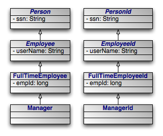

[[jpa_overview_pc]]
=== Entity
(((persistent classes)))
(((Entity)))
(((class , persistent)))

JPA recognizes two types of persistent classes: _entity_ classes and _embeddable_ classes.
Each persistent instance of an entity class - each _entity_ - represents a unique datastore record.
You can use the [class]``EntityManager`` to find an entity by its persistent identity (covered later in this chapter), or use a [class]``Query`` to find entities matching certain criteria.

An instance of an embeddable class, on the other hand, is only stored as part of a separate entity.
Embeddable instances have no persistent identity, and are never returned directly from the [class]``EntityManager`` or from a [class]``Query`` unless the query uses a projection on owning class to the embedded instance.
For example, if [class]``Address`` is embedded in [class]``Company``, then a query [class]``"SELECT a FROM Address a"`` will never return the embedded [class]``Address`` of [class]``Company``; but a projection query such as [class]``"SELECT c.address FROM Company c"`` will.

Despite these differences, there are few distinctions between entity classes and embeddable classes.
In fact, writing either type of persistent class is a lot like writing any other class.
There are no special parent classes to extend from, field types to use, or methods to write.
This is one important way in which JPA makes persistence transparent to you, the developer.

[NOTE]
====
JPA supports both fields and JavaBean properties as persistent state.
For simplicity, however, we will refer to all persistent state as persistent fields, unless we want to note a unique aspect of persistent properties.
====

[[jpa_overview_pc_pcclass]]
.Persistent Class
====
[source]
----

package org.mag;

/**
 * Example persistent class.  Notice that it looks exactly like any other
 * class.  JPA makes writing persistent classes completely transparent.
 */
public class Magazine {

    private String isbn;
    private String title;
    private Set articles = new HashSet();
    private Article coverArticle;
    private int copiesSold;
    private double price;
    private Company publisher;
    private int version;

    protected Magazine() {
    }

    public Magazine(String title, String isbn) {
        this.title = title;
        this.isbn = isbn;
    }

    public void publish(Company publisher, double price) {
        this.publisher = publisher;
        publisher.addMagazine(this);
        this.price = price;
    }

    public void sell() {
        copiesSold++;
        publisher.addRevenue(price);
    }

    public void addArticle(Article article) {
        articles.add(article);
    }

    // rest of methods omitted
}
----
====

[[jpa_overview_pc_restrict]]
==== Restrictions on Persistent Classes
(((persistent classes , restrictions on)))

There are very few restrictions placed on persistent classes.
Still, it never hurts to familiarize yourself with exactly what JPA does and does not support.

[[jpa_overview_pc_no_arg]]
===== Default or No-Arg Constructor
(((constructor , no-arg constructor requirement)))

The JPA specification requires that all persistent classes have a no-arg constructor.
This constructor may be public or protected.
Because the compiler automatically creates a default no-arg constructor when no other constructor is defined, only classes that define constructors must also include a no-arg constructor.

[NOTE]
====
OpenJPA's _enhancer_ will automatically add a protected no-arg constructor to your class when required.
Therefore, this restriction does not apply when using the enhancer.
See <<ref_guide_pc_enhance>> of the Reference Guide for details.
====

[[jpa_overview_pc_final]]
===== Final

Entity classes may not be final.
No method of an entity class can be final.

[NOTE]
====
OpenJPA supports final classes and final methods.
====

[[jpa_overview_pc_id]]
===== Identity Fields
(((persistent classes , JPA id requirement)))

All entity classes must declare one or more fields which together form the persistent identity of an instance.
These are called _identity_  or _primary key_ fields.
In our [class]``Magazine`` class, `isbn` and `title` are identity fields, because no two magazine records in the datastore can have the same `isbn` and `title` values. <<jpa_overview_meta_id>> will show you how to denote your identity fields in JPA metadata. <<jpa_overview_pc_identity>> below examines persistent identity.

[NOTE]
====
OpenJPA fully supports identity fields, but does not require them.
See <<ref_guide_pc_oid>> of the Reference Guide for details.
====

[[jpa_overview_pc_version]]
===== Version Field
(((persistent classes , JPA version requirement)))

The `version` field in our [class]``Magazine`` class may seem out of place.
JPA uses a version field in your entities to detect concurrent modifications to the same datastore record.
When the JPA runtime detects an attempt to concurrently modify the same record, it throws an exception to the transaction attempting to commit last.
This prevents overwriting the previous commit with stale data.

A version field is not required, but without one concurrent threads or processes might succeed in making conflicting changes to the same record at the same time.
This is unacceptable to most applications. <<jpa_overview_meta_version>> shows you how to designate a version field in JPA metadata.

The version field must be an integral type ([class]``int``, [class]``Long``, etc), a [class]``java.sql.Timestamp``, a [class]``java.time.LocalDateTime``  or a [class]``java.time.Instant``.
You should consider version fields immutable.
Changing the field value has undefined results.

[NOTE]
====
OpenJPA fully supports version fields, but does not require them within the actual entity for concurrency detection.
OpenJPA can maintain surrogate version values or use state comparisons to detect concurrent modifications.
See <<ref_guide_mapping_jpa>> in the Reference Guide.
====

[[jpa_overview_pc_restrict_inheritance]]
===== Inheritance
(((inheritance , of persistent classes)))

JPA fully supports inheritance in persistent classes.
It allows persistent classes to inherit from non-persistent classes, persistent classes to inherit from other persistent classes, and non-persistent classes to inherit from persistent classes.
It is even possible to form inheritance hierarchies in which persistence skips generations.
There are, however, a few important limitations:

* Persistent classes cannot inherit from certain natively-implemented system classes such as [class]``java.net.Socket`` and [class]``java.lang.Thread``.
* If a persistent class inherits from a non-persistent class, the fields of the non-persistent superclass cannot be persisted.
* All classes in an inheritance tree must use the same identity type. We cover entity identity in <<jpa_overview_pc_identity>>.

[[jpa_overview_pc_restrict_fields]]
===== Persistent Fields
(((field , persistent)))

JPA manages the state of all persistent fields.
Before you access persistent state, the JPA runtime makes sure that it has been loaded from the datastore.
When you set a field, the runtime records that it has changed so that the new value will be persisted.
This allows you to treat the field in exactly the same way you treat any other field - another aspect of JPA's transparency.

JPA does not support static or final fields.
It does, however, include built-in support for most common field types.
These types can be roughly divided into three categories: immutable types, mutable types, and relations.

(((persistent fields , immutable types)))__Immutable__ types, once created, cannot be changed.
The only way to alter a persistent field of an immutable type is to assign a new value to the field.
JPA supports the following immutable types:

* All primitives ([class]``int, float, byte``, etc)
* All primitive wrappers ([class]``java.lang.Integer, java.lang.Float, java.lang.Byte``, etc)
* [class]``java.lang.String``
* [class]``java.math.BigInteger``
* [class]``java.math.BigDecimal``
* [class]``java.time.LocalDate``
* [class]``java.time.LocalDateTime``
* [class]``java.time.LocalTime``
* [class]``java.time.OffsetDateTime``
* [class]``java.time.OffsetTime``
* [class]``java.util.UUID``

JPA also supports [class]``byte[]``, [class]``Byte[]``, [class]``char[]``, and [class]``Character[]`` as immutable types.
That is, you can persist fields of these types, but you should not manipulate individual array indexes without resetting the array into the persistent field.

(((persistent fields , mutable types)))
(((persistent fields , user-defined types))) Persistent fields of _mutable_ types can be altered without assigning the field a new value.
Mutable types can be modified directly through their own methods.
The JPA specification requires that implementations support the following mutable field types:

* [class]``java.util.Date``
* [class]``java.util.Calendar``
* [class]``java.sql.Date``
* [class]``java.sql.Timestamp``
* [class]``java.sql.Time``
* Enums
* Entity types (relations between entities)
* Embeddable types
* [class]``java.util.Collection``s of entities
* [class]``java.util.Set``s of entities
* [class]``java.util.List``s of entities
* [class]``java.util.Map``s in which each entry maps the value of one of a related entity's fields to that entity.

Collection and map types may be parameterized.

(((persistent fields , of unknown types))) Most JPA implementations also have support for persisting serializable values as binary data in the datastore. <<jpa_overview_meta>> has more information on persisting serializable types.

[NOTE]
====
OpenJPA also supports arrays, [class]``java.lang.Number``, [class]``java.util.Locale``, all JDK 1.2 [class]``Set``, [class]``List``, and [class]``Map`` types, and many other mutable and immutable field types.
OpenJPA also allows you to plug in support for custom types.
====

[[jpa_overview_pc_restrict_conclusion]]
===== Conclusions

This section detailed all of the restrictions JPA places on persistent classes.
While it may seem like we presented a lot of information, you will seldom find yourself hindered by these restrictions in practice.
Additionally, there are often ways of using JPA's other features to circumvent any limitations you run into.

[[jpa_overview_pc_identity]]
==== Entity Identity
(((JPA , identity)))
(((identity , JPA)))

(((identity , qualitative)))
(((qualitative identity))) Java recognizes two forms of object identity: numeric identity and qualitative identity.
If two references are _numerically_ identical, then they refer to the same JVM instance in memory.
You can test for this using the ``==`` operator. _Qualitative_ identity, on the other hand, relies on some user-defined criteria to determine whether two objects are "equal". You test for qualitative identity using the [method]``equals`` method.
By default, this method simply relies on numeric identity.

JPA introduces another form of object identity, called _entity
identity_ or __persistent identity__.
Entity identity tests whether two persistent objects represent the same state in the datastore.

(((persistent fields , id))) The entity identity of each persistent instance is encapsulated in its __identity field(s)__.
If two entities of the same type have the same identity field values, then the two entities represent the same state in the datastore.
Each entity's identity field values must be unique among all other entities of the same type.

Identity fields must be primitives, primitive wrappers, [class]``String``s, [class]``Date``s, [class]``Timestamp``s, [class]``UUID``s or embeddable types.

[NOTE]
====
OpenJPA supports entities as identity fields, as the Reference Guide discusses in <<ref_guide_pc_oid_entitypk>>.
For legacy schemas with binary primary key columns, OpenJPA also supports using identity fields of type [class]``byte[]``.
When you use a [class]``byte[]`` identity field, you must create an identity class.
Identity classes are covered below.
====

[NOTE]
====
OpenJPA supports [class]``UUID``s identity fields using the binary representation of UUID on the database if the database and its  JDBC driver supports it.
When this conditions are not met, it uses the canonical string representation of the UUID.
====

[WARNING]
====
Changing the fields of an embeddable instance while it is assigned to an identity field has undefined results.
Always treat embeddable identity instances as immutable objects in your applications.
====

(((identity , uniqueness requirement))) If you are dealing with a single persistence context (see <<jpa_overview_emfactory_perscontext>>), then you do not have to compare identity fields to test whether two entity references represent the same state in the datastore.
There is a much easier way: the `==`  operator.
JPA requires that each persistence context maintain only one JVM object to represent each unique datastore record.
Thus, entity identity is equivalent to numeric identity within a persistence context.
This is referred to as the __uniqueness requirement__.

The uniqueness requirement is extremely important - without it, it would be impossible to maintain data integrity.
Think of what could happen if two different objects in the same transaction were allowed to represent the same persistent data.
If you made different modifications to each of these objects, which set of changes should be written to the datastore? How would your application logic handle seeing two different "versions" of the same data? Thanks to the uniqueness requirement, these questions do not have to be answered.

[[jpa_overview_pc_identitycls]]
===== Identity Class

(((identity class)))
(((identity , class requirements))) If your entity has only one identity field, you can use the value of that field as the entity's identity object in all <<jpa_overview_em,[class]``EntityManager``>> APIs.
Otherwise, you must supply an identity class to use for identity objects.
Your identity class must meet the following criteria:

* The class must have a no-args constructor.
* The names of the non-static fields or properties of the class must be the same as the names of the identity fields or properties of the corresponding entity class, and the types must be identical.
* The [method]``equals`` and [method]``hashCode`` methods of the class must use the values of all fields or properties corresponding to identity fields or properties in the entity class.
* If the class is an inner class, it must be ``static``.
* All entity classes related by inheritance must use the same identity class, or else each entity class must have its own identity class whose inheritance hierarchy mirrors the inheritance hierarchy of the owning entity classes (see <<jpa_overview_pc_identity_hierarchy>>).

[NOTE]
====
Jakarta Persistence 3.2 no longer requires the identity class to be public or to implement [class]``java.io.Serializable``, and OpenJPA no longer enforces either.
An identity class that does not implement [class]``Serializable`` can, however, not be used where OpenJPA has to serialize the identity object it is wrapped in: serializing a detached entity, remote commit events in a clustered configuration, and a distributed data cache.
Those fail with a [class]``java.io.NotSerializableException`` naming the identity class.
====

[NOTE]
====
Though you may still create identity classes by hand, OpenJPA provides the [class]``appidtool`` to automatically generate proper identity classes based on your identity fields.
See <<ref_guide_pc_oid_application>> of the Reference Guide.
====

[[jpa_overview_pc_identity_appidcode]]
.Identity Class
====
This example illustrates a proper identity class for an entity with multiple identity fields.

[source]
----

/**
 * Persistent class using application identity.
 */
public class Magazine {

    private String isbn;    // identity field
    private String title;   // identity field

    // rest of fields and methods omitted

    /**
     * Application identity class for Magazine.
     */
    public static class MagazineId {

        // each identity field in the Magazine class must have a
        // corresponding field in the identity class
        public String isbn;
        public String title;

        /**
         * Equality must be implemented in terms of identity field
         * equality, and must use instanceof rather than comparing
         * classes directly (some JPA implementations may subclass the
         * identity class).
         */
        public boolean equals(Object other) {
            if (other == this)
                return true;
            if (!(other instanceof MagazineId))
                return false;

            MagazineId mi = (MagazineId) other;
            return (isbn == mi.isbn
                || (isbn != null && isbn.equals(mi.isbn)))
                && (title == mi.title
                || (title != null && title.equals(mi.title)));
        }

        /**
         * Hashcode must also depend on identity values.
         */
        public int hashCode() {
            return ((isbn == null) ? 0 : isbn.hashCode())
                ^ ((title == null) ? 0 : title.hashCode());
        }

        public String toString() {
            return isbn + ":" + title;
        }
    }
}
----
====

[[jpa_overview_pc_identity_hierarchy]]
====== Identity Hierarchies

An alternative to having a single identity class for an entire inheritance hierarchy is to have one identity class per level in the inheritance hierarchy.
The requirements for using a hierarchy of identity classes are as follows:

* The inheritance hierarchy of identity classes must exactly mirror the hierarchy of the persistent classes that they identify. In the example pictured above, abstract class [class]``Person`` is extended by abstract class [class]``Employee``, which is extended by non-abstract class [class]``FullTimeEmployee``, which is extended by non-abstract class [class]``Manager``. The corresponding identity classes, then, are an abstract [class]``PersonId`` class, extended by an abstract [class]``EmployeeId`` class, extended by a non-abstract [class]``FullTimeEmployeeId`` class, extended by a non-abstract [class]``ManagerId`` class.
* Subclasses in the identity hierarchy may define additional identity fields until the hierarchy becomes non-abstract. In the aforementioned example, [class]``Person`` defines an identity field ``ssn``, [class]``Employee`` defines additional identity field ``userName``, and [class]``FullTimeEmployee`` adds a final identity field, ``empId``. However, [class]``Manager`` may not define any additional identity fields, since it is a subclass of a non-abstract class. The hierarchy of identity classes, of course, must match the identity field definitions of the persistent class hierarchy.
* It is not necessary for each abstract class to declare identity fields. In the previous example, the abstract [class]``Person`` and [class]``Employee`` classes could declare no identity fields, and the first concrete subclass [class]``FullTimeEmployee`` could define one or more identity fields.
* All subclasses of a concrete identity class must be [method]``equals`` and [method]``hashCode``-compatible with the concrete superclass. This means that in our example, a [class]``ManagerId`` instance and a [class]``FullTimeEmployeeId`` instance with the same identity field values should have the same hash code, and should compare equal to each other using the [method]``equals`` method of either one. In practice, this requirement reduces to the following coding practices:
.. Use `instanceof` instead of comparing [class]``Class`` objects in the [method]``equals`` methods of your identity classes.
.. An identity class that extends another non-abstract identity class should not override [method]``equals`` or [method]``hashCode``.

[[jpa_overview_pc_callbacks]]
==== Lifecycle Callbacks
(((lifecycle callbacks)))
(((persistent classes , lifecycle callbacks)))

It is often necessary to perform various actions at different stages of a persistent object's lifecycle.
JPA includes a variety of callbacks methods for monitoring changes in the lifecycle of your persistent objects.
These callbacks can be defined on the persistent classes themselves and on non-persistent listener classes.

[[jpa_overview_pc_callbacks_methods]]
===== Callback Methods
(((entity , callback methods)))

Every persistence event has a corresponding callback method marker.
These markers are shared between persistent classes and their listeners.
You can use these markers to designate a method for callback either by annotating that method or by listing the method in the XML mapping file for a given class.
The lifecycle events and their corresponding method markers are:

* https://jakarta.ee/specifications/persistence/3.2/apidocs/jakarta.persistence/jakarta/persistence/prepersist[ PrePersist]: Methods marked with this annotation will be invoked before an object is persisted. This could be used for assigning primary key values to persistent objects. This is equivalent to the XML element tag ``pre-persist``.
* (((PostPersist)))https://jakarta.ee/specifications/persistence/3.2/apidocs/jakarta.persistence/jakarta/persistence/postpersist[
PostPersist]: Methods marked with this annotation will be invoked after an object has transitioned to the persistent state.
You might want to use such methods to update a screen after a new row is added.
This is equivalent to the XML element tag ``post-persist``.
* (((PostLoad)))https://jakarta.ee/specifications/persistence/3.2/apidocs/jakarta.persistence/jakarta/persistence/postload[
PostLoad]: Methods marked with this annotation will be invoked after all eagerly fetched fields of your class have been loaded from the datastore.
No other persistent fields can be accessed in this method.
This is equivalent to the XML element tag ``post-load``.

[class]``PostLoad`` is often used to initialize non-persistent fields whose values depend on the values of persistent fields, such as a complex data structure.
* (((PreUpdate)))https://jakarta.ee/specifications/persistence/3.2/apidocs/jakarta.persistence/jakarta/persistence/preupdate[
PreUpdate]: Methods marked with this annotation will be invoked just the persistent values in your objects are flushed to the datastore.
This is equivalent to the XML element tag ``pre-update``.

[class]``PreUpdate`` is the complement to [class]``PostLoad``.
While methods marked with [class]``PostLoad`` are most often used to initialize non-persistent values from persistent data, methods annotated with [class]``PreUpdate`` is normally used to set persistent fields with information cached in non-persistent data.
* (((PostUpdate)))https://jakarta.ee/specifications/persistence/3.2/apidocs/jakarta.persistence/jakarta/persistence/postupdate[
PostUpdate]: Methods marked with this annotation will be invoked after changes to a given instance have been stored to the datastore.
This is useful for clearing stale data cached at the application layer.
This is equivalent to the XML element tag ``post-update``.
* (((PreRemove)))https://jakarta.ee/specifications/persistence/3.2/apidocs/jakarta.persistence/jakarta/persistence/preremove[
PreRemove]: Methods marked with this annotation will be invoked before an object transactions to the deleted state.
Access to persistent fields is valid within this method.
You might use this method to cascade the deletion to related objects based on complex criteria, or to perform other cleanup.
This is equivalent to the XML element tag ``pre-remove``.
* (((PostRemove)))https://jakarta.ee/specifications/persistence/3.2/apidocs/jakarta.persistence/jakarta/persistence/postremove[
PostRemove]: Methods marked with this annotation will be invoked after an object has been marked as to be deleted.
This is equivalent to the XML element tag ``post-remove``.

[[jpa_overview_callbacks_using]]
===== Using Callback Methods

When declaring callback methods on a persistent class, any method may be used which takes no arguments and is not shared with any property access fields.
Multiple events can be assigned to a single method as well.

Below is an example of how to declare callback methods on persistent classes:

[source]
----

/**
 * Example persistent class declaring our entity listener.
 */
@Entity
public class Magazine {

    @Transient
    private byte[][] data;

    @ManyToMany
    private List<Photo> photos;

    @PostLoad
    public void convertPhotos() {
        data = new byte[photos.size()][];
        for (int i = 0; i < photos.size(); i++)
            data[i] = photos.get(i).toByteArray();
    }

    @PreDelete
    public void logMagazineDeletion() {
        getLog().debug("deleting magazine containing" + photos.size()
            + " photos.");
    }
}
----

In an XML mapping file, we can define the same methods without annotations:

[source]
----

<entity class="Magazine">
    <pre-remove>logMagazineDeletion</pre-remove>
    <post-load>convertPhotos</post-load>
</entity>
----

[NOTE]
====
We fully explore persistence metadata annotations and XML in <<jpa_overview_meta>>.
====

[[jpa_overview_entity_listeners_using]]
===== Using Entity Listeners

Mixing lifecycle event code into your persistent classes is not always ideal.
It is often more elegant to handle cross-cutting lifecycle events in a non-persistent listener class.
JPA allows for this, requiring only that listener classes have a public no-arg constructor.
Like persistent classes, your listener classes can consume any number of callbacks.
The callback methods must take in a single [class]``java.lang.Object`` argument which represents the persistent object that triggered the event.

Entities can enumerate listeners using the [class]``EntityListeners`` annotation.
This annotation takes an array of listener classes as its value.

Below is an example of how to declare an entity and its corresponding listener classes.

[source]
----

/**
 * Example persistent class declaring our entity listener.
 */
@Entity
@EntityListeners({ MagazineLogger.class, ... })
public class Magazine {

    // ... //
}

/**
 * Example entity listener.
 */
public class MagazineLogger {

    @PostPersist
    public void logAddition(Object pc) {
        getLog().debug("Added new magazine:" + ((Magazine) pc).getTitle());
    }

    @PreRemove
    public void logDeletion(Object pc) {
        getLog().debug("Removing from circulation:"
            ((Magazine) pc).getTitle());
    }
}
----

In XML, we define both the listeners and their callback methods as so:

[source]
----

<entity class="Magazine">
    <entity-listeners>
        <entity-listener class="MagazineLogger">
            <post-persist>logAddition</post-persist>
            <pre-remove>logDeletion</pre-remove>
        </entity-listener>
    </entity-listeners>
</entity>
----

[[jpa_overview_entity_listeners_exclude]]
===== Entity Listeners Hierarchy
(((lifecycle listeners , hierarchy)))

Entity listener methods are invoked in a specific order when a given event is fired.
So-called _default_ listeners are invoked first: these are listeners which have been defined in a package annotation or in the root element of XML mapping files.
Next, entity listeners are invoked in the order of the inheritance hierarchy, with superclass listeners being invoked before subclass listeners.
Finally, if an entity has multiple listeners for the same event, the listeners are invoked in declaration order.

You can exclude default listeners and listeners defined in superclasses from the invocation chain through the use of two class-level annotations:

* [class]``ExcludeDefaultListeners``: This annotation indicates that no default listeners will be invoked for this class, or any of its subclasses. The XML equivalent is the empty `exclude-default-listeners` element.
* [class]``ExcludeSuperclassListeners``: This annotation will cause OpenJPA to skip invoking any listeners declared in superclasses. The XML equivalent is the empty `exclude-superclass-listeners` element.

[[jpa_overview_pc_conclusion]]
==== Conclusions

This chapter covered everything you need to know to write persistent class definitions in JPA.
JPA cannot use your persistent classes, however, until you complete one additional step: you must define the persistence metadata.
The next chapter explores metadata in detail.

ifdef::backend-docbook[]
[index]
== Index
endif::backend-docbook[]
