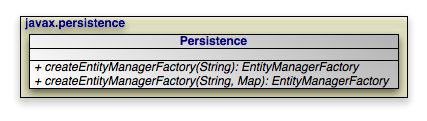

[[_jpa_overview_persistence]]
=== Persistence
(((Persistence)))
(((EntityManagerFactory , construction)))
(((getEntityManagerFactory)))

[NOTE]
====
OpenJPA also includes the link:../../apidocs/org/apache/openjpa/persistence/OpenJPAPersistence.html[
OpenJPAPersistence] helper class to provide additional utility methods.
====

Within a container, you will typically use _injection_ to access an [class]``EntityManagerFactory``.
Applications operating outside of a container, however, can use the https://jakarta.ee/specifications/persistence/3.2/apidocs/jakarta.persistence/jakarta/persistence/persistence[
Persistence] class to obtain [class]``
EntityManagerFactory`` objects in a vendor-neutral fashion.

[source]
----

public static EntityManagerFactory createEntityManagerFactory(String name);
public static EntityManagerFactory createEntityManagerFactory(String name, Map props);
public static PersistenceUtil getPersistenceUtil();
----

Each [method]``createEntityManagerFactory`` method searches the system for an [class]``EntityManagerFactory`` definition with the given name.
Use `null` for an unnamed factory.
The optional map contains vendor-specific property settings used to further configure the factory.

[path]_persistence.xml_ files define [class]``
EntityManagerFactories``.
The [method]``createEntityManagerFactory `` methods search for [path]_persistence.xml_ files within the [path]_META-INF_ directory of any `CLASSPATH ` element.
For example, if your `CLASSPATH` contains the [path]_conf_ directory, you could place an [class]``
EntityManagerFactory`` definition in [path]_
conf/META-INF/persistence.xml_.

The [method]``getPersistenceUtil`` method returns a PersistenceUtil interface that can be used to determine whether an entity or attribute of an entity is loaded.

[source]
----

PersistenceUtil pUtil = Persistence.getPersistenceUtil();

if (!pUtil.isLoaded(myEntity)) {
    loadEntity(myEntity);
}
----

[[_jpa_overview_persistence_xml]]
==== persistence.xml

With the introduction of JPA 2.0, there are two versions of the [path]_persistence.xml_.
The most current revision of the 2.0 persistence schema is presented below.
Version 1.0 of the persistence schema can be found at http://java.sun.com/xml/ns/persistence/persistence_1_0.xsd.

[source]
----

<?xml version="1.0" encoding="UTF-8"?>
    <!-- persistence.xml schema -->
<xsd:schema targetNamespace="http://java.sun.com/xml/ns/persistence"
    xmlns:xsd="http://www.w3.org/2001/XMLSchema"
    xmlns:persistence="http://java.sun.com/xml/ns/persistence"
    elementFormDefault="qualified" attributeFormDefault="unqualified"
    version="2.0">

    <xsd:annotation>
        <xsd:documentation>
            @(#)persistence_2_0.xsd 1.0 October 1 2009
        </xsd:documentation>
    </xsd:annotation>

    <xsd:annotation>
        <xsd:documentation>

          DO NOT ALTER OR REMOVE COPYRIGHT NOTICES OR THIS HEADER.

          Copyright 2005-2009 Sun Microsystems, Inc. All rights reserved.

          The contents of this file are subject to the terms of either the
          GNU General Public License Version 2 only ("GPL") or the Common
          Development and Distribution License("CDDL") (collectively, the
          "License").  You may not use this file except in compliance with
          the License. You can obtain a copy of the License at
          https://glassfish.dev.java.net/public/CDDL+GPL.html or
          glassfish/bootstrap/legal/LICENSE.txt.  See the License for the
          specific language governing permissions and limitations under the
          License.

          When distributing the software, include this License Header
          Notice in each file and include the License file at
          glassfish/bootstrap/legal/LICENSE.txt.  Sun designates this
          particular file as subject to the "Classpath" exception as
          provided by Sun in the GPL Version 2 section of the License file
          that accompanied this code.  If applicable, add the following
          below the License Header, with the fields enclosed by brackets []
          replaced by your own identifying information:
          "Portions Copyrighted [year] [name of copyright owner]"

          Contributor(s):

          If you wish your version of this file to be governed by only the
          CDDL or only the GPL Version 2, indicate your decision by adding
          "[Contributor] elects to include this software in this
          distribution under the [CDDL or GPL Version 2] license."  If you
          don't indicate a single choice of license, a recipient has the
          option to distribute your version of this file under either the
          CDDL, the GPL Version 2 or to extend the choice of license to its
          licensees as provided above.  However, if you add GPL Version 2
          code and therefore, elected the GPL Version 2 license, then the
          option applies only if the new code is made subject to such
          option by the copyright holder.

        </xsd:documentation>
    </xsd:annotation>

    <xsd:annotation>
        <xsd:documentation>
        <![CDATA[
            This is the XML Schema for the persistence configuration file.
            The file must be named "META-INF/persistence.xml" in the
            persistence archive.
            Persistence configuration files must indicate
            the persistence schema by using the persistence namespace:
            http://java.sun.com/xml/ns/persistence
            and indicate the version of the schema by
            using the version element as shown below:
            <persistence xmlns="http://java.sun.com/xml/ns/persistence"
            xmlns:xsi="http://www.w3.org/2001/XMLSchema-instance"
            xsi:schemaLocation="http://java.sun.com/xml/ns/persistence
            http://java.sun.com/xml/ns/persistence/persistence_2_0.xsd"
            version="2.0">
            ...
            </persistence>
        ]]>
        </xsd:documentation>
    </xsd:annotation>

    <xsd:simpleType name="versionType">
        <xsd:restriction base="xsd:token">
            <xsd:pattern value="[0-9]+(\.[0-9]+)*" />
        </xsd:restriction>
    </xsd:simpleType>
    <!-- **************************************************** -->
    <xsd:element name="persistence">
        <xsd:complexType>
            <xsd:sequence>
                <!-- **************************************************** -->
                <xsd:element name="persistence-unit"
                    minOccurs="1" maxOccurs="unbounded">
                    <xsd:complexType>
                        <xsd:annotation>
                            <xsd:documentation>
                                Configuration of a persistence unit.
                            </xsd:documentation>
                        </xsd:annotation>
                        <xsd:sequence>
                            <!-- **************************************************** -->
                            <xsd:element name="description"
                                type="xsd:string" minOccurs="0">
                                <xsd:annotation>
                                    <xsd:documentation>
                                        Description of this persistence unit.
                                    </xsd:documentation>
                                </xsd:annotation>
                            </xsd:element>
                            <!-- **************************************************** -->
                            <xsd:element name="provider"
                                type="xsd:string" minOccurs="0">
                                <xsd:annotation>
                                    <xsd:documentation>
                                        Provider class that supplies EntityManagers for this
                                        persistence unit.
                                    </xsd:documentation>
                                </xsd:annotation>
                            </xsd:element>
                            <!-- **************************************************** -->
                            <xsd:element name="jta-data-source"
                                type="xsd:string" minOccurs="0">
                                <xsd:annotation>
                                    <xsd:documentation>
                                        The container-specific name of the JTA datasource to use.
                                    </xsd:documentation>
                                </xsd:annotation>
                            </xsd:element>
                            <!-- **************************************************** -->
                            <xsd:element name="non-jta-data-source"
                                type="xsd:string" minOccurs="0">
                                <xsd:annotation>
                                    <xsd:documentation>
                                        The container-specific name of a non-JTA datasource to use.
                                    </xsd:documentation>
                                </xsd:annotation>
                            </xsd:element>
                            <!-- **************************************************** -->
                            <xsd:element name="mapping-file"
                                type="xsd:string" minOccurs="0"
                                maxOccurs="unbounded">
                                <xsd:annotation>
                                    <xsd:documentation>
                                        File containing mapping information. Loaded as a resource
                                        by the persistence provider.
                                    </xsd:documentation>
                                </xsd:annotation>
                            </xsd:element>
                            <!-- **************************************************** -->
                            <xsd:element name="jar-file"
                                type="xsd:string" minOccurs="0"
                                maxOccurs="unbounded">
                                <xsd:annotation>
                                    <xsd:documentation>
                                        Jar file that is to be scanned for managed classes.
                                    </xsd:documentation>
                                </xsd:annotation>
                            </xsd:element>
                            <!-- **************************************************** -->
                            <xsd:element name="class" type="xsd:string"
                                minOccurs="0" maxOccurs="unbounded">
                                <xsd:annotation>
                                    <xsd:documentation>
                                        Managed class to be included in the persistence unit and
                                        to scan for annotations. It should be annotated
                                        with either @Entity, @Embeddable or @MappedSuperclass.
                                    </xsd:documentation>
                                </xsd:annotation>
                            </xsd:element>
                            <!-- **************************************************** -->
                            <xsd:element name="exclude-unlisted-classes"
                                type="xsd:boolean" default="true"
                                minOccurs="0">
                                <xsd:annotation>
                                    <xsd:documentation>
                                        When set to true then only listed classes and jars will
                                        be scanned for persistent classes, otherwise the
                                        enclosing jar or directory will also be scanned.
                                        Not applicable to Java SE persistence units.
                                    </xsd:documentation>
                                </xsd:annotation>
                            </xsd:element>
                            <!-- **************************************************** -->
                            <xsd:element name="shared-cache-mode"
                                type="persistence:persistence-unit-caching-type"
                                minOccurs="0">
                                <xsd:annotation>
                                    <xsd:documentation>
                                        Defines whether caching is enabled for the
                                        persistence unit if caching is supported by the
                                        persistence provider. When set to ALL, all entities
                                        will be cached. When set to NONE, no entities will
                                        be cached. When set to ENABLE_SELECTIVE, only entities
                                        specified as cacheable will be cached. When set to
                                        DISABLE_SELECTIVE, entities specified as not cacheable
                                        will not be cached. When not specified or when set to
                                        UNSPECIFIED, provider defaults may apply.
                                    </xsd:documentation>
                                </xsd:annotation>
                            </xsd:element>
                            <!-- **************************************************** -->
                            <xsd:element name="validation-mode"
                                type="persistence:persistence-unit-validation-mode-type"
                                minOccurs="0">
                                <xsd:annotation>
                                    <xsd:documentation>
                                        The validation mode to be used for the persistence unit.
                                    </xsd:documentation>
                                </xsd:annotation>
                            </xsd:element>
                            <!-- **************************************************** -->
                            <xsd:element name="properties"
                                minOccurs="0">
                                <xsd:annotation>
                                    <xsd:documentation>
                                        A list of standard and vendor-specific properties
                                        and hints.
                                    </xsd:documentation>
                                </xsd:annotation>
                                <xsd:complexType>
                                    <xsd:sequence>
                                        <xsd:element name="property"
                                            minOccurs="0" maxOccurs="unbounded">
                                            <xsd:annotation>
                                                <xsd:documentation>
                                                    A name-value pair.
                                                </xsd:documentation>
                                            </xsd:annotation>
                                            <xsd:complexType>
                                                <xsd:attribute
                                                    name="name" type="xsd:string"
                                                    use="required" />
                                                <xsd:attribute
                                                    name="value" type="xsd:string"
                                                    use="required" />
                                            </xsd:complexType>
                                        </xsd:element>
                                    </xsd:sequence>
                                </xsd:complexType>
                            </xsd:element>
                        </xsd:sequence>
                        <!-- **************************************************** -->
                        <xsd:attribute name="name" type="xsd:string"
                            use="required">
                            <xsd:annotation>
                                <xsd:documentation>
                                    Name used in code to reference this persistence unit.
                                </xsd:documentation>
                            </xsd:annotation>
                        </xsd:attribute>
                        <!-- **************************************************** -->
                        <xsd:attribute name="transaction-type"
                            type="persistence:persistence-unit-transaction-type">
                            <xsd:annotation>
                                <xsd:documentation>
                                    Type of transactions used by EntityManagers from this
                                    persistence unit.
                                </xsd:documentation>
                            </xsd:annotation>
                        </xsd:attribute>
                    </xsd:complexType>
                </xsd:element>
            </xsd:sequence>
            <xsd:attribute name="version" type="persistence:versionType"
                fixed="2.0" use="required" />
        </xsd:complexType>
    </xsd:element>
    <!-- **************************************************** -->
    <xsd:simpleType name="persistence-unit-transaction-type">
        <xsd:annotation>
            <xsd:documentation>
                public enum PersistenceUnitTransactionType {JTA, RESOURCE_LOCAL};
            </xsd:documentation>
        </xsd:annotation>
        <xsd:restriction base="xsd:token">
            <xsd:enumeration value="JTA" />
            <xsd:enumeration value="RESOURCE_LOCAL" />
        </xsd:restriction>
    </xsd:simpleType>
    <!-- **************************************************** -->
    <xsd:simpleType name="persistence-unit-caching-type">
        <xsd:annotation>
            <xsd:documentation>
                public enum SharedCacheMode { ALL, NONE, ENABLE_SELECTIVE,
                DISABLE_SELECTIVE, UNSPECIFIED};
            </xsd:documentation>
        </xsd:annotation>
        <xsd:restriction base="xsd:token">
            <xsd:enumeration value="ALL" />
            <xsd:enumeration value="NONE" />
            <xsd:enumeration value="ENABLE_SELECTIVE" />
            <xsd:enumeration value="DISABLE_SELECTIVE" />
            <xsd:enumeration value="UNSPECIFIED" />
        </xsd:restriction>
    </xsd:simpleType>
    <!-- **************************************************** -->
    <xsd:simpleType name="persistence-unit-validation-mode-type">
        <xsd:annotation>
            <xsd:documentation>
                public enum ValidationMode { AUTO, CALLBACK, NONE};
            </xsd:documentation>
        </xsd:annotation>
        <xsd:restriction base="xsd:token">
            <xsd:enumeration value="AUTO" />
            <xsd:enumeration value="CALLBACK" />
            <xsd:enumeration value="NONE" />
        </xsd:restriction>
    </xsd:simpleType>
</xsd:schema>
----

The root element of a [path]_persistence.xml_ file is ``
persistence``, which then contains one or more `
persistence-unit` definitions.
The root element should include the version attribute with the appropriate version, `1.0` for a version 1.0 file and `2.0` for a version 2.0 file.
Each persistence unit describes the configuration for the entity managers created by the persistence unit's entity manager factory.
The persistence unit can specify these elements and attributes.

* ``name``: This is the name you pass to the [method]`` Persistence.createEntityManagerFactory`` methods described above. The name attribute is required.
* ``transaction-type``: Whether to use managed (``JTA``) or local (``RESOURCE_LOCAL``) transaction management.
* ``provider``: If you are using a third-party JPA vendor, this element names its implementation of the https://jakarta.ee/specifications/persistence/3.2/apidocs/jakarta.persistence/jakarta/persistence/spi/persistenceprovider[ PersistenceProvider] bootstrapping interface.

[NOTE]
====
Set the `provider` to [class]``
org.apache.openjpa.persistence.PersistenceProviderImpl`` to use OpenJPA.
====
* ``jta-data-source``: The JNDI name of a JDBC [class]`` DataSource`` that is automatically enlisted in JTA transactions. This may be an XA [class]``DataSource``.
* ``non-jta-data-source``: The JNDI name of a JDBC [class]`` DataSource`` that is not enlisted in JTA transactions.
* ``mapping-file``*: The resource names of XML mapping files for entities and embeddable classes. You can also specify mapping information in an [path]_orm.xml_ file in your [path]_META-INF_ directory. If present, the [path]_orm.xml_ mapping file will be read automatically.
* ``jar-file``*: The names of jar files containing entities and embeddable classes. The implementation will scan the jar for annotated classes.
* ``class``*: The class names of entities and embeddable classes.
* ``properties``: This element contains nested `property ` elements used to specify vendor-specific settings. Each ` property` has a name attribute and a value attribute.

[NOTE]
====
The Reference Guide's <<_ref_guide_conf>> describes OpenJPA's configuration properties.
====

Here is a typical [path]_persistence.xml_ file for a non-EE environment:

.persistence.xml
====
[source]
----

<?xml version="1.0"?>
<persistence version="1.0">
  <persistence-unit name="openjpa">
    <provider>org.apache.openjpa.persistence.PersistenceProviderImpl</provider>
    <class>tutorial.Animal</class>
    <class>tutorial.Dog</class>
    <class>tutorial.Rabbit</class>
    <class>tutorial.Snake</class>
    <properties>
      <property name="openjpa.ConnectionURL" value="jdbc:hsqldb:tutorial_database"/>
      <property name="openjpa.ConnectionDriverName" value="org.hsqldb.jdbcDriver"/>
      <property name="openjpa.ConnectionUserName" value="sa"/>
      <property name="openjpa.ConnectionPassword" value=""/>
      <property name="openjpa.Log" value="DefaultLevel=WARN, Tool=INFO"/>
    </properties>
  </persistence-unit>
</persistence>
----
====

[[_jpa_overview_persistence_use]]
==== Non-EE Use

The example below demonstrates the [class]``Persistence`` class in action.
You will typically execute code like this on application startup, then cache the resulting factory for future use.
This bootstrapping code is only necessary in non-EE environments; in an EE environment [class]``
EntityManagerFactories`` are typically injected.

.Obtaining an EntityManagerFactory
====
[source]
----

// if your persistence.xml file does not contain all settings already, you
// can add vendor settings to a map
Properties props = new Properties();
...

// create the factory defined by the "openjpa" entity-manager entry
EntityManagerFactory emf = Persistence.createEntityManagerFactory("openjpa", props);
----
====

ifdef::backend-docbook[]
[index]
== Index
endif::backend-docbook[]
