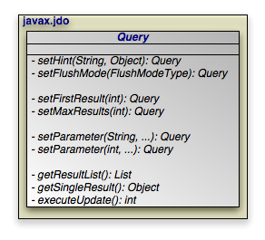

[[_jpa_overview_query]]
=== JPA Query
(((
            JP Query
        )))
(((
            queries
        )))




The [class]``jakarta.persistence.Query`` interface is the mechanism for issuing queries in JPA.
The primary query language used is the Java Persistence Query Language, or ``JPQL``.
JPQL is syntactically very similar to SQL, but is object-oriented rather than table-oriented.

The API for executing JPQL queries will be discussed in <<_jpa_query_api>>, and a full language reference will be covered in <<_jpa_langref>>.

[[_jpa_query_api]]
==== JPQL API

[[_jpa_overview_query_basic]]
===== Query Basics

[source]
----
SELECT x FROM Magazine x
----

The preceding is a simple JPQL query for all [class]``Magazine`` entities.

[source]
----

public Query createQuery(String jpql);
----

The https://jakarta.ee/specifications/persistence/3.2/apidocs/jakarta.persistence/jakarta/persistence/entitymanager[
EntityManager.createQuery] method creates a [class]``Query`` instance from a given JPQL string.

[source]
----

public List getResultList();
----

Invoking https://jakarta.ee/specifications/persistence/3.2/apidocs/jakarta.persistence/jakarta/persistence/query#getResultList()[
Query.getResultList] executes the query and returns a [class]``List`` containing the matching objects.
The following example executes our [class]``Magazine`` query above:

[source]
----

EntityManager em = ...
Query q = em.createQuery("SELECT x FROM Magazine x");
List<Magazine> results = (List<Magazine>) q.getResultList();
----

A JPQL query has an internal namespace declared in the `from` clause of the query.
Arbitrary identifiers are assigned to entities so that they can be referenced elsewhere in the query.
In the query example above, the identifier `x` is assigned to the entity [class]`` Magazine ``.

[NOTE]
====
The `as` keyword can optionally be used when declaring identifiers in the `from` clause. `SELECT x FROM
Magazine x` and `SELECT x FROM Magazine AS x` are synonymous.
====

Following the `select` clause of the query is the object or objects that the query returns.
In the case of the query above, the query's result list will contain instances of the [class]``Magazine`` class.

[NOTE]
====
When selecting entities, you can optionally use the keyword ``object ``.
The clauses `select x` and `SELECT
OBJECT(x)` are synonymous.
====

The optional `where` clause places criteria on matching results.
For example:

[source]
----
SELECT x FROM Magazine x WHERE x.title = 'JDJ'
----

Keywords in JPQL expressions are case-insensitive, but entity, identifier, and member names are not.
For example, the expression above could also be expressed as:

[source]
----
select x from Magazine x where x.title = 'JDJ'
----

But it could not be expressed as:

[source]
----
SELECT x FROM Magazine x WHERE x.TITLE = 'JDJ'
----

As with the `select` clause, alias names in the `where ` clause are resolved to the entity declared in the `from ` clause.
The query above could be described in English as "for all [class]``Magazine`` instances ``x``, return a list of every `x` such that ``x``'s `title ` field is equal to 'JDJ'".

JPQL uses SQL-like syntax for query criteria.
The `and` and ``or`` logical operators chain multiple criteria together:

[source]
----

SELECT x FROM Magazine x WHERE x.title = 'JDJ' OR x.title = 'JavaPro'
----

The `=` operator tests for equality. `<> ` tests for inequality.
JPQL also supports the following arithmetic operators for numeric comparisons: ``>, >=, <, <=``.
For example:

[source]
----

SELECT x FROM Magazine x WHERE x.price > 3.00 AND x.price <= 5.00
----

This query returns all magazines whose price is greater than 3.00 and less than or equal to 5.00.

[source]
----

SELECT x FROM Magazine x WHERE x.price <> 3.00
----

This query returns all Magazines whose price is not equal to 3.00.

You can group expressions together using parentheses in order to specify how they are evaluated.
This is similar to how parentheses are used in Java.
For example:

[source]
----

SELECT x FROM Magazine x WHERE (x.price > 3.00 AND x.price <= 5.00) OR x.price < 7.00
----

This expression would match magazines whose price is less than 7.00.
Alternately:

[source]
----

SELECT x FROM Magazine x WHERE x.price > 3.00 AND (x.price <= 5.00 OR x.price < 7.00)
----

This expression would match magazines whose price is 4.00, 5.00 or 6.00, but not 1.00, 2.00 or 3.00.

JPQL also includes the following conditionals:

* (((
                            BETWEEN expressions
                        )))``[NOT] BETWEEN``: Shorthand for expressing that a value falls between two other values.
The following two statements are synonymous:


[source]
----

SELECT x FROM Magazine x WHERE x.price >= 3.00 AND x.price <= 5.00
----


[source]
----

SELECT x FROM Magazine x WHERE x.price BETWEEN 3.00 AND 5.00
----
* (((
                            LIKE expressions
                        )))``[NOT] LIKE``: Performs a string comparison with wildcard support.
The special character '_' in the parameter means to match any single character, and the special character '%' means to match any sequence of characters.
The following statement matches title fields "JDJ" and "JavaPro", but not "IT Insider":


[source]
----

SELECT x FROM Magazine x WHERE x.title LIKE 'J%'
----

The following statement matches the title field "JDJ" but not "JavaPro":


[source]
----

SELECT x FROM Magazine x WHERE x.title LIKE 'J__'
----
* (((
                            IN expressions
                        )))``[NOT] IN``: Specifies that the member must be equal to one element of the provided list.
The following two statements are synonymous:


[source]
----

SELECT x FROM Magazine x WHERE x.title IN ('JDJ', 'JavaPro', 'IT Insider')
----


[source]
----
SELECT x FROM Magazine x WHERE x.title = 'JDJ' OR x.title = 'JavaPro' OR x.title = 'IT Insider'
----
* (((
                            IS EMPTY expressions
                        )))``IS [NOT] EMPTY``: Specifies that the collection field holds no elements.
For example:


[source]
----

SELECT x FROM Magazine x WHERE x.articles is empty
----

This statement will return all magazines whose ` articles` member contains no elements.
* (((
                            IS NULL expressions
                        )))``IS [NOT] NULL``: Specifies that the field is equal to null.
For example:


[source]
----

SELECT x FROM Magazine x WHERE x.publisher is null
----

This statement will return all Magazine instances whose "publisher" field is set to ``null``.
* (((
                            NOT expressions
                        )))``NOT``: Negates the contained expression.
For example, the following two statements are synonymous:


[source]
----

SELECT x FROM Magazine x WHERE NOT(x.price = 10.0)
----


[source]
----

SELECT x FROM Magazine x WHERE x.price <> 10.0
----


[[_jpa_overview_query_relations]]
===== Relation Traversal

Relations between objects can be traversed using Java-like syntax.
For example, if the Magazine class has a field named "publisher" of type Company, that relation can be queried as follows:

[source]
----

SELECT x FROM Magazine x WHERE x.publisher.name = 'Random House'
----

This query returns all [class]``Magazine`` instances whose `
publisher` field is set to a [class]``Company`` instance whose name is "Random House".

Single-valued relation traversal implies that the relation is not null.
In SQL terms, this is known as an __inner join__.
If you want to also include relations that are null, you can specify:

[source]
----

SELECT x FROM Magazine x WHERE x.publisher.name = 'Random House' or x.publisher is null
----

You can also traverse collection fields in queries, but you must declare each traversal in the `from` clause.
Consider:

[source]
----

SELECT x FROM Magazine x, IN(x.articles) y WHERE y.authorName = 'John Doe'
----

This query says that for each [class]``Magazine```` x ``, traverse the `articles` relation and check each [class]``Article````y``, and pass the filter if ``y``'s `authorName` field is equal to "John Doe". In short, this query will return all magazines that have any articles written by John Doe.

[NOTE]
====
The `IN()` syntax can also be expressed with the keywords ``inner join``.
The statements `SELECT x FROM Magazine
x, IN(x.articles) y WHERE y.authorName = 'John Doe'` and `
SELECT x FROM Magazine x inner join x.articles y WHERE y.authorName = 'John Doe' ` are synonymous.
====

[[_jpa_overview_query_embeddables]]
===== Embeddable Traversal

Similar to relation traversal, nested embeddable objects can be traversed using Java-like syntax.
For example, if the [class]``Company`` class has a field named "address" of an embeddable type [class]``Address``, and the [class]``Address`` has a field named "geocode" of an embeddable type [class]``Geocode``, the `geocode` of a company's address can be queried as follows:

[source]
----

SELECT c.address.geocode FROM Company c WHERE c.name = 'Random House'
----

[NOTE]
====
The `geocode` returned by the above query will not be part of the state of any managed entity.
Modifications to these embeddable instances are not allowed.
====

Traversal into embeddable's state field is also allowed as shown in the following query:

[source]
----

SELECT c.address.geocode.latitude FROM Company c WHERE c.name = 'Random House'
----

Embeddable objects may contain single-valued or collection-valued relations.
These relations can also be traversed using Java-like syntax.
For example, if the Address has a relation field named "phoneLists" of an entity type [class]``PhoneNumber``, the following query returns the [class]``PhoneNumber`` entities of the [class]``Company`` named 'Random House':

[source]
----

SELECT p FROM Company c, IN(c.address.phoneLists) p WHERE c.name = 'Random House'
----

[[_jpa_overview_join_fetch]]
===== Fetch Joins

JPQL queries may specify one or more `join fetch` declarations, which allow the query to specify which fields in the returned instances will be pre-fetched.

[source]
----

SELECT x FROM Magazine x join fetch x.articles WHERE x.title = 'JDJ'
----

The query above returns [class]``Magazine`` instances and guarantees that the `articles` field will already be fetched in the returned instances.

Multiple fields may be specified in separate `join fetch` declarations:
[source]
----

SELECT x FROM Magazine x join fetch x.articles join fetch x.authors WHERE x.title = 'JDJ'
----

Notice that in the above query, both `articles` and `authors` are relation property in [class]``Magazine``.
JPQL syntax does not allow range variable declared for paths on the right-hand side of ``join fetch``.
Therefore, if [class]``Article`` entity has a relation property of ``publishers``, it is not possible to specify a query that returns [class]``Magazine`` instances and pre-fetch the `articles` and the ``publishers``.
The following query will result in syntax error:
[source]
----

SELECT x FROM Magazine x join fetch x.articles a join fetch a.publishers p WHERE x.title = 'JDJ'
----


[NOTE]
====
Specifying the `join fetch` declaration is functionally equivalent to adding the fields to the Query's [class]``
FetchConfiguration``.
See <<_ref_guide_fetch>>.
====

[[_jpa_overview_query_functions]]
===== JPQL Functions

As well as supporting direct field and relation comparisons, JPQL supports a pre-defined set of functions that you can apply.

* (((
                            CONCAT function
                        )))``CONCAT(string1, string2)``: Concatenates two string fields or literals.
For example:


[source]
----

SELECT x FROM Magazine x WHERE CONCAT(x.title, 's') = 'JDJs'
----
* (((
                            SUBSTRING function
                        )))``SUBSTRING(string, startIndex, [length])``: Returns the part of the `string` argument starting at `startIndex` (1-based) and optionally ending at `length` characters past ``
startIndex``.
If the `length` argument is not specified, the substring from the `startIndex` to the end of the `string` is returned.


[source]
----

SELECT x FROM Magazine x WHERE SUBSTRING(x.title, 1, 1) = 'J'
----
* (((
                            TRIM function
                        )))``TRIM([LEADING | TRAILING | BOTH] [character FROM] string``: Trims the specified character from either the beginning ( ``LEADING ``) end ( ``TRAILING``) or both ( `` BOTH ``) of the string argument.
If no trim character is specified, the space character will be trimmed.


[source]
----

SELECT x FROM Magazine x WHERE TRIM(BOTH 'J' FROM x.title) = 'D'
----
* (((
                            LOWER function
                        )))``LOWER(string)``: Returns the lower-case of the specified string argument.


[source]
----

SELECT x FROM Magazine x WHERE LOWER(x.title) = 'jdj'
----
* (((
                            UPPER function
                        )))``UPPER(string)``: Returns the upper-case of the specified string argument.


[source]
----

SELECT x FROM Magazine x WHERE UPPER(x.title) = 'JAVAPRO'
----
* (((
                            LENGTH function
                        )))``LENGTH(string)``: Returns the number of characters in the specified string argument.


[source]
----

SELECT x FROM Magazine x WHERE LENGTH(x.title) = 3
----
* (((
                            LOCATE function
                        )))``LOCATE(searchString, candidateString [, startIndex])``: Returns the first index of `searchString` in ``
candidateString``.
Positions are 1-based.
If the string is not found, returns 0.


[source]
----

SELECT x FROM Magazine x WHERE LOCATE('D', x.title) = 2
----
* (((
                            ABS function
                        )))``ABS(number)``: Returns the absolute value of the argument.


[source]
----

SELECT x FROM Magazine x WHERE ABS(x.price) >= 5.00
----
* (((
                            CEILING function
                        )))``CEILING(number)``: Returns the smallest (closest to negative infinity) value that is greater than or equal to the argument and is equal to a mathematical integer.


[source]
----

SELECT x FROM Magazine x WHERE CEILING(x.price) >= 10
----
* (((
                            EXP function
                        )))``EXP(number)``: Returns the Euler's number `e` raised to the power of a value.


[source]
----

SELECT x FROM Magazine x WHERE EXP(x.price) >= 10
----
* (((
                            FLOOR function
                        )))``FLOOR(number)``: Returns the largest (closest to positive infinity) value that is less than or equal to the argument and is equal to a mathematical integer.


[source]
----

SELECT x FROM Magazine x WHERE FLOOR(x.price) >= 10
----
* (((
                            LN function
                        )))``LN(number)``: Returns the natural logarithm (base ``e``) of a value.


[source]
----

SELECT x FROM Magazine x WHERE LN(x.price) >= 10
----
* (((
                            SQRT function
                        )))``SQRT(number)``: Returns the square root of the argument.


[source]
----

SELECT x FROM Magazine x WHERE SQRT(x.price) >= 1.00
----
* (((
                            MOD function
                        )))``MOD(number, divisor)``: Returns the modulo of `number ` and ``divisor``.


[source]
----

SELECT x FROM Magazine x WHERE MOD(x.price, 10) = 0
----
* (((
                            POWER function
                        )))``POWER(base, exponent)``: Returns the value of the first argument raised to the power of the second argument.


[source]
----

SELECT x FROM Magazine x WHERE POWER(x.price, 2) >= 10
----
* (((
                            ROUND function
                        )))``ROUND(number, precision)``: Rounds the number to given precision.


[source]
----

SELECT x FROM Magazine x WHERE ROUND(x.price, 2) >= 10
----
* (((
                            SIGN function
                        )))``SIGN(number)``: Returns the sign (-1, 0, 1) of a number


[source]
----

SELECT x FROM Magazine x WHERE SIGN(x.price) >= 0
----
* (((
                            INDEX function
                        )))``INDEX(identification_variable)``: Returns an integer value corresponding to the position of its argument in an ordered list.
The INDEX function can only be applied to identification variables denoting types for which an order column has been specified.

In the following example, `studentWaitlist` is a list of students for which an order column has been specified, the query returns the name of the first student on the waiting list of the course named 'Calculus':


[source]
----

SELECT w.name FROM Course c JOIN c.studentWaitlist w WHERE c.name = ‘Calculus’ AND INDEX(w) = 0
----
* (((
                            CURRENT_DATE function
                        )))``CURRENT_DATE``: Returns the current date.
* (((
                            CURRENT_TIME function
                        )))``CURRENT_TIME``: Returns the current time.
* (((
                            CURRENT_TIMESTAMP function
                        )))``CURRENT_TIMESTAMP``: Returns the current timestamp.
* (((
                            LOCAL DATE function
                        )))``LOCAL DATE``: returns the value of current date on the database server.
* (((
                            LOCAL TIME function
                        )))``LOCAL TIME``: returns the value of current time on the database server.
* (((
                            LOCAL DATETIME function
                        )))``LOCAL DATETIME``: returns the value of current timestamp on the database server.
* (((
                            EXTRACT date field function
                        )))``EXTRACT``(date_field `FROM` date_expression) : extracts a given field  (year, quarter, month, week, day, hour, minute or second) from a datetime.


[source]
----

SELECT c FROM Customer AS c WHERE EXTRACT(YEAR FROM c.birthDate)  (EXTRACT(YEAR FROM CURRENT_DATE) - 13)
----
* (((
                            EXTRACT date part function
                        )))``EXTRACT``(date_part `FROM` date_expression) : extracts a date part  (date or time) from a datetime.


[source]
----

SELECT c FROM Customer AS c WHERE EXTRACT(DATE FROM c.createdTimestamp)  { d '1969-07-20' }
----


[[_jpa_overview_query_inheritance]]
===== Polymorphic Queries

All JPQL queries are polymorphic, which means the `from` clause of a query includes not only instances of the specific entity class to which it refers, but all subclasses of that class as well.
The instances returned by a query include instances of the subclasses that satisfy the query conditions.
For example, the following query may return instances of [class]`` Magazine ``, as well as [class]``Tabloid`` and [class]``Digest `` instances, where [class]``Tabloid`` and [class]``
Digest`` are [class]``Magazine`` subclasses.

[source]
----
SELECT x FROM Magazine x WHERE x.price  5
----

Non-polymorphic queries or queries whose polymorphism is restricted can be specified using entity type expressions (see <<_jpa_langref_entity_type_expressions>> ) in the `WHERE` clause to restrict the domain of the query.
For example, the following query returns instances of [class]``Digest``:
[source]
----

SELECT x FROM Magazine WHERE TYPE(x) = Digest
----

[[_jpa_overview_query_params]]
===== Query Parameters

JPQL provides support for parameterized queries.
Either named parameters or positional parameters may be specified in the query string.
Parameters allow you to re-use query templates where only the input parameters vary.
A single query can declare either named parameters or positional parameters, but is not allowed to declare both named and positional parameters.

[source]
----

public Query setParameter (int pos, Object value);
----

Specify positional parameters in your JPQL string using an integer prefixed by a question mark.
You can then populate the [class]``Query`` object with positional parameter values via calls to the [method]``setParameter `` method above.
The method returns the [class]``Query`` instance for optional method chaining.

[source]
----

EntityManager em = ...
Query q = em.createQuery("SELECT x FROM Magazine x WHERE x.title = ?1 and x.price  ?2");
q.setParameter(1, "JDJ").setParameter(2, 5.0);
ListMagazine results = (ListMagazine) q.getResultList();
----

This code will substitute `JDJ` for the `?1` parameter and `5.0` for the `?2` parameter, then execute the query with those values.

[source]
----

public Query setParameter(String name, Object value);
----

Named parameters are denoted by prefixing an arbitrary name with a colon in your JPQL string.
You can then populate the [class]`` Query`` object with parameter values using the method above.
Like the positional parameter method, this method returns the [class]``Query`` instance for optional method chaining.

[source]
----

EntityManager em = ...
Query q = em.createQuery("SELECT x FROM Magazine x WHERE x.title = :titleParam and x.price  :priceParam");
q.setParameter("titleParam", "JDJ").setParameter("priceParam", 5.0);
ListMagazine results = (ListMagazine) q.getResultList();
----

This code substitutes `JDJ` for the ` :titleParam ` parameter and `5.0` for the `:priceParam ` parameter, then executes the query with those values.

All input parameters must be single-valued, except in IN expressions (see <<_jpa_langref_in_expressions>>), which support the use of collection-valued input parameters.

[[_jpa_overview_query_hints]]
===== Query Hints

JPQL provides support for hints which are name/value pairs used to control locking and optimization keywords in SQL.
The following example shows how to use the JPA hint API to set the [class]``ReadLockMode`` and [class]``ResultCount`` in the OpenJPA fetch plan.
This will result in a database-specific SQL keyword (usually FOR UPDATE) to be emitted into the SQL provided that a pessimistic LockManager is being used.
Additionally, if a DB2 database is being used, the OPTIMIZE FOR 2 ROWS clause will also be emitted.

.Query Hints
====
[source]
----

...
Query q = em.createQuery("select m from Magazine m where ... ");
q.setHint("openjpa.hint.OptimizeResultCount", new Integer(2));
q.setHint("openjpa.FetchPlan.ReadLockMode","WRITE");
List r = q.getResultList();
...
----
====

Hints which can not be processed by a particular database or are unknown to OpenJPA are ignored.
Hints known to OpenJPA but supplied with an incompatible value will result in an [class]``IllegalArgumentException`` being thrown.

[[_jpa_hints_locking]]
====== Locking Hints

To avoid deadlock and optimistic update exceptions among multiple updaters, use a pessimistic LockManager, specified in the persistence unit definition, and use a hint name of openjpa.FetchPlan.ReadLockMode on queries for entities that must be locked for serialization.
The value of [class]``ReadLockMode`` can be either READ or WRITE.
This results in a database-specific locking keyword (usually FOR UPDATE) to be emitted into the SQL.

Using a [class]``ReadLockMode`` hint with JPA optimistic locking (i.e.
specifying LockManager = version) will result in the entity version field either being reread at end of transaction in the case of a value of READ or the version field updated at end of transaction in the case of  WRITE.
You must define a version field in the entity mapping when using a version LockManager and using ReadLockMode.

.Interaction of ReadLockMode hint and LockManager
[cols="1,1,1", options="header"]
|===
|
                                ReadLockMode

|
                                LockManager=pessimistic

|
                                LockManager=version


|
                                 READ
|
                                 SQL with FOR UPDATE
|SQL without FOR UPDATE;

reread version field at the end of transaction and check for no change.

|
                                 WRITE
|
                                 SQL with FOR UPDATE
|
                                 SQL without FOR UPDATE;

force update version field at the end of transaction

|
                                 not specified
|
                                 SQL without FOR UPDATE
|
                                 SQL without FOR UPDATE
|===

[[_jpa_hints_locktimeout]]
====== Lock Timeout Hint

To specify a lock timeout hint in milliseconds to those databases that support it, specify a hint name of openjpa.LockTimeout or jakarta.persistence.lock.timeout with an integer value greater than zero, or zero for no timeout which is the default behavior.

[[_jpa_hints_querytimeout]]
====== Query Timeout Hint

To specify a query timeout hint in milliseconds to those database drivers that support it, specify a hint name of jakarta.persistence.query.timeout with an integer value greater than zero, or zero for no timeout which is the default behavior.

[[_jpa_hints_resultset]]
====== Result Set Size Hint

To specify a result set size hint to those databases that support it, specify a hint name of openjpa.hint.OptimizeResultCount with an integer value greater than zero.
This causes the SQL keyword OPTIMIZE FOR to be generated.

[[_jpa_hints_isolation]]
====== Isolation Level Hint

To specify an isolation level, specify a hint name of openjpa.FetchPlan.Isolation.
The value will be used to specify isolation level using the SQL WITH isolation clause for those databases that support it.
This hint only works in conjunction with the ReadLockMode hint.

[[_jpa_hints_fetchplan]]
====== Other Fetchplan Hints

Any property of  an OpenJPA FetchPlan can be changed using a hint by using a name of the form openjpa.FetchPlan.property name.
Valid property names include: [class]``MaxFetchDepth``, [class]``FetchBatchSize``, [class]``LockTimeOut``, [class]``EagerFetchMode``, [class]``SubclassFetchMode`` and [class]``Isolation``.

====== Database-Specific Hints

The hint names openjpa.hint.MySQLSelectHint and openjpa.hint.OracleSelectHint can be used to specify a string value of a query hint that will be inserted into SQL for MySQL and Oracle databases.
See <<_dbsupport_mysql_query_hints>> and <<_dbsupport_oracle_query_hints>> for examples.

[[_jpa_hints_named]]
====== Named Query Hints

Hints can also be included as part of a NamedQuery definition.

.Named Query using Hints
====
[source]
----

...
@NamedQuery(name="magsOverPrice",
    query="SELECT x FROM Magazine x WHERE x.price > ?1",
    hints={
        @QueryHint(name="openjpa.hint.OptimizeResultCount", value="2"),
        @QueryHint(name="openjpa.FetchPlan.ReadLockMode", value="WRITE")
    }
)
...
----
====

[[_multi_hints_handling]]
====== Handling of Multiple Similar Query Hints

When similar hints in different prefix scopes are specified in a query, the following prefix precedence order is used to select the effective hint:

* jakarta.persistence.*
* openjpa.FetchPlan.*
* openjpa.jdbc.*
* openjpa.*


.Setting Multiple Similar Query Hints
====
[source]
----

...
Query q = em.createQuery(.....);
q.setHint("openjpa.FetchPlan.LockTimeout", 1000);
q.setHint("jakarta.persistence.lock.timeout", 2000);
q.setHint("openjpa.LockTimeout", 3000);
// Lock time out of 2000 ms is in effect for query q
...
----
====

[[_jpa_overview_query_ordering]]
===== Ordering

JPQL queries may optionally contain an `order by` clause which specifies one or more fields to order by when returning query results.
You may follow the `order by field` clause with the `asc ` or `desc` keywords, which indicate that ordering should be ascending or descending, respectively.
If the direction is omitted, ordering is ascending by default.

[source]
----

SELECT x FROM Magazine x order by x.title asc, x.price desc
----

The query above returns [class]``Magazine`` instances sorted by their title in ascending order.
In cases where the titles of two or more magazines are the same, those instances will be sorted by price in descending order.

[[_jpa_overview_query_aggregates]]
===== Aggregates

JPQL queries can select aggregate data as well as objects.
JPQL includes the ``min``, ``max``, ``avg``, and ``count`` aggregates.
These functions can be used for reporting and summary queries.

The following query will return the average of all the prices of all the magazines:

[source]
----

EntityManager em = ...
Query q = em.createQuery("SELECT AVG(x.price) FROM Magazine x");
Number result = (Number) q.getSingleResult();
----

The following query will return the highest price of all the magazines titled "JDJ":

[source]
----

EntityManager em = ...
Query q = em.createQuery("SELECT MAX(x.price) FROM Magazine x WHERE x.title = 'JDJ'");
Number result = (Number) q.getSingleResult();
----

[[_jpa_overview_query_named]]
===== Named Queries

Query templates can be statically declared using the ` NamedQuery ` and `NamedQueries` annotations.
For example:

[source]
----

@Entity
@NamedQueries({
    @NamedQuery(name="magsOverPrice",
        query="SELECT x FROM Magazine x WHERE x.price  ?1"),
    @NamedQuery(name="magsByTitle",
        query="SELECT x FROM Magazine x WHERE x.title = :titleParam")
})
public class Magazine {
    ...
}
----

These declarations will define two named queries called `magsOverPrice ` and ``magsByTitle``.

[source]
----

public Query createNamedQuery(String name);
----

You retrieve named queries with the above [class]``EntityManager`` method.
For example:

[source]
----

EntityManager em = ...
Query q = em.createNamedQuery("magsOverPrice");
q.setParameter(1, 5.0f);
ListMagazine results = (ListMagazine) q.getResultList();
----

[source]
----

EntityManager em = ...
Query q = em.createNamedQuery("magsByTitle");
q.setParameter("titleParam", "JDJ");
ListMagazine results = (ListMagazine) q.getResultList();
----

[[_jpa_overview_query_delete]]
===== Delete By Query

Queries are useful not only for finding objects, but for efficiently deleting them as well.
For example, you might delete all records created before a certain date.
Rather than bring these objects into memory and delete them individually, JPA allows you to perform a single bulk delete based on JPQL criteria.

Delete by query uses the same JPQL syntax as normal queries, with one exception: begin your query string with the `delete` keyword instead of the `select` keyword.
To then execute the delete, you call the following [class]``Query`` method:

[source]
----

public int executeUpdate();
----

This method returns the number of objects deleted.
The following example deletes all subscriptions whose expiration date has passed.

.Delete by Query
====
[source]
----

Query q = em.createQuery("DELETE FROM Subscription s WHERE s.subscriptionDate  :today");
q.setParameter("today", new Date());
int deleted = q.executeUpdate();
----
====

[[_jpa_overview_query_update]]
===== Update By Query

Similar to bulk deletes, it is sometimes necessary to perform updates against a large number of queries in a single operation, without having to bring all the instances down to the client.
Rather than bring these objects into memory and modifying them individually, JPA allows you to perform a single bulk update based on JPQL criteria.

Update by query uses the same JPQL syntax as normal queries, except that the query string begins with the `update` keyword instead of ``select``.
To execute the update, you call the following [class]``Query`` method:

[source]
----

public int executeUpdate();
----

This method returns the number of objects updated.
The following example updates all subscriptions whose expiration date has passed to have the "paid" field set to true..

.Update by Query
====
[source]
----

Query q = em.createQuery("UPDATE Subscription s SET s.paid = :paid WHERE s.subscriptionDate  :today");
q.setParameter("today", new Date());
q.setParameter("paid", true);
int updated = q.executeUpdate();
----
====

[[_jpa_langref]]
==== JPQL Language Reference

The Java Persistence Query Language (JPQL) is used to define searches against persistent entities independent of the mechanism used to store those entities.
As such, JPQL is "portable", and not constrained to any particular data store.
The Java Persistence query language is an extension of the Enterprise JavaBeans query language, ``EJB QL``, adding operations such as bulk deletes and updates, join operations, aggregates, projections, and subqueries.
Furthermore, JPQL queries can be declared statically in metadata, or can be dynamically built in code.
This chapter provides the full definition of the language.

[NOTE]
====
Much of this section is paraphrased or taken directly from Chapter 4 of the JSR 317 Java Persistence API Specification.
====

[[_jpa_langref_stmnttypes]]
===== JPQL Statement Types

A JPQL statement may be either a `SELECT` statement, an ``UPDATE`` statement, or a `DELETE` statement.
This chapter refers to all such statements as "queries". Where it is important to distinguish among statement types, the specific statement type is referenced.
In BNF syntax, a query language statement is defined as:

* QL_statement ::= select_statement | update_statement | delete_statement

The complete BNF for JPQL is defined in <<_jpa_langref_bnf>>.
Any JPQL statement may be constructed dynamically or may be statically defined in a metadata annotation or XML descriptor element.
All statement types may have parameters, as discussed in <<_jpa_langref_input_params>>.

[[_jpa_langref_select]]
====== JPQL Select Statement

A select statement is a string which consists of the following clauses:

* a `SELECT` clause, which determines the type of the objects or values to be selected.
* a `FROM` clause, which provides declarations that designate the domain to which the expressions specified in the other clauses of the query apply.
* an optional `WHERE` clause, which may be used to restrict the results that are returned by the query.
* an optional `GROUP BY` clause, which allows query results to be aggregated in terms of groups.
* an optional `HAVING` clause, which allows filtering over aggregated groups.
* an optional `ORDER BY` clause, which may be used to order the results that are returned by the query.

In BNF syntax, a select statement is defined as:

* select_statement ::= select_clause from_clause [where_clause] [groupby_clause] [having_clause] [orderby_clause]

A select statement must always have a `SELECT` and a ``FROM`` clause.
The square brackets [] indicate that the other clauses are optional.

[[_jpa_langref_bulk]]
====== JPQL Update and Delete Statements

Update and delete statements provide bulk operations over sets of entities.
In BNF syntax, these operations are defined as:

* update_statement ::= update_clause [where_clause]
* delete_statement ::= delete_clause [where_clause]

The update and delete clauses determine the type of the entities to be updated or deleted.
The `WHERE` clause may be used to restrict the scope of the update or delete operation.
Update and delete statements are described further in <<_jpa_langref_bulk_ops>>.

[[_jpa_langref_schematypes]]
===== JPQL Abstract Schema Types and Query Domains

The Java Persistence query language is a typed language, and every expression has a type.
The type of an expression is derived from the structure of the expression, the abstract schema types of the identification variable declarations, the types to which the persistent fields and relationships evaluate, and the types of literals.

The abstract schema type of an entity or embeddable is derived from the entity class and the metadata information provided by Java language annotations or in the XML descriptor.

Informally, the abstract schema type of an entity or embeddable can be characterized as follows:

* For every persistent field or get accessor method (for a persistent property) of the entity class, there is a field ("state-field") whose abstract schema type corresponds to that of the field or the result type of the accessor method.
* For every persistent relationship field or get accessor method (for a persistent relationship property) of the entity class, there is a field ("association-field") whose type is the abstract schema type of the related entity (or, if the relationship is a one-to-many or many-to-many, a collection of such).

Abstract schema types are specific to the query language data model.
The persistence provider is not required to implement or otherwise materialize an abstract schema type.

The domain of a query consists of the abstract schema types of all entities and embeddables that are defined in the same persistence unit.

The domain of a query may be restricted by the `navigability` of the relationships of the entity and associated embeddable classes on which it is based.
The association-fields of an entity's or embeddable's abstract schema type determine navigability.
Using the association fields and their values, a query can select related entities and use their abstract schema types in the query.

[[_jpa_langref_schemanaming]]
====== JPQL Entity Naming

Entities are designated in query strings by their entity names.
The entity name is defined by the name element of the Entity annotation (or the entity-name XML descriptor element), and defaults to the unqualified name of the entity class.
Entity names are scoped within the persistence unit and must be unique within the persistence unit.

[[_jpa_langref_schemaexample]]
====== JPQL Schema Example

This example assumes that the application developer provides several entity classes, representing magazines, publishers, authors, and articles.
The abstract schema types for these entities are ``Magazine``, ``
Publisher``, ``Author``, and ``Article``.

Several Entities with Abstract Persistence Schemas Defined in the Same Persistence Unit.
The entity `Publisher` has a one-to-many relationships with ``Magazine``.
There is also a one-to-many relationship between `Magazine` and `Article` . The entity `Article` is related to `Author` in a one-to-one relationship.

Queries to select magazines can be defined by navigating over the association-fields and state-fields defined by `Magazine` and ``Author``.
A query to find all magazines that have unpublished articles is as follows:

[source]
----

SELECT DISTINCT mag FROM Magazine AS mag JOIN mag.articles AS art WHERE art.published = FALSE
----

This query navigates over the association-field `authors` of the abstract schema type `Magazine` to find articles, and uses the state-field `published` of `Article` to select those magazines that have at least one article that is not published.
Although predefined reserved identifiers, such as ``DISTINCT``, ``
FROM``, ``AS``, ``JOIN``, ``
WHERE``, and `FALSE` appear in upper case in this example, predefined reserved identifiers are case insensitive.

The `
SELECT` clause of this example designates the return type of this query to be of type ``Magazine``.

Because the same persistence unit defines the abstract persistence schemas of the related entities, the developer can also specify a query over articles that utilizes the abstract schema type for products, and hence the state-fields and association-fields of both the abstract schema types `Magazine` and ``Author``.
For example, if the abstract schema type `Author` has a state-field named ``firstName``, a query over articles can be specified using this state-field.
Such a query might be to find all magazines that have articles authored by someone with the first name "John".

[source]
----

SELECT DISTINCT mag FROM Magazine mag JOIN mag.articles art JOIN art.author auth WHERE auth.firstName = 'John'
----

Because `Magazine` is related to `Author` by means of the relationships between `Magazine` and `Article` and between `Article` and ``Author``, navigation using the association-fields `authors` and ``product`` is used to express the query.
This query is specified by using the abstract schema name ``Magazine``, which designates the abstract schema type over which the query ranges.
The basis for the navigation is provided by the association-fields `authors` and `product` of the abstract schema types `Magazine` and `Article` respectively.

[[_jpa_langref_fromclause]]
===== JPQL FROM Clause and Navigational Declarations

The `FROM` clause of a query defines the domain of the query by declaring identification variables.
An identification variable is an identifier declared in the `FROM` clause of a query.
The domain of the query may be constrained by path expressions (See section <<_jpa_langref_path>>.

Identification variables designate instances of a particular entity abstract schema type.
The `FROM ` clause can contain multiple identification variable declarations separated by a comma (,).

* from_clause ::= FROM identification_variable_declaration {, {identification_variable_declaration | collection_member_declaration}}*
* identification_variable_declaration ::= range_variable_declaration { join | fetch_join }*
* range_variable_declaration ::= abstract_schema_name [AS] identification_variable
* join ::= join_spec join_association_path_expression [AS] identification_variable
* fetch_join ::= join_spec FETCH join_association_path_expression
* join_association_path_expression ::= join_collection_valued_path_expression | join_single_valued_association_path_expression
* join_collection_valued_path_expression::= identification_variable.{single_valued_embeddable_object_field.}*collection_valued_field
* join_single_valued_path_expression::= identification_variable.{single_valued_embeddable_object_field.}*single_valued_object_field
* join_spec ::= [ LEFT [OUTER] | INNER ] JOIN
* collection_member_declaration ::= IN (collection_valued_path_expression) [AS] identification_variable

The following subsections discuss the constructs used in the `FROM` clause.

[[_jpa_langref_from_identifiers]]
====== JPQL FROM Identifiers

An identifier is a character sequence of unlimited length.
The character sequence must begin with a Java identifier start character, and all other characters must be Java identifier part characters.
An identifier start character is any character for which the method [method]``
Character.isJavaIdentifierStart`` returns ``true``.
This includes the underscore (_) character and the dollar sign ($) character.
An identifier part character is any character for which the method [method]``
Character.isJavaIdentifierPart`` returns ``true``.
The question mark (?) character is reserved for use by the Java Persistence query language.
The following are reserved identifiers:

* `ABS`
* `ALL`
* `AND`
* `ANY`
* `AS`
* `ASC`
* `AVG`
* `BETWEEN`
* `BIT_LENGTH`
* `BOTH`
* `BY`
* `CASE`
* `CEILING`
* `CHAR_LENGTH`
* `CHARACTER_LENGTH`
* `CLASS`
* `COALESCE`
* `CONCAT`
* `COUNT`
* `CURRENT_DATE`
* `CURRENT_TIME`
* `CURRENT_TIMESTAMP`
* `DELETE`
* `DESC`
* `DISTINCT`
* `ELSE`
* `EMPTY`
* `END`
* `ENTRY`
* `ESCAPE`
* `EXISTS`
* `EXP`
* `EXTRACT`
* `FALSE`
* `FETCH`
* `FLOOR`
* `FROM`
* `GROUP`
* `HAVING`
* `IN`
* `INDEX`
* `INNER`
* `IS`
* `JOIN`
* `KEY`
* `LEADING`
* `LEFT`
* `LENGTH`
* `LIKE`
* `LOCAL`
* `LN`
* `LOCATE`
* `LOWER`
* `MAX`
* `MEMBER`
* `MIN`
* `MOD`
* `NEW`
* `NOT`
* `NULL`
* `NULLIF`
* `OBJECT`
* `OF`
* `ON`
* `OR`
* `ORDER`
* `OUTER`
* `POSITION`
* `POWER`
* `ROUND`
* `SELECT`
* `SET`
* `SIGN`
* `SIZE`
* `SOME`
* `SQRT`
* `SIBSTRING`
* `SUM`
* `THEN`
* `TRAILING`
* `TREAT`
* `TRIM`
* `TRUE`
* `TYPE`
* `UNKNOWN`
* `UPDATE`
* `UPPER`
* `VALUE`
* `WHEN`
* `WHERE`

Reserved identifiers are case insensitive.
Reserved identifiers must not be used as identification variables or result variables.

[NOTE]
====
It is recommended that other SQL reserved words also not be used as identification variables in queries because they may be used as reserved identifiers in future releases of the specification.
====

[NOTE]
====
BIT_LENGTH, CHAR_LENGTH, CHARACTER_LENGTH, POSITION, and UNKNOWN are not currently used: they are reserved for future use.
====

[[_jpa_langref_from_vars]]
====== JPQL Identification Variables

An identification variable is a valid identifier declared in the `FROM ` clause of a query.

All identification variables must be declared in the `FROM` clause.
Identification variables cannot be declared in other clauses.

An identification variable must not be a reserved identifier or have the same name as any entity in the same persistence unit.

Identification variables are case insensitive.

An identification variable evaluates to a value of the type of the expression used in declaring the variable.
For example, consider the previous query:
[source]
----
SELECT DISTINCT mag FROM Magazine mag JOIN mag.articles art JOIN art.author auth WHERE auth.firstName = 'John'
----
In the `FROM` clause declaration `
mag.articles```art``, the identification variable ``art`` evaluates to any `Article` value directly reachable from ``Magazine``.
The association-field ``articles`` is a collection of instances of the abstract schema type `Article` and the identification variable `art ` refers to an element of this collection.
The type of `auth ` is the abstract schema type of ``Author``.

An identification variable can range over an entity, embeddable, or basic abstract schema type.
An identification variable designates an instance of an entity abstract schema type or an element of a collection of entity abstract schema type instances.

Note that for identification variables referring to an instance of an association or collection represented as a ``java.util.Map``, the identification variable is of the abstract schema type of the map ``value``.

An identification variable always designates a reference to a single value.
It is declared in one of three ways: in a range variable declaration, in a join clause, or in a collection member declaration.
The identification variable declarations are evaluated from left to right in the `FROM` clause, and an identification variable declaration can use the result of a preceding identification variable declaration of the query string.

All identification variables used in the ``SELECT``, ``WHERE``, ``ORDER BY``, ``GROUP BY``, or ``HAVING`` clause of a `SELECT` or ``DELETE`` statement must be declared in the `FROM` clause.
The identification variables used in the `WHERE` clause of an `UPDATE` statement must be declared in the `UPDATE` clause.

Identification variables are existentially quantified in these clauses.
This means that an identification variable represents a member of a collection or an instance of an entity`'s abstract schema type.
An identification variable never designates a collection in its entirety.

An identification variable is scoped to the query (or subquery) in which it is defined and is also visible to any subqueries within that query scope that do not define an identification variable of the same name.

[[_jpa_langref_range]]
====== JPQL Range Declarations

The syntax for declaring an identification variable as a range variable is similar to that of SQL; optionally, it uses the AS keyword.
A range variable designates an entity abstract schema type.

[NOTE]
====
A range variable must not designate an embeddable class abstract schema type.
====

* range_variable_declaration ::= entity_name [AS] identification_variable

Range variable declarations allow the developer to designate a "root" for objects which may not be reachable by navigation.

In order to select values by comparing more than one instance of an entity abstract schema type, more than one identification variable ranging over the abstract schema type is needed in the `FROM` clause.

The following query returns magazines whose price is greater than the price of magazines published by "Adventure" publishers.
This example illustrates the use of two different identification variables in the `FROM` clause, both of the abstract schema type Magazine.
The `SELECT` clause of this query determines that it is the magazines with prices greater than those of "Adventure" publisher's that are returned.

[source]
----

SELECT DISTINCT mag1 FROM Magazine mag1, Magazine mag2
WHERE mag1.price  mag2.price AND mag2.publisher.name = 'Adventure'
----

[[_jpa_langref_path]]
====== JPQL Path Expressions

An identification variable followed by the navigation operator (.) and a state-field or association-field is a path expression.
The type of the path expression is the type computed as the result of navigation; that is, the type of the state-field or association-field to which the expression navigates.

An identification variable qualified by the ``KEY``, ``VALUE``, or `ENTRY` operator is a path expression.
The ``KEY``, ``VALUE``, and `ENTRY` operators may only be applied to identification variables that correspond to map-valued associations or map-valued element collections.
The type of the path expression is the type computed as the result of the operation; that is, the abstract schema type of the field that is the value of the ``KEY``, ``VALUE``, or `ENTRY` operator (the map key, map value, or map entry respectively).

[NOTE]
====
Note that use of `VALUE` is optional, as an identification variable referring to an association of type ``java.util.Map`` is of the abstract schema type of the map value.
====

The syntax for qualified identification variables is as follows.

* qualified_identification_variable {two-colons} = KEY(identification_variable) | VALUE(identification_variable) | ENTRY(identification_variable)

A path expression using the `KEY` or `VALUE` operator may be further composed.
A path expression using the `ENTRY` operator is terminal.
It cannot be further composed and can only appear in the ``SELECT`` list of a query.

In the following query, `photos` is a map from photo label to filename.

[source]
----

SELECT i.name, VALUE(p)
FROM Item i JOIN i.photos p
WHERE KEY(p) LIKE ‘egret’
----

In the above query the identification variable `p` designates an abstract schema type corresponding to the map value.
The results of `VALUE(p)` and `KEY(p)` are the map value and the map key associated with p, respectively.
The following query is equivalent:

[source]
----

SELECT i.name, p
FROM Item i JOIN i.photos p
WHERE KEY(p) LIKE ‘egret’
----

Depending on navigability, a path expression that leads to a association-field or to a field whose type is an embeddable class may be further composed.
Path expressions can be composed from other path expressions if the original path expression evaluates to a single-valued type (not a collection) corresponding to a association-field.

In the following example, `contactInfo` denotes an embeddable class consisting of an address and set of phones. `Phone` is an entity.

[source]
----

SELECT p.vendor
FROM Employee e JOIN e.contactInfo.phones p
WHERE e.contactInfo.address.zipcode = '95054'
----

Path expression navigability is composed using "inner join" semantics.
That is, if the value of a non-terminal association-field in the path expression is null, the path is considered to have no value, and does not participate in the determination of the result.

The following query is equivalent to the query above:

[source]
----

SELECT p.vendor
FROM Employee e JOIN e.contactInfo c JOIN c.phones p
WHERE e.contactInfo.address.zipcode = '95054'
----

The syntax for single-valued path expressions and collection valued path expressions is as follows:

* single_valued_path_expression ::= qualified_identification_variable | state_field_path_expression | single_valued_object_path_expression
* state_field_path_expression ::= general_identification_variable.{single_valued_object_field.}*state_field
* single_valued_object_path_expression ::= general_identification_variable.{single_valued_object_field.}*single_valued_object_field
* collection_valued_path_expression ::= general_identification_variable.{single_valued_object_field.}*collection_valued_field

A `single_valued_object_field` is designated by the name of an association-field in a one-to-one or many-to-one relationship or a field of embeddable class type.
The type of a ``single_valued_object_field`` is the abstract schema type of the related entity or embeddable class.

A `state_field` is designated by the name of an entity or embeddable class state field that corresponds to a basic type.

A collection_valued_field is designated by the name of an association-field in a one-to-many or a many-to-many relationship or by the name of an element collection field.
The type of a `collection_valued_field` is a collection of values of the abstract schema type of the related entity or element type.

An identification variable used in a ``single_valued_object_path_expression`` or in a ``collection_valued_path_expression`` may be an unqualified identification variable or an identification variable to which the KEY or VALUE function has been applied.

* general_identification_variable ::= identification_variable | KEY(identification_variable) | VALUE(identification_variable)

It is syntactically illegal to compose a path expression from a path expression that evaluates to a collection.
For example, if `mag ` designates ``Magazine``, the path expression `
mag.articles.author` is illegal since navigation to authors results in a collection.
This case should produce an error when the query string is verified.
To handle such a navigation, an identification variable must be declared in the `FROM` clause to range over the elements of the ``articles`` collection.
Another path expression must be used to navigate over each such element in the `WHERE` clause of the query, as in the following query which returns all authors that have any articles in any magazines:

[source]
----

SELECT DISTINCT art.author FROM Magazine AS mag, IN(mag.articles) art
----

It is illegal to use a `collection_valued_path_expression` other than in the `FROM` clause of a query except in an ``empty_collection_comparison_expression``, in a ``collection_member_expression``, or as an argument to the `SIZE` operator.
See <<_jpa_langref_empty_comp>>, <<_jpa_langref_collection_member>>, and <<_jpa_langref_arithmetic>>.

[[_jpa_langref_joins]]
====== JPQL Joins

An inner join may be implicitly specified by the use of a cartesian product in the `FROM` clause and a join condition in the `WHERE ` clause.
In the absence of a join condition, this reduces to the cartesian product.

The main use case for this generalized style of join is when a join condition does not involve a foreign key relationship that is mapped to an entity relationship, for example:

[source]
----
SELECT c FROM Customer c, Employee e WHERE c.hatsize = e.shoesize
----

In general, use of this style of inner join (also referred to as theta-join) is less typical than explicitly defined joins over relationships.

The syntax for explicit join operations is as follows:

* join ::= join_spec join_association_path_expression [AS] identification_variable
* fetch_join ::= join_spec FETCH join_association_path_expression
* join_association_path_expression ::= join_collection_valued_path_expression | join_single_valued_path_expression
* join_collection_valued_path_expression::= identification_variable.{single_valued_embeddable_object_field.}*collection_valued_field
* join_single_valued_path_expression::= identification_variable.{single_valued_embeddable_object_field.}*single_valued_object_field
* join_spec ::= [ LEFT [OUTER] | INNER ] JOIN

The inner and outer join operation types described in <<_jpa_langref_inner_joins>> and <<_jpa_langref_outer_joins>> are supported.

[[_jpa_langref_inner_joins]]
====== JPQL Inner Joins (Relationship Joins)

The syntax for the inner join operation is

* [ INNER ] JOIN join_association_path_expression [AS] identification_variable

 For example, the query below joins over the relationship between publishers and magazines.
This type of join typically equates to a join over a foreign key relationship in the database.

[source]
----

SELECT pub FROM Publisher pub JOIN pub.magazines mag WHERE pub.revenue  1000000
----

The keyword `INNER` may optionally be used:

[source]
----

SELECT pub FROM Publisher pub INNER JOIN pub.magazines mag WHERE pub.revenue  1000000
----

This is equivalent to the following query using the earlier ``IN`` construct.
It selects those publishers with revenue of over 1 million for which at least one magazine exists:

[source]
----

SELECT OBJECT(pub) FROM Publisher pub, IN(pub.magazines) mag WHERE pub.revenue  1000000
----

The query below joins over Employee, ContactInfo and Phone.
ContactInfo is an embeddable class that consists of an address and set of phones.
Phone is an entity.

[source]
----

SELECT p.vendor
FROM Employee e JOIN e.contactInfo c JOIN c.phones p
WHERE c.address.zipcode = '95054'
----

[[_jpa_langref_outer_joins]]
====== JPQL Outer Joins

`LEFT JOIN` and `LEFT OUTER JOIN` are synonymous.
They enable the retrieval of a set of entities where matching values in the join condition may be absent.
The syntax for a left outer join is:

* LEFT [OUTER] JOIN join_association_path_expression [AS] identification_variable

For example:
[source]
----
SELECT pub FROM Publisher pub LEFT JOIN pub.magazines mag WHERE pub.revenue  1000000
---- The keyword `OUTER` may optionally be used:
[source]
----
SELECT pub FROM Publisher pub LEFT OUTER JOIN pub.magazines mags WHERE pub.revenue  1000000
---- An important use case for `LEFT JOIN` is in enabling the prefetching of related data items as a side effect of a query.
This is accomplished by specifying the `LEFT JOIN` as a ``
FETCH JOIN``.

[[_jpa_langref_fetch_joins]]
====== JPQL Fetch Joins

A `FETCH JOIN` enables the fetching of an association as a side effect of the execution of a query.
A `FETCH JOIN` is specified over an entity and its related entities.
The syntax for a fetch join is

* fetch_join ::= [ LEFT [OUTER] | INNER ] JOIN FETCH join_association_path_expression

The association referenced by the right side of the `FETCH JOIN ` clause must be an association that belongs to an entity that is returned as a result of the query.
It is not permitted to specify an identification variable for the entities referenced by the right side of the ``FETCH JOIN`` clause, and hence references to the implicitly fetched entities cannot appear elsewhere in the query.

The following query returns a set of magazines.
As a side effect, the associated articles for those magazines are also retrieved, even though they are not part of the explicit query result.
The persistent fields or properties of the articles that are eagerly fetched are fully initialized.
The initialization of the relationship properties of the `articles` that are retrieved is determined by the metadata for the `Article` entity class.
[source]
----
SELECT mag FROM Magazine mag LEFT JOIN FETCH mag.articles WHERE mag.id = 1
----

A fetch join has the same join semantics as the corresponding inner or outer join, except that the related objects specified on the right-hand side of the join operation are not returned in the query result or otherwise referenced in the query.
Hence, for example, if magazine id 1 has five articles, the above query returns five references to the magazine 1 entity.

The `FETCH JOIN` construct must not be used in the FROM clause of a subquery.

[[_jpa_langref_collection_dec]]
====== JPQL Collection Member Declarations

An identification variable declared by a `collection_member_declaration` ranges over values of a collection obtained by navigation using a path expression.
Such a path expression represents a navigation involving the association-fields of an entity abstract schema type.
Because a path expression can be based on another path expression, the navigation can use the association-fields of related entities.

An identification variable of a collection member declaration is declared using a special operator, the reserved identifier `IN` . The argument to the `IN` operator is a collection-valued path expression.
The path expression evaluates to a collection type specified as a result of navigation to a collection-valued association-field of an entity or embeddable class abstract schema type.

The syntax for declaring a collection member identification variable is as follows:


* collection_member_declaration ::= IN (collection_valued_path_expression) [AS] identification_variable

For example, the query
[source]
----
SELECT DISTINCT mag FROM Magazine mag
    JOIN mag.articles art
    JOIN art.author auth
    WHERE auth.lastName = 'Grisham'
---- can equivalently be expressed as follows, using the `IN` operator:
[source]
----
SELECT DISTINCT mag FROM Magazine mag,
    IN(mag.articles) art
    WHERE art.author.lastName = 'Grisham'
---- In this example, ``articles`` is the name of an association-field whose value is a collection of instances of the abstract schema type ``Article``.
The identification variable `art` designates a member of this collection, a single `Article` abstract schema type instance.
In this example, `mag` is an identification variable of the abstract schema type ``Magazine``.

[[_jpa_langref_from_clause_and_sql]]
====== JPQL FROM Clause and SQL

The Java Persistence query language treats the FROM clause similarly to SQL in that the declared identification variables affect the results of the query even if they are not used in the WHERE clause.
Application developers should use caution in defining identification variables because the domain of the query can depend on whether there are any values of the declared type.

For example, the `FROM` clause below defines a query over all orders that have line items and existing products.
If there are no `Product` instances in the database, the domain of the query is empty and no order is selected.

[source]
----

SELECT o
FROM Order AS o JOIN o.lineItems l JOIN l.product p
----

[[_jpa_langref_polymorph]]
====== JPQL Polymorphism

Java Persistence queries are automatically polymorphic.
The `FROM ` clause of a query designates not only instances of the specific entity classes to which explicitly refers but of subclasses as well.
The instances returned by a query include instances of the subclasses that satisfy the query criteria.

Non-polymorphic queries or queries whose polymorphism is restricted can be specified using entity type expressions in the `WHERE` clause to restrict the domain of the query.
See <<_jpa_langref_entity_type_expressions>>.

[[_jpa_langref_where]]
===== JPQL WHERE Clause

The `WHERE` clause of a query consists of a conditional expression used to select objects or values that satisfy the expression.
The ``WHERE`` clause restricts the result of a select statement or the scope of an update or delete operation.

A `WHERE` clause is defined as follows:

* where_clause ::= WHERE conditional_expression

The `GROUP BY` construct enables the aggregation of values according to the properties of an entity class.
The `HAVING` construct enables conditions to be specified that further restrict the query result as restrictions upon the groups.

The syntax of the `HAVING ` clause is as follows:

* having_clause ::= HAVING conditional_expression

The `GROUP BY` and `HAVING` constructs are further discussed in <<_jpa_langref_group>>.

[[_jpa_langref_cond]]
===== JPQL Conditional Expressions

The following sections describe the language constructs that can be used in a conditional expression of the `WHERE` clause or `
HAVING` clause.

State-fields that are mapped in serialized form or as LOBs may not be portably used in conditional expressions.

[NOTE]
====
The implementation is not expected to perform such query operations involving such fields in memory rather than in the database.
====

[[_jpa_langref_lit]]
====== JPQL Literals

A string literal is enclosed in single quotes--for example: 'literal'. A string literal that includes a single quote is represented by two single quotes--for example: 'literal''s'. String literals in queries, like Java String literals, use unicode character encoding.
The use of Java escape notation is not supported in query string literals.

Exact numeric literals support the use of Java integer literal syntax as well as SQL exact numeric literal syntax.

Approximate literals support the use of Java floating point literal syntax as well as SQL approximate numeric literal syntax.

Enum literals support the use of Java enum literal syntax.
The enum class name must be specified.

Appropriate suffixes can be used to indicate the specific type of a numeric literal in accordance with the Java Language Specification.
The boolean literals are `TRUE` and ``FALSE``.
Although predefined reserved literals appear in upper case, they are case insensitive.

The JDBC escape syntax may be used for the specification of date, time, and timestamp literals.
For example:

[source]
----

SELECT o
FROM Customer c JOIN c.orders o
WHERE c.name = 'Smith'
AND o.submissionDate  {d '2008-12-31'}
----

Date, time, and timestamp literals are passed as is to the JDBC driver in use.

Entity type literals are specified by entity names--for example: ``Customer``.

Although reserved literals appear in upper case, they are case insensitive.

[[_jpa_langref_idvar]]
====== JPQL Identification Variables

All identification variables used in the `WHERE` or `
HAVING` clause of a `SELECT` or `DELETE ` statement must be declared in the `FROM` clause, as described in <<_jpa_langref_from_vars>>.
The identification variables used in the `WHERE` clause of an `UPDATE ` statement must be declared in the `UPDATE` clause.

Identification variables are existentially quantified in the `WHERE ` and `HAVING` clause.
This means that an identification variable represents a member of a collection or an instance of an entity's abstract schema type.
An identification variable never designates a collection in its entirety.

[[_jpa_langref_path_exp]]
====== JPQL Path Expressions

It is illegal to use a `collection_valued_path_expression` within a `
WHERE` or `HAVING` clause as part of a conditional expression except in an ``empty_collection_comparison_expression``, in a ``collection_member_expression``, or as an argument to the `SIZE` operator.

[[_jpa_langref_input_params]]
====== JPQL Input Parameters

Either positional or named parameters may be used.
Positional and named parameters may not be mixed in a single query.

Input parameters can only be used in the `WHERE` clause or `HAVING` clause of a query.

Note that if an input parameter value is null, comparison operations or arithmetic operations involving the input parameter will return an unknown value.
See <<_jpa_langref_null_values>>.

All input parameters must be single-valued, except in IN expressions (see <<_jpa_langref_in_expressions>> ), which support the use of collection-valued input parameters.

[[_jpa_langref_pos_params]]
====== JPQL Positional Parameters

The following rules apply to positional parameters.

* Input parameters are designated by the question mark (?) prefix followed by an integer. For example: ?1.
* Input parameters are numbered starting from 1.
* The same parameter can be used more than once in the query string.
* The ordering of the use of parameters within the query string need not conform to the order of the positional parameters.


[[_jpa_langref_named_params]]
====== JPQL Named Parameters

A named parameter is an identifier that is prefixed by the ":" symbol.
It follows the rules for identifiers defined in <<_jpa_langref_from_identifiers>>.
Named parameters are case sensitive.

Example:
[source]
----
SELECT pub FROM Publisher pub WHERE pub.revenue  :rev
----

The same named parameter can be used more than once in the query string.

[[_jpa_langref_cond_comp]]
====== JPQL Conditional Expression Composition

Conditional expressions are composed of other conditional expressions, comparison operations, logical operations, path expressions that evaluate to boolean values, boolean literals, and boolean input parameters.

The scalar expressions described in <<_jpa_langref_scalar_expressions>> can be used in conditional expressions.

Standard bracketing () for ordering expression evaluation is supported.

Aggregate functions can only be used in conditional expressions in a `
HAVING` clause.
See <<_jpa_langref_group>>.

Conditional expressions are defined as follows:


* conditional_expression ::= conditional_term | conditional_expression OR conditional_term
* conditional_term ::= conditional_factor | conditional_term AND conditional_factor
* conditional_factor ::= [ NOT ] conditional_primary
* conditional_primary ::= simple_cond_expression | (conditional_expression)
* simple_cond_expression ::= comparison_expression | between_expression | like_expression | in_expression | null_comparison_expression | empty_collection_comparison_expression | collection_member_expression | exists_expression


[[_jpa_langref_operators]]
====== JPQL Operators and Operator Precedence

The operators are listed below in order of decreasing precedence.

* Navigation operator (.)
* Arithmetic operators: +, - unary *, / multiplication and division +, - addition and subtraction. Operators of equal precedence are evaluated from left to right.
* String concatenation (||)
* Comparison operators: =, , =, , =,  (not equal), [ ``NOT`` ] ``BETWEEN``, [ `NOT` ] ``LIKE``, [ `NOT` ] ``IN``, ``IS`` [ `NOT` ] ``NULL``, ``IS`` [ `NOT` ] ``EMPTY``, [ ``NOT`` ] `MEMBER` [ `OF` ]
* Logical operators: ``NOT``, ``AND``, ``OR``

The following sections describe other operators used in specific expressions.

[[_jpa_langref_comparison_expressions]]
====== JPQL Comparison Expressions

The syntax for the use of comparison expressions in a conditional expression is as follows:

* comparison_expression ::= string_expression comparison_operator {string_expression | all_or_any_expression} | boolean_expression { =| } {boolean_expression | all_or_any_expression} | enum_expression { =| } {enum_expression | all_or_any_expression} | datetime_expression comparison_operator {datetime_expression | all_or_any_expression} | entity_expression { = |  } {entity_expression | all_or_any_expression} | arithmetic_expression comparison_operator {arithmetic_expression | all_or_any_expression} | entity_type_expression { = |  } entity_type_expression}
* comparison_operator ::= = |  | = |  | = |

Examples:

[source]
----

item.cost * 1.08 = 100.00
----

[source]
----

CONCAT(person.lastName, ‘, ’, person.firstName)) = ‘Jones, Sam’
----

[source]
----

TYPE(e) = ExemptEmployee
----

[NOTE]
====
Comparisons over instances of embeddable class types are not supported.
====

[[_jpa_langref_between]]
====== JPQL Between Expressions

The syntax for the use of the comparison operator [ `NOT` ] ``BETWEEN`` in a conditional expression is as follows:

arithmetic_expression [NOT] BETWEEN arithmetic_expression AND arithmetic_expression | string_expression [NOT] BETWEEN string_expression AND string_expression | datetime_expression [NOT] BETWEEN datetime_expression AND datetime_expression

The BETWEEN expression
[source]
----
x BETWEEN y AND z
---- is semantically equivalent to:
[source]
----
y = x AND x = z
---- The rules for unknown and `NULL` values in comparison operations apply.
See <<_jpa_langref_null_values>> .

Examples are:
[source]
----
p.age BETWEEN 15 and 19
---- is equivalent to:
[source]
----
p.age = 15 AND p.age = 19
----

The following expression:
[source]
----
p.age NOT BETWEEN 15 and 19
---- excludes the range, and is equivalent to:
[source]
----
p.age  15 OR p.age  19
----

In the following example, `transactionHistory` is a list of credit card transactions defined using an order column.

[source]
----

SELECT t
FROM CreditCard c JOIN c.transactionHistory t
WHERE c.holder.name = ‘John Doe’ AND INDEX(t) BETWEEN 0 AND 9
----

[[_jpa_langref_in_expressions]]
====== JPQL In Expressions

The syntax for the use of the comparison operator [ `NOT` ] ``IN`` in a conditional expression is as follows:


* in_expression ::= state_field_path_expression [NOT] IN {( in_item {, in_item}* ) | (subquery) | collection_valued_input_parameter }
* in_item ::= literal | single_valued_input_parameter

The `state_field_path_expression` must have a string, numeric, date, time, timestamp, or enum value.

The literal and/or input_parameter values must be `like` the same abstract schema type of the `state_field_path_expression` in type.
(See <<_jpa_langref_equality>> ).

The results of the subquery must be `like` the same abstract schema type of the ``state_field_path_expression`` in type.
Subqueries are discussed in <<_jpa_langref_subqueries>>.

Examples:

[source]
----
o.country IN ('UK', 'US', 'France')
----

[source]
----
(o.country = 'UK') OR (o.country = 'US') OR (o.country = ' France')
----

[source]
----
o.country NOT IN ('UK', 'US', 'France')
----

[source]
----
NOT ((o.country = 'UK') OR (o.country = 'US') OR (o.country = 'France'))
----

There must be at least one element in the comma separated list that defines the set of values for the `IN` expression.

If the value of a `state_field_path_expression` or `in_item` in an `IN` or `
NOT IN` expression is `NULL` or unknown, the value of the expression is unknown.

Note that use of a collection-valued input parameter will mean that a static query cannot be precompiled.

[[_jpa_langref_like]]
====== JPQL Like Expressions

The syntax for the use of the comparison operator [ `NOT` ] ``LIKE`` in a conditional expression is as follows:

like_expression ::= string_expression [NOT] LIKE `pattern_value` [ESCAPE ``escape_character``]

The `string_expression` must have a string value.
The `pattern_value` is a string literal or a string-valued input parameter in which an underscore (_) stands for any single character, a percent (%) character stands for any sequence of characters (including the empty sequence), and all other characters stand for themselves.
The optional escape_character is a single-character string literal or a character-valued input parameter (i.e., char or Character) and is used to escape the special meaning of the underscore and percent characters in pattern_value.

Examples:


* [source]
----
address.phone LIKE '12%3'
---- is true for '123' '12993' and false for '1234'
* [source]
----
asentence.word LIKE 'l_se'
---- is true for 'lose' and false for 'loose'
* [source]
----
aword.underscored LIKE '\_%' ESCAPE '\'
---- is true for '_foo' and false for 'bar'
* [source]
----
address.phone NOT LIKE '12%3'
---- is false for '123' and '12993' and true for '1234'.

If the value of the `string_expression` or ``pattern_value`` is `NULL` or unknown, the value of the `
LIKE` expression is unknown.
If the `escape_character` is specified and is ``NULL``, the value of the `LIKE` expression is unknown.

[[_jpa_langref_null]]
====== JPQL Null Comparison Expressions

The syntax for the use of the comparison operator `IS NULL` in a conditional expression is as follows:

null_comparison_expression ::= {single_valued_path_expression | input_parameter } IS [NOT] NULL

A null comparison expression tests whether or not the single-valued path expression or input parameter is a `NULL` value.

Null comparisons over instances of embeddable class types are not supported.

[[_jpa_langref_empty_comp]]
====== JPQL Empty Collection Comparison Expressions

The syntax for the use of the comparison operator `IS EMPTY` in an `empty_collection_comparison_expression` is as follows:

empty_collection_comparison_expression ::= collection_valued_path_expression IS [NOT] EMPTY

This expression tests whether or not the collection designated by the collection-valued path expression is empty (i.e.
has no elements).

For example, the following query will return all magazines that don't have any articles at all:
[source]
----
SELECT mag FROM Magazine mag WHERE mag.articles IS EMPTY
----

If the value of the collection-valued path expression in an empty collection comparison expression is unknown, the value of the empty comparison expression is unknown.

[[_jpa_langref_collection_member]]
====== JPQL Collection Member Expressions

The syntax for the use of the comparison operator `MEMBER OF` in an `collection_member_expression` is as follows:

* collection_member_expression ::= entity_or_value_expression [NOT] MEMBER [OF] collection_valued_path_expression
* entity_or_value_expression ::= single_valued_object_path_expression | state_field_path_expression | simple_entity_or_value_expression
* simple_entity_or_value_expression ::= identification_variable | input_parameter | literal

This expression tests whether the designated value is a member of the collection specified by the collection-valued path expression.


If the collection valued path expression designates an empty collection, the value of the `
MEMBER OF` expression is `FALSE` and the value of the ``NOT MEMBER OF`` expression is ``TRUE``.
Otherwise, if the value of the `collection_valued_path_expression` or ``entity_or_value_expression`` in the collection member expression is `NULL` or unknown, the value of the collection member expression is unknown.

The use of the reserved word OF is optional in this expression.

Example:

[source]
----

SELECT p
FROM Person p
WHERE 'Joe' MEMBER OF p.nicknames
----

[[_jpa_langref_exists]]
====== JPQL Exists Expressions

An `EXISTS` expression is a predicate that is true only if the result of the subquery consists of one or more values and that is false otherwise.
The syntax of an exists expression is

* exists_expression ::= [NOT] EXISTS (subquery)

Example:
[source]
----
SELECT DISTINCT auth FROM Author auth
    WHERE EXISTS
        (SELECT spouseAuthor FROM Author spouseAuthor WHERE spouseAuthor = auth.spouse)
----
The result of this query consists of all authors whose spouse is also an author.

[[_jpa_langref_all_any]]
====== JPQL All or Any Expressions

An `ALL` conditional expression is a predicate over a subquery that is true if the comparison operation is true for all values in the result of the subquery or the result of the subquery is empty.
An `ALL` conditional expression is false if the result of the comparison is false for at least one value of the result of the subquery, and is unknown if neither true nor false.

An `ANY` conditional expression is a predicate over a subquery that is true if the comparison operation is true for some value in the result of the subquery.
An `ANY` conditional expression is false if the result of the subquery is empty or if the comparison operation is false for every value in the result of the subquery, and is unknown if neither true nor false.
The keyword `SOME` is synonymous with ``ANY``.

The comparison operators used with ``ALL`` or `ANY` conditional expressions are =, , =, , =, . The result of the subquery must be like that of the other argument to the comparison operator in type.
See <<_jpa_langref_equality>>.
The syntax of an `ALL ` or `ANY` expression is specified as follows:

* all_or_any_expression ::= { ALL | ANY | SOME} (subquery)

The following example select the authors who make the highest salary for their magazine:
[source]
----
SELECT auth FROM Author auth
    WHERE auth.salary = ALL(SELECT a.salary FROM Author a WHERE a.magazine = auth.magazine)
----

[[_jpa_langref_subqueries]]
====== JPQL Subqueries

Subqueries may be used in the `WHERE` or `HAVING ` clause.
The syntax for subqueries is as follows:

* subquery ::= simple_select_clause subquery_from_clause [where_clause] [groupby_clause] [having_clause]
* simple_select_clause ::= SELECT [DISTINCT] simple_select_expression
* subquery_from_clause ::= FROM subselect_identification_variable_declaration {, subselect_identification_variable_declaration | collection_member_declaration }*
* subselect_identification_variable_declaration ::= identification_variable_declaration | derived_path_expression [AS] identification_variable {join}* | derived_collection_member_declaration
* simple_select_expression ::= single_valued_path_expression | scalar_expression | aggregate_expression | identification_variable
* derived_path_expression ::= superquery_identification_variable.{single_valued_object_field.}*collection_valued_field | superquery_identification_variable.{single_valued_object_field.}*single_valued_object_field
* derived_collection_member_declaration ::= IN superquery_identification_variable.{single_valued_object_field.}*collection_valued_field

Subqueries are restricted to the `WHERE` and `HAVING ` clauses in this release.
Support for subqueries in the `FROM ` clause will be considered in a later release of the specification.

Examples:
[source]
----
SELECT DISTINCT auth FROM Author auth
    WHERE EXISTS (SELECT spouseAuth FROM Author spouseAuth WHERE spouseAuth = auth.spouse)
----
[source]
----
SELECT mag FROM Magazine mag
    WHERE (SELECT COUNT(art) FROM mag.articles art)  10
----
Note that some contexts in which a subquery can be used require that the subquery be a scalar subquery (i.e., produce a single result). This is illustrated in the following example involving a numeric comparison operation.
[source]
----
SELECT goodPublisher FROM Publisher goodPublisher
    WHERE goodPublisher.revenue  (SELECT AVG(p.revenue) FROM Publisher p)
----
[source]
----

SELECT goodCustomer
FROM Customer goodCustomer
WHERE goodCustomer.balanceOwed  (
SELECT AVG(c.balanceOwed)/2.0 FROM Customer c)
----

[[_jpa_langref_scalar_expressions]]
===== JPQL Scalar Expressions

Numeric, string, datetime, case, and entity type expressions result in scalar values.

Scalar expressions may be used in the `SELECT` clause of a query as well as in the `WHERE` and `HAVING` clauses.

scalar_expression::= arithmetic_expression | string_primary | enum_primary | datetime_primary | boolean_primary | case_expression | entity_type_expression

[[_jpa_langref_math_expressions]]
====== Arithmetic Expressions

The arithmetic operators are:

* +, - unary
* *, / multiplication and division
* +, - addition and subtraction

Arithmetic operations use numeric promotion.

Arithmetic functions are described in <<_jpa_langref_arithmetic>>.

[[_jpa_langref_functional_expressions]]
====== String, Arithmetic, and Datetime Functional Expressions

JPQL includes the built-in functions described in subsections <<_jpa_langref_string_fun>>, <<_jpa_langref_arithmetic>>, <<_jpa_langref_datetime>>, which may be used in the ``SELECT``, ``WHERE`` or `HAVING` clause of a query.

 If the value of any argument to a functional expression is null or unknown, the value of the functional expression is unknown.

[[_jpa_langref_string_fun]]
====== JPQL String Functions


* functions_returning_strings ::= CONCAT(string_primary, string_primary) | SUBSTRING(string_primary, simple_arithmetic_expression[, simple_arithmetic_expression]) | TRIM([[trim_specification] [trim_character] FROM] string_primary) | LOWER(string_primary) | UPPER(string_primary) |  REPLACE(string_expression, string_expression, string_expression) |  LEFT(string_expression, arithmetic_expression) | RIGHT(string_expression, arithmetic_expression)
* trim_specification ::= LEADING | TRAILING | BOTH
* functions_returning_numerics ::= LENGTH(string_primary) | LOCATE(string_primary, string_primary[, simple_arithmetic_expression])

The `CONCAT` function returns a string that is a concatenation of its arguments.

The second and third arguments of the `SUBSTRING ` function denote the starting position and length of the substring to be returned.
These arguments are integers.
The third argument is optional.
If it is not specified, the substring from the start position to the end of the string is returned.
The first position of a string is denoted by 1.
The `SUBSTRING` function returns a string.

The ``TRIM`` function trims the specified character from a string.
If the character to be trimmed is not specified, it is assumed to be space (or blank). The optional trim_character is a single-character string literal or a character-valued input parameter (i.e., char or Character). If a trim specification is not provided, `BOTH` is assumed.
The `
TRIM` function returns the trimmed string.

The `LOWER` and `UPPER` functions convert a string to lower and upper case, respectively.
They return a string.

The `LOCATE` function returns the position of a given string within a string, starting the search at a specified position.
It returns the first position at which the string was found as an integer.
The first argument is the string to be located; the second argument is the string to be searched; the optional third argument is an integer that represents the string position at which the search is started (by default, the beginning of the string to be searched). The first position in a string is denoted by 1.
If the string is not found, 0 is returned.

Note that not all databases support the use of a trim character other than the space character; use of this argument may result in queries that are not portable.
Note that not all databases support the use of the third argument to ``LOCATE``; use of this argument may result in queries that are not portable.

The `LENGTH ` function returns the length of the string in characters as an integer.

[[_jpa_langref_arithmetic]]
====== JPQL Arithmetic Functions


* functions_returning_numerics ::= ABS(simple_arithmetic_expression) | CEILING(arithmetic_expression) | EXP(arithmetic_expression) | FLOOR(arithmetic_expression) | LN(arithmetic_expression) | POWER(arithmetic_expression, arithmetic_expression) | ROUND(arithmetic_expression, arithmetic_expression) | SIGN(arithmetic_expression) | SQRT(simple_arithmetic_expression) | MOD(simple_arithmetic_expression, simple_arithmetic_expression) | SIZE(collection_valued_path_expression) | INDEX(identification_variable) | extract_datetime_field

The ``ABS``, `CEILING` and `FLOOR` functions  accept a numeric argument and return a number (integer, float, or double) of the same type as  the argument.

The `SIGN` function accepts a numeric argument and returns an integer.

The ``SQRT``, `EXP` and `LN` functions accept  a numeric argument and return a double.

The `MOD` function takes two integer arguments and returns an integer.

The `ROUND` function accepts a numeric argument and an integer argument and  returns a number of the same type as the first argument.

The `POWER` function accepts two numeric arguments and returns a double.

Numeric arguments to these functions may correspond to the numeric Java object types as well as the primitive numeric types.

The `SIZE` function returns an integer value, the number of elements of the collection.
If the collection is empty, the `
SIZE` function evaluates to zero.
Numeric arguments to these functions may correspond to the numeric Java object types as well as the primitive numeric types.

The INDEX function returns an integer value corresponding to the position of its argument in an ordered list.
The INDEX function can only be applied to identification variables denoting types for which an order column has been specified.

[[_jpa_langref_datetime]]
====== JPQL Datetime Functions

functions_returning_datetime:= CURRENT_DATE | CURRENT_TIME | CURRENT_TIMESTAMP | LOCAL DATE  | LOCAL TIME | LOCAL DATETIME | extract_datetime_part

The functions LOCAL DATE, LOCAL TIME, and LOCAL DATETIME return the value of the current date, time,  or timestamp on the database server, respectively.
Their types are java.time.LocalDate,  java.time.LocalTime, and java.time.LocalDateTime respectively.

The functions CURRENT_DATE, CURRENT_TIME, and CURRENT_TIMESTAMP return the value of the current date,  time, or timestamp on the database server, respectively.
Their types are java.sql.Date, java.sql.Time,  and java.sql.Timestamp respectively.

The EXTRACT function takes a datetime argument and one of the following field type identifiers: YEAR,  QUARTER, MONTH, WEEK, DAY, HOUR, MINUTE, SECOND, DATE, TIME.

EXTRACT returns the value of the corresponding field or part of the datetime.

For the following field type identifiers, EXTRACT returns an integer value:

* `YEAR` means the calendar year.
* `QUARTER` means the calendar quarter, numbered from 1 to 4.
* `MONTH` means the calendar month of the year, numbered from 1.
* `WEEK` means the ISO-8601 week number.
* `DAY` means the calendar day of the month, numbered from 1.
* `HOUR` means the hour of the day in 24-hour time, numbered from 0 to 23.
* `MINUTE` means the minute of the hour, numbered from 0 to 59.

For the SECOND field type identifier, EXTRACT returns a floating point value:

* `SECOND` means the second of the minute, numbered from 0 to 59, including a fractional part representing fractions of a second.

It is illegal to pass a datetime argument which does not have the given field type to EXTRACT.

For the following field type identifiers, EXTRACT returns a part of the datetime value:

* `DATE` means the date part of a datetime.
* `TIME` means the time part of a datetime.

It is illegal to pass a datetime argument which does not have the given part to EXTRACT.

[[_jpa_langref_typecasts_expressions]]
====== Typecasts

The CAST function converts an expression of one type to an expression of a different type.

* string_cast_function::=
  CAST(scalar_expression AS STRING)
* arithmetic_cast_function::=
  CAST(string_expression AS {INTEGER | LONG | FLOAT | DOUBLE})

Examples

[source]
----

UPDATE Invoice AS inv SET inv.description = CONCAT('Price ', CAST(inv.price AS STRING))
----

[[_jpa_langref_case_expressions]]
====== Case Expressions

The following forms of case expressions are supported: general case expressions, simple case expressions, coalesce expressions, and nullif expressions.

* case_expression::=
  general_case_expression |
  simple_case_expression |
  coalesce_expression |
  nullif_expression
* general_case_expression::= ``CASE`` when_clause {when_clause}* `ELSE` scalar_expression `END`
* when_clause::= `WHEN` conditional_expression `THEN` scalar_expression

simple_case_expression::= ``CASE`` case_operand simple_when_clause {simple_when_clause}* ``ELSE`` scalar_expression ``END``* case_operand::= state_field_path_expression | type_discriminator
* simple_when_clause::= `WHEN` scalar_expression `THEN` scalar_expression
* coalesce_expression::= ``COALESCE``(scalar_expression {, scalar_expression}+)
* nullif_expression::= ``NULLIF``(scalar_expression, scalar_expression)

Examples:

[source]
----

UPDATE Employee e
SET e.salary =
    CASE WHEN e.rating = 1 THEN e.salary * 1.1
         WHEN e.rating = 2 THEN e.salary * 1.05
         ELSE e.salary * 1.01
    END
----

[source]
----

UPDATE Employee e
SET e.salary =
    CASE e.rating WHEN 1 THEN e.salary * 1.1
                  WHEN 2 THEN e.salary * 1.05
                  ELSE e.salary * 1.01
    END
----

[source]
----

SELECT e.name,
    CASE TYPE(e) WHEN Exempt THEN 'Exempt'
                 WHEN Contractor THEN 'Contractor'
                 WHEN Intern THEN 'Intern'
                 ELSE 'NonExempt'
    END
FROM Employee e
WHERE e.dept.name = 'Engineering'
----

[source]
----

SELECT e.name,
       f.name,
       CONCAT(CASE WHEN f.annualMiles  50000 THEN 'Platinum '
                   WHEN f.annualMiles  25000 THEN 'Gold '
                   ELSE ''
                   END,
              'Frequent Flyer')
FROM Employee e JOIN e.frequentFlierPlan f
----

[[_jpa_langref_entity_type_expressions]]
====== Entity Type Expressions

An entity type expression can be used to restrict query polymorphism.
The `TYPE` operator returns the exact type of the argument.

The syntax of an entity type expression is as follows:

* entity_type_expression ::=
  type_discriminator |
  entity_type_literal |
  input_parameter
* type_discriminator ::=
  TYPE(identification_variable |
  single_valued_object_path_expression |
  input_parameter )

An `entity_type_literal` is designated by the entity name.

The Java class of the entity is used as an input parameter to specify the entity type.

Examples:

[source]
----

SELECT e
FROM Employee e
WHERE TYPE(e) IN (Exempt, Contractor)
----

[source]
----

SELECT e
FROM Employee e
WHERE TYPE(e) IN (:empType1, :empType2)
----

[source]
----

SELECT e
FROM Employee e
WHERE TYPE(e) IN :empTypes
----

[source]
----

SELECT TYPE(e)
FROM Employee e
WHERE TYPE(e)  Exempt
----

[[_jpa_langref_group]]
===== JPQL GROUP BY, HAVING

The `GROUP BY` construct enables the aggregation of values according to a set of properties.
The `HAVING` construct enables conditions to be specified that further restrict the query result.
Such conditions are restrictions upon the groups.

The syntax of the `GROUP
BY` and `HAVING` clauses is as follows:


* groupby_clause ::= GROUP BY groupby_item {, groupby_item}*
* groupby_item ::= single_valued_path_expression | identification_variable
* having_clause ::= HAVING conditional_expression

If a query contains both a `WHERE` clause and a `GROUP
BY` clause, the effect is that of first applying the where clause, and then forming the groups and filtering them according to the `HAVING ` clause.
The `HAVING` clause causes those groups to be retained that satisfy the condition of the `HAVING` clause.

The requirements for the `SELECT` clause when `GROUP
BY` is used follow those of SQL: namely, any item that appears in the ``SELECT`` clause (other than as an argument to an aggregate function) must also appear in the `GROUP BY` clause.
In forming the groups, null values are treated as the same for grouping purposes.

Grouping by an entity is permitted.
In this case, the entity must contain no serialized state fields or LOB-valued state fields that are eagerly fetched.

Grouping by embeddables is not supported.

The `HAVING` clause must specify search conditions over the grouping items or aggregate functions that apply to grouping items.

If there is no `GROUP BY` clause and the `HAVING ` clause is used, the result is treated as a single group, and the select list can only consist of aggregate functions.
The use of `HAVING` in the absence of ``GROUP BY`` is not required to be supported by a JPA implementation.
Portable applications should not rely on `HAVING` without the use of ``GROUP BY``.

[NOTE]
====
OpenJPA supports the use of `HAVING` in the absence of ``GROUP BY`` if the underlying database supports it.
====

Examples:

[source]
----

SELECT c.status, AVG(c.filledOrderCount), COUNT(c)
FROM Customer c
GROUP BY c.status
HAVING c.status IN (1, 2)
----

[source]
----

SELECT c.country, COUNT(c)
FROM Customer c
GROUP BY c.country
HAVING COUNT(c)  30
----

[[_jpa_langref_select_clause]]
===== JPQL SELECT Clause

The `SELECT` clause denotes the query result.
More than one value may be returned from the `SELECT` clause of a query.

The `SELECT` clause can contain one or more of the following elements: a single range variable or identification variable that ranges over an entity abstract schema type, a single-valued path expression, a scalar expression, an aggregate expression, a constructor expression.

The `SELECT` clause has the following syntax:


* select_clause ::= SELECT [DISTINCT] select_item {, select_item}*
* select_item ::= select_expression [ [AS] result_variable]
* select_expression ::= single_valued_path_expression | scalar_expression | aggregate_expression | identification_variable | OBJECT(identification_variable) | constructor_expression
* constructor_expression ::= NEW constructor_name ( constructor_item {, constructor_item}*)
* constructor_item ::= single_valued_path_expression | scalar_expression | aggregate_expression | identification_variable
* aggregate_expression ::= { AVG | MAX | MIN | SUM } ([DISTINCT] state_field_path_expression) | COUNT ([DISTINCT] identification_variable | state_field_path_expression | single_valued_object_path_expression)

For example:
[source]
----
SELECT pub.id, pub.revenue
    FROM Publisher pub JOIN pub.magazines mag WHERE mag.price  5.00
----

In the following example, videoInventory is a Map from the entity Movie to the number of copies in stock:

[source]
----

SELECT v.location.street, KEY(i).title, VALUE(i)
FROM VideoStore v JOIN v.videoInventory i
WHERE v.location.zipcode = '94301' AND VALUE(i)  0
----

Note that the `SELECT` clause must be specified to return only single-valued expressions.
The query below is therefore not valid:
[source]
----
SELECT mag.authors FROM Magazine AS mag
----

The `DISTINCT` keyword is used to specify that duplicate values must be eliminated from the query result.

If `DISTINCT` is not specified, duplicate values are not eliminated.

The result of DISTINCT over embeddable objects or map entry results is undefined.

Standalone identification variables in the `SELECT` clause may optionally be qualified by the `OBJECT` operator.
The `SELECT` clause must not use the OBJECT operator to qualify path expressions.

A `result_variable` may be used to name a `select_item` in the query result.
For example,
[source]
----

SELECT c, COUNT(l) AS itemCount
FROM Customer c JOIN c.Orders o JOIN o.lineItems l
WHERE c.address.state = ‘CA’
ORDER BY itemCount
----

[[_jpa_langref_resulttype]]
====== JPQL Result Type of the SELECT Clause

The type of the query result specified by the `SELECT` clause of a query is an entity abstract schema type, a state-field type, the result of of a scalar expression, the result of an aggregate function, the result of a construction operation, or some sequence of these.

The result type of the `SELECT` clause is defined by the result types of the select_expressions contained in it.
When multiple select expressions are used in the `SELECT` clause, the result of the query is of type Object[], and the elements in this result correspond in order to the order of their specification in the `SELECT` clause and in type to the result types of each of the select expressions.

The type of the result of a `select_expression` is as follows:

* The result type of an `identification_variable` is the type of the entity object or embeddable object to which the identification variable corresponds. The type of an ``identification_variable`` that refers to an entity abstract schema type is the type of the entity to which that identification variable corresponds or a subtype as determined by the object/relational mapping.
* The result type of a `single_valued_path_expression` that is a ``state_field_path_expression`` results in an object of the same type as the corresponding state field of the entity or embeddable class. If the state field of the entity is a primitive type, the result type is the corresponding object type.
* The result type of a `single_valued_path_expression` that is a ``single_valued_object_path_expression`` is the type of the entity object or embeddable object to which the path expression corresponds. A `single_valued_object_path_expression` that results in an entity object will result in an entity of the type of the relationship field or the subtype of the relationship field of the entity object as determined by the object/relational mapping.
* The result type of a ``single_valued_path_expression`` that is an identification_variable to which the `KEY` or `VALUE` function has been applied is determined by the type of the map key or value respectively, as defined by the above rules
* The result type of a ``single_valued_path_expression`` that is an ``identification_variable`` to which the `ENTRY` function has been applied is ``java.util.Map.Entry``, where the key and value types of the map entry are determined by the above rules as applied to the map key and map value respectively.
* The result type of a ``scalar_expression`` is the type of the scalar value to which the expression evaluates. The result type of a numeric `scalar_expression` is defined in <<_jpa_langref_scalar_expressions>>
* The result type of an ``entity_type_expression`` scalar expression is the Java class to which the resulting abstract schema type corresponds.
* The result type of aggregate_expression is defined in <<_jpa_langref_aggregates>>.
* The result type of a ``constructor_expression`` is the type of the class for which the constructor is defined. The types of the arguments to the constructor are defined by the above rules.


[[_jpa_langref_constructor]]
====== JPQL Constructor Expressions

A constructor may be used in the ``SELECT`` list to return one or more Java instances.
The specified class is not required to be an entity or to be mapped to the database.
The constructor name must be fully qualified.

If an entity class name is specified in the `SELECT NEW` clause, the resulting entity instances are in the new state.

If a `single_valued_path_expression` or ``identification_variable`` that is an argument to the constructor references an entity, the resulting entity instance referenced by that ``single_valued_path_expression`` or ``identification_variable`` will be in the managed state.

If `PublisherInfo` is an entity class, the following 2 queries return instances of `PublisherInfo` that will be in the new state.
In the second example, `mag` is an `identification_variable` passed as an argument to the constructor ``PublisherInfo(Magazine mag)``; the entity instances of `Magazine` created during query evaluation will be in the managed state.
Example:

[source]
----
SELECT NEW com.company.PublisherInfo(pub.id, pub.revenue, mag.price)
    FROM Publisher pub JOIN pub.magazines mag WHERE mag.price  5.00
----

[source]
----
SELECT NEW com.company.PublisherInfo(mag)
    FROM Publisher pub JOIN pub.magazines mag WHERE mag.price  5.00
----

[[_jpa_langref_null_select]]
====== JPQL Null Values in the Query Result

If the result of a query corresponds to a association-field or state-field whose value is null, that null value is returned in the result of the query method.
The `IS NOT NULL` construct can be used to eliminate such null values from the result set of the query.

Note, however, that state-field types defined in terms of Java numeric primitive types cannot produce `NULL ` values in the query result.
A query that returns such a state-field type as a result type must not return a null value.

[[_jpa_langref_embeddables]]
====== JPQL Embeddables in the Query Result

If the result of a query corresponds to an identification variable or state field whose value is an embeddable, the embeddable instance returned by the query will not be in the managed state (i.e., it will not be part of the state of any managed entity).

In the following example, the `Address` instances returned by the query will reference Phone instances.
While the `Phone` instances will be managed, the ``Address``> instances referenced by the ``addr`` result variable will not be.
Modifications to these embeddable instances are not allowed.

[source]
----

@Entity
public class Employee {
  @Id int id;
  Address address;
  ...
}

@Embeddable
public class Address {
  String street;
  ...
  @OneToOne Phone phone; // fetch=EAGER
}

@Entity
public class Phone {
  @Id int id;
  ...
  @OneToOne(mappedBy="address.phone") Employee emp; // fetch=EAGER
}

SELECT e.address AS addr
FROM Employee e
----

[[_jpa_langref_aggregates]]
====== JPQL Aggregate Functions

The result of a query may be the result of an aggregate function applied to a path expression.

The following aggregate functions can be used in the `SELECT` clause of a query: ``AVG``, ``COUNT``, ``MAX``, ``MIN``, ``SUM``.

For all aggregate functions except ``COUNT``, the path expression that is the argument to the aggregate function must terminate in a state-field.
The path expression argument to `COUNT` may terminate in either a state-field or a association-field, or the argument to `COUNT` may be an identification variable.

Arguments to the functions `SUM` and ``AVG`` must be numeric.
Arguments to the functions `MAX ` and `MIN` must correspond to orderable state-field types (i.e., numeric types, string types, character types, or date types).

The Java type that is contained in the result of a query using an aggregate function is as follows:

* `COUNT` returns Long.
* ``MAX``, `MIN` return the type of the state-field to which they are applied.
* `AVG` returns Double.
* `SUM` returns Long when applied to state-fields of integral types (other than BigInteger); Double when applied to state-fields of floating point types; BigInteger when applied to state-fields of type BigInteger; and BigDecimal when applied to state-fields of type BigDecimal.

If ``SUM ``, ``AVG``, ``MAX``, or `MIN ` is used, and there are no values to which the aggregate function can be applied, the result of the aggregate function is ``NULL``.

If `COUNT` is used, and there are no values to which `
COUNT` can be applied, the result of the aggregate function is 0.

The argument to an aggregate function may be preceded by the keyword `
DISTINCT` to specify that duplicate values are to be eliminated before the aggregate function is applied.
It is legal to specify `DISTINCT` with `MAX` or ``MIN``, but it does not affect the result.

Null values are eliminated before the aggregate function is applied, regardless of whether the keyword `
DISTINCT` is specified.

The use of `DISTINCT` with `COUNT` is not supported for arguments of embeddable types or map entry types.

[[_jpa_langref_agg_examples]]
====== JPQL Aggregate Examples

The following query returns the average price of all magazines:
[source]
----
SELECT AVG(mag.price) FROM Magazine mag
---- The following query returns the sum of all the prices from all the magazines published by 'Larry':
[source]
----
SELECT SUM(mag.price) FROM Publisher pub JOIN pub.magazines mag WHERE pub.firstName = 'Larry'
---- The following query returns the total number of magazines:
[source]
----
SELECT COUNT(mag) FROM Magazine mag
----

[[_jpa_langref_numeric_expressions_in_select]]
====== JPQL Numeric Expressions in the SELECT Clause

The type of a numeric expression in the query result is determined as follows:

An operand that corresponds to a persistent state-field is of the same type as that persistent state-field.

An operand that corresponds to one of arithmetic functions described in <<_jpa_langref_arithmetic>> is of the type defined by <<_jpa_langref_arithmetic>>.

An operand that corresponds to one of an aggregate functions described in <<_jpa_langref_aggregates>> is of the type defined by <<_jpa_langref_aggregates>>.

The result of a case expression, coalesce expression, nullif expression, or arithmetic expression (+, -, *, /) is determined by applying the following rule to its operands.

* If there is an operand of type Double or double, the result of the operation is of type Double;
* otherwise, if there is an operand of type Float or float, the result of the operation is of type Float;
* otherwise, if there is an operand of type BigDecimal, the result of the operation is of type Big- Decimal;
* otherwise, if there is an operand of type BigInteger, the result of the operation is of type BigInteger;
* otherwise, if there is an operand of type Long or long, the result of the operation is of type Long;
* otherwise, if there is an operand of integral type, the result of the operation is of type Integer.


[[_jpa_langref_orderby]]
===== JPQL ORDER BY Clause

The `ORDER BY` clause allows the objects or values that are returned by the query to be ordered.
The syntax of the `ORDER BY ` clause is


* orderby_clause ::= ORDER BY orderby_item {, orderby_item}*
* orderby_item ::= { state_field_path_expression | result_variable } [ASC | DESC]

An orderby_item must be one of the following:

* A `state_field_path_expression` that evaluates to an orderable state field of an entity or embeddable class abstract schema type designated in the SELECT clause by one of the following:
** a `general_identification_variable`
** a `single_valued_object_path_expression`
* A `state_field_path_expression` that evaluates to the same state field of the same entity or embeddable abstract schema type as a `state_field_path_expression` in the `SELECT` clause.
* A `result_variable` that refers to an orderable item in the ``SELECT`` clause for which the same ``result_variable`` has been specified. This may be the result of an ``aggregate_expression``, a ``scalar_expression``, or a `state_field_path_expression` in the `SELECT` clause.

For example, the five queries below are legal.

[source]
----

SELECT pub FROM Publisher pub ORDER BY pub.revenue, pub.name
----

[source]
----

SELECT o
FROM Customer c JOIN c.orders o JOIN c.address a
WHERE a.state = ‘CA’
ORDER BY o.quantity DESC, o.totalcost
----

[source]
----

SELECT o.quantity, a.zipcode
FROM Customer c JOIN c.orders o JOIN c.address a
WHERE a.state = ‘CA’
ORDER BY o.quantity, a.zipcode
----

[source]
----

SELECT o.quantity, o.cost*1.08 AS taxedCost, a.zipcode
FROM Customer c JOIN c.orders o JOIN c.address a
WHERE a.state = ‘CA’ AND a.county = ‘Santa Clara’
ORDER BY o.quantity, taxedCost, a.zipcode
----

[source]
----

SELECT AVG(o.quantity) as q, a.zipcode
FROM Customer c JOIN c.orders o JOIN c.address a
WHERE a.state = ‘CA’
GROUP BY a.zipcode
ORDER BY q DESC
----

The following two queries are not legal because the `orderby_item` is not reflected in the `SELECT` clause of the query.

[source]
----

SELECT p.product_name
FROM Order o JOIN o.lineItems l JOIN l.product p JOIN o.customer c
WHERE c.lastname = ‘Smith’ AND c.firstname = ‘John’
ORDER BY p.price
----

[source]
----

SELECT p.product_name
FROM Order o, IN(o.lineItems) l JOIN o.customer c
WHERE c.lastname = ‘Smith’ AND c.firstname = ‘John’
ORDER BY o.quantity
----

If more than one `orderby_item` is specified, the left-to-right sequence of the `orderby_item` elements determines the precedence, whereby the leftmost `orderby_item` has highest precedence.

The keyword `ASC` specifies that ascending ordering be used; the keyword `DESC` specifies that descending ordering be used.
Ascending ordering is the default.

SQL rules for the ordering of null values apply: that is, all null values must appear before all non-null values in the ordering or all null values must appear after all non-null values in the ordering, but it is not specified which.

The ordering of the query result is preserved in the result of the query method if the `ORDER BY` clause is used.

[[_jpa_langref_bulk_ops]]
===== JPQL Bulk Update and Delete

Bulk update and delete operations apply to entities of a single entity class (together with its subclasses, if any). Only one entity abstract schema type may be specified in the `FROM` or `UPDATE ` clause.
The syntax of these operations is as follows:


* update_statement ::= update_clause [where_clause]
* update_clause ::= UPDATE entity_name [[AS] identification_variable] SET update_item {, update_item}*
* update_item ::= [identification_variable.]{state_field | single_valued_object_field} = new_value
* new_value ::= scalar_expression | simple_entity_expression | NULL
* delete_statement ::= delete_clause [where_clause]
* delete_clause ::= DELETE FROM entity_name [[AS] identification_variable]

The syntax of the `WHERE` clause is described in <<_jpa_langref_where>>.

A delete operation only applies to entities of the specified class and its subclasses.
It does not cascade to related entities.

The `new_value` specified for an update operation must be compatible in type with the state-field to which it is assigned.

Bulk update maps directly to a database update operation, bypassing optimistic locking checks.
Portable applications must manually update the value of the version column, if desired, and/or manually validate the value of the version column.

The persistence context is not synchronized with the result of the bulk update or delete.

Caution should be used when executing bulk update or delete operations because they may result in inconsistencies between the database and the entities in the active persistence context.
In general, bulk update and delete operations should only be performed within a transaction in a new persistence context or at the beginning of a transaction (before entities have been accessed whose state might be affected by such operations).

Examples:
[source]
----
DELETE FROM Publisher pub WHERE pub.revenue  1000000.0
----
[source]
----
DELETE FROM Publisher pub WHERE pub.revenue = 0 AND pub.magazines IS EMPTY
----
[source]
----
UPDATE Publisher pub SET pub.status = 'outstanding'
    WHERE pub.revenue  1000000 AND 20  (SELECT COUNT(mag) FROM pub.magazines mag)
----

[[_jpa_langref_null_values]]
===== JPQL Null Values

When the target of a reference does not exist in the database, its value is regarded as ``NULL``.
SQL 92 `NULL` semantics defines the evaluation of conditional expressions containing `NULL ` values.
The following is a brief description of these semantics:


* Comparison or arithmetic operations with a ``NULL`` value always yield an unknown value.
* Two `NULL` values are not considered to be equal, the comparison yields an unknown value.
* Comparison or arithmetic operations with an unknown value always yield an unknown value.
* The `IS NULL` and `IS NOT NULL` operators convert a `NULL` state-field or single-valued association-field value into the respective `TRUE` or `FALSE` value.

Note: The JPQL defines the empty string, "", as a string with 0 length, which is not equal to a `NULL` value.
However, `NULL` values and empty strings may not always be distinguished when queries are mapped to some databases.
Application developers should therefore not rely on the semantics of query comparisons involving the empty string and `NULL ` value.

[[_jpa_langref_equality]]
===== JPQL Equality and Comparison Semantics

Only the values of `like` types are permitted to be compared.
A type is `like` another type if they correspond to the same Java language type, or if one is a primitive Java language type and the other is the wrappered Java class type equivalent (e.g., `int` and `Integer` are like types in this sense). There is one exception to this rule: it is valid to compare numeric values for which the rules of numeric promotion apply.
Conditional expressions attempting to compare non-like type values are disallowed except for this numeric case.

Note that the arithmetic operators and comparison operators are permitted to be applied to state-fields and input parameters of the wrappered Java class equivalents to the primitive numeric Java types.

Two entities of the same abstract schema type are equal if and only if they have the same primary key value.

Equality/inequality comparisons over enums are supported.

Comparisons over instances of embeddable class or map entry types are not supported.

[[_jpa_langref_bnf]]
===== JPQL BNF

BNF notation summary:

* { ... } grouping
* [ ... ] optional constructs
* * zero or more
* + one or more
* | alternates

The following is the BNF for the Jakarta Persistence query language, from section 4.14 of the Jarkata Persistence 3.1 specification.

* QL_statement ::= select_statement | update_statement | delete_statement
* select_statement ::= union
* union ::= intersection | union {UNION [ALL] | EXCEPT [ALL]} intersection
* intersection ::= query_expression | intersection INTERSECT [ALL] query_expression
* query_expression ::= select_query | (union)
* select_query ::= [select_clause] from_clause [where_clause] [groupby_clause] [having_clause] [orderby_clause]
* update_statement ::= update_clause [where_clause]
* delete_statement ::= delete_clause [where_clause]
* from_clause ::= `FROM` identification_variable_declaration {, {identification_variable_declaration | collection_member_declaration}}*
* identification_variable_declaration ::= range_variable_declaration { join | fetch_join }*
* range_variable_declaration ::= entity_name [ `AS` ] identification_variable
* join ::= join_spec join_association_path_expression [ `AS` ] identification_variable [join_conition]
* fetch_join ::= join_spec `FETCH` join_association_path_expression
* join_spec ::= [ `LEFT` [ `OUTER` ]| ` INNER` ] `JOIN`
* join_condition ::= ON conditional_expression
* join_association_path_expression ::= join_collection_valued_path_expression | join_single_valued_path_expression | ``TREAT``(join_collection_valued_path_expression AS subtype) | ``TREAT``(join_single_valued_path_expression AS subtype)
* join_collection_valued_path_expression ::= identification_variable.{single_valued_embeddable_object_field.}* collection_valued_field
* join_single_valued_path_expression ::= identification_variable.{single_valued_embeddable_object_field.}* single_valued_object_field
* collection_member_declaration ::= `IN` (join_collection_valued_path_expression) [ `AS` ] identification_variable
* qualified_identification_variable ::= map_field_identification_variable | ``ENTRY``(identification_variable)
* map_field_identification_variable ::= ``KEY``(identification_variable) | ``VALUE``(identification_variable)
* single_valued_path_expression ::= qualified_identification_variable | ``TREAT``(qualified_identification_variable `AS` subtype) | state_field_path_expression | single_valued_object_path_expression
* general_identification_variable ::= identification_variable | map_field_identification_variable
* general_subpath ::= simple_subpath | treated_subpath{.single_valued_object_field}*
* simple_subpath ::=  general_identification_variable | general_identification_variable{.single_valued_object_field}*
* treated_subpath ::= ``TREAT``(general_subpath AS subtype)
* state_field_path_expression ::= general_subpath.state_field
* state_valued_path_expression ::= state_field_path_expression | general_identification_variable
* single_valued_object_path_expression ::= general_subpath.single_valued_object_field
* collection_valued_path_expression ::= general_subpath.{collection_valued_field}
* update_clause ::= `UPDATE` entity_name [[ `AS ` ] identification_variable] `SET` update_item {, update_item}*
* update_item ::= [identification_variable.]{single_valued_embeddable_object_field.}* {state_field | single_valued_object_field} = new_value
* new_value ::= scalar_expression | simple_entity_expression | `NULL`
* delete_clause ::= ``DELETE````FROM`` entity_name [[ `AS` ] identification_variable]
* select_clause ::= `SELECT` [ `DISTINCT` ] select_item {, select_item}*

select_item ::= select_expression [[AS] result_variable] *
* select_expression ::=  single_valued_path_expression | scalar_expression | aggregate_expression | identification_variable | `OBJECT` (identification_variable) | constructor_expression
* constructor_expression ::= `NEW` constructor_name( constructor_item {, constructor_item}*)
* constructor_item ::= single_valued_path_expression | scalar_expression | aggregate_expression | identification_variable
* aggregate_expression ::= { `AVG` | `MAX` | ``MIN`` | `SUM` }([ `DISTINCT` ] state_field_path_expression) | `COUNT` ([ `DISTINCT ` ] identification_variable | state_field_path_expression | single_valued_object_path_expression) | function_invocation
* where_clause ::= `WHERE` conditional_expression
* groupby_clause ::= ``GROUP````BY`` groupby_item {, groupby_item}*
* groupby_item ::= single_valued_path_expression | identification_variable
* having_clause ::= `HAVING` conditional_expression
* orderby_clause ::= ``ORDER````BY`` orderby_item {, orderby_item}*
* orderby_item ::= state_field_path_expression | general_identification_variable |  result_variable [ `ASC` | ``DESC`` ]
* subquery ::= simple_select_clause subquery_from_clause [where_clause] [groupby_clause] [having_clause]
* subquery_from_clause ::= `FROM` subselect_identification_variable_declaration {, subselect_identification_variable_declaration | collection_member_declaration}*
* subselect_identification_variable_declaration ::= identification_variable_declaration | derived_path_expression [ `AS ` ] identification_variable | derived_collection_member_declaration
* derived_path_expression ::= general_derived_path.single_valued_object_field | general_derived_path.collection_valued_field
* general_derived_path ::= simple_derived_path | treated_derived_path{.single_valued_object_field}*
* simple_derived_path ::= superquery_identification_variable{.single_valued_object_field}*
* treated_derived_path ::= ``TREAT``(general_derived_path AS subtype)
* derived_collection_member_declaration ::= ``IN`` superquery_identification_variable.{single_valued_object_field.}*collection_valued_field
* simple_select_clause ::= `SELECT` [ `DISTINCT` ] simple_select_expression
* simple_select_expression ::= single_valued_path_expression | scalar_expression | aggregate_expression | identification_variable
* scalar_expression ::= arithmetic_expression | string_expression | enum_expression | datetime_expression | boolean_expression | case_expression | entity_type_expression
* conditional_expression ::= conditional_term | conditional_expression ` OR` conditional_term
* conditional_term ::= conditional_factor | conditional_term `AND ` conditional_factor
* conditional_factor ::= [ `NOT` ] conditional_primary
* conditional_primary ::= simple_cond_expression | (conditional_expression)
* simple_cond_expression ::= comparison_expression | between_expression | in_expression | like_expression | null_comparison_expression | empty_collection_comparison_expression | collection_member_expression | exists_expression
* between_expression ::= arithmetic_expression [ `NOT` ] ``BETWEEN`` arithmetic_expression `AND` arithmetic_expression | string_expression [ `NOT` ] ` BETWEEN` string_expression `AND` string_expression | datetime_expression [ `NOT` ] `BETWEEN` datetime_expression `AND` datetime_expression
* in_expression ::= {state_field_path_expression | type_discriminator} [ `NOT` ] ``IN`` {( in_item {, in_item}*) | (subquery) | collection_valued_input_parameter }
* in_item ::= literal | single_valued_input_parameter
* like_expression ::= string_expression [ `NOT` ] `LIKE ` pattern_value [ `ESCAPE` escape_character]
* null_comparison_expression ::= {single_valued_path_expression | input_parameter} ``IS`` [ `NOT` ] `NULL`
* empty_collection_comparison_expression ::= collection_valued_path_expression ``IS`` [ `NOT` ] `EMPTY`
* collection_member_expression ::= entity_expression [ `NOT` ] ``MEMBER`` [ `OF` ] collection_valued_path_expression
* entity_or_value_expression ::= single_valued_object_path_expression | state_field_path_expression | simple_entity_or_value_expression
* simple_entity_or_value_expression ::= identification_variable | input_parameter | literal
* exists_expression ::= [ `NOT` ] `EXISTS` (subquery)
* all_or_any_expression ::= { `ALL` | `ANY` | ``SOME`` }(subquery)
* comparison_expression ::= string_expression comparison_operator {string_expression | all_or_any_expression} |  boolean_expression {= | } {boolean_expression | all_or_any_expression} | enum_expression {= |} {enum_expression | all_or_any_expression} | datetime_expression comparison_operator {datetime_expression | all_or_any_expression} | entity_expression {= | } {entity_expression | all_or_any_expression} | arithmetic_expression comparison_operator {arithmetic_expression | all_or_any_expression} | entity_type_expression {= |} entity_type_expression}
* comparison_operator ::= = |  | = |  | = |
* arithmetic_expression ::= arithmetic_term | arithmetic_expression {+ | -} arithmetic_term
* arithmetic_term ::= arithmetic_factor | arithmetic_term {* | /} arithmetic_factor
* arithmetic_factor ::= [{+ | -}] arithmetic_primary
* arithmetic_primary ::= state_valued_path_expression | numeric_literal | (arithmetic_expression) | input_parameter | functions_returning_numerics | aggregate_expression | case_expression | function_invocation | arithmetic_cast_function | (subquery)
* string_expression ::= state_valued_path_expression | string_literal | input_parameter | functions_returning_strings | aggregate_expression | case_expression | function_invocation | string_cast_function | string_expression || string_expression | (subquery)
* datetime_expression ::= state_valued_path_expression | input_parameter | functions_returning_datetime | aggregate_expression | case_expression | function_invocation | date_time_timestamp_literal | (subquery)
* boolean_expression ::= state_valued_path_expression | boolean_literal | input_parameter | case_expression | function_invocation | (subquery)
* enum_expression ::= state_valued_path_expression | enum_literal | input_parameter | case_expression | (subquery)
* entity_expression ::= single_valued_object_path_expression | simple_entity_expression
* simple_entity_expression ::= identification_variable | input_parameter
* entity_type_expression ::= type_discriminator | entity_type_literal | input_parameter
* type_discriminator ::= ``TYPE``(identification_variable | single_valued_object_path_expression | input_parameter)
* arithmetic_cast_function::= CAST(string_expression AS {INTEGER | LONG | FLOAT | DOUBLE})
* functions_returning_numerics ::= `LENGTH` (string_primary)| ``LOCATE`` (string_primary,string_primary [, arithmetic_expression]) | `ABS` (arithmetic_expression) | `CEILING` (arithmetic_expression) | `EXP` (arithmetic_expression) | `FLOOR` (arithmetic_expression) | `LN` (arithmetic_expression) | `SIGN` (arithmetic_expression) | `SQRT` (arithmetic_expression) | `MOD` (arithmetic_expression, arithmetic_expression) | `POWER` (arithmetic_expression) | `ROUND` (arithmetic_expression, arithmetic_expression) | `SIZE ` (collection_valued_path_expression) | ``INDEX``(identification_variable) | extract_datetime_field
* functions_returning_datetime ::= `CURRENT_DATE` | ` CURRENT_TIME` | `CURRENT_TIMESTAMP` | ``LOCAL DATE`` | ``LOCAL TIME`` | ``LOCAL DATETIME`` | extract_datetime_part
* string_cast_function::= CAST(scalar_expression AS STRING)
* functions_returning_strings ::= `CONCAT` (string_expression, string_expression) | `SUBSTRING` (string_expression, arithmetic_expression[,arithmetic_expression])| `TRIM ` ([[trim_specification] [trim_character] `FROM` ] string_expression) | `LOWER` (string_expression) | `UPPER ` (string_expression)``REPLACE``(string_expression, string_expression, string_expression) | ``LEFT``(string_expression, arithmetic_expression) | ``RIGHT``(string_expression, arithmetic_expression)
* trim_specification ::= `LEADING` | `TRAILING` | `BOTH`
* function_invocation ::= ``FUNCTION``(function_name{, function_arg}*)
* extract_datetime_field := ``EXTRACT``(datetime_field FROM datetime_expression)
* datetime_field := identification_variable
* extract_datetime_part := ``EXTRACT``(datetime_part FROM datetime_expression)
* datetime_part := identification_variable
* function_arg ::= literal | state_valued_path_expression | input_parameter | scalar_expression
* case_expression ::= general_case_expression | simple_case_expression | coalesce_expression | nullif_expression
* general_case_expression::= ``CASE`` when_clause {when_clause}* `ELSE` scalar_expression `END`
* when_clause::= `WHEN` conditional_expression `THEN` scalar_expression
* simple_case_expression::= ``CASE`` case_operand simple_when_clause {simple_when_clause}* ``ELSE`` scalar_expression ``END``
* case_operand::= state_field_path_expression | type_discriminator
* simple_when_clause::= `WHEN` scalar_expression `THEN` scalar_expression
* coalesce_expression::= ``COALESCE``(scalar_expression {, scalar_expression}+)
* nullif_expression::= ``NULLIF``(scalar_expression, scalar_expression)


ifdef::backend-docbook[]
[index]
== Index
endif::backend-docbook[]
