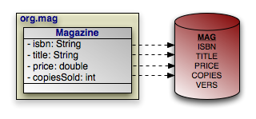

[[_jpa_overview_sqlquery]]
=== SQL Queries
(((SQL queries)))
(((Query , SQL)))
(((Native , queries)))

JPQL is a powerful query language, but there are times when it is not enough.
Maybe you're migrating a JDBC application to JPA on a strict deadline, and you don't have time to translate your existing SQL selects to JPQL.
Or maybe a certain query requires database-specific SQL your JPA implementation doesn't support.
Or maybe your DBA has spent hours crafting the perfect select statement for a query in your application's critical path.
Whatever the reason, SQL queries can remain an essential part of an application.

You are probably familiar with executing SQL queries by obtaining a [class]``
java.sql.Connection``, using the JDBC APIs to create a [class]``
Statement``, and executing that [class]``Statement`` to obtain a [class]``ResultSet``.
And of course, you are free to continue using this low-level approach to SQL execution in your JPA applications.
However, JPA also supports executing SQL queries through the [class]``jakarta.persistence.Query`` interface introduced in <<_jpa_overview_query>>.
Using a JPA SQL query, you can retrieve either persistent objects or projections of column values.
The following sections detail each use.

[[_jpa_overview_sqlquery_create]]
==== Creating SQL Queries

The [class]``EntityManager`` has two factory methods suitable for creating SQL queries:

[source]
----

public Query createNativeQuery(String sqlString, Class resultClass);
public Query createNativeQuery(String sqlString, String resultSetMapping);
----

The first method is used to create a new [class]``Query`` instance that will return instances of the specified class.

The second method uses a `SqlResultSetMapping` to determine the type of object or objects to return.
The example below shows these methods in action.

.Creating a SQL Query
====
[source]
----

EntityManager em = ...;
Query query = em.createNativeQuery("SELECT * FROM MAG", Magazine.class);
processMagazines(query.getResultList());
----
====

[NOTE]
====

(((SQL queries , stored procedures))) In addition to SELECT statements, OpenJPA supports stored procedure invocations as SQL queries.
OpenJPA will assume any SQL that does not begin with the ``SELECT`` keyword (ignoring case) is a stored procedure call, and invoke it as such at the JDBC level.
====

[[_jpa_overview_sqlquery_obj]]
==== Retrieving Persistent Objects with SQL
(((SQL queries , retrieving persistent objects)))

When you give a SQL [class]``Query`` a candidate class, it will return persistent instances of that class.
At a minimum, your SQL must select the class' primary key columns, discriminator column (if mapped), and version column (also if mapped). The JPA runtime uses the values of the primary key columns to construct each result object's identity, and possibly to match it with a persistent object already in the [class]``EntityManager``'s cache.
When an object is not already cached, the implementation creates a new object to represent the current result row.
It might use the discriminator column value to make sure it constructs an object of the correct subclass.
Finally, the query records available version column data for use in optimistic concurrency checking, should you later change the result object and flush it back to the database.

Aside from the primary key, discriminator, and version columns, any columns you select are used to populate the persistent fields of each result object.
JPA implementations will compete on how effectively they map your selected data to your persistent instance fields.

Let's make the discussion above concrete with an example.
It uses the following simple mapping between a class and the database:

.Retrieving Persistent Objects
====
[source]
----

Query query = em.createNativeQuery("SELECT ISBN, TITLE, PRICE, "
    + "VERS FROM MAG WHERE PRICE > 5 AND PRICE < 10", Magazine.class);
List<Magazine> results = (List<Magazine>) query.getResultList();
for (Magazine mag : results)
    processMagazine(mag);
----
====

The query above works as advertised, but isn't very flexible.
Let's update it to take in parameters for the minimum and maximum price, so we can reuse it to find magazines in any price range:

.SQL Query Parameters
====
[source]
----

Query query = em.createNativeQuery("SELECT ISBN, TITLE, PRICE, "
    + "VERS FROM MAG WHERE PRICE > ?1 AND PRICE < ?2", Magazine.class);

query.setParameter(1, 5d);
query.setParameter(2, 10d);

List<Magazine> results = (List<Magazine>) query.getResultList();
for (Magazine mag : results)
    processMagazine(mag);
----
====

(((SQL queries , parameters))) Like JDBC prepared statements, SQL queries represent parameters with question marks, but are followed by an integer to represent its index.

ifdef::backend-docbook[]
[index]
== Index
endif::backend-docbook[]
