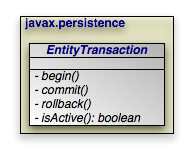

[[jpa_overview_trans]]
=== Transaction
(((transactions)))

Transactions are critical to maintaining data integrity.
They are used to group operations into units of work that act in an all-or-nothing fashion.
Transactions have the following qualities:

* (((atomicity)))
(((transactions , atomicity)))__Atomicity__.
Atomicity refers to the all-or-nothing property of transactions.
Either every data update in the transaction completes successfully, or they all fail, leaving the datastore in its original state.
A transaction cannot be only partially successful.
* (((transactions , consistency)))__Consistency__.
Each transaction takes the datastore from one consistent state to another consistent state.
* (((transactions , isolation)))__Isolation__.
Transactions are isolated from each other.
When you are reading persistent data in one transaction, you cannot "see" the changes that are being made to that data in other transactions.
Similarly, the updates you make in one transaction cannot conflict with updates made in concurrent transactions.
The form of conflict resolution employed depends on whether you are using pessimistic or optimistic transactions.
Both types are described later in this chapter.
* (((transactions , durability)))__Durability__.
The effects of successful transactions are durable; the updates made to persistent data last for the lifetime of the datastore.

(((transactions , ACID))) Together, these qualities are called the ACID properties of transactions.
To understand why these properties are so important to maintaining data integrity, consider the following example:

Suppose you create an application to manage bank accounts.
The application includes a method to transfer funds from one user to another, and it looks something like this:

[source]
----

public void transferFunds(User from, User to, double amnt) {
    from.decrementAccount(amnt);
    to.incrementAccount(amnt);
}
----

Now suppose that user Alice wants to transfer 100 dollars to user Bob.
No problem; you simply invoke your [method]``transferFunds`` method, supplying Alice in the `from` parameter, Bob in the 
`to` parameter, and `100.00` as the ``amnt``.
The first line of the method is executed, and 100 dollars is subtracted from Alice's account.
But then, something goes wrong.
An unexpected exception occurs, or the hardware fails, and your method never completes.

You are left with a situation in which the 100 dollars has simply disappeared.
Thanks to the first line of your method, it is no longer in Alice's account, and yet it was never transferred to Bob's account either.
The datastore is in an inconsistent state.

The importance of transactions should now be clear.
If the two lines of the [method]``transferFunds`` method had been placed together in a transaction, it would be impossible for only the first line to succeed.
Either the funds would be transferred properly or they would not be transferred at all, and an exception would be thrown.
Money could never vanish into thin air, and the data store could never get into an inconsistent state.

[[jpa_overview_trans_types]]
==== Transaction Types

There are two major types of transactions: pessimistic transactions and optimistic transactions.
Each type has both advantages and disadvantages.

(((transactions , pessimistic)))
(((deadlock))) Pessimistic transactions generally lock the datastore records they act on, preventing other concurrent transactions from using the same data.
This avoids conflicts between transactions, but consumes database resources.
Additionally, locking records can result in __deadlock__, a situation in which two transactions are both waiting for the other to release its locks before completing.
The results of a deadlock are datastore-dependent; usually one transaction is forcefully rolled back after some specified timeout interval, and an exception is thrown.

(((transactions , datastore))) This document will often use the term _datastore_ transaction in place of _pessimistic_ transaction.
This is to acknowledge that some datastores do not support pessimistic semantics, and that the exact meaning of a non-optimistic JPA transaction is dependent on the datastore.
Most of the time, a datastore transaction is equivalent to a pessimistic transaction.

(((transactions , optimistic))) Optimistic transactions consume less resources than pessimistic/datastore transactions, but only at the expense of reliability.
Because optimistic transactions do not lock datastore records, two transactions might change the same persistent information at the same time, and the conflict will not be detected until the second transaction attempts to flush or commit.
At this time, the second transaction will realize that another transaction has concurrently modified the same records (usually through a timestamp or versioning system), and will throw an appropriate exception.
Note that optimistic transactions still maintain data integrity; they are simply more likely to fail in heavily concurrent situations.

Despite their drawbacks, optimistic transactions are the best choice for most applications.
They offer better performance, better scalability, and lower risk of hanging due to deadlock.

[NOTE]
====
OpenJPA uses optimistic semantics by default, but supports both optimistic and datastore transactions.
OpenJPA also offers advanced locking and versioning APIs for fine-grained control over database resource allocation and object versioning.
See <<ref_guide_locking>> of the Reference Guide for details on locking. <<jpa_overview_meta_version>> of this document covers standard object versioning, while <<ref_guide_mapping_jpa>> of the Reference Guide discusses additional versioning strategies available in OpenJPA.
====

[[jpa_overview_trans_local]]
==== The EntityTransaction Interface
(((Transaction)))

JPA integrates with your container's _managed_ transactions, allowing you to use the container's declarative transaction demarcation and its Java Transaction API (JTA) implementation for transaction management.
Outside of a container, though, you must demarcate transactions manually through JPA.
The [class]``EntityTransaction`` interface controls unmanaged transactions in JPA.

[source]
----

public void begin();
public void commit();
public void rollback();
----

(((Transaction , demarcation)))
(((Transaction , begin)))
(((Transaction , rollback))) The [method]``begin``, [method]``commit``, and [method]``rollback`` methods demarcate transaction boundaries.
The methods should be self-explanatory: [method]``begin`` starts a transaction, [method]``commit`` attempts to commit the transaction's changes to the datastore, and [method]``rollback`` aborts the transaction, in which case the datastore is "rolled back" to its previous state.
JPA implementations will automatically roll back transactions if any exception is thrown during the commit process.

Unless you are using an extended persistence context, committing or rolling back also ends the persistence context.
All managed entities will be detached from the [class]``EntityManager``.

[source]
----

public boolean isActive();
----

Finally, the [method]``isActive`` method returns `true`  if the transaction is in progress ([method]``begin`` has been called more recently than [method]``commit`` or [method]``rollback``), and `false` otherwise.

[[jpa_overview_trans_group]]
.Grouping Operations with Transactions
====
[source]
----

public void transferFunds(EntityManager em, User from, User to, double amnt) {
    // note: it would be better practice to move the transaction demarcation
    // code out of this method, but for the purposes of example...
    Transaction trans = em.getTransaction();
    trans.begin();
    try
    {
        from.decrementAccount(amnt);
        to.incrementAccount(amnt);
        trans.commit();
    }
    catch (RuntimeException re)
    {
        if (trans.isActive())
            trans.rollback();   // or could attempt to fix error and retry
        throw re;
    }
}
----
====

ifdef::backend-docbook[]
[index]
== Index
endif::backend-docbook[]
