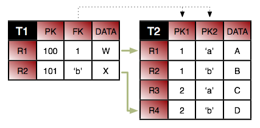
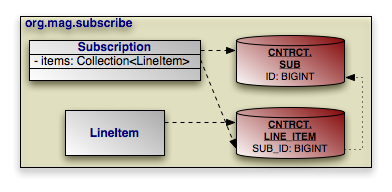
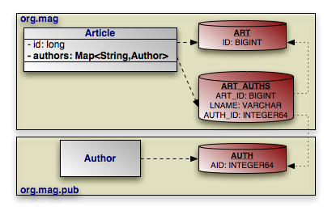

[[_ref_guide_mapping]]
=== Mapping
(((mapping metadata)))

The JPA Overview's <<_jpa_overview_mapping>> explains object-relational mapping under JPA.
This chapter reviews the mapping utilities OpenJPA provides and examines OpenJPA features that go beyond the JPA specification.

[[_ref_guide_mapping_mappingtool]]
==== Forward Mapping
(((forward mapping)))
(((mapping tool)))
(((mapping metadata , forward mapping)))

_Forward mapping_ is the process of creating mappings and their corresponding database schema from your object model.
OpenJPA supports forward mapping through the __mapping tool__.
The next section presents several common mapping tool use cases.
You can invoke the tool through its Java class, link:../../apidocs/org/apache/openjpa/jdbc/meta/MappingTool[
org.apache.openjpa.jdbc.meta.MappingTool].

[NOTE]
====
<<_ref_guide_integration_mappingtool>> describes the mapping tool Ant task.
====

.Using the Mapping Tool
====
[source]
----

java org.apache.openjpa.jdbc.meta.MappingTool Magazine.java
----
====

In addition to the universal flags of the <<_ref_guide_conf_devtools,configuration framework>>, the mapping tool accepts the following command line arguments:

* ``-schemaAction/-sa <add | refresh | drop | build | retain | reflect | createDB | dropDB | import | export | none>``: The action to take on the schema. These options correspond to the same-named actions on the schema tool described in <<_ref_guide_schema_schematool>>. Actions can be composed in a comma-separated list. Unless you are running the mapping tool on all of your persistent types at once or dropping a mapping, we strongly recommend you use the default `add` action or the ``build`` action. Otherwise you may end up inadvertently dropping schema components that are used by classes you are not currently running the tool over.
* ``-schemaFile/-sf <stdout | output file>``: Use this option to write the planned schema to an XML document rather than modify the database. The document can then be manipulated and committed to the database with the <<_ref_guide_schema_schematool, schema tool>>.
* ``-sqlFile/-sql <stdout | output file>``: Use this option to write the planned schema modifications to a SQL script rather than modify the database. Combine this with a `schemaAction` of `build`  to generate a script that recreates the schema for the current mappings, even if the schema already exists.
* ``-sqlEncode/-se <encoding>``: Use this option with `-sqlFile` to write the SQL script in a different Java character set encoding than the default JVM locale, such as ``-sqlTerminator/-st <terminal>``: Use this option with `-sqlFile` to write the SQL terminating with a different character instead of a semicolon.
* ``-dropTables/-dt <true/t | false/f>``: Corresponds to the same-named option on the schema tool.
* ``-rollbackBeforeDDL/-rbddl <true/t | false/f>``: Corresponds to the same-named option on the schema tool.
* ``-dropSequences/-dsq <true/t | false/f>``: Corresponds to the same-named option on the schema tool.
* ``-openjpaTables/-ot <true/t | false/f>``: Corresponds to the same-named option on the schema tool.
* ``-ignoreErrors/-i <true/t | false/f>``: Corresponds to the same-named option on the schema tool.
* ``-schemas/-s <schema and table names>``: Corresponds to the same-named option on the schema tool. This option is ignored if  `readSchema` is not set to ``true``.
* ``-readSchema/-rs <true/t | false/f>``: Set this option to ``true`` to read the entire existing schema when the tool runs. Reading the existing schema ensures that OpenJPA does not generate any mappings that use table, index, primary key, or foreign key names that conflict with existing names. Depending on the JDBC driver, though, it can be a slow process for large schemas.
* ``-primaryKeys/-pk <true/t | false/f>``: Whether to read and manipulate primary key information of existing tables. Defaults to false.
* ``-foreignKeys/-fk <true/t | false/f>``: Whether to read and manipulate foreign key information of existing tables. Defaults to false. This means that to add any new foreign keys to a class that has already been mapped, you must explicitly set this flag to true.
* ``-indexes/-ix <true/t | false/f>``: Whether to read and manipulate index information of existing tables. Defaults to false. This means that to add any new indexes to a class that has already been mapped once, you must explicitly set this flag to true.
* ``-sequences/-sq <true/t | false/f>``: Whether to manipulate sequences. Defaults to true.
* ``-meta/-m <true/t | false/f>``: Whether the given action applies to metadata rather than or in addition to mappings.

The mapping tool also uses an `-action/-a` argument to specify the action to take on each class.
The available actions are:

* ``buildSchema``: This is the default action. It makes the database schema match your existing mappings. If your provided mappings conflict with your class definitions, OpenJPA will fail with an informative exception.
* ``validate``: Ensure that the mappings for the given classes are valid and that they match the schema. No mappings or tables will be changed. An exception is thrown if any mappings are invalid.

Each additional argument to the tool should be one of:

* The full name of a persistent class.
* The .java file for a persistent class.
* The [path]_.class_ file of a persistent class.

If you do not supply any arguments to the mapping tool, it will run on the classes in your persistent classes list (see <<_ref_guide_pc_pcclasses>>).

The mappings generated by the mapping tool are stored by the system __
mapping factory__. <<_ref_guide_mapping_factory>> discusses your mapping factory options.

[[_ref_guide_mapping_mappingtool_examples]]
===== Using the Mapping Tool

The JPA specification defines a comprehensive set of defaults for missing mapping information.
Thus, forward mapping in JPA is virtually automatic.
After using the mapping annotations covered in <<_jpa_overview_mapping>> of the JPA Overview to override any unsatisfactory defaults, run the mapping tool on your persistent classes.
The default `buildSchema`  mapping tool action manipulates the database schema to match your mappings.
It fails if any of your mappings don't match your object model.

.Creating the Relational Schema from Mappings
====
[source]
----

java org.apache.openjpa.jdbc.meta.MappingTool Magazine.java
----
====

To drop the schema for a persistent class, set the mapping tool's 
`schemaAction` to ``drop``.

.Refreshing entire schema and cleaning out tables
====
(((testing , Rebuild mappings and clean tables)))
[source]
----

java org.apache.openjpa.jdbc.meta.MappingTool -schemaAction add,deleteTableContents
----
====

.Dropping Mappings and Association Schema
====
[source]
----

java org.apache.openjpa.jdbc.meta.MappingTool -schemaAction drop Magazine.java
----
====

[[_ref_guide_ddl_examples]]
===== Generating DDL SQL
(((DDL , with mapping tool)))

The examples below show how to use the mapping tool to generate DDL SQL scripts, rather than modifying the database directly.

.Create DDL for Current Mappings
====
This example uses your existing mappings to determine the needed schema, then writes the SQL to create that schema to [path]_create.sql_.

[source]
----

java org.apache.openjpa.jdbc.meta.MappingTool -schemaAction build -sql create.sql Magazine.java
----
====

.Create DDL to Update Database for Current Mappings
====
This example uses your existing mappings to determine the needed schema.
It then writes the SQL to add any missing tables and columns to the current schema to [path]_update.sql_.

[source]
----

java org.apache.openjpa.jdbc.meta.MappingTool -sql update.sql Magazine.java
----
====

[[_ref_guide_mapping_synch]]
===== Runtime Forward Mapping
(((mapping metadata , automatic runtime mapping)))

You can configure OpenJPA to automatically run the mapping tool at runtime through the <<_openjpa.jdbc.synchronizemappings,
`openjpa.jdbc.SynchronizeMappings`>> configuration property.
Using this property saves you the trouble of running the mapping tool manually, and is meant for use during rapid test/debug cycles.

In order to enable automatic runtime mapping, you must first list all your persistent classes as described in <<_ref_guide_pc_pcclasses>>.

OpenJPA will run the mapping tool on these classes when your application obtains its first [class]``EntityManager``.

The `openjpa.jdbc.SynchronizeMappings` property is a plugin string (see <<_ref_guide_conf_plugins>>) where the class name is the mapping tool action to invoke, and the properties are the [class]``MappingTool`` class' JavaBean properties.
These properties correspond go the long versions of the tool's command line flags.

.Configuring Runtime Forward Mapping
====
[source]
----

<property name="openjpa.jdbc.SynchronizeMappings" value="buildSchema(ForeignKeys=true)"/>
----

The setting above corresponds to running the following command:

[source]
----

java org.apache.openjpa.jdbc.meta.MappingTool -action buildSchema -foreignKeys true
----
====

[[_ref_guide_pc_reverse]]
==== Reverse Mapping
(((reverse mapping tool)))
(((mapping metadata , reverse mapping)))

OpenJPA includes a _reverse mapping_ tool for generating persistent class definitions, complete with metadata, from an existing database schema.
You do not have to use the reverse mapping tool to access an existing schema; you are free to write your classes and mappings yourself, as described in <<_ref_guide_mapping_middle>>.
The reverse mapping tool, however, can give you an excellent starting point from which to grow your persistent classes.

To use the reverse mapping tool, follow the steps below:

. Use the <<_ref_guide_schema_schematool, schema tool>> to export your current schema to an XML schema file. You can skip this step and the next step if you want to run the reverse mapping tool directly against the database.


.Reflection with the Schema Tool
====
[source]
----

java org.apache.openjpa.jdbc.schema.SchemaTool -a reflect -f schema.xml
----
====
. Examine the generated schema file. JDBC drivers often provide incomplete or faulty metadata, in which case the file will not exactly match the actual schema. Alter the XML file to match the true schema. The XML format for the schema file is described in <<_ref_guide_schema_xml>>.

After fixing any errors in the schema file, modify the XML to include foreign keys between all relations.
The schema tool will have automatically detected existing foreign key constraints; many schemas, however, do not employ database foreign keys for every relation.
By manually adding any missing foreign keys, you will give the reverse mapping tool the information it needs to generate the proper relations between the persistent classes it creates.
. Run the reverse mapping tool on the finished schema file. If you do not supply the schema file to reverse map, the tool will run directly against the schema in the database. The tool can be run via its Java class, link:../../apidocs/org/apache/openjpa/jdbc/meta/ReverseMappingTool[ org.apache.openjpa.jdbc.meta.ReverseMappingTool].

[#_ref_guide_pc_reverse_reversemappingtool]
.Using the Reverse Mapping Tool
====
[source]
----

java org.apache.openjpa.jdbc.meta.ReverseMappingTool -pkg com.xyz -d ~/src -cp customizer.properties schema.xml
----
====

In addition to OpenJPA's <<_ref_guide_conf_devtools,standard
configuration flags>>, including <<_ref_guide_conf_devtools_format,code formatting options>>, the reverse mapping tool recognizes the following command line arguments:
** ``-schemas/-s <schema and table names>``: A comma-separated list of schema and table names to reverse map, if no XML schema file is supplied. Each element of the list must follow the naming conventions for the `openjpa.jdbc.Schemas` property described in <<_ref_guide_schema_info_list>>. In fact, if this flag is omitted, it defaults to the value of the `Schemas` property. If the `Schemas` property is not defined, all schemas will be reverse-mapped.
** ``-package/-pkg <package name>``: The package name of the generated classes. If no package name is given, the generated code will not contain package declarations.
** ``-directory/-d <output directory>``: All generated code and metadata will be written to the directory at this path. If the path does not match the package of a class, the package structure will be created beneath this directory. Defaults to the current directory.
** ``-metadata/-md <class | package | none>``: Specify the level the metadata should be generated at. Defaults to generating a single package-level metadata file. Set to `none` to disable orm.xml generation.
** ``-annotations/-ann <true/t | false/f>``: Set to ``true`` to generate JPA annotations in generated Java classes.
** ``-accessType/-access <field | property>``: Change access type for generated annotations. Defaults to field access.
** ``-useSchemaName/-sn <true/t | false/f>``: Set this flag to `true` to include the schema as well as table name in the name of each generated class. This can be useful when dealing with multiple schemas with same-named tables.
** ``-useSchemaElement/-se <true/t | false/f>``: Set this flag to `false` to exclude the schema name from the ``@Table`` annotation in the generated class for each table. If set to ``false``, the schema name will also be removed from the corresponding XML mapping files (orm.xml) that are generated by the tool. The initialized value is true (in order to preserve backwards compatibility).
** ``-useForeignKeyName/-fkn <true/t | false/f>``: Set this flag to `true` if you would like field names for relations to be based on the database foreign key name. By default, relation field names are derived from the name of the related class.
** ``-nullableAsObject/-no <true/t | false/f>``: By default, all non-foreign key columns are mapped to primitives. Set this flag to  `true` to generate primitive wrapper fields instead for columns that allow null values.
** ``-blobAsObject/-bo <true/t | false/f>``: By default, all binary columns are mapped to [class]``byte[]`` fields. Set this flag to `true` to map them to [class]``Object`` fields instead. Note that when mapped this way, the column is presumed to contain a serialized Java object.
** ``-primaryKeyOnJoin/-pkj <true/t | false/f>``: The standard reverse mapping tool behavior is to map all tables with primary keys to persistent classes. If your schema has primary keys on many-many join tables as well, set this flag to `true` to avoid creating classes for those tables.
** ``-inverseRelations/-ir <true/t | false/f>``: Set to ``false`` to prevent the creation of inverse 1-many/1-1 relations for every many-1/1-1 relation detected.
** ``-useGenericCollections/-gc <true/t | false/f>``: Set to true to use generic collections on OneToMany and ManyToMany relations.
** ``-useDatastoreIdentity/-ds <true/t | false/f>``: Set to ``true`` to use datastore identity for tables that have single numeric primary key columns. The tool typically uses application identity for all generated classes.
** ``-useBuiltinIdentityClass/-bic <true/t | false/f>``: Set to `false` to prevent the tool from using built-in application identity classes when possible. This will force the tool to create custom application identity classes even when there is only one primary key column.
** ``-innerIdentityClasses/-inn <true/t | false/f>``: Set to ``true`` to have any generated application identity classes be created as static inner classes within the persistent classes. Defaults to ``false``.
** ``-identityClassSuffix/-is <suffix>``: Suffix to append to class names to form application identity class names, or for inner identity classes, the inner class name. Defaults to ``Id``.
** ``-typeMap/-typ <type mapping>``: A string that specifies the default Java classes to generate for each SQL type that is seen in the schema. The format is ``SQLTYPE1=JavaClass1,SQLTYPE2=JavaClass2``. The SQL type name first looks for a customization based on ``SQLTYPE(SIZE,PRECISION)``, then ``SQLTYPE(SIZE)``, then ``SQLTYPE``. So if a column whose type name is ``CHAR`` is found, it will first look for the  `CHAR(50,0)` type name specification, then it will look for ``CHAR(50)``, and finally it will just look for ``CHAR``. For example, to generate a char array for every `CHAR` column whose size is exactly 50, and to generate a `short` for every type name of ``INTEGER``, you might specify: ``CHAR(50)=char[],INTEGER=short``. Note that since various databases report different type names differently, one database's type name specification might not work for another database. Enable `TRACE` level logging on the `MetaData` channel to track which type names OpenJPA is examining.
** ``-customizerClass/-cc <class name>``: The full class name of a link:../../apidocs/org/apache/openjpa/jdbc/meta/ReverseCustomizer.html[ org.apache.openjpa.jdbc.meta.ReverseCustomizer] customization plugin. If you do not specify a reverse customizer of your own, the system defaults to a link:../../apidocs/org/apache/openjpa/jdbc/meta/PropertiesReverseCustomizer.html[ PropertiesReverseCustomizer]. This customizer allows you to specify simple customization options in the properties file given with the `-customizerProperties` flag below. We present the available property keys <<_ref_guide_pc_reverse_custom, below>>.
** `-customizerProperties/-cp <properties file or resource>` : The path or resource name of a properties file to pass to the reverse customizer on initialization.
** `-customizer./-c.<property name> <property value>` : The given property name will be matched with the corresponding Java bean property in the specified reverse customizer, and set to the given value.


Running the tool will generate [path]_.java_ files for each generated class (and its application identity class, if applicable), along with JPA annotations (if enabled by setting ``-annotations true``), or an [path]_orm.xml_ file (if not disabled with ``-metadata none``) containing the corresponding persistence metadata.
. Examine the generated class, metadata, and mapping information, and modify it as necessary. Remember that the reverse mapping tool only provides a starting point, and you are free to make whatever modifications you like to the code it generates.

After you are satisfied with the generated classes and their mappings, you should first compile the classes with ``javac``, ``jikes``, or your favorite Java compiler.
Make sure the classes are located in the directory corresponding to the `-package` flag you gave the reverse mapping tool.
Next, if you have generated an [path]_orm.xml_, move that file to a [path]_META-INF_ directory within a directory in your classpath.
Finally, enhance the classes if necessary (see <<_ref_guide_pc_enhance>>).

Your persistent classes are now ready to access your existing schema.

[[_ref_guide_pc_reverse_custom]]
===== Customizing Reverse Mapping

The [class]``org.apache.openjpa.jdbc.meta.ReverseCustomizer`` plugin interface allows you to customize the reverse mapping process.
See the class link:../../apidocs/org/apache/openjpa/jdbc/meta/ReverseCustomizer.html[
Javadoc] for details on the hooks that this interface provides.
Specify the concrete plugin implementation to use with the 
`-customizerClass/-cc` command-line flag, described in the preceding section.

By default, the reverse mapping tool uses a link:../../apidocs/org/apache/openjpa/jdbc/meta/PropertiesReverseCustomizer.html[
org.apache.openjpa.jdbc.meta.PropertiesReverseCustomizer
].
This customizer allows you to perform relatively simple customizations through the properties file named with the 
`-customizerProperties` tool flag.
The customizer recognizes the following properties:

* ``<table name>.table-type <type>``: Override the default type of the table with name ``<table name>``. Legal values are:
** ``base``: Primary table for a base class.
** ``secondary``: Secondary table for a class. The table must have a foreign key joining to a class table.
** ``secondary-outer``: Outer-joined secondary table for a class. The table must have a foreign key joining to a class table.
** ``association``: Association table. The table must have two foreign keys to class tables.
** ``collection``: Collection table. The table must have one foreign key to a class table and one data column.
** ``subclass``: A joined subclass table. The table must have a foreign key to the superclass' table.
** ``none``: The table should not be reverse-mapped.
* ``<class name>.rename <new class name>``: Override the given tool-generated name `<class name>` with a new value. Use full class names, including package. You are free to rename a class to a new package. Specify a value of `none` to reject the class and leave the corresponding table unmapped.
* ``<table name>.class-name <new class name>``: Assign the given fully-qualified class name to the type created from the table with name ``<table name>``. Use a value of `none`  to prevent reverse mapping this table. This property can be used in place of the `rename` property.
* ``<class name>.identity <datastore | builtin | identity class name>``: Set this property to `datastore` to use datastore identity for the class ``<class name>``, ``builtin`` to use a built-in identity class, or the desired application identity class name. Give full class names, including package. You are free to change the package of the identity class this way. If the persistent class has been renamed, use the new class name for this property key. Remember that datastore identity requires a table with a single numeric primary key column, and built-in identity requires a single primary key column of any type.
* ``<class name>.<field name>.rename <new field name>``: Override the tool-generated `<field name>` in class `<class name>` with the given name. Use the field owner's full class name in the property key. If the field owner's class was renamed, use the new class name. The property value should be the new field name, without the preceding class name. Use a value of `none` to reject the generated mapping and remove the field from the class.
* ``<table name>.<column name>.field-name <new field name>``: Set the generated field name for the `<table name>` table's `<column name>` column. If this is a multi-column mapping, any of the columns can be used. Use a value of ``none`` to prevent the column and its associated columns from being reverse-mapped.
* `<class name>.<field name>.type <field type>` : The type to give the named field. Use full class names. If the field or the field's owner class has been renamed, use the new name.
* ``<class name>.<field name>.value``: The initial value for the named field. The given string will be placed as-is in the generated Java code, so be sure it is valid Java. If the field or the field's owner class has been renamed, use the new name.

All property keys are optional; if not specified, the customizer keeps the default value generated by the reverse mapping tool.

.Customizing Reverse Mapping with Properties
====
[source]
----

java org.apache.openjpa.jdbc.meta.ReverseMappingTool -pkg com.xyz -cp custom.properties schema.xml
----

Example [path]_custom.properties_:

[source]
----

com.xyz.TblMagazine.rename:             com.xyz.Magazine
com.xyz.TblArticle.rename:              com.xyz.Article
com.xyz.TblPubCompany.rename:           com.xyz.pub.Company
com.xyz.TblSysInfo.rename:              none

com.xyz.Magazine.allArticles.rename:    articles
com.xyz.Magazine.articles.type:         java.util.Collection
com.xyz.Magazine.articles.value:        new TreeSet()
com.xyz.Magazine.identity:              datastore

com.xyz.pub.Company.identity:           com.xyz.pub.CompanyId
----
====

[[_ref_guide_mapping_middle]]
==== Meet-in-the-Middle Mapping
(((reverse mapping tool)))
(((mapping metadata , meet-in-the-middle mapping)))

In the _meet-in-the-middle_ mapping approach, you control both the relational model and the object model.
It is up to you to define the mappings between these models.
The mapping tool's `validate` action is useful to meet-in-the-middle mappers.
This action verifies that the mapping information for a class matches the class definition and the existing schema.
It throws an informative exception when your mappings are incorrect.

.Validating Mappings
====
[source]
----

java org.apache.openjpa.jdbc.meta.MappingTool -action validate Magazine.java
----
====

The `buildSchema` action we discussed in <<_ref_guide_mapping_mappingtool>> is also somewhat useful during meet-in-the-middle mapping.
Unlike the `validate` action, which throws an exception if your mapping data does not match the existing schema, the `buildSchema` action assumes your mapping data is correct, and modifies the schema to match your mappings.
This lets you modify your mapping data manually, but saves you the hassle of using your database's tools to bring the schema up-to-date.

[[_ref_guide_mapping_defaults]]
==== Mapping Defaults
(((mapping metadata , defaults)))

The previous sections showed how to use the mapping tool to generate default mappings.
But how does the mapping tool know what mappings to generate? The answer lies in the link:../../apidocs/org/apache/openjpa/jdbc/meta/MappingDefaults.html[
org.apache.openjpa.jdbc.meta.MappingDefaults] interface.
OpenJPA uses an instance of this interface to decide how to name tables and columns, where to put foreign keys, and generally how to create a schema that matches your object model.

[IMPORTANT]
====
OpenJPA relies on foreign key constraint information at runtime to order SQL appropriately.
Be sure to set your mapping defaults to reflect your existing database constraints, set the schema factory to reflect on the database for constraint information (see <<_ref_guide_schema_info_factory>>), or use explicit foreign key mappings as described in <<_ref_guide_mapping_jpa_fk>>.
====

The <<_openjpa.jdbc.mappingdefaults,
`openjpa.jdbc.MappingDefaults`>> configuration property controls the [class]``MappingDefaults`` interface implementation in use.
This is a plugin property (see <<_ref_guide_conf_plugins>>), so you can substitute your own implementation or configure the existing ones.
OpenJPA includes the following standard implementations:

* ``jpa``: Provides defaults in compliance with the JPA standard. This is an alias for the link:../../apidocs/org/apache/openjpa/persistence/jdbc/PersistenceMappingDefaults.html[ org.apache.openjpa.persistence.jdbc.PersistenceMappingDefaults ] class. This class extends the [class]``MappingDefaultsImpl`` class described below, so it has all the same properties (though with different default values), as well as:
** ``PrependFieldNameToJoinTableInverseJoinColumns``: Whether to prepend the owning field name to the names of inverse join columns in join tables. Defaults to true per the JPA specification. Set to false for compatibility with older OpenJPA versions which did not prepend the field name.
* ``default``: This is an alias for the link:../../apidocs/org/apache/openjpa/jdbc/meta/MappingDefaultsImpl.html[ org.apache.openjpa.jdbc.meta.MappingDefaultsImpl] class. This default implementation is highly configurable. It has the following properties:
** ``DefaultMissingInfo``: Whether to default missing column and table names rather than throw an exception. If set to false, full explicit mappings are required at runtime and when using mapping tool actions like ``buildSchema`` and ``validate``.
** ``RemoveHungarianNotation``: Switches on/off removal of Hungarian notation when generating column names. Fields such as `mFoobar` and `strBarFoo` would become columns named `foobar` and ``barfoo`` respectively. OpenJPA will search for the first instance of a uppercase character in the field name and then truncate the column name to remove anything before it.
** ``BaseClassStrategy``: The default mapping strategy for base classes. You can specify a built-in strategy alias or the full class name of a <<_ref_guide_mapping_custom_class,custom class strategy>>. You can also use OpenJPA's plugin format (see <<_ref_guide_conf_plugins>>) to pass arguments to the strategy instance. See the link:../../apidocs/org/apache/openjpa/jdbc/meta/strats/package-summary.html[ org.apache.openjpa.jdbc.meta.strats] package for available strategies.
** ``SubclassStrategy``: The default mapping strategy for subclasses. You can specify a builtin strategy alias or the full class name of a <<_ref_guide_mapping_custom_class, custom class strategy>>. You can also use OpenJPA's plugin format (see <<_ref_guide_conf_plugins>>) to pass arguments to the strategy instance. Common strategies are `vertical` and ``flat``, the default. See the link:../../apidocs/org/apache/openjpa/jdbc/meta/strats/package-summary.html[ org.apache.openjpa.jdbc.meta.strats] package for all available strategies.
** ``VersionStrategy``: The default version strategy for classes without a version field. You can specify a builtin strategy alias or the full class name of a <<_ref_guide_mapping_custom_versdiscrim, custom version strategy>>. You can also use OpenJPA's plugin format (see <<_ref_guide_conf_plugins>>) to pass arguments to the strategy instance. Common strategies are ``none``, ``state-comparison``, ``timestamp``, and ``version-number``, the default. See the link:../../apidocs/org/apache/openjpa/jdbc/meta/strats/package-summary.html[ org.apache.openjpa.jdbc.meta.strats] package for all available strategies.
** ``DiscriminatorStrategy``: The default discriminator strategy when no discriminator value is given. You can specify a builtin strategy alias or the full class name of a <<_ref_guide_mapping_custom_versdiscrim, custom discriminator strategy>>. You can also use OpenJPA's plugin format (see <<_ref_guide_conf_plugins>>) to pass arguments to the strategy instance. Common strategies are `final` for a base class without subclasses, `none` to use joins to subclass tables rather than a discriminator column, and ``class-name``, the default. See the link:../../apidocs/org/apache/openjpa/jdbc/meta/strats/package-summary.html[ org.apache.openjpa.jdbc.meta.strats] package for all available strategies.
** ``FieldStrategies``: This property associates field types with custom strategies. The format of this property is similar to that of plugin strings (see <<_ref_guide_conf_plugins>> ), without the class name. It is a comma-separated list of key/value pairs, where each key is a possible field type, and each value is itself a plugin string describing the strategy for that type. We present an example below. See <<_ref_guide_mapping_custom_field>> for information on custom field strategies.
** ``ForeignKeyDeleteAction``: The default delete action of foreign keys representing relations to other objects. Recognized values include ``restrict``, ``cascade``, `null` , ``default``. These values correspond exactly to the standard database foreign key actions of the same names.

The value `none` tells OpenJPA not to create database foreign keys on relation columns.
This is the default.
** ``JoinForeignKeyDeleteAction``: The default delete action of foreign keys that join secondary, collection, map, or subclass tables to the primary table. Accepts the same values as the  `ForeignKeyDeleteAction` property above.
** ``DeferConstraints``: Whether to use deferred database constraints if possible. Defaults to false.
** ``IndexLogicalForeignKeys``: Boolean property controlling whether to create indexes on logical foreign keys. Logical foreign keys are columns that represent a link between tables, but have been configured through the `ForeignKey` properties above not to use a physical database foreign key. Defaults to true.
** ``IndexPhysicalForeignKeys``: Boolean property controlling whether to create explicit indexes for real physical foreign keys depending on the corresponding `DBDictionary` attribute. Set this to

// <litreral>true</litreral>
 if you want to make sure that foreign keys are indexed.
Defaults to false for backward compatibility reasons.
** ``DataStoreIdColumnName``: The default name of datastore identity columns.
** ``DiscriminatorColumnName``: The default name of discriminator columns.
** ``IndexDiscriminator``: Whether to index the discriminator column. Defaults to true.
** ``VersionColumnName``: The default name of version columns.
** ``IndexVersion``: Whether to index the version column. Defaults to false.
** ``AddNullIndicator``: Whether to create a synthetic null indicator column for embedded mappings. The null indicator column allows OpenJPA to distinguish between a null embedded object and one with default values for all persistent fields.
** ``NullIndicatorColumnName``: The default name of synthetic null indicator columns for embedded objects.
** ``OrderLists``: Whether to create a database ordering column for maintaining the order of persistent lists and arrays.
** ``OrderColumnName``: The default name of collection and array ordering columns.
** ``StoreEnumOrdinal``: Set to true to store enum fields as numeric ordinal values in the database. The default is to store the enum value name as a string, which is more robust if the Java enum declaration might be rearranged.
** ``StoreUnmappedObjectIdString``: Set to true to store the stringified identity of related objects when the declared related type is unmapped. By default, OpenJPA stores the related object's primary key value(s). However, this breaks down if different subclasses of the related type use incompatible primary key structures. In that case, stringifying the identity value is the better choice.

The example below turns on foreign key generation during schema creation and associates the [class]``org.mag.data.InfoStruct`` field type with the custom [class]``org.mag.mapping.InfoStructHandler`` value handler.

.Configuring Mapping Defaults
====
[source]
----

<property name="openjpa.jdbc.MappingDefaults"
    value="ForeignKeyDeleteAction=restrict,
    FieldStrategies='org.mag.data.InfoStruct=org.mag.mapping.InfoStructHandler'"/>
----
====

[[_ref_guide_mapping_factory]]
==== Mapping Factory
(((MappingFactory)))
(((mapping metadata , loading and storing)))

An important decision in the object-relational mapping process is how and where to store the data necessary to map your persistent classes to the database schema.

<<_ref_guide_meta_factory>> introduced OpenJPA's [class]``MetaDataFactory`` interface.
OpenJPA uses this same interface to abstract the storage and retrieval of mapping information.
OpenJPA includes the built-in mapping factories below, and you can create your own factory if you have custom needs.
You control which mapping factory OpenJPA uses with the <<_openjpa.jdbc.mappingfactory,
`openjpa.jdbc.MappingFactory`>> configuration property.

The bundled mapping factories are:

* ``-``: Leaving the  `openjpa.jdbc.MappingFactory`  property unset allows your metadata factory to take over mappings as well. If you are using the default `jpa` metadata factory, OpenJPA will read mapping information from your annotations and [path]_orm.xml_ when you leave the mapping factory unspecified.


.Standard JPA Configuration
====
In the standard JPA configuration, the mapping factory is left unset.

[source]
----

<property name="openjpa.MetaDataFactory" value="jpa"/>
----
====

[[_ref_guide_mapping_notes_nonstdjoins]]
==== Non-Standard Joins

The JPA Overview's <<_jpa_overview_mapping>> explains join mapping.
All of the examples in that document, however, use "standard" joins, in that there is one foreign key column for each primary key column in the target table.
OpenJPA supports additional join patterns, including partial primary key joins, non-primary key joins, and joins using constant values.


(((joins , partial primary key))) In a partial primary key join, the source table only has foreign key columns for a subset of the primary key columns in the target table.
So long as this subset of columns correctly identifies the proper row(s) in the referenced table, OpenJPA will function properly.
There is no special syntax for expressing a partial primary key join - just do not include column definitions for missing foreign key columns.

In a non-primary key join, at least one of the target columns is not a primary key.
Once again, OpenJPA supports this join type with the same syntax as a primary key join.
There is one restriction, however: each non-primary key column you are joining to must be controlled by a field mapping that implements the link:../../apidocs/org/apache/openjpa/jdbc/meta/Joinable.html[
org.apache.openjpa.jdbc.meta.Joinable] interface.
All built in basic mappings implement this interface, including basic fields of embedded objects.
OpenJPA will also respect any custom mappings that implement this interface.
See <<_ref_guide_mapping_custom>> for an examination of custom mappings.


(((joins , constant))) Not all joins consist of only links between columns.
In some cases you might have a schema in which one of the join criteria is that a column in the source or target table must have some constant value.
OpenJPA calls joins involving constant values __constant joins__.

To form a constant join in JPA mapping, first set the ``JoinColumn``'s `name` attribute to the name of the column.
If the column with the constant value is the target of the join, give its fully qualified name in the form ``<table name>.<column name>``.
Next, set the `referencedColumnName` attribute to the constant value.
If the constant value is a string, place it in single quotes to differentiate it from a column name.




Consider the tables above.
First, we want to join row `T1.R1` to row ``T2.R1``.
If we just join column `T1.FK` to ``T2.PK1``, we will wind up matching both `T2.R1`  and ``T2.R2``.
So in addition to joining 
`T1.FK` to ``T2.PK1``, we also have to specify that ``T2.PK2`` has the value ``a``.
Here is how we'd accomplish this in mapping metadata.

[source]
----

@Entity
@Table(name="T1")
public class ...  {

    @ManyToOne
    @JoinColumns({
        @JoinColumn(name="FK" referencedColumnName="PK1"),
        @JoinColumn(name="T2.PK2" referencedColumnName="'a'")
    });
    private ...;
}
----

Notice that we had to fully qualify the name of column `PK2` because it is in the target table.
Also notice that we put single quotes around the constant value so that it won't be confused with a column name.
You do not need single quotes for numeric constants.
For example, the syntax to join ``T1.R2`` to `T2.R4` is:

[source]
----

@Entity
@Table(name="T1")
public class ...  {

    @ManyToOne
    @JoinColumns({
        @JoinColumn(name="FK" referencedColumnName="PK2"),
        @JoinColumn(name="T2.PK1" referencedColumnName="2")
    });
    private ...;
}
----

Finally, from the inverse direction, these joins would look like this:

[source]
----

@Entity
@Table(name="T2")
public class ...  {

    @ManyToOne
    @JoinColumns({
        @JoinColumn(name="T1.FK" referencedColumnName="PK1"),
        @JoinColumn(name="PK2" referencedColumnName="'a'")
    });
    private ...;

    @ManyToOne
    @JoinColumns({
        @JoinColumn(name="T1.FK" referencedColumnName="PK2"),
        @JoinColumn(name="PK1" referencedColumnName="2")
    });
    private ...;
}
----

[[_ref_guide_mapping_jpa]]
==== Additional JPA Mappings

OpenJPA supports many persistence strategies beyond those of the JPA specification. <<_ref_guide_meta_jpa>> covered the logical metadata for OpenJPA's additional persistence strategies.
We now demonstrate how to map entities using these strategies to the database.

[[_ref_guide_mapping_jpa_datastoreid]]
===== Datastore Identity Mapping
(((datastore identity , mapping)))
(((DataStoreIdColumn)))
(((primary key)))

<<_ref_guide_pc_oid>> describes how to use datastore identity in JPA.
OpenJPA requires a single numeric primary key column to hold datastore identity values.
The link:../../apidocs/org/apache/openjpa/persistence/jdbc/DataStoreIdColumn.html[
org.apache.openjpa.persistence.jdbc.DataStoreIdColumn
] annotation customizes the datastore identity column.
This annotation has the following properties:

* ``String name``: Defaults to ``ID``.
* `int precision`
* `String columnDefinition`
* `boolean insertable`
* `boolean updatable`

All properties correspond exactly to the same-named properties on the standard [class]``Column`` annotation, described in <<_jpa_overview_mapping_column>>.

.Datastore Identity Mapping
====
[source]
----

import org.apache.openjpa.persistence.*;
import org.apache.openjpa.persistence.jdbc.*;

@Entity
@Table(name="LOGS")
@DataStoreIdColumn(name="ENTRY")
public class LogEntry {

    @Lob
    private String content;

    ...
}
----
====

[[_ref_guide_mapping_jpa_version]]
===== Surrogate Version Mapping
(((version , mapping)))
(((VersionColumn)))

OpenJPA supports version fields as defined by the JPA specification, but allows you to use a surrogate version column in place of a version field if you like.
You map the surrogate version column with the link:../../apidocs/org/apache/openjpa/persistence/jdbc/VersionColumn.html[
org.apache.openjpa.persistence.jdbc.VersionColumn] annotation.
You can also use the link:../../apidocs/org/apache/openjpa/persistence/jdbc/VersionColumns.html[
org.apache.openjpa.persistence.jdbc.VersionColumns
] annotation to declare an array of [class]``VersionColumn`` values.
Each [class]``VersionColumn`` has the following properties:

* ``String name``: Defaults to ``VERSN``.
* `String table`
* `int length`
* `int precision`
* `int scale`
* `String columnDefinition`
* `boolean nullable`
* `boolean insertable`
* `boolean updatable`

All properties correspond exactly to the same-named properties on the standard [class]``Column`` annotation, described in <<_jpa_overview_mapping_column>>.

By default, OpenJPA assumes that surrogate versioning uses a version number strategy.
You can choose a different strategy with the [class]``VersionStrategy`` annotation described in <<_version_strategy>>.

If multiple columns are used for surrogate versioning, then each column, by default, uses a version number.
But column definition for each version column can be set independently to other numeric types.
The version values are compared to detect optimistic concurrent modification.
Such comparison must determine whether a version value `v1` represents an earlier, later or same with respect to another version value ``v2``.
While result of such comparison is obvious for a single numeric column that monotonically increases on each update, the same is not true when version value is an array of numbers.
By default, OpenJPA compares a version ``v1`` as later than another version ``v2``, if any array element of `v1` is later than the corresponding element of ``v2``. ``v1`` is equal to `v2` if every array element is equal and `v1` is earlier to `v1` if some elements of `v1` are earlier and rest are equal to corresponding element of ``v2``.

Multiple surrogate version columns can be spread across primary and secondary tables.
For example, following example shows 3 version columns ``v01, v11, v12, v21`` defined across the primary and secondary tables of a persistent entity

[source]
----

@Entity
@Table(name="PRIMARY")
@SecondaryTables({
    @SecondaryTable(name = "SECONDARY_1"),
    @SecondaryTable(name = "SECONDARY_2")
})
@VersionStrategy("version-numbers")
@VersionColumns({
    @VersionColumn(name = "v01") // default is the PRIMARY table
    @VersionColumn(name = "v11", table="SECONDARY_1", columnDefinition="FLOAT", scale=3, precision=10),
    @VersionColumn(name = "v12", table="SECONDARY_1"),
    @VersionColumn(name = "v21", table="SECONDARY_2"),
})
----

[[_ref_guide_mapping_jpa_columns]]
===== Multi-Column Mappings
(((mapping metadata , column)))
(((Columns)))

OpenJPA makes it easy to create multi-column <<_ref_guide_mapping_custom_field,custom mappings>>.
The JPA specification includes a [class]``Column`` annotation, but is missing a way to declare multiple columns for a single field.
OpenJPA remedies this with the link:../../apidocs/org/apache/openjpa/persistence/jdbc/Columns.html[
org.apache.openjpa.persistence.jdbc.Columns] annotation, which contains an array of [class]``Column`` values.

Remember to annotate custom field types with [class]``Persistent``, as described in <<_ref_guide_meta_jpa_persistent>>.

[[_ref_guide_mapping_jpa_fieldjoin]]
===== Join Column Attribute Targets

<<_jpa_overview_mapping_rel>> in the JPA Overview introduced you to the [class]``JoinColumn`` annotation.
A [class]``JoinColumn``'s  `referencedColumnName` property declares which column in the table of the related type this join column links to.
Suppose, however, that the related type is unmapped, or that it is part of a table-per-class inheritance hierarchy.
Each subclass that might be assigned to the field could reside in a different table, and could use entirely different names for its primary key columns.
It becomes impossible to supply a single ``referencedColumnName`` that works for all subclasses.

OpenJPA rectifies this by allowing you to declare which _attribute_  in the related type each join column links to, rather than which column.
If the attribute is mapped differently in various subclass tables, OpenJPA automatically forms the proper join for the subclass record at hand.
The link:../../apidocs/org/apache/openjpa/persistence/jdbc/XJoinColumn.html[
org.apache.openjpa.persistence.jdbc.XJoinColumn] annotation has all the same properties as the standard [class]``JoinColumn`` annotation, but adds an additional 
`referencedAttributeName` property for this purpose.
Simply use a [class]``XJoinColumn`` in place of a [class]``JoinColumn`` whenever you need to access this added functionality.

For compound keys, use the link:../../apidocs/org/apache/openjpa/persistence/jdbc/XJoinColumns.html[
org.apache.openjpa.persistence.jdbc.XJoinColumns] annotation.
The value of this annotation is an array of individual [class]``XJoinColumn``s.

[[_ref_guide_mapping_jpa_embed]]
===== Embedded Mapping

JPA uses the [class]``AttributeOverride`` annotation to override the default mappings of an embeddable class.
The JPA Overview details this process in <<_jpa_overview_mapping_embed>>. [class]``AttributeOverride``s suffice for simple mappings, but do not allow you to override complex mappings.
Also, JPA has no way to differentiate between a null embedded object and one with default values for all of its fields.

OpenJPA overcomes these shortcomings with the link:../../apidocs/org/apache/openjpa/persistence/jdbc/EmbeddedMapping.html[
org.apache.openjpa.persistence.jdbc.EmbeddedMapping
] annotation.
This annotation has the following properties:

* ``String nullIndicatorColumnName``: If the named column's value is ``NULL``, then the embedded object is assumed to be null. If the named column has a non- `NULL` value, then the embedded object will get loaded and populated with data from the other embedded fields. This property is entirely optional. By default, OpenJPA always assumes the embedded object is non-null, just as in standard JPA mapping.

If the column you name does not belong to any fields of the embedded object, OpenJPA will create a synthetic null-indicator column with this name.
In fact, you can specify a value of `true` to simply indicate that you want a synthetic null-indicator column, without having to come up with a name for it.
A value of `false` signals that you explicitly do not want a null-indicator column created for this mapping (in case you have configured your <<_ref_guide_mapping_defaults,mapping defaults >> to create one by default).
* ``String nullIndicatorFieldName``: Rather than name a null indicator column, you can name a field of the embedded type. OpenJPA will use the column of this field as the null-indicator column.
* ``MappingOverride[] overrides``: This array allows you to override any mapping of the embedded object.

The [class]``EmbeddedMapping``'s `overrides` array serves the same purpose as standard JPA's [class]``AttributeOverride`` s and [class]``AssociationOverride`` s.
In fact, you can also use the [class]``MappingOverride`` annotation on an entity class to override a complex mapping of its mapped superclass, just as you can with [class]``AttributeOverride`` and [class]``AssociationOverride`` s.
The [class]``MappingOverrides`` annotation, whose value is an array of [class]``MappingOverride`` s, allows you to override multiple mapped superclass mappings.

Each link:../../apidocs/org/apache/openjpa/persistence/jdbc/MappingOverride.html[
org.apache.openjpa.persistence.jdbc.MappingOverride
] annotation has the following properties:

* ``String name``: The name of the field that is being overridden.
* ``Column[] columns``: Columns for the new field mapping.
* ``XJoinColumn[] joinColumns``: Join columns for the new field mapping, if it is a relation field.
* ``ContainerTable containerTable``: Table for the new collection or map field mapping. We cover collection mappings in <<_ref_guide_mapping_jpa_coll>>, and map mappings in <<_ref_guide_mapping_jpa_map>>.
* ``ElementJoinColumn[] elementJoinColumns``: Element join columns for the new collection or map field mapping. You will see how to use element join columns in <<_ref_guide_mapping_jpa_coll_joincols>>.

The following example defines an embeddable [class]``PathCoordinate`` class with a custom mapping of a [class]``java.awt.Point`` field to two columns.
It then defines an entity which embeds a [class]``PointCoordinate`` and overrides the default mapping for the point field.
The entity also declares that if the [class]``PathCoordinate``'s `siteName` field column is null, it means that no [class]``PathCoordinate`` is stored in the embedded record; the owning field will load as null.

.Overriding Complex Mappings
====
[source]
----

import org.apache.openjpa.persistence.jdbc.*;

@Embeddable
public class PathCoordinate {

    private String siteName;

    @Persistent
    @Strategy("com.xyz.openjpa.PointValueHandler")
    private Point point;

    ...
}

@Entity
public class Path {

    @Embedded
    @EmbeddedMapping(nullIndicatorFieldName="siteName", overrides={
        @MappingOverride(name="siteName", columns=@Column(name="START_SITE")),
        @MappingOverride(name="point", columns={
            @Column(name="START_X"),
            @Column(name="START_Y")
        })
    })
    private PathCoordinate start;

    ...
}
----
====

[[_ref_guide_mapping_jpa_coll]]
===== Collections
(((mapping metadata , collections)))

In <<_ref_guide_meta_jpa_persistent_coll>>, we explored the [class]``PersistentCollection`` annotation for persistent collection fields that aren't a standard `OneToMany` or 
`ManyToMany` relation.
To map these non-standard collections, combine OpenJPA's [class]``ContainerTable`` annotation with [class]``ElementJoinColumn``s.
We explore the annotations below.

[[_ref_guide_mapping_jpa_coll_table]]
====== Container Table

The link:../../apidocs/org/apache/openjpa/persistence/jdbc/ContainerTable.html[
org.apache.openjpa.persistence.jdbc.ContainerTable
] annotation describes a database table that holds collection (or map) elements.
This annotation has the following properties:

* `String name`
* `String catalog`
* `String schema`
* `XJoinColumn[] joinColumns`
* `ForeignKey joinForeignKey`
* `Index joinIndex`

The ``name``, ``catalog``, ``schema``, and `joinColumns` properties describe the container table and how it joins to the owning entity's table.
These properties correspond to the same-named properties on the standard [class]``JoinTable`` annotation, described in <<_jpa_overview_mapping_assoccoll>> . If left unspecified, the name of the table defaults to the first five characters of the entity table name, plus an underscore, plus the field name.
The `joinForeignKey` and  `joinIndex` properties override default foreign key and index generation for the join columns.
We explore foreign keys and indexes later in this chapter.

You may notice that the container table does not define how to store the collection elements.
That is left to separate annotations, which are the subject of the next sections.

[[_ref_guide_mapping_jpa_coll_joincols]]
====== Element Join Columns
(((ElementJoinColumn)))

Element join columns are equivalent to standard JPA join columns, except that they represent a join to a collection or map element entity rather than a direct relation.
You represent an element join column with OpenJPA's link:../../apidocs/org/apache/openjpa/persistence/jdbc/ElementJoinColumn.html[
org.apache.openjpa.persistence.jdbc.ElementJoinColumn
] annotation.
To declare a compound join, enclose an array of [class]``ElementJoinColumn``s in the link:../../apidocs/org/apache/openjpa/persistence/jdbc/ElementJoinColumns.html[
org.apache.openjpa.persistence.jdbc.ElementJoinColumns
] annotation.

An [class]``ElementJoinColumn`` always resides in a container table, so it does not have the  `table` property of a standard [class]``JoinColumn``.
Like [class]``XJoinColumn``s above, [class]``ElementJoinColumn``s can reference a linked attribute rather than a static linked column.
Otherwise, the [class]``ElementJoinColumn`` and standard [class]``JoinColumn`` annotations are equivalent.
See <<_jpa_overview_mapping_rel>> in the JPA Overview for a review of the [class]``JoinColumn`` annotation.

[[_ref_guide_mapping_jpa_coll_order]]
====== Order Column
(((OrderColumn)))

Relational databases do not guarantee that records are returned in insertion order.
If you want to make sure that your collection elements are loaded in the same order they were in when last stored, you must declare an order column.
An order column can be declared using OpenJPA's link:../../apidocs/org/apache/openjpa/persistence/jdbc/OrderColumn[
org.apache.openjpa.persistence.jdbc.OrderColumn] annotation or the JPA 2.0 [class]``jakarta.persistence.OrderColumn`` annotation or `order-column` orm element as defined in <<_jpa_overview_meta_xml>>.
OpenJPA's link:../../apidocs/org/apache/openjpa/persistence/jdbc/OrderColumn[
org.apache.openjpa.persistence.jdbc.OrderColumn] annotation has the following properties:

* ``String name``: Defaults to ``the name of the relationship property or field of the entity or embeddable class + _ORDER``. To use the JPA 1.0 default order column name ``ORDR``, set the <<_openjpa.compatibility>> option `UseJPA2DefaultOrderColumnName` to ``false``.
* `boolean enabled`
* `int precision`
* `String columnDefinition`
* `boolean insertable`
* `boolean updatable`

Order columns are always in the container table.
You can explicitly turn off ordering (if you have enabled it by default via your <<_ref_guide_mapping_defaults, mapping defaults>>) by setting the `enabled` property to ``false``.
All other properties correspond exactly to the same-named properties on the standard [class]``Column`` annotation, described in <<_jpa_overview_mapping_column>>.

[[_ref_guide_mapping_jpa_onemany]]
===== One-Sided One-Many Mapping
(((mapping metadata , collections , JPA one-sided one-many)))

The previous section covered the use of [class]``ElementJoinColumn`` annotations in conjunction with a [class]``ContainerTable`` for mapping collections to dedicate tables. [class]``ElementJoinColumn`` s, however, have one additional use: to create a one-sided one-many mapping.
Standard JPA supports [class]``OneToMany`` fields without a ``mappedBy`` inverse, but only by mapping these fields to a [class]``JoinTable`` (see <<_jpa_overview_mapping_assoccoll>> in the JPA Overview for details). Often, you'd like to create a one-many association based on an inverse foreign key (logical or actual) in the table of the related type.




Consider the model above. [class]``Subscription`` has a collection of [class]``LineItem`` s, but [class]``LineItem`` has no inverse relation to [class]``Subscription``.
To retrieve all of the [class]``LineItem`` records for a [class]``Subscription``, we join the `SUB_ID` inverse foreign key column in the `LINE_ITEM` table to the primary key column of the ``SUB`` table.
The example below shows how to represent this model in mapping annotations.
Note that OpenJPA automatically assumes an inverse foreign key mapping when element join columns are given, but no container or join table is given.

.One-Sided One-Many Mapping
====
[source]
----

package org.mag.subscribe;

import org.apache.openjpa.persistence.jdbc.*;

@Entity
@Table(name="LINE_ITEM", schema="CNTRCT")
public class LineItem {
    ...
}

@Entity
@Table(name="SUB", schema="CNTRCT")
public class Subscription {

    @Id private long id;

    @OneToMany
    @ElementJoinColumn(name="SUB_ID", referencedColumnName="ID")
    private Collection<LineItem> items;

    ...
}
----
====

[[_ref_guide_mapping_jpa_map]]
===== Maps

We detailed the `ContainerTable` annotation in <<_ref_guide_mapping_jpa_coll_table>>.
Custom map mappings may also use this annotation to represent a map table.

[[_ref_guide_mapping_jpa_map_keycols]]
====== Key Columns

Key columns serve the same role for map keys as the element join columns described in <<_ref_guide_mapping_jpa_coll_joincols>> serve for collection elements.
OpenJPA's link:../../apidocs/org/apache/openjpa/persistence/jdbc/KeyColumn.html[org.apache.openjpa.persistence.jdbc.KeyColumn] annotation represents a map key.
To map custom multi-column keys, use the link:../../apidocs/org/apache/openjpa/persistence/jdbc/KeyColumns.html[org.apache.openjpa.persistence.jdbc.KeyColumns] annotation, whose value is an array of [class]``KeyColumn``s.

A [class]``KeyColumn`` always resides in a container table, so it does not have the `table` property of a standard [class]``Column``.
Otherwise, the [class]``KeyColumn`` and standard [class]``Column`` annotations are equivalent.
See <<_jpa_overview_mapping_column>> in the JPA Overview for a review of the [class]``Column`` annotation.

[[_ref_guide_mapping_jpa_map_keyjoincols]]
====== Key Join Columns
(((KeyJoinColumn)))

Key join columns are equivalent to standard JPA join columns, except that they represent a join to a map key entity rather than a direct relation.
You represent a key join column with OpenJPA's link:../../apidocs/org/apache/openjpa/persistence/jdbc/KeyJoinColumn.html[org.apache.openjpa.persistence.jdbc.KeyJoinColumn] annotation.
To declare a compound join, enclose an array of [class]``KeyJoinColumn``s in the link:../../apidocs/org/apache/openjpa/persistence/jdbc/KeyJoinColumns.html[org.apache.openjpa.persistence.jdbc.KeyJoinColumns] annotation.

A [class]``KeyJoinColumn`` always resides in a container table, so it does not have the `table` property of a standard [class]``JoinColumn``.
Like [class]``XJoinColumn``s above, [class]``KeyJoinColumn``s can reference a linked field rather than a static linked column.
Otherwise, the [class]``KeyJoinColumn`` and standard [class]``JoinColumn`` annotations are equivalent.
See <<_jpa_overview_mapping_rel>> in the JPA Overview for a review of the [class]``JoinColumn`` annotation.

[[_ref_guide_mapping_jpa_map_embedkey]]
====== Key Embedded Mapping
(((KeyEmbeddedMapping)))

The link:../../apidocs/org/apache/openjpa/persistence/jdbc/KeyEmbeddedMapping.html[org.apache.openjpa.persistence.jdbc.KeyEmbeddedMapping] annotation allows you to map your map field's embedded key type to your container table.
This annotation has exactly the same properties as the [class]``EmbeddedMapping`` annotation described <<_ref_guide_mapping_jpa_embed,above>>.

[[_ref_guide_mapping_jpa_map_ex]]
====== Examples




Map mapping in OpenJPA uses the same principles you saw in collection mapping.
The example below maps the 
        `Article.authors` map according to the diagram above.

.String Key, Entity Value Map Mapping
====
[source]
----

package org.mag.pub;

import org.apache.openjpa.persistence.*;
import org.apache.openjpa.persistence.jdbc.*;

@Entity
@Table(name="AUTH")
@DataStoreIdColumn(name="AID", columnDefinition="INTEGER64")
public class Author {
    ...
}

package org.mag;

@Entity
@Table(name="ART")
public class Article {
    @Id private long id;

    @PersistentMap
    @ContainerTable(name="ART_AUTHS", joinColumns=@XJoinColumn(name="ART_ID"))
    @KeyColumn(name="LNAME")
    @ElementJoinColumn(name="AUTH_ID")
    private Map<String,Author> authors;

    ...
}
----
====

[[_ref_guide_mapping_jpa_constraints]]
===== Indexes and Constraints

OpenJPA uses index information during schema generation to index the proper columns.
OpenJPA uses foreign key and unique constraint information during schema creation to generate the proper database constraints, and also at runtime to order SQL statements to avoid constraint violations while maximizing SQL batch size.

OpenJPA assumes certain columns have indexes or constraints based on your mapping defaults, as detailed in <<_ref_guide_mapping_defaults>>.
You can override the configured defaults on individual joins, field values, collection elements, map keys, or map values using the annotations presented in the following sections.

[[_ref_guide_mapping_jpa_index]]
====== Indexes
(((mapping metadata , indexes)))

The link:../../apidocs/org/apache/openjpa/persistence/jdbc/Index.html[
org.apache.openjpa.persistence.jdbc.Index] annotation represents an index on the columns of a field.
It is also used within the <<_ref_guide_mapping_jpa_coll_table,[class]``ContainerTable``>> annotation to index join columns.
To index the columns of a collection element, use the link:../../apidocs/org/apache/openjpa/persistence/jdbc/ElementIndex.html[org.apache.openjpa.persistence.jdbc.ElementIndex] annotation.
These annotations have the following properties:

* ``boolean enabled``: Set this property to `false`  to explicitly tell OpenJPA not to index these columns, when OpenJPA would otherwise do so.
* ``String name``: The name of the index. OpenJPA will choose a name if you do not provide one.
* ``boolean unique``: Whether to create a unique index. Defaults to false.


[[_ref_guide_mapping_jpa_fk]]
====== Foreign Keys
(((mapping metadata , foreign keys)))

The link:../../apidocs/org/apache/openjpa/persistence/jdbc/ForeignKey.html[
org.apache.openjpa.persistence.jdbc.ForeignKey] annotation represents a foreign key on the columns of a field.
It is also used within the <<_ref_guide_mapping_jpa_coll_table,[class]``ContainerTable``>> annotation to set a database foreign key on join columns.
To set a constraint to the columns of a collection element, use the link:../../apidocs/org/apache/openjpa/persistence/jdbc/ElementForeignKey.html[org.apache.openjpa.persistence.jdbc.ElementForeignKey] annotation.
These annotations have the following properties:

* ``boolean enabled``: Set this property to `false`  to explicitly tell OpenJPA not to set a foreign key on these columns, when OpenJPA would otherwise do so.
* ``String name``: The name of the foreign key. OpenJPA will choose a name if you do not provide one, or will create an anonymous key.
* ``boolean deferred``: Whether to create a deferred key if supported by the database.
* ``boolean implicit``: Whether to mark a relation field value as implicitly referring to a related entity. This property can be used, for example, when a field value represents primary key field of a related entity, but for legacy or other logistic reasons, the field is declared as the same type of the primary key of the related entity instead of a reference to the entity itself. Hence no actual mapping can be defined on the field itself. If this implicit property is set, then no other property on the ForeignKey annotation can be set to their non-default value. This setting does not manifest as a database foreign key constraint.
* ``ForeignKeyAction deleteAction``: Value from the link:../../apidocs/org/apache/openjpa/persistence/jdbc/ForeignKeyAction.html[ org.apache.openjpa.persistence.jdbc.ForeignKeyAction ] enum identifying the desired delete action. Defaults to ``RESTRICT``.
* ``ForeignKeyAction updateAction``: Value from the link:../../apidocs/org/apache/openjpa/persistence/jdbc/ForeignKeyAction.html[ org.apache.openjpa.persistence.jdbc.ForeignKeyAction ] enum identifying the desired update action. Defaults to ``RESTRICT``.

Keep in mind that OpenJPA uses foreign key information at runtime to avoid constraint violations; it is important, therefore, that your <<_ref_guide_mapping_defaults,mapping defaults>> and foreign key annotations combine to accurately reflect your existing database constraints, or that  you configure OpenJPA to reflect on your database schema to discover existing foreign keys (see <<_ref_guide_schema_info_factory>>).

[[_ref_guide_mapping_jpa_unique]]
====== Unique Constraints
(((mapping metadata , unique constraints)))

The link:../../apidocs/org/apache/openjpa/persistence/jdbc/Unique.html[
org.apache.openjpa.persistence.jdbc.Unique] annotation represents a unique constraint on the columns of a field.
It is more convenient than using the `uniqueConstraints` property of standard JPA [class]``Table`` and [class]``SecondaryTable`` annotations, because you can apply it directly to the constrained field.
The [class]``Unique`` annotation has the following properties:

* ``boolean enabled``: Set this property to `false`  to explicitly tell OpenJPA not to constrain these columns, when OpenJPA would otherwise do so.
* ``String name``: The name of the constraint. OpenJPA will choose a name if you do not provide one, or will create an anonymous constraint.
* ``boolean deferred``: Whether to create a deferred constraint if supported by the database.


[[_ref_guide_xmlmapping]]
===== XML Column Mapping
(((mapping metadata , xml column mapping)))

Some databases support XML column types and XPath queries and indexes over these columns.
OpenJPA supports mapping of an entity property mapped to an XML column on the following databases and their minimum versions.

* DB2 9
* MySQL 5.1.30
* Oracle 9
* PostgreSQL 8.3 (XML support must be compiled in, the minimum JDBC driver version is 8.3-603)
* SQL Server 2005

See <<_supported_databases>> for possible database-specific restrictions.

Annotate the entity property using the XMLValueHandler strategy:

[source]
----

@Persistent
@Strategy("org.apache.openjpa.jdbc.meta.strats.XMLValueHandler")
----

The default fetch type is EAGER but can be changed to LAZY by using:

[source]
----

@Persistence(fetch=FetchType.LAZY)
----

The entity property class is required to have JAXB binding annotations.
You can generate property class from an XML schema by using the `xjc` generator from the http://jaxb.java.net/[JAXB reference implementation].
The `xjc` will generate the class along with the required annotations.
Ensure that [class]``@XmlRootElement`` appears in the root class.
In some cases this annotation needs to be added manually.

The entity property class is required to have getter and setter methods for all its fields.
By default, the `xjc` will not generate setter methods for collections but you can force it to do so by using the http://confluence.highsource.org/display/J2B/Setters+Plugin[
setters plugin] or collection setter injector plugin.

The JAXB jar files must be on the application classpath (jaxb-api.jar, jaxb-impl.jar, jsr173_1.0_api.jar or equivalent).

JPQL path expressions can navigate into the mapped class and its subfields to any level.

The path expression is rewritten into an equivalent XPath expression using SQL XML functions.

The path expression must be single-valued.
Path expressions over XML mapped classes can only be used in the WHERE clause as an operand to a simple predicate (=  <>  <  >  >=  <=).

Path expressions over XML mapped fields can not be:

* an input to a JPQL scalar function
* an operand of BETWEEN,  IS NULL, LIKE or IN predicate
* used to project out subfields in the SELECT clause
* used in the FROM, GROUP BY, HAVING, ORDER BY clauses

XML schema must not contain namespace declarations.
The JPQL path expressions can not refer to Java fields generated from XML ANY type or XML mixed element types.

The data type generated by JAXB must be a valid type to use the property in a JPQL predicate.

Shown below is a sample XML schema <<_ref_guide_xmlmapping_myaddress,myaddress.xsd>>, in which the JPA entity Order has [class]``shipAddress`` persistent field that maps to an XML column.

[#_ref_guide_xmlmapping_myaddress]
.myaddress.xsd
====
[source]
----

<?xml version="1.0" ?>
<xs:schema xmlns:xs="http://www.w3.org/2001/XMLSchema" >

<xs:complexType name="Address">
 <xs:sequence>
  <xs:element name="Name" type="xs:string" />
  <xs:element name="Street" type="xs:string"
  	minOccurs="1" maxOccurs="3" />
  <xs:element name="City" type="xs:string" />
</xs:sequence>
</xs:complexType>

<xs:complexType name="CAN_Address">
 <xs:complexContent>
  <xs:extension base="Address">
   <xs:sequence>
    <xs:element name="Province" type="xs:string" />
    <xs:element name="PostalCode" type="xs:string" />
   </xs:sequence>
  </xs:extension>
</xs:complexContent>
</xs:complexType>

<xs:simpleType name="USPS_ZIP">
 <xs:restriction base="xs:integer">
  <xs:minInclusive value="01000" />
  <xs:maxInclusive value="99999" />
 </xs:restriction>
</xs:simpleType>

<xs:complexType name="USA_Address">
 <xs:complexContent>
  <xs:extension base="Address">
   <xs:sequence>
    <xs:element name="State" type="xs:string" />
    <xs:element name="ZIP" type="USPS_ZIP" />
   </xs:sequence>
  </xs:extension>
 </xs:complexContent>
</xs:complexType>

<xs:element name="MailAddress" type="Address" />
<xs:element name="AddrCAN" type="CAN_Address"
   substitutionGroup="MailAddress" />
<xs:element name="AddrUSA" type="USA_Address"
   substitutionGroup="MailAddress" />
</xs:schema>
----
====

Java classes <<_ref_guide_xmlmapping_address,Address>>, <<_ref_guide_xmlmapping_usaaddress,USAAddress>> and <<_ref_guide_xmlmapping_canaddress,CANAddress>> are produced from `myaddress` schema by using the ``xjc`` generator.

[#_ref_guide_xmlmapping_address]
.Address.java
====
[source]
----

    ...
@XmlRootElement
@XmlAccessorType(XmlAccessType.FIELD)
@XmlType(name = "Address", propOrder = {
    "name",
    "street",
    "city"
})
public class Address {
    @XmlElement(name = "Name", required = true)
    protected String name;
    @XmlElement(name = "Street", required = true)
    protected List<String> street;
    @XmlElement(name = "City", required = true)
    protected String city;

   /**
     * Getter and Setter methods.
     *
     */
     ...
}
----
====

[#_ref_guide_xmlmapping_usaaddress]
.USAAddress.java
====
[source]
----

    ...
@XmlRootElement
@XmlAccessorType(XmlAccessType.FIELD)
@XmlType(name = "USA_Address", propOrder = {
    "state",
    "zip"
})
public class USAAddress
    extends Address
{

    @XmlElement(name = "State")
    protected String state;
    @XmlElement(name = "ZIP")
    protected int zip;

   /**
     * Getter and Setter methods.
     *
     */
     ...
}
----
====

[#_ref_guide_xmlmapping_canaddress]
.CANAddress.java
====
[source]
----

     ...
@XmlRootElement
@XmlAccessorType(XmlAccessType.FIELD)
@XmlType(name = "CAN_Address", propOrder = {
    "province",
    "postalCode"
})
public class CANAddress
    extends Address
{

    @XmlElement(name = "Province")
    protected String province;
    @XmlElement(name = "PostalCode")
    protected String postalCode;

   /**
     * Getter and Setter methods.
     *
     */
     ...
}
----
====

.Showing annotated Order entity with XML mapping strategy
====
[source]
----

@Entity
public class Order {
    @Id  private into id;
    @Persistent
    @Strategy ("org.apache.openjpa.jdbc.meta.strats.XMLValueHandler")
    private Address shipAddress;
    ...
}
----
====

.Showing creation of Order entity having shipAddress mapped to XML column
====
[source]
----

...
myaddress.ObjectFactory addressFactory = new myaddress.ObjectFactory();
Customer c1 = new Customer();
c1.setCid( new Customer.CustomerKey("USA", 1) );
c1.setName("Harry's Auto");
Order o1 = new Order( 850, false, c1);
USAAddress addr1 = addressFactory.createUSAAddress();
addr1.setCity("San Jose");
addr1.setState("CA");
addr1.setZIP(new Integer("95141"));
addr1.getStreet().add("12500 Monterey");
addr1.setName( c1.getName());
o1.setShipAddress(addr1);
em.persist(o1);
...
----
====

.Sample JPQL queries for XML column mapping
====
[source]
----

. select o from Order o where o.shipAddress.city = "San Jose" or
			      o.shipAddress.city = "San Francisco"  (OK)

. select o.shipaAddress from Order o  (OK)

. select o.shipAddress.city from Order o  (INVALID)

. select o from Order o where o.shipAddress.street = "San Jose"  (INVALID multi-valued)
----
====

[[_ref_guide_streamsupport]]
===== LOB Streaming
(((lob streaming)))

In addition to handling LOBs in a standard JPA manner ([class]``LOB`` annotation and `lob` XML element), OpenJPA supports LOB streaming.
This feature makes it possible to stream large amounts of data into and out of persistent field without ever holding all the data in memory at the same time.

LOB streaming is supported on the following databases.

* MySQL
* Oracle
* PostgreSQL
* SQL Server
* DB2

See <<_supported_databases>> for possible database-specific restrictions.

To persist a stream, apply the link:../../apidocs/org/apache/openjpa/persistence/Persistent.html[
org.apache.openjpa.persistence.Persistent] annotation to either [class]``java.io.InputStream`` or [class]``java.io.Reader`` field.

.Annotated InputStream and Reader
====
[source]
----

@Entity
public class Employee {
    ...
    @Persistent
    private InputStream photoStream;

    @Persistent
    private Reader photoDescription;
    ...
}
----
====

[[_ref_guide_mapping_limits]]
==== Mapping Limitations
(((mapping metadata , limitations)))

The following sections outline the limitations OpenJPA places on specific mapping strategies.

[[_ref_guide_mapping_limits_tpc]]
===== Table Per Class

Table-per-class inheritance mapping has the following limitations:

* You cannot traverse polymorphic relations to non-leaf classes in a table-per-class inheritance hierarchy in queries.
* You cannot map a one-sided polymorphic relation to a non-leaf class in a table-per-class inheritance hierarchy using an inverse foreign key.
* You cannot use an order column in a polymorphic relation to a non-leaf class in a table-per-class inheritance hierarchy mapped with an inverse foreign key.
* Table-per-class hierarchies impose limitations on eager fetching. See <<_ref_guide_perfpack_eager_consider>>.


[NOTE]
====
Non-polymorphic relations do not suffer from these limitations.
You can declare a non-polymorphic relation using the extensions described in <<_nonpolymorphic>>.
====

[[_ref_guide_mapping_ext]]
==== Mapping Extensions

Mapping extensions allow you to access OpenJPA-specific functionality from your mappings.
Note that all extensions below are specific to mappings.
If you store your mappings separately from your persistence metadata, these extensions must be specified along with the mapping information, not the persistence metadata information.

[[_ref_guide_mapping_ext_cls]]
===== Class Extensions

OpenJPA recognizes the following class extensions.

[[_subclass_fetch_mode]]
====== Subclass Fetch Mode
(((mapping metadata , extensions , subclass fetch mode)))

This extension specifies how to eagerly fetch subclass state.
It overrides the global <<_openjpa.jdbc.subclassfetchmode,
`openjpa.jdbc.SubclassFetchMode`>> property.
Set the OpenJPA link:../../apidocs/org/apache/openjpa/persistence/jdbc/SubclassFetchMode.html[
org.apache.openjpa.persistence.jdbc.SubclassFetchMode
] annotation to a value from the link:../../apidocs/org/apache/openjpa/persistence/jdbc/FetchMode.html[
org.apache.openjpa.persistence.jdbc.FetchMode
] enum: ``JOIN``, ``PARALLEL``, or ``NONE``.
See <<_ref_guide_perfpack_eager>> for a discussion of eager fetching.

[[_class_strategy]]
====== Strategy

The link:../../apidocs/org/apache/openjpa/persistence/jdbc/Strategy.html[
org.apache.openjpa.persistence.jdbc.Strategy] class annotation allows you to specify a custom mapping strategy for your class.
See <<_ref_guide_mapping_custom>> for information on custom mappings.

[[_discriminator_strategy]]
====== Discriminator Strategy

The link:../../apidocs/org/apache/openjpa/persistence/jdbc/DiscriminatorStrategy.html[
org.apache.openjpa.persistence.jdbc.DiscriminatorStrategy
] class annotation allows you to specify a custom discriminator strategy.
See <<_ref_guide_mapping_custom>> for information on custom mappings.

[[_version_strategy]]
====== Version Strategy
(((mapping metadata , extensions , version strategy)))

The link:../../apidocs/org/apache/openjpa/persistence/jdbc/VersionStrategy.html[
org.apache.openjpa.persistence.jdbc.VersionStrategy
] class annotation allows you to specify a custom version strategy.
See <<_ref_guide_mapping_custom>> for information on custom mappings.

[[_ref_guide_mapping_ext_field]]
===== Field Extensions

OpenJPA recognizes the following field extensions.

[[_eager_fetch_mode]]
====== Eager Fetch Mode

This extension specifies how to eagerly fetch related objects.
It overrides the global <<_openjpa.jdbc.eagerfetchmode,
`openjpa.jdbc.EagerFetchMode`>> property.
Set the OpenJPA link:../../apidocs/org/apache/openjpa/persistence/jdbc/EagerFetchMode.html[
org.apache.openjpa.persistence.jdbc.EagerFetchMode
] annotation to a value from the link:../../apidocs/org/apache/openjpa/persistence/jdbc/FetchMode.html[
org.apache.openjpa.persistence.jdbc.FetchMode
] enum: ``JOIN``, ``PARALLEL``, or ``NONE``.
See <<_ref_guide_perfpack_eager>> for a discussion of eager fetching.

[[_nonpolymorphic]]
====== Nonpolymorphic

All fields in Java are polymorphic.
If you declare a field of type ``T``, you can assign any subclass of `T` to the field as well.
This is very convenient, but can make relation traversal very inefficient under some inheritance strategies.
It can even make querying across the field impossible.
Often, you know that certain fields do not need to be entirely polymorphic.
By telling OpenJPA about such fields, you can improve the efficiency of your relations.

[NOTE]
====
OpenJPA also includes the `type` metadata extension for narrowing the declared type of a field.
See <<_type>>.
====

OpenJPA defines the following extensions for nonpolymorphic values:

* link:../../apidocs/org/apache/openjpa/persistence/jdbc/Nonpolymorphic.html[ org.apache.openjpa.persistence.jdbc.Nonpolymorphic ]
* link:../../apidocs/org/apache/openjpa/persistence/jdbc/ElementNonpolymorphic.html[ org.apache.openjpa.persistence.jdbc.ElementNonpolymorphic ]

The value of these extensions is a constant from the link:../../apidocs/org/apache/openjpa/persistence/jdbc/NonpolymorphicType.html[
org.apache.openjpa.persistence.jdbc.NonpolymorphicType
] enumeration.
The default value, ``EXACT``, indicates that the relation will always be of the exact declared type.
A value of ``JOINABLE``, on the other hand, means that the relation might be to any joinable subclass of the declared type.
This value only excludes table-per-class subclasses.

[[_class_criteria]]
====== Class Criteria
(((mapping metadata , extensions , class criteria)))

This family of boolean extensions determines whether OpenJPA will use the expected class of related objects as criteria in the SQL it issues to load a relation field.
Typically, this is not needed.
The foreign key values uniquely identify the record for the related object.
Under some rare mappings, however, you may need to consider both foreign key values and the expected class of the related object - for example, if you have an inverse relation that shares the foreign key with another inverse relation to an object of a different subclass.
In these cases, set the proper class criteria extension to `true`  to force OpenJPA to append class criteria to its select SQL.

OpenJPA defines the following class criteria annotations for field relations and array or collection element relations, respectively:

* link:../../apidocs/org/apache/openjpa/persistence/jdbc/ClassCriteria.html[ org.apache.openjpa.persistence.jdbc.ClassCriteria]
* link:../../apidocs/org/apache/openjpa/persistence/jdbc/ElementClassCriteria.html[ org.apache.openjpa.persistence.jdbc.ElementClassCriteria ]


[[_strategy]]
====== Strategy

OpenJPA's link:../../apidocs/org/apache/openjpa/persistence/jdbc/Strategy.html[
org.apache.openjpa.persistence.jdbc.Strategy] extension allows you to specify a custom mapping strategy or value handler for a field.
See <<_ref_guide_mapping_custom>> for information on custom mappings.

[[_ref_guide_mapping_custom]]
==== Custom Mappings
(((custom mapping)))
(((mapping metadata , custom mapping)))

In OpenJPA, you are not limited to the set of standard mappings defined by the specification.
OpenJPA allows you to define custom class, discriminator, version, and field mapping strategies with all the power of OpenJPA's built-in strategies.

[[_ref_guide_mapping_custom_class]]
===== Custom Class Mapping

To create a custom class mapping, write an implementation of the link:../../apidocs/org/apache/openjpa/jdbc/meta/ClassStrategy.html[
org.apache.openjpa.jdbc.meta.ClassStrategy] interface.
You will probably want to extend one of the existing abstract or concrete strategies in the `org.apache.openjpa.jdbc.meta.strats`  package.

The link:../../apidocs/org/apache/openjpa/persistence/jdbc/Strategy.html[
org.apache.openjpa.persistence.jdbc.Strategy] annotation allows you to declare a custom class mapping strategy in JPA mapping metadata.
Set the value of the annotation to the full class name of your custom strategy.
You can configure your strategy class' bean properties using OpenJPA's plugin syntax, detailed in <<_ref_guide_conf_plugins>>.

[[_ref_guide_mapping_custom_versdiscrim]]
===== Custom Discriminator and Version Strategies

To define a custom discriminator or version strategy, implement the link:../../apidocs/org/apache/openjpa/jdbc/meta/DiscriminatorStrategy.html[
org.apache.openjpa.jdbc.meta.DiscriminatorStrategy
] or link:../../apidocs/org/apache/openjpa/jdbc/meta/VersionStrategy.html[
org.apache.openjpa.jdbc.meta.VersionStrategy] interface, respectively.
You might extend one of the existing abstract or concrete strategies in the `org.apache.openjpa.jdbc.meta.strats`  package.

OpenJPA includes the link:../../apidocs/org/apache/openjpa/persistence/jdbc/DiscriminatorStrategy.html[
org.apache.openjpa.persistence.jdbc.DiscriminatorStrategy
] and link:../../apidocs/org/apache/openjpa/persistence/jdbc/VersionStrategy.html[
org.apache.openjpa.persistence.jdbc.VersionStrategy
] class annotations for declaring a custom discriminator or version strategy in JPA mapping metadata.
Set the string value of these annotations to the full class name of your implementation, or to the class name or alias of an existing OpenJPA implementation.

As with custom class mappings, you can configure your strategy class' bean properties using OpenJPA's plugin syntax, detailed in <<_ref_guide_conf_plugins>>.

[[_ref_guide_mapping_custom_field]]
===== Custom Field Mapping

While custom class, discriminator, and version mapping can be useful, custom field mappings are far more common.
OpenJPA offers two types of custom field mappings: value handlers, and full custom field strategies.
The following sections examine each.

[[_ref_guide_mapping_custom_vhandler]]
====== Value Handlers
(((custom mapping , field mapping , value handler)))

Value handlers make it trivial to map any type that you can break down into one or more simple values.
All value handlers implement the [class]``org.apache.openjpa.jdbc.meta.ValueHandler`` interface; see its link:../../apidocs/org/apache/openjpa/jdbc/meta/ValueHandler.html[ Javadoc
] for details.
Also, examine the built-in handlers in the [path]_src/openjpa/jdbc/meta/strats_ directory of your OpenJPA source distribution.
Use these functional implementations as examples when you create your own value handlers.

[[_ref_guide_mapping_custom_fieldstrat]]
====== Field Strategies

OpenJPA interacts with persistent fields through the link:../../apidocs/org/apache/openjpa/jdbc/meta/FieldStrategy[
org.apache.openjpa.jdbc.meta.FieldStrategy] interface.
You can implement this interface yourself to create a custom field strategy, or extend one of the existing abstract or concrete strategies in the 
`org.apache.openjpa.jdbc.meta.strats` package.
Creating a custom field strategy is more difficult than writing a custom value handler, but gives you more freedom in how you interact with the database.

[[_ref_guide_mapping_custom_field_conf]]
====== Configuration

OpenJPA gives you two ways to configure your custom field mappings.
The ``FieldStrategies`` property of the built-in [class]``MappingDefaults`` implementations allows you to globally associate field types with their corresponding custom value handler or strategy.
OpenJPA will automatically use your custom strategies when it encounters a field of the associated type.
OpenJPA will use your custom value handlers whenever it encounters a field of the associated type. <<_ref_guide_mapping_defaults>> described mapping defaults in detail.

Your other option is to explicitly install a custom value handler or strategy on a particular field.
To do so, specify the full name of your implementation class in the proper mapping metadata extension.
OpenJPA includes the link:../../apidocs/org/apache/openjpa/persistence/jdbc/Strategy.html[
org.apache.openjpa.persistence.jdbc.Strategy] annotation.
You can configure the named strategy or handler's bean properties in these extensions using OpenJPA's plugin format (see <<_ref_guide_conf_plugins>>).

[[_ref_guide_orphan]]
==== Orphaned Keys

Unless you apply database foreign key constraints extensively, it is possible to end up with orphaned keys in your database.
For example, suppose [class]``Magazine````m`` has a reference to [class]``Article````a``.
If you delete `a` without nulling ``m``'s reference, ``m``'s database record will wind up with an orphaned key to the non-existent `a`  record.

[NOTE]
====
One way of avoiding orphaned keys is to use _dependent_ fields.
====

OpenJPA's <<_openjpa.orphanedkeyaction,
`openjpa.OrphanedKeyAction`>> configuration property controls what action to take when OpenJPA encounters an orphaned key.
You can set this plugin string (see <<_ref_guide_conf_plugins>>) to a custom implementation of the link:../../apidocs/org/apache/openjpa/event/OrphanedKeyAction.html[org.apache.openjpa.event.OrphanedKeyAction] interface, or use one of the built-in options:

* ``log``: This is the default setting. This option logs a message for each orphaned key. It is an alias for the link:../../apidocs/org/apache/openjpa/event/LogOrphanedKeyAction.html[ org.apache.openjpa.event.LogOrphanedKeyAction] class, which has the following additional properties:
** ``Channel``: The channel to log to. Defaults to ``openjpa.Runtime``.
** ``Level``: The level to log at. Defaults to ``WARN``.
* ``exception``: Throw an [class]``EntityNotFoundException`` when OpenJPA discovers an orphaned key. This is an alias for the link:../../apidocs/org/apache/openjpa/event/ExceptionOrphanedKeyAction.html[ org.apache.openjpa.event.ExceptionOrphanedKeyAction ] class.
* ``none``: Ignore orphaned keys. This is an alias for the link:../../apidocs/org/apache/openjpa/event/NoneOrphanedKeyAction.html[ org.apache.openjpa.event.NoneOrphanedKeyAction] class.


.Custom Logging Orphaned Keys
====
[source]
----

<property name="openjpa.OrphanedKeyAction" value="log(Channel=Orphans, Level=DEBUG)"/>
----
====

ifdef::backend-docbook[]
[index]
== Index
endif::backend-docbook[]
