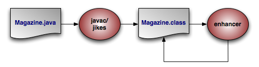

////
 Licensed to the Apache Software Foundation (ASF) under one
 or more contributor license agreements.  See the NOTICE file
 distributed with this work for additional information
 regarding copyright ownership.  The ASF licenses this file
 to you under the Apache License, Version 2.0 (the
 "License"); you may not use this file except in compliance
 with the License.  You may obtain a copy of the License at

 http://www.apache.org/licenses/LICENSE-2.0

 Unless required by applicable law or agreed to in writing,
 software distributed under the License is distributed on an
 "AS IS" BASIS, WITHOUT WARRANTIES OR CONDITIONS OF ANY
 KIND, either express or implied.  See the License for the
 specific language governing permissions and limitations
 under the License.
////
[[ref_guide_pc]]
=== Persistent Classes
(((persistent classes)))

Persistent class basics are covered in <<jpa_overview_pc>> of the JPA Overview.
This chapter details the persistent class features OpenJPA offers beyond the core JPA specification.

[[ref_guide_pc_pcclasses]]
==== Persistent Class List
(((persistent classes , list)))

Unlike many ORM products, OpenJPA does not need to know about all of your persistent classes at startup.
OpenJPA discovers new persistent classes automatically as they are loaded into the JVM; in fact you can introduce new persistent classes into running applications under OpenJPA.
However, there are certain situations in which providing OpenJPA with a persistent class list is helpful:

* OpenJPA must be able to match entity names in JPQL queries to persistent classes. OpenJPA automatically knows the entity names of any persistent classes already loaded into the JVM. To match entity names to classes that have not been loaded, however, you must supply a persistent class list.
* When OpenJPA manipulates classes in a persistent inheritance hierarchy, OpenJPA must be aware of all the classes in the hierarchy. If some of the classes have not been loaded into the JVM yet, OpenJPA may not know about them, and queries may return incorrect results.
* If you configure OpenJPA to create the needed database schema on startup (see <<ref_guide_mapping_synch>>), OpenJPA must know all of your persistent classes up-front.

When any of these conditions are a factor in your JPA application, use the ``class``, ``mapping-file``, and 
`jar-file` elements of JPA's standard XML format to list your persistent classes.
See <<jpa_overview_persistence_xml>> for details.

Alternately, you can tell OpenJPA to search through your classpath for persistent types.
This is described in more detail in <<ref_guide_meta_factory>>.

[NOTE]
====
Listing persistent classes (or their metadata or jar files) is an all-or-nothing endeavor.
If your persistent class list is non-empty, OpenJPA will assume that any unlisted class is not persistent.
====

[[ref_guide_pc_enhance]]
==== Enhancement
(((enhancer)))
(((openjpac)))

In order to provide optimal runtime performance, flexible lazy loading, and efficient, immediate dirty tracking, OpenJPA can use an __enhancer __.
An enhancer is a tool that automatically adds code to your persistent classes after you have written them.
The enhancer post-processes the bytecode generated by your Java compiler, adding the necessary fields and methods to implement the required persistence features.
This bytecode modification perfectly preserves the line numbers in stack traces and is compatible with Java debuggers.
In fact, the only change to debugging is that the persistent setter and getter methods of entity classes using property access will be prefixed with `pc` in stack traces and step-throughs.
For example, if your entity has a [method]``getId`` method for persistent property ``id``, and that method throws an exception, the stack trace will report the exception from method [method]``pcgetId``.
The line numbers, however, will correctly correspond to the [method]``getId`` method in your source file.

The diagram above illustrates the compilation of a persistent class.

You can add the OpenJPA enhancer to your build process, or use Java 1.5's instrumentation features to transparently enhance persistent classes when they are loaded into the JVM.
The following sections describe each option.

[[ref_guide_pc_enhance_build]]
===== Enhancing at Build Time
(((enhancer , build time)))

The enhancer can be invoked at build time via its Java class, [class]``org.apache.openjpa.enhance.PCEnhancer``.

[NOTE]
====
You can also enhance via Ant; see <<ref_guide_integration_enhance>>.
====

[[ref_guide_pc_enhance_enhancer]]
.Using the OpenJPA Enhancer
====
[source]
----

java org.apache.openjpa.enhance.PCEnhancer Magazine.java
----
====

The enhancer accepts the standard set of command-line arguments defined by the configuration framework (see <<ref_guide_conf_devtools>> ), along with the following flags:

* ``-directory/-d <output directory>``: Path to the output directory. If the directory does not match the enhanced class' package, the package structure will be created beneath the directory. By default, the enhancer overwrites the original [path]_.class_ file.
* ``-enforcePropertyRestrictions/-epr <true/t | false/f>``: Whether to throw an exception when it appears that a property access entity is not obeying the restrictions placed on property access. Defaults to false.
* ``-addDefaultConstructor/-adc <true/t | false/f>``: The spec requires that all persistent classes define a no-arg constructor. This flag tells the enhancer whether to add a protected no-arg constructor to any persistent classes that don't already have one. Defaults to ``true``.
* ``-tmpClassLoader/-tcl <true/t | false/f>``: Whether to load persistent classes with a temporary class loader. This allows other code to then load the enhanced version of the class within the same JVM. Defaults to ``true``. Try setting this flag to `false` as a debugging step if you run into class loading problems when running the enhancer.

Each additional argument to the enhancer must be one of the following:

* The full name of a class.
* The .java file for a class.
* The [path]_.class_ file of a class.

If you do not supply any arguments to the enhancer, it will run on the classes in your persistent class list (see <<ref_guide_pc_pcclasses>>). You must, however, supply the classpath you wish the enhancer to run with.
This classpath must include, at minimum, the openjpa jar(s), persistence.xml and the target classes.

You can run the enhancer over classes that have already been enhanced, in which case it will not further modify the class.
You can also run it over classes that are not persistence-capable, in which case it will treat the class as persistence-aware.
Persistence-aware classes can directly manipulate the persistent fields of persistence-capable classes.

Note that the enhancement process for subclasses introduces dependencies on the persistent parent class being enhanced.
This is normally not problematic; however, when running the enhancer multiple times over a subclass whose parent class is not yet enhanced, class loading errors can occur.
In the event of a class load error, simply re-compile and re-enhance the offending classes.

[[ref_guide_pc_enhance_runtime_container]]
===== Enhancing JPA Entities on Deployment

The Java EE specification includes hooks to automatically enhance JPA entities when they are deployed into a container.
Thus, if you are using a Java EE-compliant application server, OpenJPA will enhance your entities automatically at runtime.
Note that if you prefer build-time enhancement, OpenJPA's runtime enhancer will correctly recognize and skip pre-enhanced classes.

If your application server does not support the Java EE enhancement hooks, consider using the build-time enhancement described above, or the more general runtime enhancement described in the next section.

[[ref_guide_pc_enhance_runtime]]
===== Enhancing at Runtime
(((enhancer , runtime , outside a container)))

OpenJPA includes a _Java agent_ for automatically enhancing persistent classes as they are loaded into the JVM.
Java agents are classes that are invoked prior to your application's [method]``main`` method.
OpenJPA's agent uses JVM hooks to intercept all class loading to enhance classes that have persistence metadata before the JVM loads them.

Searching for metadata for every class loaded by the JVM can slow application initialization.
One way to speed things up is to take advantage of the optional persistent class list described in <<ref_guide_pc_pcclasses>>.
If you declare a persistent class list, OpenJPA will only search for metadata for classes in that list.

To employ the OpenJPA agent, invoke `java` with the 
`-javaagent` set to the path to your OpenJPA jar file.

[[ref_guide_pc_enhance_runtime_ex]]
.Using the OpenJPA Agent for Runtime Enhancement
====
[source]
----

java -javaagent:/home/dev/openjpa/lib/openjpa.jar com.xyz.Main
----
====

You can pass settings to the agent using OpenJPA's plugin syntax (see <<ref_guide_conf_plugins>>). The agent accepts the long form of any of the standard configuration options (<<ref_guide_conf_devtools>> ). It also accepts the following options, the first three of which correspond exactly to the same-named options of the enhancer tool described in <<ref_guide_pc_enhance_build>>:

* `addDefaultConstructor`
* `enforcePropertyRestrictions`
* ``scanDevPath``: Boolean indicating whether to scan the classpath for persistent types if none have been configured. If you do not specify a persistent types list and do not set this option to true, OpenJPA will check whether each class loaded into the JVM is persistent, and enhance it accordingly. This may slow down class load times significantly.
* ``classLoadEnhancement``: Boolean controlling whether OpenJPA load-time class enhancement should be available in this JVM execution. Default: ``true``
* ``runtimeRedefinition``: Boolean controlling whether OpenJPA class redefinition should be available in this JVM execution. Default: ``true``

[[ref_guide_pc_enhance_runtime_opt_ex]]
.Passing Options to the OpenJPA Agent
====
[source]
----

java -javaagent:/home/dev/openjpa/lib/openjpa.jar=addDefaultConstructor=false com.xyz.Main
----
====

[[ref_guide_pc_enhance_dynamic]]
===== Enhancing Dynamically at Runtime

If a javaagent is not provided via the command line and OpenJPA is running on the Oracle 1.6 SDK or IBM 1.6 JDK (SR8+), OpenJPA will attempt to dynamically load the Enhancer that was mentioned in the previous section.
This support is provided as an ease of use feature and it is not recommended for use in a production system.
Using this method of enhancement has the following caveats:

* The dynamic runtime enhancer is plugged into the JVM during creation of the EntityManagerFactory. Any Entity classes that are loaded before the EntityManagerFactory is created will not be enhanced.
* The command line javaagent settings are not configurable when using this method of enhancement.
* Just as with the Javaagent approach, if you declare a persistent class list, then OpenJPA will only search for metadata and try to enhance the listed classes.

When then dynamic enhancer is loaded, the following informational message is logged:
[source]
----

[java] jpa.enhancement  INFO   [main] openjpa.Runtime - OpenJPA dynamically loaded the class enhancer. Any classes that were not enhanced at build time will be enhanced when they are loaded by the JVM.
----

Setting the property openjpa.DynamicEnhancementAgent to false will disable this function.

[[ref_guide_pc_enhance_unenhanced_types]]
===== Omitting the OpenJPA enhancer

OpenJPA does not require that the enhancer be run.
If you do not run the enhancer, OpenJPA will fall back to one of several possible alternatives for state tracking, depending on the execution environment.

* __Deploy-time enhancement__: if you are running your application inside a Java EE container, or another environment that supports the JPA container contract, then OpenJPA will automatically perform class transformation at deploy time.
* __Java 6 class retransformation__: if you are running your application in a Java 6 environment, OpenJPA will attempt to dynamically register a `ClassTransformer` that will redefine your persistent classes on the fly to track access to persistent data. Additionally, OpenJPA will create a subclass for each of your persistent classes. When you execute a query or traverse a relation, OpenJPA will return an instance of the subclass. This means that the `instanceof` operator will work as expected, but `o.getClass()` will return the subclass instead of the class that you wrote.

You do not need to do anything at all to get this behavior.
OpenJPA will automatically detect whether or not the execution environment is capable of Java 6 class retransformation.
* __Java 5 class redefinition__: if you are running your application in a Java 5 environment, and you specify the OpenJPA javaagent, OpenJPA will use Java 5 class redefinition to redefine any persistent classes that are not enhanced by the OpenJPA javaagent. Aside from the requirement that you specify a javaagent on the command line, this behavior is exactly the same as the Java 6 class retransformation behavior. Of course, since the OpenJPA javaagent performs enhancement by default, this will only be available if you set the `classLoadEnhancement` javaagent flag to ``false``, or on any classes that are skipped by the OpenJPA runtime enhancement process for some reason.
* __Runtime Unenhanced Classes__: AKA state comparison and subclassing. If you are running in a Java 5 environment without a javaagent, or in a Java 6 environment that does not support class retransformation, OpenJPA will still create subclasses as outlined above. However, in some cases, OpenJPA may not be able to receive notifications when you read or write persistent data.

[NOTE]
====
Runtime Unenhanced Classes has some known limitations which are discussed below
and documented in JIRA issue tracker on the OpenJPA website. As a result this option is
disabled by default. Support for this method of automatic enhancement may be
enabled via the
<<openjpa.RuntimeUnenhancedClasses,openjpa.RuntimeUnenhancedClasses>> configuration option.
====

To enable Runtime Unenhanced Classes for a specific persistence unit, add the following property to persistence.xml:

[source]
----

<properties>
    . . .
    <property name="openjpa.RuntimeUnenhancedClasses" value="supported"/>
    . . .
<properties>
----

If you are using _property access_ for your persistent data, then OpenJPA will be able to track all accesses for instances that you load from the database, but not for instances that you create.
This is because OpenJPA will create new instances of its dynamically-generated subclass when it loads data from the database.
The dynamically-generated subclass has code in the setters and getters that notify OpenJPA about persistent data access.
This means that new instances that you create will be subject to state-comparison checks (see discussion below) to compute which fields to write to the database, and that OpenJPA will ignore requests to evict persistent data from such instances.
In practice, this is not a particularly bad limitation, since OpenJPA already knows that it must insert all field values for new instances.
So, this is only really an issue if you flush changes to the database while inserting new records; after such a flush, OpenJPA will need to hold potentially-unneeded hard references to the new-flushed instances.

If you are using _field access_ for your persistent data, then OpenJPA will not be able to track accesses for any instances, including ones that you load from the database.
So, OpenJPA will perform state-comparison checks to determine which fields are dirty.
These state comparison checks are costly in two ways.
First, there is a performance penalty at flush / commit time, since OpenJPA must walk through every field of every instance to determine which fields of which records are dirty.
Second, there is a memory penalty, since OpenJPA must hold hard references to all instances that were loaded at any time in a given transaction, and since OpenJPA must keep a copy of all the initial values of the loaded data for later comparison.
Additionally, OpenJPA will ignore requests to evict persistent state for these types of instances.
Finally, the default lazy loading configuration will be ignored for single-valued fields (one-to-one, many-to-one, and any other non-collection or non-map field that has a lazy loading configuration). If you use fetch groups or programmatically configure your fetch plan, OpenJPA will obey these directives, but will be unable to lazily load any data that you exclude from loading.
As a result of these limitations, it is not recommended that you use field access if you are not either running the enhancer or using OpenJPA with a javaagent or in a Java 6 environment.

[[ref_guide_pc_interfaces]]
==== Managed Interfaces

OpenJPA's managed interface feature allows you to define your object model entirely in terms of interfaces, instead of concrete classes.
To use this feature, you must annotate your managed interfaces with the [class]``ManagedInterface`` annotation, and use the ``OpenJPAEntityManager.createInstance(Class)`` method to create new records.
Note that `createInstance()` returns unmanaged instances; you must pass them to ``EntityManager.persist()`` to store them in the database.

[source]
----

@ManagedInterface
public interface PersonIface {
    @Id @GeneratedValue
    int getId();
    void setId(int id);

    // implicitly persistent per JPA property rules
    String getName();
    void setName(String name);
}
----

[source]
----

OpenJPAEntityManager em = ...;
PersonIface person = em.createInstance(PersonIface.class);
person.setName("Homer Simpson");
em.getTransaction().begin();
em.persist(person);
em.getTransaction().commit();
----

[[ref_guide_pc_oid]]
==== Object Identity
(((identity)))

OpenJPA makes several enhancements to JPA's standard entity identity.

[[ref_guide_pc_oid_datastore]]
===== Datastore Identity
(((identity , datastore)))

The JPA specification requires you to declare one or more identity fields in your persistent classes.
OpenJPA fully supports this form of object identity, called _application_ identity.
OpenJPA, however, also supports _datastore_ identity.
In datastore identity, you do not declare any primary key fields.
OpenJPA manages the identity of your persistent objects for you through a surrogate key in the database.

You can control how your JPA datastore identity value is generated through OpenJPA's link:../../apidocs/org/apache/openjpa/persistence/DataStoreId.html[
org.apache.openjpa.persistence.DataStoreId] class annotation.
This annotation has `strategy` and 
`generator` properties that mirror the same-named properties on the standard [class]``jakarta.persistence.GeneratedValue`` annotation described in <<jpa_overview_meta_id>> of the JPA Overview.

To retrieve the identity value of a datastore identity entity, use the [method]``OpenJPAEntityManager.getObjectId(Object entity)`` method.
See <<ref_guide_runtime_em>> for more information on the [class]``OpenJPAEntityManager``.

[[ref_guide_pc_oid_datastoreentityex]]
.JPA Datastore Identity Metadata
====
[source]
----

import org.apache.openjpa.persistence.*;

@Entity
@DataStoreId
public class LineItem {

    ... no @Id fields declared ...
}
----
====

Internally, OpenJPA uses the public link:../../apidocs/org/apache/openjpa/util/Id.html[
org.apache.openjpa.util.Id] class for datastore identity objects.
When writing OpenJPA plugins, you can manipulate datastore identity objects by casting them to this class.
You can also create your own [class]``Id`` instances and pass them to any internal OpenJPA method that expects an identity object.

In JPA, you will never see [class]``Id`` instances directly.
Instead, calling [class]``OpenJPAEntityManager.getObjectId`` on a datastore identity object will return the [class]``Long`` surrogate primary key value for that object.
You can then use this value in calls to [class]``EntityManager.find`` for subsequent lookups of the same record.

[[ref_guide_pc_oid_entitypk]]
===== Entities as Identity Fields

OpenJPA allows `ManyToOne` and `OneToOne` relations to be identity fields.
To identify a relation field as an identity field, simply annotate it with both the `@ManyToOne` or ``@OneToOne`` relation annotation and the `@Id` identity annotation.

When finding an entity identified by a relation, pass the id of the __relation__ to the [method]``EntityManager.find`` method:

[[ref_guide_pc_oid_entitypk_simplefind]]
.Finding an Entity with an Entity Identity Field
====
[source]
----

public Delivery createDelivery(Order order) {
    Delivery delivery = new Delivery();
    delivery.setId(order);
    delivery.setDelivered(new Date());
    return delivery;
}

public Delivery findDelivery(EntityManager em, Order order) {
    // use the identity of the related instance
    return em.find(Delivery.class, order.getId());
}
----
====

When your entity has multiple identity fields, at least one of which is a relation to another entity, you can use an identity class (see <<jpa_overview_pc_identitycls>> in the JPA Overview), or an embedded identity object.
Identity class fields corresponding to entity identity fields should be of the same type as the related entity's identity.
If an embedded identity object is used, you must annotate the relation field with both the `@ManyToOne` or ``@OneToOne`` relation annotation and the ``@MapsId`` annotation.

[[ref_guide_pc_oid_entitypk_idcls]]
.Id Class for Entity Identity Fields
====
[source]
----

@Entity
public class Order {

    @Id
    private long id;

    ...
}

	/**
	 * LineItem uses a compound primary key. Part of the compound key
	 * LineItemId is relation or reference to Order instance.
	**/
@Entity
@IdClass(LineItemId.class)
public class LineItem {

    @Id
    private int index;

    @Id
    @ManyToOne
    private Order order;

    ...
}

public class LineItemId {

    public int index;
    public long order; // same type as identity of Order i.e Order.id
                       // also the variable name must match the name of the
                       // variable in LineItem that refers to Order.
}
----
====

In the example above, if [class]``Order`` had used an identity class [class]``OrderId`` in place of a simple [class]``long`` value, then the `LineItemId.order` field would have been of type [class]``OrderId``.

[[ref_guide_pc_oid_entitypk_embeded_id]]
.Embedded Id for Entity Identity Fields
====
[source]
----

@Entity
public class Order {

    @Id
    private long id;

    ...
}

	/**
	 * LineItem uses a compound primary key. Part of the compound key
	 * LineItemId is relation or reference to Order instance.
	**/
@Entity
public class LineItem {

    @EmbeddedId LineItemId id;

    @ManyToOne
    @MapsId("orderId")     // The value element of the MapsId annotation
                           // must be used to specify the name of the primary
                           // key attribute to which the relationship
                           // corresponds. If the primary key referenced by
                           // the relationship attribute is of the same Java
                           // type as the dependent's primary key, then the
                           // value element is not specified.
    private Order order;

    ...
}

@Embeddable
public class LineItemId {

    public int index;
    public long orderId;
}
----
====

In the example above, the [class]``LineItem`` uses an embedded id to represent its primary key.
The primary key attribute corresponding to the relationship in the [class]``LineItemId`` must be of the same type as the primary key of the [class]``Order``.
The ``MapsId`` annotation must be applied to the relationship field ``LineItem.order``.

[[ref_guide_pc_oid_application]]
===== Application Identity Tool
(((identity , application , application identity tool)))

If you choose to use application identity, you may want to take advantage of OpenJPA's application identity tool.
The application identity tool generates Java code implementing the identity class for any persistent type using application identity.
The code satisfies all the requirements the specification places on identity classes.
You can use it as-is, or simply use it as a starting point, editing it to meet your needs.

Before you can run the application identity tool on a persistent class, the class must be compiled and must have complete metadata.
All primary key fields must be marked as such in the metadata.

In JPA metadata, do not attempt to specify the `@IdClass` annotation unless you are using the application identity tool to overwrite an existing identity class.
Attempting to set the value of the `@IdClass`  to a non-existent class will prevent your persistent class from compiling.
Instead, use the `-name` or `-suffix`  options described below to tell OpenJPA what name to give your generated identity class.
Once the application identity tool has generated the class code, you can set the `@IdClass` annotation.

The application identity tool can be invoked via its Java class, link:../../apidocs/org/apache/openjpa/enhance/ApplicationIdTool[
org.apache.openjpa.enhance.ApplicationIdTool].

[NOTE]
====
<<ref_guide_integration_appidtool>> describes the application identity tool's Ant task.
====

[[ref_guide_pc_appid_appidtool]]
.Using the Application Identity Tool
====
[source]
----

java org.apache.openjpa.enhance.ApplicationIdTool -s Id Magazine.java
----
====

The application identity tool accepts the standard set of command-line arguments defined by the configuration framework (see <<ref_guide_conf_devtools>>), including code formatting flags described in <<ref_guide_conf_devtools_format>>.
It also accepts the following arguments:

* ``-directory/-d <output directory>``: Path to the output directory. If the directory does not match the generated oid class' package, the package structure will be created beneath the directory. If not specified, the tool will first try to find the directory of the [path]_.java_ file for the persistence-capable class, and failing that will use the current directory.
* ``-ignoreErrors/-i <true/t | false/f>``: If ``false``, an exception will be thrown if the tool is run on any class that does not use application identity, or is not the base class in the inheritance hierarchy (recall that subclasses never define the application identity class; they inherit it from their persistent superclass).
* ``-token/-t <token>``: The token to use to separate stringified primary key values in the string form of the object id. This option is only used if you have multiple primary key fields. It defaults to "::".
* ``-name/-n <id class name>``: The name of the identity class to generate. If this option is specified, you must run the tool on exactly one class. If the class metadata already names an object id class, this option is ignored. If the name is not fully qualified, the persistent class' package is prepended to form the qualified name.
* ``-suffix/-s <id class suffix>``: A string to suffix each persistent class name with to form the identity class name. This option is overridden by `-name` or by any object id class specified in metadata.

Each additional argument to the tool must be one of the following:

* The full name of a persistent class.
* The .java file for a persistent class.
* The [path]_.class_ file of a persistent class.

If you do not supply any arguments to the tool, it will act on the classes in your persistent classes list (see <<ref_guide_pc_pcclasses>>).

[[ref_guide_pc_oid_pkgen_autoinc]]
===== Autoassign / Identity Strategy Caveats
(((datastore identity , autoassign strategy)))

<<jpa_overview_meta_gen>> explains how to use JPA's ``IDENTITY`` generation type to automatically assign field values.
However, here are some additional caveats you should be aware of when using `IDENTITY` generation:

. Your database must support auto-increment / identity columns, or some equivalent (see <<ref_guide_dbsetup_dbsupport_oracle>> for how to configure a combination of triggers and sequences to fake auto-increment support in Oracle database).
. Auto-increment / identity columns must be an integer or long integer type.
. Databases support auto-increment / identity columns to varying degrees. Some do not support them at all. Others only allow a single such column per table, and require that it be the primary key column. More lenient databases may allow non-primary key auto-increment columns, and may allow more than one per table. See your database documentation for details.

[[ref_guide_inverses]]
==== Managed Inverses
(((bidirectional relations , automatic management)))

Bidirectional relations are an essential part of data modeling. <<jpa_overview_mapping>> in the JPA Overview explains how to use the `mappedBy` annotation attribute to form bidirectional relations that also share datastore storage in JPA.

OpenJPA also allows you to define purely logical bidirectional relations.
The link:../../apidocs/org/apache/openjpa/persistence/InverseLogical.html[
org.apache.openjpa.persistence.InverseLogical] annotation names a logical inverse in JPA metadata.

[[ref_guide_inverses_logicalex]]
.Specifying Logical Inverses
====
`Magazine.coverPhoto` and `Photograph.mag` are each mapped to different foreign keys in their respective tables, but form a logical bidirectional relation.
Only one of the fields needs to declare the other as its logical inverse, though it is not an error to set the logical inverse of both fields.

[source]
----

import org.apache.openjpa.persistence.*;

@Entity
public class Magazine {

    @OneToOne
    private Photograph coverPhoto;

    ...
}

@Entity
public class Photograph {

    @OneToOne
    @InverseLogical("coverPhoto")
    private Magazine mag;

    ...
}
----
====

Java does not provide any native facilities to ensure that both sides of a bidirectional relation remain consistent.
Whenever you set one side of the relation, you must manually set the other side as well.

By default, OpenJPA behaves the same way.
OpenJPA does not automatically propagate changes from one field in bidirectional relation to the other field.
This is in keeping with the philosophy of transparency, and also provides higher performance, as OpenJPA does not need to analyze your object graph to correct inconsistent relations.

If convenience is more important to you than strict transparency, however, you can enable inverse relation management in OpenJPA.
Set the <<openjpa.InverseManager,[class]``openjpa.InverseManager``>> plugin property to `true` for standard management.
Under this setting, OpenJPA detects changes to either side of a bidirectional relation (logical or physical), and automatically sets the other side appropriately on flush.

[[ref_guide_inversesex]]
.Enabling Managed Inverses
====
[source]
----

<property name="openjpa.InverseManager" value="true"/>
----
====

The inverse manager has options to log a warning or throw an exception when it detects an inconsistent bidirectional relation, rather than correcting it.
To use these modes, set the manager's `Action` property to ``warn`` or ``exception``, respectively.

By default, OpenJPA excludes <<ref_guide_pc_scos_proxy_lrs, large
result set fields>> from management.
You can force large result set fields to be included by setting the `ManageLRS` plugin property to ``true``.

[[ref_guide_inverses_logex]]
.Log Inconsistencies
====
[source]
----

<property name="openjpa.InverseManager" value="true(Action=warn)"/>
----
====

[[ref_guide_pc_scos]]
==== Persistent Fields
(((persistent fields)))

OpenJPA enhances the specification's support for persistent fields in many ways.
This section documents aspects of OpenJPA's persistent field handling that may affect the way you design your persistent classes.

[[ref_guide_pc_scos_restore]]
===== Restoring State
(((persistent fields , field rollback)))

While the JPA specification says that you should not use rolled back objects, such objects are perfectly valid in OpenJPA.
You can control whether the objects' managed state is rolled back to its pre-transaction values with the <<openjpa.RestoreState,`openjpa.RestoreState`>> configuration property. `none` does not roll back state (the object becomes hollow, and will re-load its state the next time it is accessed), `immutable` restores immutable values (primitives, primitive wrappers, strings) and clears mutable values so that they are reloaded on next access, and `all` restores all managed values to their pre-transaction state.

[[ref_guide_pc_scos_order]]
===== Typing and Ordering
(((persistent fields , comparators)))

When loading data into a field, OpenJPA examines the value you assign the field in your declaration code or in your no-args constructor.
If the field value's type is more specific than the field's declared type, OpenJPA uses the value type to hold the loaded data.
OpenJPA also uses the comparator you've initialized the field with, if any.
Therefore, you can use custom comparators on your persistent field simply by setting up the comparator and using it in your field's initial value.

[[ref_guide_pc_scos_order_initialvals]]
.Using Initial Field Values
====
Though the annotations are left out for simplicity, assume 
`employeesBySal` and `departments` are persistent fields in the class below.

[source]
----

public class Company {

    // OpenJPA will detect the custom comparator in the initial field value
    // and use it whenever loading data from the database into this field
    private Collection employeesBySal = new TreeSet(new SalaryComparator());
    private Map departments;

    public Company {
        // or we can initialize fields in our no-args constructor; even though
        // this field is declared type Map, OpenJPA will detect that it's
        // actually a TreeMap and use natural ordering for loaded data
        departments = new TreeMap();
    }

    // rest of class definition...
}
----
====

[[ref_guide_pc_calendar_timezone]]
===== Calendar Fields and TimeZones

OpenJPA's support for the [class]``java.util.Calendar`` type will store only the [class]``Date`` part of the field, not the [class]``TimeZone`` associated with the field.
When loading the date into the [class]``Calendar`` field, OpenJPA will use the [class]``TimeZone`` that was used to initialize the field.

[[ref_guide_pc_scos_proxy]]
===== Proxies
(((proxies)))
(((persistent fields , proxies)))

At runtime, the values of all mutable second class object fields in persistent and transactional objects are replaced with implementation-specific proxies.
On modification, these proxies notify their owning instance that they have been changed, so that the appropriate updates can be made on the datastore.

[[ref_guide_pc_scos_proxy_smart]]
====== Smart Proxies

Most proxies only track whether or not they have been modified.
Smart proxies for collection and map fields, however, keep a record of which elements have been added, removed, and changed.
This record enables the OpenJPA runtime to make more efficient database updates on these fields.

When designing your persistent classes, keep in mind that you can optimize for OpenJPA smart proxies by using fields of type [class]``java.util.Set``, [class]``java.util.TreeSet``, and [class]``java.util.HashSet`` for your collections whenever possible.
Smart proxies for these types are more efficient than proxies for [class]``List``s.
You can also design your own smart proxies to further optimize OpenJPA for your usage patterns.
See the section on <<ref_guide_pc_scos_proxy_custom,custom proxies>> for details.

[[ref_guide_pc_scos_proxy_lrs]]
====== Large Result Set Proxies
(((proxies , large result set)))

Under standard ORM behavior, traversing a persistent collection or map field brings the entire contents of that field into memory.
Some persistent fields, however, might represent huge amounts of data, to the point that attempting to fully instantiate them can overwhelm the JVM or seriously degrade performance.

OpenJPA uses special proxy types to represent these "large result set" fields.
OpenJPA's large result set proxies do not cache any data in memory.
Instead, each operation on the proxy offloads the work to the database and returns the proper result.
For example, the [method]``contains`` method of a large result set collection will perform a  `SELECT COUNT(*)` query with the proper `WHERE` conditions to find out if the given element exists in the database's record of the collection.
Similarly, each time you obtain an iterator OpenJPA performs the proper query using the current <<ref_guide_dbsetup_lrs,large result set settings>>, as discussed in the <<ref_guide_dbsetup,JDBC>> chapter.
As you invoke [method]``Iterator.next``, OpenJPA instantiates the result objects on-demand.

You can free the resources used by a large result set iterator by passing it to the static <<ref_guide_runtime_openjpapersistence,[method]``OpenJPAPersistence.close``>> method.

[[ref_guide_pc_scos_proxy_lrs_itr]]
.Using a Large Result Set Iterator
====
[source]
----

import org.apache.openjpa.persistence.*;

...

Collection employees = company.getEmployees(); // employees is a lrs collection
Iterator itr = employees.iterator();
while (itr.hasNext())
    process((Employee) itr.next());
OpenJPAPersistence.close(itr);
----
====

You can also add and remove from large result set proxies, just as with standard fields.
OpenJPA keeps a record of all changes to the elements of the proxy, which it uses to make sure the proper results are always returned from collection and map methods, and to update the field's database record on commit.

In order to use large result set proxies in JPA, add the link:../../apidocs/org/apache/openjpa/persistence/LRS.html[
org.apache.openjpa.persistence.LRS] annotation to the persistent field.

The following restrictions apply to large result set fields:

* The field must be declared as either a [class]``java.util.Collection`` or [class]``java.util.Map``. It cannot be declared as any other type, including any sub-interface of collection or map, or any concrete collection or map class.
* The field cannot have an externalizer (see <<ref_guide_pc_extern>>).
* Because they rely on their owning object for context, large result set proxies cannot be transferred from one persistent field to another. The following code would result in an error on commit:

[source]
----

Collection employees = company.getEmployees()  // employees is a lrs collection
company.setEmployees(null);
anotherCompany.setEmployees(employees);
----

[[ref_guide_pc_scos_proxy_lrs_extension]]
.Marking a Large Result Set Field
====
[source]
----

import org.apache.openjpa.persistence.*;

@Entity
public class Company {

    @ManyToMany
    @LRS private Collection<Employee> employees;

    ...
}
----
====

[[ref_guide_pc_scos_proxy_custom]]
====== Custom Proxies
(((proxies , custom)))

OpenJPA manages proxies through the link:../../apidocs/org/apache/openjpa/util/ProxyManager.html[
org.apache.openjpa.util.ProxyManager] interface.
OpenJPA includes a default proxy manager, the [class]``org.apache.openjpa.util.ProxyManagerImpl`` (with a plugin alias name of ``default``), that will meet the needs of most users.
The default proxy manager understands the following configuration properties:

* ``TrackChanges``: Whether to use <<ref_guide_pc_scos_proxy_smart,smart proxies>>. Defaults to ``true``.
* ``AssertAllowedType``: Whether to immediately throw an exception if you attempt to add an element to a collection or map that is not assignable to the element type declared in metadata. Defaults to ``false``.
* ``DelayCollectionLoading``: Whether to delay loading elements of a lazily loaded collection. Delay loading allows non-indexed add and remove operations to occur without prior loading of the collection from the data store. This can improve performance of some applications by allowing them to perform simple add or remove operations on collections without requiring them to be loaded. Delayed proxies are loaded when an operation is performed that requires loading, such as iteration, size, serialization, and indexOf. They can also be loaded by casting the proxy to a link:../../apidocs/org/apache/openjpa/util/DelayedProxy.html[ org.apache.openjpa.util.proxy.DelayedProxy] and invoking the [method]``load`` method. If a broker factory is available after detaching the owning entity, a collection may be available for delayed loading after the persistence context has been cleared. In post-detachment, entities that are loaded are not associated with a persistence context. Defaults to ``false``.

The default proxy manager can proxy the standard methods of any [class]``Collection``, [class]``List``, [class]``Map``, [class]``Queue``, [class]``Date``, or [class]``Calendar`` class, including custom implementations.
It can also proxy custom classes whose accessor and mutator methods follow JavaBean naming conventions.
Your custom types must, however, meet the following criteria:

* Custom container types must have a public no-arg constructor or a public constructor that takes a single [class]``Comparator`` parameter.
* Custom date types must have a public no-arg constructor or a public constructor that takes a single [class]``long`` parameter representing the current time.
* Other custom types must have a public no-arg constructor or a public copy constructor. If a custom types does not have a copy constructor, it must be possible to fully copy an instance A by creating a new instance B and calling each of B's setters with the value from the corresponding getter on A.

If you have custom classes that must be proxied and do not meet these requirements, OpenJPA allows you to define your own proxy classes and your own proxy manager.
See the `openjpa.util` package link:../../apidocs/[Javadoc] for details on the interfaces involved, and the utility classes OpenJPA provides to assist you.

You can plug your custom proxy manager into the OpenJPA runtime through the <<openjpa.ProxyManager, `openjpa.ProxyManager`>> configuration property.

[[ref_guide_pc_scos_proxy_custom_ex]]
.Configuring the Proxy Manager
====
[source]
----

<property name="openjpa.ProxyManager" value="TrackChanges=false"/>
----
====

[[ref_guide_pc_scos_proxy_serial]]
====== Serialization
(((proxies , serialization)))

When objects are serialized, the `DetachedStateField` in section <<ref_guide_detach_state>> will be used to help determine when build time proxies will be removed.
If runtime created proxies are being used (proxies not supplied by OpenJPA) or if an entity has already been detached, then any found proxies will be removed during serialization.

* ``transient``: Use a transient detached state field. This gives the benefits of a detached state field to local objects that are never serialized, but retains serialization compatibility for client tiers without access to the enhanced versions of your classes or the OpenJPA runtime. All proxies will be removed during serialization. This is the default.
* ``true``: Use a non-transient detached state field so that objects crossing serialization barriers can still be attached efficiently. This requires, however, that your client tier have the enhanced versions of your classes and the OpenJPA runtime. No OpenJPA provided proxies will be removed during serialization.
* ``false``: Do not use a detached state field. All proxies will be removed during serialization.

[[ref_guide_pc_extern]]
===== Externalization
(((externalization)))
(((persistent fields , externalization)))

OpenJPA offers the ability to write <<ref_guide_mapping_custom_field,custom field mappings>> in order to have complete control over the mechanism with which fields are stored, queried, and loaded from the datastore.
Often, however, a custom mapping is overkill.
There is often a simple transformation from a Java field value to its database representation.
Thus, OpenJPA provides the externalization service.
Externalization allows you to specify methods that will externalize a field value to its database equivalent on store and then rebuild the value from its externalized form on load.

[NOTE]
====
Fields of embeddable classes used for `@EmbeddedId` values in JPA cannot have externalizers.
====

The OpenJPA link:../../apidocs/org/apache/openjpa/persistence/Externalizer.html[
org.apache.openjpa.persistence.Externalizer] annotation sets the name of a method that will be invoked to convert the field into its external form for database storage.
You can specify either the name of a non-static method, which will be invoked on the field value, or a static method, which will be invoked with the field value as a parameter.
Each method can also take an optional link:../../apidocs/org/apache/openjpa/kernel/StoreContext.html[
StoreContext] parameter for access to a persistence context.
The return value of the method is the field's external form.
By default, OpenJPA assumes that all named methods belong to the field value's class (or its superclasses). You can, however, specify static methods of other classes using the format ``<class-name>.<method-name>``.

Given a field of type [class]``CustomType`` that externalizes to a string, the table below demonstrates several possible externalizer methods and their corresponding metadata extensions.

.Externalizer Options
[cols="1,1", options="header"]
|===
|
Method

|
Extension

| ``public String CustomType.toString()``
| ``@Externalizer("toString")``

| ``public String CustomType.toString(StoreContext ctx)``
| ``@Externalizer("toString")``

| ``public static String AnyClass.toString(CustomType ct)``
| ``@Externalizer("AnyClass.toString")``

| ``public static String AnyClass.toString(CustomType ct, StoreContext ctx)``
| ``@Externalizer("AnyClass.toString")``
|===

The OpenJPA link:../../apidocs/org/apache/openjpa/persistence/Factory.html[
org.apache.openjpa.persistence.Factory] annotation contains the name of a method that will be invoked to instantiate the field from the external form stored in the database.
Specify a static method name.
The method will be invoked with the externalized value and must return an instance of the field type.
The method can also take an optional link:../../apidocs/org/apache/openjpa/kernel/StoreContext.html[
StoreContext] parameter for access to a persistence context.
If a factory is not specified, OpenJPA will use the constructor of the field type that takes a single argument of the external type, or will throw an exception if no constructor with that signature exists.

Given a field of type [class]``CustomType`` that externalizes to a string, the table below demonstrates several possible factory methods and their corresponding metadata extensions.

.Factory Options
[cols="1,1", options="header"]
|===
|
Method

|
Extension

| ``public CustomType(String str)``
|
none

| ``public static CustomType CustomType.fromString(String str)``
| ``@Factory("fromString")``

| ``public static CustomType CustomType.fromString(String str, StoreContext ctx)``
| ``@Factory("fromString")``

| ``public static CustomType AnyClass.fromString(String str)``
| ``@Factory("AnyClass.fromString")``

| ``public static CustomType AnyClass.fromString(String str, StoreContext ctx)``
| ``@Factory("AnyClass.fromString")``
|===

If your externalized field is not a standard persistent type, you must explicitly mark it persistent.
In OpenJPA, you can force a persistent field by annotating it with <<ref_guide_meta_jpa_persistent,[class]``org.apache.openjpa.persistence.Persistent``>> annotation.

[NOTE]
====
If your custom field type is mutable and is not a standard collection, map, or date class, OpenJPA will not be able to detect changes to the field.
You must mark the field dirty manually, or create a custom field proxy.
See link:../../apidocs/org/apache/openjpa/persistence/OpenJPAEntityManager.html[
OpenJPAEntityManager.dirty] for how to mark a field dirty manually in JPA.
See <<ref_guide_pc_scos_proxy>> for a discussion of proxies.
====

You can externalize a field to virtually any value that is supported by OpenJPA's field mappings (embedded relations are the exception; you must declare your field to be a persistence-capable type in order to embed it). This means that a field can externalize to something as simple as a primitive, something as complex as a collection or map of entities, or anything in between.
If you do choose to externalize to a collection or map, OpenJPA recognizes a family of metadata extensions for specifying type information for the externalized form of your fields - see <<type>>.
If the external form of your field is an entity object or contains entities, OpenJPA will correctly include the objects in its persistence-by-reachability algorithms and its delete-dependent algorithms.

The example below demonstrates a few forms of externalization.

[[ref_guide_pc_externex]]
.Using Externalization
====
[source]
----

import org.apache.openjpa.persistence.*;

@Entity
public class Magazine {

    // use Class.getName and Class.forName to go to/from strings
    @Persistent
    @Externalizer("getName")
    @Factory("forName")
    private Class cls;

    // use URL.getExternalForm for externalization. no factory;
    // we can rely on the URL string constructor
    @Persistent
    @Externalizer("toExternalForm")
    private URL url;

    // use our custom methods
    @Persistent
    @Externalizer("Magazine.authorsFromCustomType")
    @Factory("Magazine.authorsToCustomType")
    @ElementType(Author.class)
    private CustomType customType;

    public static Collection authorsFromCustomType(CustomType customType) {
        ... logic to pack custom type into a list of authors ...
    }

    public static CustomType authorsToCustomType(Collection authors) {
        ... logic to create custom type from a collection of authors ...
    }

    ...
}
----
====

You can query externalized fields using parameters.
Pass in a value of the field type when executing the query.
OpenJPA will externalize the parameter using the externalizer method named in your metadata, and compare the externalized parameter with the value stored in the database.
As a shortcut, OpenJPA also allows you to use parameters or literals of the field's externalized type in queries, as demonstrated in the example below.

[NOTE]
====
Currently, queries are limited to fields that externalize to a primitive, primitive wrapper, string, or date types, due to constraints on query syntax.
====

[[ref_guide_pc_extern_queryex]]
.Querying Externalization Fields
====
Assume the [class]``Magazine`` class has the same fields as in the previous example.

[source]
----

// you can query using parameters
Query q = em.createQuery("select m from Magazine m where m.url = :u");
q.setParameter("u", new URL("http://www.solarmetric.com"));
List results = q.getResultList();

// or as a shortcut, you can use the externalized form directly
q = em.createQuery("select m from Magazine m where m.url = 'http://www.solarmetric.com'");
results = q.getResultList();
----
====

[[ref_guide_pc_extern_values]]
====== External Values
(((externalization , external values)))

Externalization often takes simple constant values and transforms them to constant values of a different type.
An example would be storing a [class]``boolean`` field as a [class]``char``, where `true`  and `false` would be stored in the database as ``'T'`` and `'F'` respectively.

OpenJPA allows you to define these simple translations in metadata, so that the field behaves as in <<ref_guide_pc_extern,full-fledged
externalization>> without requiring externalizer and factory methods.
External values supports translation of pre-defined simple types (primitives, primitive wrappers, and Strings), to other pre-defined simple values.

Use the OpenJPA link:../../apidocs/org/apache/openjpa/persistence/ExternalValues.html[
org.apache.openjpa.persistence.ExternalValues] annotation to define external value translations.
The values are defined in a format similar to that of <<ref_guide_conf_plugins,
configuration plugins>>, except that the value pairs represent Java and datastore values.
To convert the Java boolean values of `true` and `false` to the character values `T` and ``F``, for example, you would use the extension value: ``true=T,false=F``.

If the type of the datastore value is different from the field's type, use the link:../../apidocs/org/apache/openjpa/persistence/Type.html[
org.apache.openjpa.persistence.Type] annotation to define the datastore type.

[[externvalues_ex]]
.Using External Values
====
This example uses external value translation to transform a string field to an integer in the database.

[source]
----

public class Magazine {

    @ExternalValues({"SMALL=5", "MEDIUM=8", "LARGE=10"})
    @Type(int.class)
    private String sizeWidth;

    ...
}
----
====

[[ref_guide_fetch]]
==== Fetch Groups

Fetch groups are sets of fields that load together.
They can be used to pool together associated fields in order to provide performance improvements over standard data fetching.
Specifying fetch groups allows for tuning of lazy loading and eager fetching behavior.

The JPA Overview's <<jpa_overview_meta_fetch>> describes how to use JPA metadata annotations to control whether a field is fetched eagerly or lazily.
Fetch groups add a dynamic aspect to this standard ability.
As you will see, OpenJPA's JPA extensions allow you can add and remove fetch groups at runtime to vary the sets of fields that are eagerly loaded.

[[ref_guide_fetch_custom]]
===== Custom Fetch Groups

OpenJPA places any field that is eagerly loaded according to the JPA metadata rules into the built-in _default_ fetch group.
As its name implies, the default fetch group is active by default.
You may also define your own named fetch groups and activate or deactivate them at runtime, as described later in this chapter.
OpenJPA will eagerly-load the fields in all active fetch groups when loading objects from the datastore.

You create fetch groups with the link:../../apidocs/org/apache/openjpa/persistence/FetchGroup.html[
org.apache.openjpa.persistence.FetchGroup] annotation.
If your class only has one custom fetch group, you can place this annotation directly on the class declaration.
Otherwise, use the link:../../apidocs/org/apache/openjpa/persistence/FetchGroups.html[
org.apache.openjpa.persistence.FetchGroups] annotation to declare an array of individual [class]``FetchGroup`` values.
The [class]``FetchGroup`` annotation has the following properties:

* ``String name``: The name of the fetch group. Fetch group names are global, and are expected to be shared among classes. For example, a shopping website may use a _detail_ fetch group in each product class to efficiently load all the data needed to display a product's "detail" page. The website might also define a sparse _list_ fetch group containing only the fields needed to display a table of products, as in a search result.

The following names are reserved for use by OpenJPA: `default` , ``values``, ``all``, ``none``, and any name beginning with ``jdo``, ``jpa``, or ``openjpa``.
* ``FetchAttribute[] attributes``: The set of persistent fields or properties in the fetch group.
* ``String[] fetchGroups``: Other fetch groups whose fields to include in this group.

As you might expect, listing a link:../../apidocs/org/apache/openjpa/persistence/FetchAttribute.html[
org.apache.openjpa.persistence.FetchAttribute] within a [class]``FetchGroup`` includes the corresponding persistent field or property in the fetch group.
Each [class]``FetchAttribute`` has the following properties:

* ``String name``: The name of the persistent field or property to include in the fetch group.
* ``recursionDepth``: If the attribute represents a relation, the maximum number of same-typed relations to eager-fetch from this field. Defaults to 1. For example, consider an [class]``Employee`` class with a ``manager`` field, also of type [class]``Employee``. When we load an [class]``Employee`` and the  `manager` field is in an active fetch group, the recursion depth (along with the max fetch depth setting, described below) determines whether we only retrieve the target [class]``Employee`` and his manager (depth 1), or whether we also retrieve the manager's manager (depth 2), or the manager's manager's manager (depth 3), etc. Use -1 for unlimited depth.

[[ref_guide_fetch_customgroups]]
.Custom Fetch Group Metadata
====
Creates a _detail_ fetch group consisting of the ``publisher`` and `articles` relations.

[source]
----

import org.apache.openjpa.persistence.*;

@Entity
@FetchGroups({
    @FetchGroup(name="detail", attributes={
        @FetchAttribute(name="publisher"),
        @FetchAttribute(name="articles")
    }),
    ...
})
public class Magazine {
   ...
}
----
====

A field can be a member of any number of fetch groups.
A field can also declare a __load fetch group__.
When you access a lazy-loaded field for the first time, OpenJPA makes a datastore trip to fetch that field's data.
Sometimes, however, you know that whenever you access a lazy field A, you're likely to access lazy fields B and C as well.
Therefore, it would be more efficient to fetch the data for A, B, and C in the same datastore trip.
By setting A's load fetch group to the name of a <<ref_guide_fetch,fetch group>> containing B and C, you can tell OpenJPA to load all of these fields together when A is first accessed.

Use OpenJPA's link:../../apidocs/org/apache/openjpa/persistence/LoadFetchGroup.html[
org.apache.openjpa.persistence.LoadFetchGroup] annotation to specify the load fetch group of any persistent field.
The value of the annotation is the name of a declared fetch group whose members should be loaded along with the annotated field.

[[ref_guide_fetch_loadgroup]]
.Load Fetch Group Metadata
====
[source]
----

import org.apache.openjpa.persistence.*;

@Entity
@FetchGroups({
    @FetchGroup(name="detail", attributes={
        @FetchAttribute(name="publisher"),
        @FetchAttribute(name="articles")
    }),
    ...
})
public class Magazine {

   @ManyToOne(fetch=FetchType.LAZY)
   @LoadFetchGroup("detail")
   private Publisher publisher;

   ...
}
----
====

[[ref_guide_fetch_conf]]
===== Custom Fetch Group Configuration
(((fetch groups , custom configuration)))

You can control the default set of fetch groups with the <<openjpa.FetchGroups,`openjpa.FetchGroups`>> configuration property.
Set this property to a comma-separated list of fetch group names.

You can also set the system's default maximum fetch depth with the <<openjpa.MaxFetchDepth,`openjpa.MaxFetchDepth`>> configuration property.
The maximum fetch depth determines how "deep" into the object graph to traverse when loading an instance.
For example, with a `MaxFetchDepth` of 1, OpenJPA will load at most the target instance and its immediate relations.
With a `MaxFetchDepth` of 2, OpenJPA may load the target instance, its immediate relations, and the relations of those relations.
This works to arbitrary depth.
In fact, the default `MaxFetchDepth` value is -1, which symbolizes infinite depth.
Under this setting, OpenJPA will fetch configured relations until it reaches the edges of the object graph.
Of course, which relation fields are loaded depends on whether the fields are eager or lazy, and on the active fetch groups.
A fetch group member's recursion depth may also limit the fetch depth to something less than the configured maximum.

OpenJPA's [class]``OpenJPAEntityManager`` and [class]``OpenJPAQuery`` extensions to the standard [class]``EntityManager`` and [class]``Query`` interfaces provide access to a link:../../apidocs/org/apache/openjpa/persistence/FetchPlan.html[
org.apache.openjpa.persistence.FetchPlan] object.
The [class]``FetchPlan`` maintains the set of active fetch groups and the maximum fetch depth.
It begins with the groups and depth defined in the ``openjpa.FetchGroups`` and `openjpa.MaxFetchDepth`  properties, but allows you to add or remove groups and change the maximum fetch depth for an individual [class]``EntityManager`` or [class]``Query`` through the methods below.

[source]
----

public FetchPlan addFetchGroup(String group);
public FetchPlan addFetchGroups(String... groups);
public FetchPlan addFetchGroups(Collection groups);
public FetchPlan removeFetchGrop(String group);
public FetchPlan removeFetchGroups(String... groups);
public FetchPlan removeFetchGroups(Collection groups);
public FetchPlan resetFetchGroups();
public Collection<String> getFetchGroups();
public void clearFetchGroups();
public FetchPlan setMaxFetchDepth(int depth);
public int getMaxFetchDepth();
----

<<ref_guide_runtime>> details the [class]``OpenJPAEntityManager``, [class]``OpenJPAQuery``, and [class]``FetchPlan`` interfaces.

[[ref_guide_fetch_conf_query]]
.Using the FetchPlan
====
[source]
----

import org.apache.openjpa.persistence.*;

...

OpenJPAQuery kq = OpenJPAPersistence.cast(em.createQuery(...));
kq.getFetchPlan().setMaxFetchDepth(3).addFetchGroup("detail");
List results = kq.getResultList();
----
====

[[ref_guide_fetch_single_field]]
===== Per-field Fetch Configuration
(((fetch groups , single fields)))

In addition to controlling fetch configuration on a per-fetch-group basis, you can configure OpenJPA to include particular fields in the current fetch plan.
This allows you to add individual fields that are not in the default fetch group or in any other active fetch groups to the set of fields that will be eagerly loaded from the database.

OpenJPA [class]``FetchPlan`` methods:

[source]
----

public FetchPlan addField(String field);
public FetchPlan addFields(String... fields);
public FetchPlan addFields(Class cls, String... fields);
public FetchPlan addFields(Collection fields);
public FetchPlan addFields(Class cls, Collection fields);
public FetchPlan removeField(String field);
public FetchPlan removeFields(String... fields);
public FetchPlan removeFields(Class cls, String... fields);
public FetchPlan removeFields(Collection fields);
public FetchPlan removeFields(Class cls, Collection fields);
public Collection<String> getFields();
public void clearFields();
----

The methods that take only string arguments use the fully-qualified field name, such as ``org.mag.Magazine.publisher``.
Similarly, [method]``getFields`` returns the set of fully-qualified field names.
In all methods, the named field must be defined in the class specified in the invocation, not a superclass.
So, if the field `publisher` is defined in base class [class]``Publication`` rather than subclass [class]``Magazine``, you must invoke `addField
(Publication.class, "publisher")` and not ``addField
(Magazine.class, "publisher")``.
This is stricter than Java's default field-masking algorithms, which would allow the latter method behavior if ``Magazine`` did not also define a field called ``publisher``.

To include the fields defined in a super class by the subclass or to distinguish between fields that are defined in _both_ super- and subclass, set `setExtendedPathLookup(boolean)` on `FetchPlan`  to ``true``.
By default, this option is set to ``false``, to reduce more extensive lookups for predominant use cases.

In order to avoid the cost of reflection, OpenJPA does not perform any validation of the field name / class name pairs that you put into the fetch configuration.
If you specify non-existent class / field pairs, nothing adverse will happen, but you will receive no notification of the fact that the specified configuration is not being used.

[[ref_guide_fetch-conf_per_field]]
.Adding an Eager Field
====
[source]
----

import org.apache.openjpa.persistence.*;

...

OpenJPAEntityManager kem = OpenJPAPersistence.cast(em);
kem.getFetchPlan().addField(Magazine.class, "publisher");
Magazine mag = em.find(Magazine.class, magId);
----
====

[[ref_guide_fetch_impl]]
===== Implementation Notes

* Even when a direct relation is not eagerly fetched, OpenJPA selects the foreign key columns and caches the values. This way when you do traverse the relation, OpenJPA can often find the related object in its cache, or at least avoid joins when loading the related object from the database.
* The above implicit foreign key-selecting behavior does not always apply when the relation is in a subclass table. If the subclass table would not otherwise be joined into the select, OpenJPA avoids the extra join just to select the foreign key values.

[[ref_guide_perfpack_eager]]
==== Eager Fetching
(((persistent fields)))
(((fetch groups , eager fetching)))

Eager fetching is the ability to efficiently load subclass data and related objects along with the base instances being queried.
Typically, OpenJPA has to make a trip to the database whenever a relation is loaded, or when you first access data that is mapped to a table other than the least-derived superclass table.
If you perform a query that returns 100 [class]``Person`` objects, and then you have to retrieve the [class]``Address`` for each person, OpenJPA may make as many as 101 queries (the initial query, plus one for the address of each person returned). Or if some of the [class]``Person`` instances turn out to be [class]``Employee``s, where [class]``Employee`` has additional data in its own joined table, OpenJPA once again might need to make extra database trips to access the additional employee data.
With eager fetching, OpenJPA can reduce these cases to a single query.

Eager fetching only affects relations in the active fetch groups, and is limited by the declared maximum fetch depth and field recursion depth (see <<ref_guide_fetch>>). In other words, relations that would not normally be loaded immediately when retrieving an object or accessing a field are not affected by eager fetching.
In our example above, the address of each person would only be eagerly fetched if the query were configured to include the address field or its fetch group, or if the address were in the default fetch group.
This allows you to control exactly which fields are eagerly fetched in different situations.
Similarly, queries that exclude subclasses aren't affected by eager subclass fetching, described below.

Eager fetching has three modes:

* ``none``: No eager fetching is performed. Related objects are always loaded in an independent select statement. No joined subclass data is loaded unless it is in the table(s) for the base type being queried. Unjoined subclass data is loaded using separate select statements rather than a SQL UNION operation.
* (((eager fetching , join mode)))``join``: In this mode, OpenJPA joins to to-one relations in the configured fetch groups.
If OpenJPA is loading data for a single instance, then OpenJPA will also join to any collection field in the configured fetch groups.
When loading data for multiple instances, though, (such as when executing a [class]``Query``) OpenJPA will not join to collections by default.
Instead, OpenJPA defaults to `parallel` mode for collections, as described below.
You can force OpenJPA use a join rather than parallel mode for a collection field using the metadata extension described in <<eager-fetch-mode>>.

Under `join` mode, OpenJPA uses a left outer join (or inner join, if the relations' field metadata declares the relation non-nullable) to select the related data along with the data for the target objects.
This process works recursively for to-one joins, so that if [class]``Person`` has an [class]``Address``, and [class]``Address`` has a [class]``TelephoneNumber``, and the fetch groups are configured correctly, OpenJPA might issue a single select that joins across the tables for all three classes.
To-many joins can not recursively spawn other to-many joins, but they can spawn recursive to-one joins.

Under the `join` subclass fetch mode, subclass data in joined tables is selected by outer joining to all possible subclass tables of the type being queried.
As you'll see below, subclass data fetching is configured separately from relation fetching, and can be disabled for specific classes.

[NOTE]
====
Some databases may not support outer joins.
Also, OpenJPA can not use outer joins if you have set the <<openjpa.jdbc.DBDictionary, `DBDictionary`>>'s `JoinSyntax` to ``traditional``.
See <<ref_guide_dbsetup_sql92>>.
====
* (((eager fetching , parallel mode)))``parallel``: Under this mode, OpenJPA selects to-one relations and joined collections as outlined in the `join` mode description above.
Unjoined collection fields, however, are eagerly fetched using a separate select statement for each collection, executed in parallel with the select statement for the target objects.
The parallel selects use the ``WHERE`` conditions from the primary select, but add their own joins to reach the related data.
Thus, if you perform a query that returns 100 [class]``Company`` objects, where each company has a list of [class]``Employee`` objects and [class]``Department`` objects, OpenJPA will make 3 queries.
The first will select the company objects, the second will select the employees for those companies, and the third will select the departments for the same companies.
Just as for joins, this process can be recursively applied to the objects in the relations being eagerly fetched.
Continuing our example, if the [class]``Employee`` class had a list of [class]``Projects`` in one of the fetch groups being loaded, OpenJPA would execute a single additional select in parallel to load the projects of all employees of the matching companies.

Using an additional select to load each collection avoids transferring more data than necessary from the database to the application.
If eager joins were used instead of parallel select statements, each collection added to the configured fetch groups would cause the amount of data being transferred to rise dangerously, to the point that you could easily overwhelm the network.

Polymorphic to-one relations to table-per-class mappings use parallel eager fetching because proper joins are impossible.
You can force other to-one relations to use parallel rather than join mode eager fetching using the metadata extension described in <<eager-fetch-mode>>.

Parallel subclass fetch mode only applies to queries on joined inheritance hierarchies.
Rather than outer-joining to subclass tables, OpenJPA will issue the query separately for each subclass.
In all other situations, parallel subclass fetch mode acts just like join mode in regards to vertically-mapped subclasses.

When OpenJPA knows that it is selecting for a single object only, it never uses ``parallel`` mode, because the additional selects can be made lazily just as efficiently.
This mode only increases efficiency over 
`join` mode when multiple objects with eager relations are being loaded, or when multiple selects might be faster than joining to all possible subclasses.

[[ref_guide_perfpack_eager_conf]]
===== Configuring Eager Fetching

(((EagerFetchMode)))
(((SubclassFetchMode)))
(((eager fetching , EagerFetchMode))) You can control OpenJPA's default eager fetch mode through the <<openjpa.jdbc.EagerFetchMode,
`openjpa.jdbc.EagerFetchMode`>> and <<openjpa.jdbc.SubclassFetchMode,
`openjpa.jdbc.SubclassFetchMode`>> configuration properties.
Set each of these properties to one of the mode names described in the previous section: ``none, join, parallel``.
If left unset, the eager fetch mode defaults to `parallel` and the subclass fetch mode defaults to `join` These are generally the most robust and performant strategies.

You can easily override the default fetch modes at runtime for any lookup or query through OpenJPA's fetch configuration APIs.
See <<ref_guide_runtime>> for details.

[[ref_guide_perfpack_eager_def]]
.Setting the Default Eager Fetch Mode
====
[source]
----

<property name="openjpa.jdbc.EagerFetchMode" value="parallel"/>
<property name="openjpa.jdbc.SubclassFetchMode" value="join"/>
----
====

[[ref_guide_perfpack_eager_runtime]]
.Setting the Eager Fetch Mode at Runtime
====
[source]
----

import org.apache.openjpa.persistence.*;
import org.apache.openjpa.persistence.jdbc.*;

...

Query q = em.createQuery("select p from Person p where p.address.state = 'TX'");
OpenJPAQuery kq = OpenJPAPersistence.cast(q);
JDBCFetchPlan fetch = (JDBCFetchPlan) kq.getFetchPlan();
fetch.setEagerFetchMode(FetchMode.PARALLEL);
fetch.setSubclassFetchMode(FetchMode.JOIN);
List results = q.getResultList();
----
====

You can specify a default subclass fetch mode for an individual class with the metadata extension described in <<subclass-fetch-mode>>.
Note, however, that you cannot "upgrade" the runtime fetch mode with your class setting.
If the runtime fetch mode is ``none``, no eager subclass data fetching will take place, regardless of your metadata setting.

This applies to the eager fetch mode metadata extension as well (see <<eager-fetch-mode>>). You can use this extension to disable eager fetching on a field or to declare that a collection would rather use joins than parallel selects or vice versa.
But an extension value of ``join`` won't cause any eager joining if the fetch configuration's setting is ``none``.

[[ref_guide_perfpack_eager_consider]]
===== Eager Fetching Considerations and Limitations

There are several important points that you should consider when using eager fetching:

* (((eager fetching , with large result sets))) When you are using `parallel` eager fetch mode and you have large result sets enabled (see <<ref_guide_dbsetup_lrs>>) or you place a range on a query, OpenJPA performs the needed parallel selects on one page of results at a time.
For example, suppose your 
`FetchBatchSize` is set to 20, and you perform a large result set query on a class that has collection fields in the configured fetch groups.
OpenJPA will immediately cache the first `20` results of the query using `join` mode eager fetching only.
Then, it will issue the extra selects needed to eager fetch your collection fields according to ``parallel`` mode.
Each select will use a SQL `IN`  clause (or multiple `OR` clauses if your class has a compound primary key) to limit the selected collection elements to those owned by the 20 cached results.

Once you iterate past the first 20 results, OpenJPA will cache the next 20 and again issue any needed extra selects for collection fields, and so on.
This pattern ensures that you get the benefits of eager fetching without bringing more data into memory than anticipated.
* Once OpenJPA eager-joins into a class, it cannot issue any further eager to-many joins or parallel selects from that class in the same query. To-one joins, however, can recurse to any level.
* Using a to-many join makes it impossible to determine the number of instances the result set contains without traversing the entire set. This is because each result object might be represented by multiple rows. Thus, queries with a range specification or queries configured for lazy result set traversal automatically turn off eager to-many joining.
* OpenJPA cannot eagerly join to polymorphic relations to non-leaf classes in a table-per-class inheritance hierarchy. You can work around this restriction using the mapping extensions described in <<nonpolymorphic>>.

ifdef::backend-docbook[]
[index]
== Index
endif::backend-docbook[]
